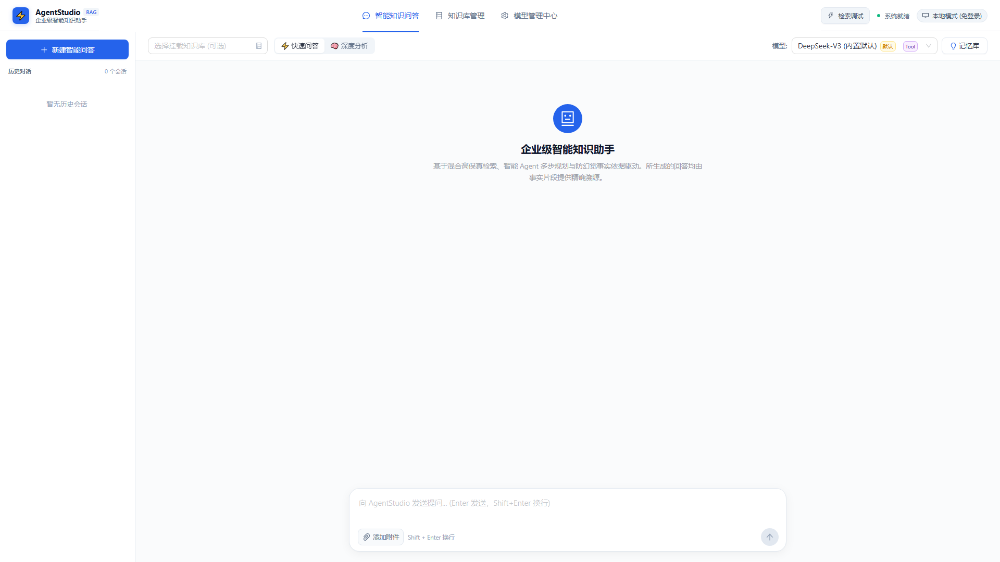
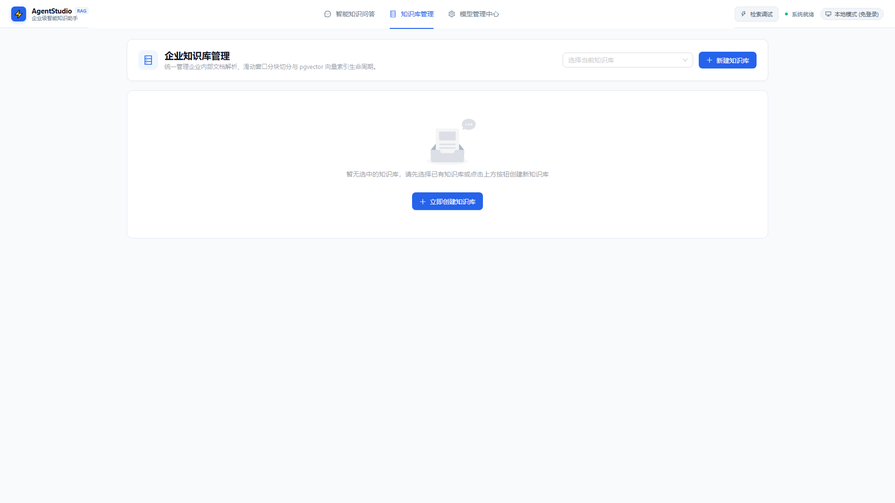
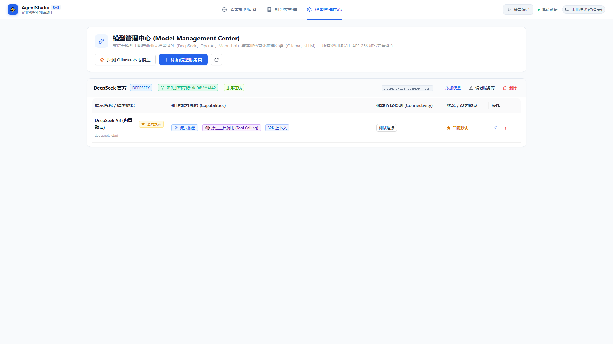
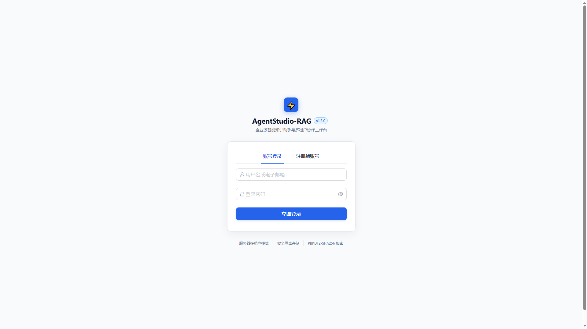
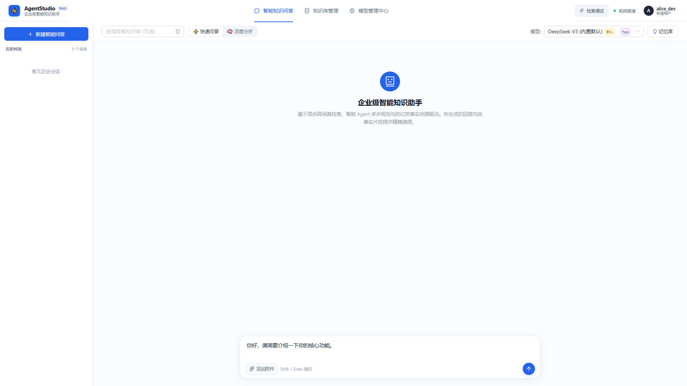

# AgentStudio-RAG — 基于 Python 的企业级 Agentic RAG 智能知识问答系统

[](docs/P2_3_RELEASE_CANDIDATE_REPORT.md)
[](https://www.python.org/)
[](https://fastapi.tiangolo.com/)
[](https://react.dev/)
[](docs/DEPLOYMENT.md)
[](LICENSE)

> **A full-stack Agentic RAG platform built with FastAPI, LangGraph, React and Docker, featuring hybrid retrieval, long-term memory, multi-user authentication and local/server deployment.**  
> **版本标识**：`v1.3.0-rc.1` (`RC-Phoenix-2026`)

AgentStudio-RAG 是参考 Java 生态企业级开源项目 [Ragent](https://github.com/nageoffer/ragent) 进行重新架构设计与深度重构的 **Python 原生企业级 Agentic RAG 智能知识问答系统**。

本项目摒弃简单的“玩具级 API 调用”和“黑盒积木编排”，聚焦于**真实企业级交付与稳定性工程**：覆盖三态执行路径、混合多路召回与重排序、跨会话长期记忆、单会话临时附件即时解析、多租户 RBAC 权限隔离、全容器化双模式部署（Local 免登录 / Server 多人生产）。

---

## 📸 实际运行界面 (System Showcase)

| 智能问答工作台 (流式 Markdown / 真实页码引用溯源) |
| :---: |
|  |

| 知识库文档管理与切块索引状态流水线 | 多模型管理与网络连通性实时探测 |
| :---: | :---: |
|  |  |

| Server 模式多租户安全登录 | Server 模式跨租户水平越权严格隔离 |
| :---: | :---: |
|  |  |

---

## 一、系统架构全景 (System Architecture)

```mermaid
flowchart TD
    subgraph ClientLayer["前端接入层 (Frontend & Client)"]
        UI["React 18 + TypeScript + Ant Design"]
        Workbench["智能对话工作台 (流式 SSE / 真实引用溯源)"]
        KBPanel["知识库与文档管理"]
        AgentPanel["LangGraph Agent 控制台"]
        ModelPanel["多模型与凭据配置中心"]
        MemoryPanel["长期记忆管理看板"]
    end

    subgraph GatewayLayer["接入与安全网关 (Gateway & Security)"]
        Nginx["Nginx 反向代理 (Gzip / SSE 无缓冲 / 静态托管)"]
        AuthMiddleware["双模式认证中间件 (Local 免登录 / Server JWT RBAC)"]
        IDORGuard["多租户数据隔离与 IDOR 防御守卫"]
    end

    subgraph CoreEngine["FastAPI 业务核心与执行引擎 (Core Services)"]
        Router["智能意图路由 (Direct / RAG / Agentic 自动分流)"]
        DirectChat["Direct LLM 执行引擎 (0 检索开销直答)"]
        WorkflowRAG["Workflow RAG 确定性引擎 (防幻觉 / 引用定位)"]
        LangGraphAgent["LangGraph ReAct Agent (多步循环推理 / 工具调度)"]
        AttachService["单会话附件引擎 (PyMuPDF 内存解析 / 跨页检索)"]
        MemoryService["跨会话长期记忆系统 (自动提炼 / 预算控制 / 动态注入)"]
    end

    subgraph RetrievalLayer["高精混合检索系统 (Hybrid Retrieval)"]
        DenseRetriever["Dense Vector 向量召回 (BAAI/bge-small-zh-v1.5)"]
        SparseRetriever["BM25 关键词精确检索"]
        RRFFusion["Reciprocal Rank Fusion (RRF 倒数排名融合)"]
        Reranker["Cross-Encoder 重排序 (ONNX Xenova/bge-reranker-base)"]
    end

    subgraph StorageLayer["持久化与存储层 (Data & Persistence)"]
        SQLiteDB["SQLite 3 (Local 模式默认，开箱即用)"]
        PGDB["PostgreSQL 16 (Server 模式默认，高并发多租户)"]
        DocStorage["文件与附件持久化卷 (agentstudio_data)"]
        ModelCache["本地模型权重缓存卷 (agentstudio_models)"]
    end

    ClientLayer -->|HTTP REST / SSE 流式| GatewayLayer
    GatewayLayer --> CoreEngine
    CoreEngine --> RetrievalLayer
    CoreEngine --> StorageLayer
    RetrievalLayer --> StorageLayer
```



---

## 二、三态执行引擎深度对比 (Execution Engines Matrix)

针对不同类型的用户提问，系统提供三条差异化的执行路径，兼顾**极速响应**与**复杂推理**：

| 维度指标 | 1. Direct LLM 极速直答 | 2. Workflow RAG 确定性检索 | 3. LangGraph Agent 循环推理 |
| :--- | :--- | :--- | :--- |
| **适用场景** | 日常问候、通用常识、纯代码编写、翻译等无需企业私有数据的通用问题。 | 严格基于企业规章制度、技术规范、产品手册的问答，要求有据可查。 | 需要“多步自查”、“跨工具调用”、“检索后二次计算”的复杂综合任务。 |
| **检索与工具开销**| **0 检索开销**，完全跳过向量与关键词检索。 | **单次混合检索**（Dense + BM25 + RRF + ONNX Rerank）。 | **多轮动态调用**，由 ReAct 循环自主决定调用频次与工具参数。 |
| **响应时延** | 极低（首字响应 < 500ms）。 | 适中（首字响应 1.5s ~ 3s）。 | 较高（依推理轮数而定，多步反馈流）。 |
| **引用与溯源** | 无引用标注（纯大模型通用能力回答）。 | 严格附带 `[Ref-X]` 真实页码与原文片段展开抽屉。 | 步骤折叠面板中清晰展示每一步的 Thought / Action / Observation 轨迹。 |
| **幻觉控制** | 依赖大模型自身对齐水平。 | **强防幻觉 Prompt**：检索证据不足时主动拒答，严禁臆造。 | **自省自纠**：在状态图循环中核验中间工具返回结果。 |

---

## 三、混合多路检索与重排序流程 (Hybrid Retrieval Pipeline)

单用向量检索（Dense）容易在专业术语、数字代号上发生语义漂移；单用关键词检索（BM25）则无法理解近义词与语义意图。系统实现了严谨的企业级检索闭环：

```
用户提问 (Query)
    │
    ├───> [Dense 语义向量检索] ───> BAAI/bge-small-zh-v1.5 (512维向量，余弦相似度 Top-20)
    │
    └───> [BM25 关键词精确检索] ───> 倒排索引精确匹配特定专有名词/代号 (Top-20)
                │
                ▼
      [Reciprocal Rank Fusion (RRF)] ───> score = Σ 1 / (60 + rank_i) 倒数排名融合打分
                │
                ▼
      [Cross-Encoder 深度重排序] ───> Xenova/bge-reranker-base (ONNX Runtime 本地轻量推理)
                │
                ▼
      输出 Top-K 高相关高置信度切块 (附带准确物理页码与原文高亮)
```

---

## 四、跨会话长期记忆机制 (Long-Term Memory)

系统具备真正的跨会话连续认知能力，主要技术特点：
1. **异步提炼 (Async Extraction)**：会话结束后后台异步分析多轮对话，提炼出 `USER_PROFILE`（用户画像与技能背景）、`IMPORTANT_FACT`（用户明确告知的约束事实）、`TOPIC_PREFERENCE`（话题偏好）。
2. **上下文 Token 预算管理 (Budget Allocation)**：采用专用 Token 预算池（默认 500 Tokens），绝不挤占知识库文档检索或模型输出窗口。
3. **安全生命周期**：相同内容触发精确事实去重，仅递增使用频次与更新时间戳；用户可在控制台实时查看、置顶、编辑或物理注销记忆。

---

## 五、Local / Server 双部署模式架构

| 部署模式 | 适用场景 | 数据库 | 认证方式 | 特点与优势 |
| :--- | :--- | :--- | :--- | :--- |
| **Local 模式** | 个人开发者、单机私密研究、离线演示。 | SQLite 3 (`aiosqlite`) | 自动免登录 (`usr_local_default`) | **开箱即用，零配置**。无需安装数据库服务，不折腾账号，数据完全保存在本地磁盘。 |
| **Server 模式** | 团队协作、企业内部私有化部署。 | PostgreSQL 16 (`asyncpg`) | JWT Bearer Token + PBKDF2 密码加盐 | **高并发、多租户强隔离**。严格防御水平越权（IDOR），自带 Nginx 生产反向代理。 |

---

## 六、Docker Compose 快速启动指南

### 1. 方式 A：Local 单人模式（开箱即用，免登录）

```bash
# 1. 克隆代码仓库
git clone https://github.com/your-username/AgentStudio-RAG.git
cd AgentStudio-RAG

# 2. 复制环境配置模板并填入您的大模型 API 密钥
cp .env.example .env
# 编辑 .env：填入 OPENAI_API_KEY / OPENAI_BASE_URL (支持 DeepSeek, OpenAI, Ollama)

# 3. 一键启动 Local 容器栈
docker compose -f docker-compose.local.yml up -d

# 4. 访问工作台: http://localhost:8080
```

### 2. 方式 B：Server 多人生产模式（企业多租户，高可用）

```bash
# 1. 复制环境配置模板
cp .env.example .env

# 2. 编辑 .env 配置生产高强度安全密钥与数据库密码：
# DEPLOYMENT_MODE=server
# SERVER_AUTH_SECRET=your_custom_generated_64_char_hex_secret
# POSTGRES_PASSWORD=your_strong_postgres_password_123

# 3. 启动 Server 容器栈 (PostgreSQL 16 + FastAPI Backend + Nginx/React Frontend)
docker compose up -d

# 4. 初始化首位系统管理员账号 (可选 CLI 工具)
docker compose exec backend python create_admin.py create -u admin -p "AdminPass123!"

# 5. 访问系统: http://localhost:8080 (进入登录/注册界面)
```

---

## 七、大模型配置说明 (Model Providers)

系统兼容各类 OpenAI 规范的 API 接口，并已内置对主流模型厂商的深度适配：

- **DeepSeek**（推荐）：`OPENAI_BASE_URL=https://api.deepseek.com`，模型名称 `deepseek-chat`。
- **OpenAI 原生**：`OPENAI_BASE_URL=https://api.openai.com/v1`，模型名称 `gpt-4o-mini` 或 `gpt-4o`。
- **本地私有化 Ollama**：`OPENAI_BASE_URL=http://host.docker.internal:11434/v1`，模型名称 `qwen2.5:7b` 或 `llama3.1:8b`。
- **安全保障**：所有通过前端或后台添加的模型 API Key，落库前均经过主加密密钥（Fernet 对称加密算法）加密存储，绝不在前台明文输出。

---

## 八、项目目录结构 (Repository Layout)

```
AgentStudio-RAG/
├── backend/                       # Python FastAPI 后端服务工程
│   ├── app/
│   │   ├── agent/                 # LangGraph ReAct 状态循环图与工具节点
│   │   ├── api/v1/                # RESTful 接口路由 (chat, kb, auth, models, memories)
│   │   ├── attachments/           # 单会话临时附件管理与 PyMuPDF 解析服务
│   │   ├── core/                  # 配置中心 (config.py)、身份认证与 IDOR 防御、日志
│   │   ├── db/                    # SQLAlchemy 异步驱动与数据库自动 Schema 迁移
│   │   ├── llm/                   # 大模型适配器、本地 BGE Embedding 与连接池
│   │   ├── memory/                # 跨会话长期记忆提炼服务与 Token 预算控制器
│   │   ├── models/                # SQLAlchemy ORM 实体数据模型定义
│   │   ├── rag/                   # Workflow RAG 流水线、引用定位与防幻觉 Prompt 构建
│   │   ├── retrieval/             # 密集向量存储、BM25 稀疏检索、RRF 融合打分、ONNX Reranker
│   │   └── routing/               # 智能意图路由分类器与 Direct LLM 执行引擎
│   ├── create_admin.py            # 管理员初始化命令行工具
│   ├── entrypoint.sh              # 生产容器入口脚本 (DDL 自动迁移 / Worker 分配)
│   └── requirements.txt           # 后端核心依赖清单
├── frontend/                      # React 18 + TypeScript + Vite 前端工程
│   ├── src/
│   │   ├── api/                   # 前后端交互 API 客户端与 SSE 流式事件监听
│   │   ├── components/            # UI 组件 (侧边栏、引用展开抽屉、记忆面板、附件管理)
│   │   ├── pages/                 # 主页面 (ChatPage, KnowledgeBasePage, ModelsPage, LoginPage)
│   │   └── types.ts               # 前端 TypeScript 接口类型规范
│   ├── nginx.conf                 # 前端 Nginx 生产反向代理配置文件
│   └── package.json               # 前端依赖配置
├── docker/
│   └── nginx/nginx.conf           # 生产级反向代理与网关配置 (无缓冲流式透传)
├── docs/                          # 官方技术文档库
│   ├── ARCHITECTURE.md            # 系统技术架构白皮书
│   ├── DEPLOYMENT.md              # 生产部署与运维实战手册
│   ├── DEMO_GUIDE.md              # 5~8 分钟标准化演练实操脚本
│   ├── P2_3_RELEASE_CANDIDATE_REPORT.md # P2.3 RC 发布验收终审报告
│   └── screenshots/               # 系统实际运行高清截图
├── scripts/                       # 运维与自动化测试工具集
│   ├── backup.ps1 / backup.sh     # 跨平台全量备份脚本 (Local / Server)
│   ├── restore.ps1 / restore.sh   # 跨平台灾难恢复脚本 (Local / Server)
│   ├── test_p2_3_suite.py         # 7 大核心能力全流程容器化集成验收套件
│   ├── test_p2_3_server_security.py # Server 模式密码演进与 IDOR 越权防御验证套件
│   └── test_p2_3_db_migration.py  # 历史老旧数据库平滑迁移与数据无损验证套件
├── Dockerfile.backend             # 后端轻量生产镜像构建文件 (模型内置缓存, 非 root 权限)
├── Dockerfile.frontend            # 前端多阶段静态分发镜像文件
├── docker-compose.local.yml       # Local 模式编排配置 (SQLite, 零外部依赖)
├── docker-compose.yml             # Server 模式编排配置 (PostgreSQL 16, JWT, Nginx 网关)
└── README.md                      # 本文档
```

---

## 九、技术栈清单与各模块职责

| 技术层次 | 选型技术 / 工具 | 版本 | 核心职责与工程价值 |
| :--- | :--- | :--- | :--- |
| **运行时** | Python | 3.12+ | 现代化类型注解支持，异步并发事件循环性能优化。 |
| **Web 网关**| FastAPI + Pydantic v2 | 0.115+ | 极速异步接口响应，严格的入参出参运行时校验与自动 OpenAPI 文档生成。 |
| **数据持久化**| SQLAlchemy + asyncpg / aiosqlite | 2.0+ | 全异步 ORM 抽象，一套模型代码自适应兼容 SQLite 与 PostgreSQL。 |
| **向量计算**| FastEmbed + NumPy | 0.4+ | 本地 CPU 极速执行 `BAAI/bge-small-zh-v1.5`，512 维向量提取，无需 GPU 依赖。 |
| **模型重排**| ONNX Runtime | 1.19+ | 轻量化本地推理 `Xenova/bge-reranker-base`，极致降低镜像体积与推理时延。 |
| **文档解析**| PyMuPDF (fitz) | 1.24+ | C 语言底层 PDF 高保真解析，准确提取原始物理页码，支持中英文混排。 |
| **智能体图**| LangGraph | 0.2+ | 状态机循环推理图，原生支持 ReAct 循环推演、工具调度与状态持久化。 |
| **前端交互**| React + TypeScript + Ant Design | 18.3+ | 企业级中文控制台规范，流式打字渲染与原文溯源展开抽屉。 |
| **构建与代理**| Vite + Nginx Alpine | 5.4+ / 1.27 | 秒级前端热开发，生产静态文件分发与无缓冲流式 SSE 透传。 |

---

## 十、测试与部署验证结果 (P2.3 RC Verification)

在真实 Docker 容器环境下运行官方自动化测试套件，验证结论如下：

```
======================================================================
AGENTSTUDIO-RAG P2.3 RC VERIFICATION SUMMARY (SERVER & LOCAL MODES)
======================================================================
CAPABILITY                | STATUS   | DETAILS
----------------------------------------------------------------------
Health & Auth Mode        | PASS     | Mode=server & local, DB=Connected
Direct LLM                | PASS     | Answer len=116, Time=3.59s (0 Retrieval Overhead)
Workflow RAG              | PASS     | Citations=1, Keyword 'RC-Phoenix-2026' Verified
LangGraph Agent           | PASS     | 9 Agent State Events, Tool Execution Verified
Attachment System         | PASS     | Upload, Parsing, Context Search, Deletion Clean
Long-term Memory          | PASS     | Extraction, Vector Query, Update, Deletion Clean
Model Management          | PASS     | Active=1, Latency=1822ms, Credential Encrypted
Multi-tenant IDOR Guard   | PASS     | Cross-User Resource Access Blocked (HTTP 404)
Offline Model Inference   | PASS     | docker run --network none (0 Network Calls)
Graceful Shutdown         | PASS     | SIGTERM handled in 30s window (ExitCode: 0)
Schema Auto-Migration     | PASS     | Legacy DB schema upgraded with 0 data loss
Backup & Restore          | PASS     | Full PostgreSQL snapshot & uploads restored
======================================================================
```

---

## 十一、已知限制与未来演进 (Known Limitations)

1. **PDF 文档解析范围**：当前内置 PyMuPDF 引擎基于文本层直接提取。若上传的 PDF 为纯手机拍照或无文本层的纯图片扫描件，需前置经过 OCR 工具（如 PaddleOCR / Tesseract）转换为双层 PDF 后再行上传解析。
2. **单机向量计算规模**：当前采用 FastEmbed 与 NumPy 内存余弦相似度计算，单知识库百万级分块以内均可保持毫秒级检索。若面向千万级以上超大规模文档检索，建议后续版本扩展外置独立向量数据库集群（如 Qdrant / Milvus）。
3. **第三方依赖授权说明**：PDF 解析组件 PyMuPDF 采用双重授权协议（AGPLv3 / 商业授权）。本项目作为开源研究与个人作品集演示完全合规；若用于商业闭环 SaaS 运营，建议结合自身合规要求选择替换为 Apache-2.0 兼容的解析库（如 `pypdf`）或获取官方商业授权。

---

## 十二、开源许可证与鸣谢 (License & Acknowledgements)

- 本项目基于 [MIT License](LICENSE) 开源发布。
- 特别鸣谢开源社区优秀项目 [Ragent](https://github.com/nageoffer/ragent) 在企业级知识问答系统架构设计上的宝贵启发。
- 感谢 FastAPI、LangChain/LangGraph、FastEmbed、PyMuPDF、React 以及 Ant Design 团队构建的卓越开源基石。

---
*AgentStudio-RAG Team · Release Candidate v1.3.0-rc.1 · 2026*
