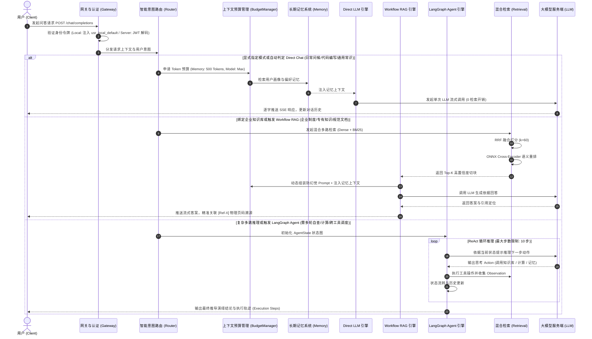
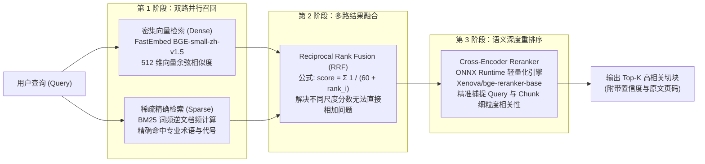
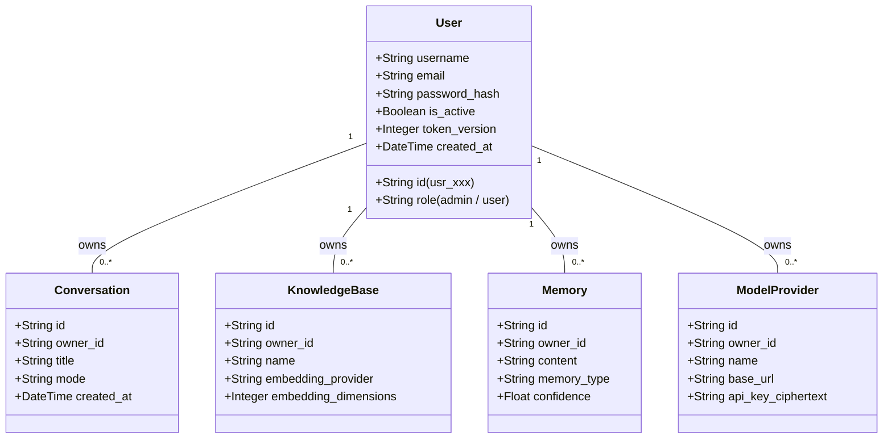

# AgentStudio-RAG — 系统架构设计白皮书 (Architecture Whitepaper)

> **版本**：`v1.3.0-RC1`  
> **代号**：`RC-Phoenix-2026`  
> **定位**：面向生产环境的企业级 Agentic RAG 智能知识问答系统技术架构与核心数据流规范。

---

## 一、系统整体技术架构全景

AgentStudio-RAG 采用高度分层的现代化微内核服务架构。整个系统由 **前端接入层**、**网关安全层**、**业务执行引擎层**、**高精检索层** 与 **持久化基础设施层** 五大核心分层构成：

```mermaid
flowchart TD
    subgraph Client["前端接入层 (Frontend)"]
        UI["React 18 + TypeScript + Ant Design"]
        SSEClient["SSE 流式客户端 (EventSource / Fetch Stream)"]
        StateStore["认证与多租户上下文状态"]
    end

    subgraph Gateway["网关安全层 (Gateway & Security)"]
        NginxProxy["Nginx 反向代理 (Gzip / Bufferless SSE / 静态分发)"]
        AuthGuard["双模式认证守卫 (Local 模式免登 / Server 模式 JWT)"]
        RBAC["RBAC 角色权限与 IDOR 拦截器"]
    end

    subgraph Router["智能调度层 (Routing & Orchestration)"]
        IntentRouter["智能意图路由器 (Intent Classification)"]
        BudgetManager["上下文 Token 动态预算管理器 (ContextBudgetManager)"]
    end

    subgraph Engines["三态执行引擎层 (Execution Engines)"]
        DirectChat["Direct LLM Engine (零检索开销直答)"]
        WorkflowRAG["Workflow RAG Engine (确定性流水线 / 真实引用溯源)"]
        LangGraphAgent["LangGraph Agent Engine (ReAct 多步状态循环推理)"]
    end

    subgraph Capabilities["专用支撑能力层 (Subsystem Capabilities)"]
        MemorySys["跨会话长期记忆系统 (自动提炼 / 向量召回 / 去重)"]
        AttachSys["单会话临时附件系统 (PyMuPDF 内存解析 / 跨页检索)"]
        ModelSys["多模型凭据加密与连接池 (OpenAI / DeepSeek / Ollama)"]
    end

    subgraph Retrieval["高精混合检索系统 (Hybrid Retrieval)"]
        BGEEmbedding["FastEmbed 密集向量语义检索 (BAAI/bge-small-zh-v1.5)"]
        BM25["BM25 关键词稀疏检索"]
        RRF["Reciprocal Rank Fusion 倒数排名融合 (k=60)"]
        ONNXRerank["ONNX Runtime Cross-Encoder 重排序 (Xenova/bge-reranker-base)"]
    end

    subgraph Persistence["持久化基础设施 (Storage & Persistence)"]
        SQLiteDriver["SQLite 3 + aiosqlite (Local 模式)"]
        PGDriver["PostgreSQL 16 + asyncpg (Server 模式)"]
        StorageVol["非结构化文件持久化卷 (agentstudio_data)"]
        ModelCacheVol["离线模型权重缓存卷 (agentstudio_models)"]
    end

    Client -->|HTTP REST / SSE| Gateway
    Gateway --> Router
    Router --> Engines
    Engines --> Capabilities
    Engines --> Retrieval
    Capabilities --> Retrieval
    Capabilities --> Persistence
    Retrieval --> Persistence
    Engines --> Persistence
```

---

## 二、三态执行引擎时序与决策机制

为了在真实企业业务中平衡 **问答响应延迟**、**知识召回准确度** 与 **多跳推理深度**，AgentStudio-RAG 创新性地构建了三态执行引擎（Tri-state Execution Engine）：

---

## 三、混合多路检索与重排序工作机制

AgentStudio-RAG 在高精检索流水线中严格遵循“多路召回 → 融合去重 → 深度重排”的生产级标准：

---

## 四、跨会话长期记忆系统架构 (Long-Term Memory)

长期记忆系统旨在使 AgentStudio-RAG 具备跨会话认知连续性，其工作机制包含“异步提炼”与“检索预算注入”双循环：

1. **事实提炼管道 (Extraction Pipeline)**：
   - 会话结束后，后台任务基于滑动窗口分析多轮问答对话。
   - 提取三类记忆：`USER_PROFILE`（用户画像与专业背景）、`IMPORTANT_FACT`（用户明确告知的约束）、`TOPIC_PREFERENCE`（话题偏好）。
   - 自动生成 512 维语义向量并持久化于 `memories` 数据表。
2. **上下文 Token 预算管理 (Budget Management)**：
   - 设定严格的记忆 Token 配额（默认 500 Tokens），绝不挤占知识库检索或大模型生成窗口。
   - 查询时基于余弦相似度召回记忆，按置信度与使用频次加权排序，超出预算自动截断。
3. **安全生命周期**：
   - 相同内容提炼触发精确事实去重，仅递增使用频次与更新时间戳，避免向量索引膨胀。
   - 用户可在前端控制台直观查看、置顶、修改或彻底注销个人记忆条目。

---

## 五、单会话临时附件系统架构 (Conversation Attachments)

为了应对“随手传一个文档临时聊两句，但不想污染公司永久知识库”的现实诉求，系统设计了与主知识库完全物理隔离的临时附件引擎：

1. **PyMuPDF 内存级解析**：
   - 采用 C 语言底层的 PyMuPDF 引擎，逐页高保真提取文本流，严格保留原始物理页码。
   - 附件元数据与解析结构仅挂载在 `conversation_attachments` 表下，外键级联绑定特定 `conversation_id`。
2. **单会话上下文检索**：
   - 问答时仅在当前会话的附件切块集合中检索，零干扰其他对话。
   - 溯源引用直接标明附件原文件名与准确页码，支持在会话侧边栏抽屉中即时预览与快速清理。

---

## 六、双部署模式与多租户权限隔离体系

### 1. Local 模式与 Server 模式的无缝对齐
- **Local 模式**：后端自动在数据库中保障唯一的 `usr_local_default` 用户记录。所有 API 请求免登录，隐式绑定此身份，完全抹除账号系统心智负担。
- **Server 模式**：启用严格的 JWT 身份认证拦截。密码采用 OWASP 推荐的加盐 PBKDF2 算法，支持密码版本轮转（`token_version` 失效即刻踢出旧 Token）。

### 2. 水平越权 (IDOR) 防御机制
- 系统在所有资源访问端点（`/conversations/{id}`, `/knowledge-bases/{id}`, `/memories/{id}`, `/models/{id}`）强制注入所有权检查。
- 非资源持有者发起访问一律返回 `HTTP 404 Not Found`（防止攻击者通过 403 探测资源存在性），彻底杜绝跨租户数据越权嗅探。

---
*AgentStudio-RAG Technical Architecture Documentation · 2026*
