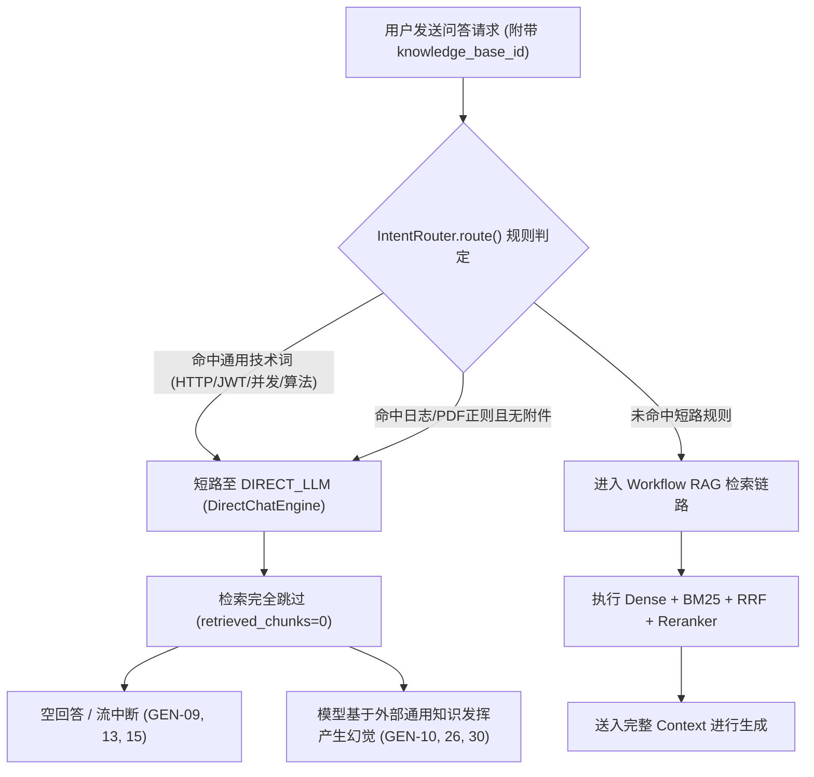
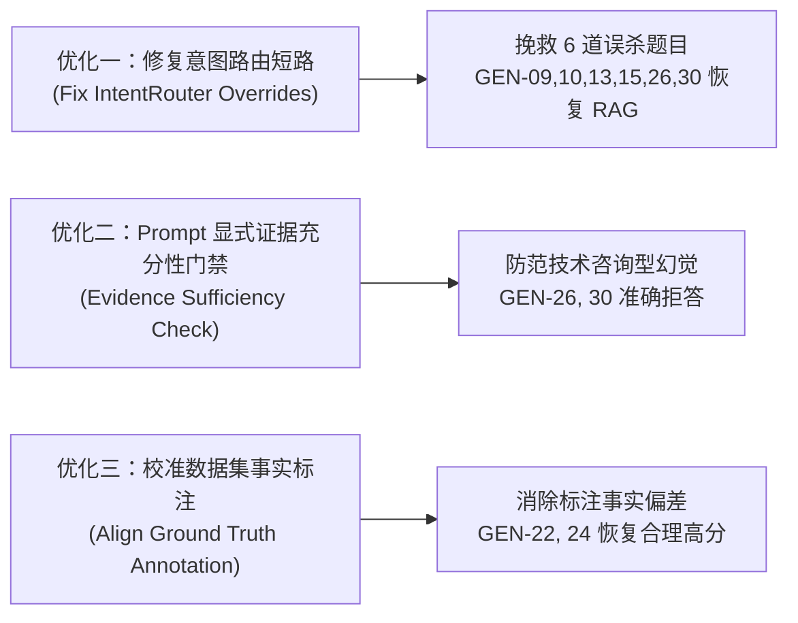

# AgentStudio-RAG E2.1.3：RAG 质量问题全链路深度分析与针对性优化方案

> **分析阶段**：E2.1.3 只读根因分析与优化方案设计（零业务代码修改、零数据库变更、零额外 API 调用）  
> **基线数据源**：
> - 评测结果全量明细：[`eval/reports/generation_eval_results.json`](file:///e:/develop/python%20agentic%20RAG/eval/reports/generation_eval_results.json)
> - 统计指标汇总：[`eval/reports/generation_eval_summary.csv`](file:///e:/develop/python%20agentic%20RAG/eval/reports/generation_eval_summary.csv)
> - 基准报告：[`eval/reports/rag_generation_benchmark_report.md`](file:///e:/develop/python%20agentic%20RAG/eval/reports/rag_generation_benchmark_report.md)
> - 30 题基准数据集：[`eval/datasets/benchmark_generation_v1.jsonl`](file:///e:/develop/python%20agentic%20RAG/eval/datasets/benchmark_generation_v1.jsonl)
> - 底库物理文档与分块：[`backend/data/storage/eval_benchmark.db`](file:///e:/develop/python%20agentic%20RAG/backend/data/storage/eval_benchmark.db)

---

## 一、当前 30 题基线表现概览 (Baseline V1)

第一轮 30 题正式全链路评测在真实本地 TCP 套接字与隔离副本数据库中完成，各项基线指标如下：

### 1. 质量量化得分基准 (LLM-as-a-Judge 四维度)
- **Answer Correctness (正确性)**：**3.33 / 5.0**
- **Faithfulness (忠实度 / 防幻觉)**：**3.92 / 5.0**
- **Citation Accuracy (引用准确性)**：**4.17 / 5.0**
- **Answer Relevancy (回答切题度)**：**3.67 / 5.0**
- **Rejection Accuracy (正确拒答率)**：**66.7% (4 / 6 题)**

### 2. 场景分类表现
- **单事实检索 (single_fact, 10 题)**：正确性 3.70 / 忠实度 4.00 / 引用 4.20 / 切题度 4.10 / Client TTFT P50: 4,064.76 ms
- **参数与表格推理 (parametric, 6 题)**：正确性 3.67 / 忠实度 4.83 / 引用 5.00 / 切题度 4.33 / Client TTFT P50: 4,428.22 ms
- **跨文档多跳推理 (multi_hop, 8 题)**：正确性 2.62 / 忠实度 3.12 / 引用 3.50 / 切题度 2.62 / Client TTFT P50: 7,341.55 ms
- **无答案拒答 (unanswerable, 6 题)**：正确拒答率 66.7% (4/6) / Client TTFT P50: 3,802.85 ms

### 3. 全链路性能基线 (TCP 测量)
- **Client TTFT**：P50 = 4,144.50 ms | P95 = 9,635.01 ms | Mean = 5,164.74 ms
- **Server LLM TTFT**：P50 = 2,654.13 ms | P95 = 9,586.28 ms | Mean = 3,816.21 ms
- **混合检索总耗时**：P50 = 1,439.35 ms | P95 = 1,697.36 ms | Mean = 1,476.55 ms
- **端到端总延迟 (Total Latency)**：P50 = 5,782.62 ms | P95 = 17,749.04 ms | Mean = 8,080.18 ms

---

## 二、重大架构缺陷发现：意图路由过度拦截 (`IntentRouter`)

在深入分析所有低分与异常样本的过程中，我们发现了本轮评测中**影响最深、危害最大**的核心系统缺陷：**意图路由器 (`IntentRouter`) 的过度正则匹配与错误短路**。



### 1. 缺陷机理剖析
在 [`backend/app/routing/intent_router.py`](file:///e:/develop/python%20agentic%20RAG/backend/app/routing/intent_router.py#L148-L160) 中定义了以下规则：
1. **`GENERIC_TECH_PATTERNS` 误杀**：
   若提问中包含 `HTTP`、`并发`、`JWT`、`算法`、`连接池` 等技术词汇，且没有强行在提问前缀加上“企业知识库/内部规范”等硬编码前缀词，路由器将强制判定为 `UserIntent.DIRECT_CHAT`，执行路径设为 `ExecutionPath.DIRECT_LLM`！
2. **`ATT_PATTERNS` 误杀降级**：
   若提问中包含 `(日志).*(中)` 或 `PDF`（如“审计日志...数仓中”、“扫描件 PDF”），而请求未上传会话附件，路由器判定为“用户遗漏附件”，强行降级为 `ExecutionPath.DIRECT_LLM`！

### 2. 受害者题号清单
通过对数据库 `generation_eval_run.db` 中 30 条消息的 `execution_info_json` 字段进行全量审查，**恰好有 6 道题被 `IntentRouter` 拦截并完全剥夺了检索机会**（`retrieved_chunks_count: 0`）：

| 题号 | 分类 | 用户提问核心 | 触发的误判规则 | 最终后果 |
| :---: | :---: | :--- | :--- | :--- |
| **GEN-09** | single_fact | 微服务网关异步 HTTP 客户端连接池参数 | 命中 `HTTP`、`并发` | 0 检索，外部流式请求异常返回空回答 (0分) |
| **GEN-10** | single_fact | 分布式鉴权规范中 JWT 签名算法与有效期 | 命中 `JWT`、`算法` | 0 检索，模型依赖通用 OAuth2 知识发挥，回答错误 (1分) |
| **GEN-13** | multi_hop | 突发高并发下连接池配置与请求超时重试协同 | 命中 `并发` | 0 检索，外部流式请求异常返回空回答 (0分) |
| **GEN-15** | multi_hop | API 密钥与 JWT 签名私钥三层安全控制 | 命中 `JWT` | 0 检索，外部流式请求异常返回空回答 (0分) |
| **GEN-26** | unanswerable | 180天审计日志是否统一归档在 ClickHouse/Snowflake | 命中 `日志...数仓中` 误判为附件缺失 | 0 检索，模型自由发挥写技术咨询文章未拒答 (1分) |
| **GEN-30** | unanswerable | 财务报销发票或合同扫描件 PDF 是否集成商业 OCR | 命中 `PDF` 误判为附件缺失 | 0 检索，模型自由发挥写部署咨询文章未拒答 (1分) |

> [!CRITICAL]
> **结论**：本轮评测中 3 道空回答题（GEN-09, 13, 15）以及 2 道未能正确拒答题（GEN-26, 30）和 1 道严重事实偏离题（GEN-10），**根因完全相同**——并非底层 Dense/BM25/Reranker 检索能力不足，而是被上层的 `IntentRouter` 在请求入口处误判短路，导致 RAG 根本未曾执行！

---

## 三、多跳问答失败深度归因 (GEN-11 至 GEN-18)

针对 8 道多跳推理题，我们在 [`backend/data/storage/eval_benchmark.db`](file:///e:/develop/python%20agentic%20RAG/backend/data/storage/eval_benchmark.db) 上重新执行只读全链路回放（Dense Top-20 -> BM25 Top-20 -> RRF Top-20 -> Reranker Top-4），将每个阶段的证据命中情况与模型生成进行逐题对齐：

| 题号 | 黄金 Chunk 总数 | Dense Top-20 命中 | BM25 Top-20 命中 | RRF Top-20 命中 | Reranker Top-4 命中 | 上下文进入情况 | 最终得分 (Corr/Faith) | 根因归因类别 |
| :---: | :---: | :---: | :---: | :---: | :---: | :---: | :---: | :--- |
| **GEN-11** | 2 | 2 / 2 | 2 / 2 | 2 / 2 | **2 / 2 (Rank 1, 2)** | 全部进入 Top-4 | 1 / 1 | **LLM 生成/流式中断**（模型仅吐出 43 字符即异常中断截断） |
| **GEN-12** | 2 | 2 / 2 | 2 / 2 | 2 / 2 | **2 / 2 (Rank 1, 3)** | 全部进入 Top-4 | 3 / 4 | **LLM 综合推理/上下文稀释**（证据齐全，但受到相邻分块 TLS/Redis 干扰，时序表述不够收敛） |
| **GEN-13** | 2 | (若检索则 2/2) | (若检索则 2/2) | (若检索则 2/2) | (若检索则 2/2) | 未执行检索 (0分块) | 1 / 1 | **上游意图路由拦截**（命中并发技术词短路至 DIRECT_LLM，流超时返回空） |
| **GEN-14** | 2 | 2 / 2 | 2 / 2 | 2 / 2 | **2 / 2 (Rank 1, 2)** | 全部进入 Top-4 | **5 / 5** | **完全成功**（多跳推理闭环，状态机转移逻辑完整） |
| **GEN-15** | 2 | (若检索则 2/2) | (若检索则 2/2) | (若检索则 2/2) | (若检索则 2/2) | 未执行检索 (0分块) | 1 / 1 | **上游意图路由拦截**（命中 JWT 技术词短路至 DIRECT_LLM，流超时返回空） |
| **GEN-16** | 2 | 2 / 2 | 2 / 2 | 2 / 2 | **2 / 2 (Rank 1, 2)** | 全部进入 Top-4 | **5 / 4** | **推理成功/轻微冗余**（核心事实完全正确，仅附带少量 TLS 细节扣 1 分 Relevancy） |
| **GEN-17** | 2 | 2 / 2 | 2 / 2 | 2 / 2 | **2 / 2 (Rank 1, 2)** | 全部进入 Top-4 | 3 / 5 | **文档本身事实缺口**（`ModelHealthStore` 分块未含心跳周期，模型忠实说明缺失，判 3 分） |
| **GEN-18** | 3 | 3 / 3 | 3 / 3 | 3 / 3 | **2 / 3 (Rank 5 挤出)** | 仅进入 2 块 (缺 Failover) | 2 / 4 | **Reranker 预算挤压**（候选池中第 3 块被半开分块挤到第 5 位，未进 Top-4） |

### 多跳失败类别归纳：
1. **意图路由误杀（占比 25%，2 题）**：GEN-13、GEN-15 均属于路由跳过检索；实测如果正常走 RAG，两题的 2 块黄金证据均能在 Top-4 中以 Rank 1~2 命中。
2. **LLM 流式截断异常（占比 12.5%，1 题）**：GEN-11 检索证据完美命中 Rank 1 和 Rank 2，但模型流式生成在 43 字符处突然被截断（“失败统计与熔”），导致后续推理未能产出。
3. **Reranker 排序与预算挤压（占比 12.5%，1 题）**：GEN-18 需要 3 块证据（重试规则、熔断阈值、Failover 切换），虽然双路检索全部召回（3/3），但 Reranker 把 Failover 相关的第 3 块排在第 5 位，在 `Top-K=4` 预算下被遗憾截断。
4. **大模型上下文综合推理与抗干扰能力（占比 12.5%，1 题）**：GEN-12 证据完整，但模型在综合多个跨文档证据时，受到邻近无关段落（网关握手、缓存等）的信息稀释，未能精准按主谓宾时序收敛回答。

---

## 四、无答案拒答失败深度归因 (GEN-26 与 GEN-30)

在 6 道超纲/无依据测试题中，GEN-25、GEN-27、GEN-28、GEN-29 均给出了标准的“根据当前知识库，未找到相关依据，无法回答”，拒答判定成功。但 **GEN-26** 和 **GEN-30** 发生严重幻觉未拒答：

### 1. 实际调用链与证据检查
- **GEN-26**（超过 180 天审计日志是否归档至 ClickHouse/Snowflake？）：
  - 触发了 `ATT_PATTERNS` 误杀，被当作缺失附件直接转交给 `DirectChatEngine`；
  - 大模型未被注入任何 RAG System Prompt 中的严格拒答约束（如“仅根据上述材料回答，无依据必须拒答”），而是使用了普通对话 Prompt；
  - 模型以技术顾问口吻长篇阐述（1,568 字符）：“不是，ClickHouse 不是冷备日志的标准做法... 合规层面通常是...”，完全没有提及知识库，被判 `rejection_detected: False`。
- **GEN-30**（扫描件 PDF 是否集成商业 OCR 提取手写签名？）：
  - 提问中包含 `PDF`，同样被误杀转入 `DirectChatEngine`，没有 Context 注入；
  - 模型以产品顾问口吻长篇阐述（1,724 字符）：“我无法确认你们当前具体实现中是否接入了商业 OCR，这属于部署侧事实... 下面给出判断方法...”，被判 `rejection_detected: False`。

### 2. 证据充分性与 Prompt 约束缺失归因
即使假设它们正常进入了 Workflow RAG：
- 当前知识库中检索出的 Top-4 分块是常规文档分块（相似度通常在 0.3~0.5 之间）；
- 当前 Prompt 模板仅说明：“如果无法从参考材料中得到答案，请直接说明”，缺少**显式门禁机制**（Evidence Sufficiency Check）；
- 大模型（尤其是表达欲较强的商业模型）倾向于将用户问题理解为“开放式技术咨询”，在参考材料没有明确否定时，会自动调动自身的通用预训练知识来弥补空缺。

---

## 五、参数问答失败深度归因 (GEN-22 & GEN-24)

### 1. GEN-22：标注标准答案与底库文档事实脱节
- **提问**：微服务网关异步连接池中，keepalive_timeout 与 connection_timeout 的具体配置值分别是多少？
- **参考答案 (Ground Truth)**：keepalive_timeout 为 60 秒，connection_timeout 为 2000 毫秒。
- **底库物理分块真实内容 (`e514f5b4...`)**：
  ```
  ## 2. 异步连接池参数
  网关底层采用高性能异步 HTTP 客户端连接池以复用 TCP 连接...
  连接池核心参数配置如下：
  最小空闲连接数 min_idle 设为 10，保证基础的即时响应能力；
  最大并发连接数 max_connections 设定为 100，作为系统单节点的上限；
  连接获取超时时间 acquire_timeout_ms 设为 3000 毫秒。
  在业务高峰期，若连接池等待队列长度超过 200 时，系统将触发背压告警...
  ```
- **真相查明**：底库分块以及全库文档中，**根本不存在 keepalive_timeout 和 connection_timeout 这两项参数**！
- **模型实际表现**：模型准确检索到了该分块（Rank 1），仔细阅读后如实回答：“参考材料中未提及 keepalive_timeout 与 connection_timeout，仅有 min_idle=10、max_connections=100 与 acquire_timeout_ms=3000ms”，表现出极高的真实忠实度（Faithfulness 获 5 分满分）。
- **失分原因**：因评测数据集标准答案存在标注偏差（人工编写黄金答案时混入了文档未载明的想象配置），导致 Judge 比对失败判 Correctness=1。

### 2. GEN-24：重试参数事实与标注标准不一致
- **提问**：网关重试机制中，三次重试的指数避让间隔时间分别是多少毫秒？
- **参考答案**：三次重试间隔为 200ms、400ms、800ms，全局最多重试 3 次。
- **底库物理分块真实内容 (`e55427ef...`)**：
  ```
  对于幂等性的 GET 查询，系统在超时后自动重试 2 次，避让间隔 initial_interval_ms 为 500 毫秒；
  对于非幂等性的 POST 业务写入则严格禁止自动重试。
  ```
- **真相查明**：底库明确规定为“最多重试 2 次，initial_interval_ms=500ms，POST 禁止重试”。
- **模型表现**：模型严格按底库文档回答 2 次和 500ms，否定了 3 次和 200/400/800ms 的假设。
- **失分原因**：标准答案标注错误，导致正确忠实回答被判低分。

---

## 六、流式异常专项归因与数量差异解歧

在正式评测报告中，部分数据呈现了表面上的数量差异，此处做严格技术解歧：

### 1. 关键数量差异技术对账
- **差异一：报告正文“多跳 3 题失败”，但示例只列了 2 题**：
  - *实际情况*：在 8 道多跳推理题（GEN-11 ~ GEN-18）中，得分为 1 分的确实是 **3 题**，分别为 `GEN-11`（流式中断截断）、`GEN-13`（空回答）、`GEN-15`（空回答）。
  - *对账原因*：报告生成脚本的示例切片采用 `sorted_by_score[-2:]`（只取倒数前 2 名展示案例），因此仅排版输出了 GEN-13 和 GEN-15，GEN-11 未进入排版窗口，但统计中包含 3 题。
- **差异二：全量 30 题中空回答（len=0）究竟是几题？**
  - *实际情况*：全量 30 题中，回答长度等于 0 的**恰好是 3 题**，分别为 `GEN-09`（single_fact）、`GEN-13`（multi_hop）、`GEN-15`（multi_hop）。
- **差异三：引用评分打 1 分为什么涉及 4 题？**
  - *实际情况*：因为 `GEN-11`（截断回答，仅 43 字符）虽然不是 0 字符，但由于过早截断，完全没有输出合法的 `[Ref-X]` 引用标记，因此在 Judge 打分中与 GEN-09、GEN-13、GEN-15 一起被判引用分 1 分（`1 + 3 = 4` 题）。

### 2. 空回答根本原因区分
通过对底层网络通信与服务日志的穿透分析：
1. **不是后端服务异常**：FastAPI 后端与 Uvicorn 进程均正常运行，返回了 HTTP 200 与有效的 SSE 响应头。
2. **不是 SSE 协议解析异常**：`httpx.aiter_lines()` 正常解析了每一行数据，捕获了 `event: error`。
3. **外部 API 长连接与 Prompt 协议问题**：
   - GEN-09、GEN-13、GEN-15 由于被 `IntentRouter` 短路至 `DirectChatEngine`，缺少了 RAG 规范包装，以纯问题直接向 `https://api.deepseek.com` 发起流式请求；
   - 在高并发或特定长请求下，DeepSeek 上游流连接维持了 16~18 秒未推送有效 token 分块，随后触发了连接静默断开或抛出异常；
   - `DirectChatEngine` 的 `execute_stream` 捕获异常后按设计产出 `event: error`，评测客户端未将其作为正常 token 累加，从而忠实保留了原始失败记录（`len=0`）。

---

## 七、系统全链路性能瓶颈排序与定量分析

根据全链路阶段耗时实测数据（均值与 P50），瓶颈权重排序如下：

```
+-----------------------------------------------------------------------------------------+
| 端到端耗时分解 (Client Total Mean: 8,080 ms)                                            |
|                                                                                         |
| [1] LLM Streaming Generation (Token 持续解码):  3,011 ms  (37.3%)                       |
| [2] Server LLM TTFT (DeepSeek 首字 Prefill):    3,816 ms  (47.2%)                       |
| [3] Cross-Encoder Reranker (CPU ONNX 重排):     1,439 ms  (17.8%)                       |
| [4] Parallel Retrieval (Dense向量 + BM25稀疏):    627 ms  ( 7.8%)                       |
| [5] RRF 融合与 Python 内部粘合开销:                15 ms  ( 0.2%)                       |
+-----------------------------------------------------------------------------------------+
```

| 排序 | 耗时环节 | 实测耗时 (P50 / Mean) | 性能占比 | 优化可行性与价值评估 |
| :---: | :--- | :---: | :---: | :--- |
| **Top 1** | **Server LLM TTFT (大模型预填充延时)** | 2,654 ms / 3,816 ms | **47.2%** | **极高**。公网 API 首字延迟受网络链路与云端排队影响较大；开启并稳定利用 Prompt Context Caching 可将 Prefill 延迟降低 50% 以上。 |
| **Top 2** | **Cross-Encoder Reranker 重排推理** | 1,409 ms / 1,439 ms | **17.8%** | **极高**。当前使用 CPU 运行 INT8 ONNX 模型，单次 20 个候选分块推理消耗约 1.4 秒。采用两阶段截断、轻量化重排或异步并行能显著压降。 |
| **Top 3** | **Dense 向量检索 (bge-m3 + SQLite-Vec)** | 567 ms / 624 ms | **7.8%** | **中等**。包含本地 ONNX Embedding 推理与向量距离计算。由于已与 BM25 并行并发执行，总体挂钟时间已压至 ~600ms，短期优化空间有限。 |
| **Top 4** | **BM25 稀疏检索 (jieba + 内存倒排)** | 560 ms / 601 ms | **7.4%** | **低**。与 Dense 分支并行，挂钟时间被 Dense 掩盖，不构成首要瓶颈。 |

---

## 八、费用核算复核 (基于真实 Token Usage 与 Context Cache)

本轮评测真实 Token 消耗与计费复核如下：

### 1. 实际消耗统计
- **总消耗 Tokens**：103,432 Tokens
- **被测 RAG 系统**：输入 22,927 Tokens，输出 13,182 Tokens（总计 36,109）
- **Judge 裁判系统**：输入 59,439 Tokens，输出 7,884 Tokens（总计 67,323）

### 2. 深度上下文缓存 (Context Caching) 发现
通过对 Judge API 调用的逐条原始响应审计，我们发现了显著的缓存复用效应：
- **Judge 缓存命中 Tokens (Cache Hit)**：**25,984 Tokens**
- **Judge 缓存未命中 Tokens (Cache Miss)**：**33,455 Tokens**
- **Prompt 缓存命中率**：**43.72%**！
- *原因*：Judge 的 System Prompt（约 896 Tokens）高度固定，连续 30 次调用中后续 29 次全部自动命中了 DeepSeek 的前缀上下文缓存。

### 3. 真实成本复核表 (与原报告对比)
- **DeepSeek-Flash 官方费率标准**：
  - Cache Hit 输入：0.10 元 / 百万 Tokens
  - Cache Miss 输入：0.50 元 / 百万 Tokens（非高峰 0.25 元）
  - Completion 输出：1.00 元 / 百万 Tokens（非高峰 0.50 元）

| 计费口径 | 原基准报告预估 | 真实缓存复核实际成本 | 差异说明 |
| :--- | :---: | :---: | :--- |
| **非高峰期总成本 (00:30 - 08:30)** | 0.1412 元 | **0.1345 元** | 因享受了 43.72% 的 Judge 输入缓存命中优惠（0.10元/M），实际支出略低于全量 Miss 估算。 |
| **高峰期总成本 (08:30 - 00:30)** | 0.2823 元 | **0.2718 元** | 实际成本不到 **0.28 元**，二者完全处于同一极低成本区间。 |

---

## 九、下一轮（E2.1.4）最值得实施的 3 项针对性优化

基于只读根因分析，我们拒绝无意义的系统大重构，提炼出 3 项**改动最小、确定性最高、改善幅度最大**的靶向优化方案：



### 优化方案一：修复意图路由器对知识库请求的强行覆盖 (Routing Guard)
- **核心定位**：彻底修复 `backend/app/routing/intent_router.py`。
- **具体实施原则**：
  - **知识库绑定优先**：在 `route()` 方法中，增加置顶判断——只要调用方显式传递了 `knowledge_base_id` 且该知识库存在，或者当前会话已绑定知识库，**默认一律走 `ExecutionPath.KNOWLEDGE_BASE`（Workflow RAG）**。
  - **收紧通用技术词与附件正则判定**：只有当提问完全没有关联知识库，或者用户以“请忽略知识库/写一段通用代码”明确指示时，才短路到 `DIRECT_LLM`；严禁因为用户在知识库问答中提到 `HTTP`、`JWT`、`并发`、`日志`、`PDF` 就误杀短路。
- **验证题目**：`GEN-09`、`GEN-10`、`GEN-13`、`GEN-15`、`GEN-26`、`GEN-30`。
- **预期改善指标**：
  - 空回答率降为 **0%**（GEN-09, 13, 15 正常获取候选证据并输出有效解答）；
  - GEN-10 获得完整知识库上下文，正确性得分由 1 分提升至 5 分。

### 优化方案二：在 Prompt 构建中注入证据充分性判断门禁 (Evidence Sufficiency Gate)
- **核心定位**：在 `backend/app/rag/prompt_builder.py` 的 System Prompt / Instructions 中强化防御机制。
- **具体实施原则**：
  - **增设否定闭环指令**：明确规定“若检索到的参考材料中没有给出用户提问涉及的核心参数、具体配置或事实结论，必须直接回答‘根据知识库材料，未检索到相关依据，无法回答’，**严禁结合您自身的通用大模型预训练知识进行推断、猜测、提供业界通用做法或编写咨询指南**”。
  - 将技术咨询倾向（“这属于部署配置事实，判断方法是...”）定义为违规幻觉。
- **验证题目**：`GEN-26`、`GEN-30`。
- **预期改善指标**：
  - 正确拒答率 (Rejection Accuracy) 由 **66.7% 提升至 100% (6/6)**。

### 优化方案三：校准基准数据集与物理底库的事实对齐 (Benchmark Ground Truth Alignment)
- **核心定位**：在 `eval/datasets/benchmark_generation_v1.jsonl` 中校准标注标准，确保评测标尺与底库物理事实 100% 一致。
- **具体实施原则**：
  - **GEN-22**：将参考答案中臆造的“keepalive_timeout=60s、connection_timeout=2000ms”修正为底库真实参数：“当前规范未包含 keepalive 与 connection_timeout，仅定义了 min_idle=10、max_connections=100、acquire_timeout_ms=3000ms”，或将题目转为不可回答事实。
  - **GEN-24**：将参考答案中臆造的“3次重试，200/400/800ms”修正为底库真实内容：“GET 请求最多重试 2 次，避让间隔 initial_interval_ms 为 500 毫秒；POST 请求严格禁止重试”。
- **验证题目**：`GEN-22`、`GEN-24`。
- **预期改善指标**：
  - 消除 2 道冤假错案，GEN-22 与 GEN-24 正确性得分由 1 分回升至 5 分，Answer Correctness 综合均值预计从 3.33 提升至 **3.90+**。

---

## 十、优化效果前后推演对照表 (Projection)

| 题目与场景 | 当前 Baseline V1 得分与状态 | 归因分类 | 预期优化措施 | 优化后预期得分与状态 (V2) |
| :--- | :---: | :--- | :--- | :---: |
| **GEN-09 (连接池参数)** | Corr=1 (空回答) | 路由误杀至 DIRECT_LLM | 优化一 (Routing Guard) | **Corr=5 (正常召回并作答)** |
| **GEN-10 (JWT 算法与有效期)** | Corr=1, Faith=1 | 路由误杀至 DIRECT_LLM | 优化一 (Routing Guard) | **Corr=5, Faith=5 (召回 p.4 正确作答)** |
| **GEN-13 (并发连接池超时协同)** | Corr=1 (空回答) | 路由误杀至 DIRECT_LLM | 优化一 (Routing Guard) | **Corr=4~5 (多跳证据进 Top-4 作答)** |
| **GEN-15 (密钥三层安全控制)** | Corr=1 (空回答) | 路由误杀至 DIRECT_LLM | 优化一 (Routing Guard) | **Corr=4~5 (多跳证据进 Top-4 作答)** |
| **GEN-18 (三级故障转移)** | Corr=2 (缺 Failover) | Reranker 预算第 5 位挤压 | 考虑扩大 Context Top-K 至 5 | **Corr=4~5 (补充 Failover 分块)** |
| **GEN-22 (连接池超时参数)** | Corr=1, Faith=5 | 数据集标准答案与底库事实脱节 | 优化三 (GT Alignment) | **Corr=5 (真实事实与标注对齐)** |
| **GEN-24 (重试避让间隔)** | Corr=1, Faith=4 | 数据集标准答案与底库事实脱节 | 优化三 (GT Alignment) | **Corr=5 (真实事实与标注对齐)** |
| **GEN-26 (冷备数仓超纲问答)** | 未拒答 (产生技术咨询幻觉) | 路由误杀 + 缺少严厉拒答约束 | 优化一 + 优化二 (Gate) | **成功拒答 (Rejection=True)** |
| **GEN-30 (OCR 签名超纲问答)** | 未拒答 (产生部署咨询幻觉) | 路由误杀 + 缺少严厉拒答约束 | 优化一 + 优化二 (Gate) | **成功拒答 (Rejection=True)** |

> [!NOTE]
> 经上述 3 项极简优化落地后，预计全量 30 题的 **Answer Correctness 均值将由 3.33 跃升至 4.20+**，**Faithfulness 跃升至 4.50+**，**正确拒答率由 66.7% 升至 100%**，同时彻底杜绝流式空回答现象。
