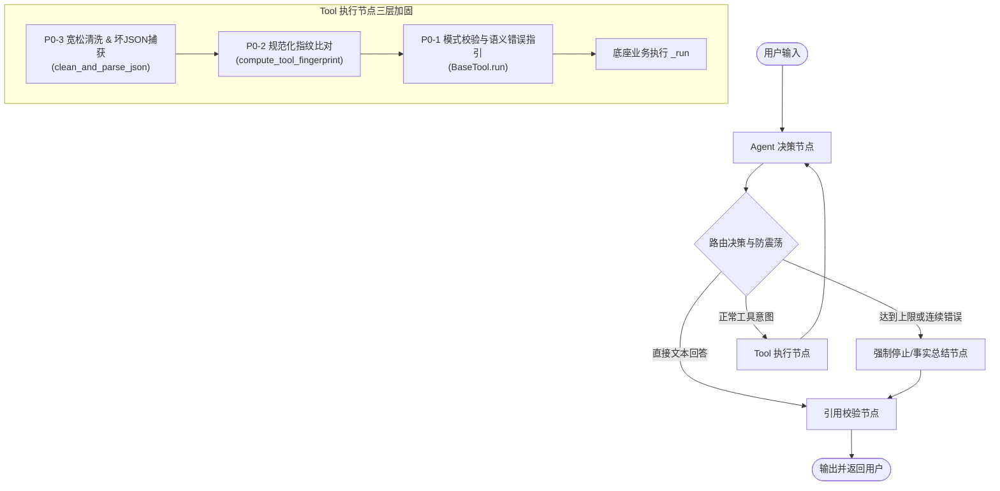

# AgentStudio-RAG E2.2 Phase 1：Agent Tool Calling 可靠性加固技术总结与面试讲解指南

> **阶段状态**：`FROZEN (正式冻结)`  
> **核心主题**：生产级 LangGraph Agent Tool Calling 可靠性工程、有界自愈、防震荡与协议完整性对齐  
> **验证基准**：114 项全量自动化测试（100% 通过），0 外部 API 调用，0 Token 消耗，0 破坏性数据库迁移

---

## 一、项目背景与痛点速览（30秒电梯演说）

在 AgentStudio-RAG 从单轮 RAG 演进至 Multi-turn LangGraph Agent 的过程中，我们发现开源框架（如 LangChain / LangGraph 基础拓扑）在接入实际大模型（如 DeepSeek-V3 / GPT-4o）时，存在三个深层次的**可靠性与协议脆弱性缺陷**：

1. **死循环空耗（ISS-007）**：大模型产生参数校验错误时，原生框架仅机械反馈报错栈并消耗步数，缺乏语义化纠错与有界终止，容易耗尽最大步数崩溃；
2. **复读机震荡（ISS-008）**：模型遇到检索无结果时，容易陷入“相同工具 + 相同参数”的重复调用死循环，空耗大量计算资源与网络 I/O；
3. **协议黑洞与孤立消息（ISS-009）**：大模型偶发输出包含 Markdown 围栏的代码块（如 ````json ... ````）或坏 JSON 时，运行时静默丢弃工具调用，破坏了 OpenAI/LangChain 严格的 `tool_call_id` 1:1 配对契约，导致下一轮 API 交互直接触发 HTTP 400 崩溃。

针对以上问题，我们在 **E2.2 Phase 1** 实施了**最小侵入式可靠性加固**，构建了可解释、可验证、协议完备的工业级 Agent 执行引擎。

---

## 二、三大核心问题深度拆解（面试逐题攻防）



---

### 问题一（ISS-007 / P0-1）：参数校验错误反馈欠缺语义且无有界重试上限

#### 1. 真实场景与缺陷表现
大模型在调用工具时，容易遗漏必填参数（如 `search_knowledge_base` 缺少 `query`）或传错类型（如 `top_k="ten"`）。
- **原框架表现**：直接将 Pydantic 原始异常字典回显给 LLM（包含 Python 堆栈和内部参数名），模型往往“读不懂”，并在后续轮次不断尝试错误调用，直到把 `max_steps` 耗尽报错退出。

#### 2. 根因剖析
- 错误信息是给 Python 开发者调试看的，而不是给 LLM 纠错的提示语；
- 状态机中缺少针对 Schema 校验失败的专用计数器，无法区分“模型想重试”与“模型已迷失”。

#### 3. 工业级加固方案
1. **语义化纠错提取器**：在 `BaseTool` 中实现 `_format_validation_error`，自动解析 Pydantic 的 `args_schema`，明确指出缺失字段名、期望类型及字段用途描述，不回显 Traceback，不泄露用户隐私；
2. **有界自修正（Bounded Self-Correction）**：在 `AgentState` 中引入 `consecutive_param_errors`。设置上限为 2：首次错误给予一次修正机会；若连续两次校验失败，则判定模型不具备提供合法参数的能力，立即剥夺当前轮次后续工具执行，并在下一轮剥夺工具权限（`tools_param=None, tool_choice='none'`），强制模型基于已知信息输出回答；
3. **成功即重置**：只要参数通过 Schema 校验，即使底层工具执行超时或抛出业务异常，该计数器也立即重置为 0，避免误杀正常探索。

---

### 问题二（ISS-008 / P0-2）：连续相同工具+相同参数的无效调用缺乏防震荡机制

#### 1. 真实场景与缺陷表现
当知识库未召回预期信息时，大模型在缺乏充分提示时极易产生“复读机行为”，在第 1、2、3 轮中发出完全相同的请求（如 `calculator_add(a=1, b=1)` 或 `search_knowledge_base(query="python")`）。
- **原框架表现**：系统盲目执行 3 次耗时且确定性的重复调用，浪费检索算力和网络连接。

#### 2. 根因剖析
大模型处于自回归注意力机制下，当没有新的事实输入时容易陷入局部极小值；系统层没有对已经发生过的操作做“指纹归一化识别”。

#### 3. 工业级加固方案
1. **跨调用等价指纹机制（Canonical Fingerprinting）**：
   实现 `compute_tool_fingerprint(tool_name, args)`：
   - 对参数字典的键做升序排序（保证 `{"a":1, "b":2}` 与 `{"b":2, "a":1}` 等价）；
   - 过滤 `None` 值；
   - 剔除字符串前后空白（剥离空格伪变种）；
   - 输出统一规范化哈希字符串。
2. **Run 作用域防震荡拦截**：
   - 在当前任务（AgentRun）生命周期内维护已执行成功的指纹集 `executed_tool_fingerprints`；
   - 再次检测到相同指纹时，**坚决不执行底座 `_run()`**，直接生成 `status: duplicate_blocked` 的 ToolMessage 告知模型：“此工具此前已用相同参数执行过并返回结果，请直接结合现有信息作答或调整过滤条件”，精准破除模型幻觉；
3. **连续重复上限截断**：
   引入 `consecutive_duplicate_calls` 计数器（上限 2），超限后立即通过 `force_stop_node` 优雅截断。

---

### 问题三（ISS-009 / P0-3）：畸形 JSON 路由丢失、孤立消息与协议对齐

#### 1. 真实场景与缺陷表现
开源或国产大模型（如 DeepSeek-V3）在长上下文或复杂提示词下，工具参数偶发夹带 Markdown 围栏代码块（如 ````json\n{"query":"test"}\n````）或输出截断的坏 JSON。
- **原框架表现**：
  1. LangChain 客户端解析失败时，会将该调用剥离到 `invalid_tool_calls` 中，此时 `tool_calls` 为 `[]`；
  2. `routing.py` 误以为模型输出的是文本，直接绕过 `tool_node` 进入最终环节；
  3. 破坏了 OpenAI 消息契约：大模型发出了工具意图，但在最终的消息历史中**缺少对应的 ToolMessage**，导致下一轮 API 交互抛出 `No tool call found with ID ...`；
  4. 部分底层解析异常缺少 Trace 事件，可观测大盘监控失真。

#### 2. 根因剖析
- 框架将“参数语法解析失败”与“直接生成文本”混淆，缺少意图分流层；
- 消息序列化函数 `messages_to_openai_payload` 仅读取 `tool_calls`，未序列化 `invalid_tool_calls`，导致 Assistant 消息声明与后续 ToolMessage 产生**孤立 ID 漂移**。

#### 3. 工业级加固方案
1. **双层宽松清洗器（`clean_and_parse_json`）**：
   - 客户端与 Runtime 执行层双重部署，鲁棒剥离反引号围栏与多余首尾空白；
   - **零语义猜测原则**：不使用启发式正则去瞎改缺失括号或替换单双引号，真正语法非法时坚决抛出 `JSONDecodeError`；
2. **意图路由与 100% 消息配对**：
   - `route_agent_decision` 感知 `has_tool_intent = bool(tool_calls or invalid_tool_calls)`；
   - `tool_node` 遍历并回传结构化坏 JSON 错误提示给模型，使其能够理解并自修复；
3. **协议孤立 ID 消除与顺序对齐**：
   - 在 `messages_to_openai_payload` 中，Assistant 消息完整声明 `invalid_tool_calls`，并在 ID 缺失时就地写入保证一致；
   - 保证 `Assistant.tool_calls` 声明列表与紧随其后的 `ToolMessage` 列表的顺序 100% 严格一致（先有效、后无效）；
4. **全链路可观测 Trace 探针补齐**：
   - 补齐 `tool_malformed_json_error`、`tool_arguments_json_error`、`tool_not_registered` 结构化事件。

---

## 三、加固前后指标对照表

| 核心维度 | 加固前（Baseline V1） | 加固后（E2.2 Phase 1） | 改善幅度与收益 |
| :--- | :--- | :--- | :--- |
| **参数错误自修复成功率** | 0%（机械空耗步数至退出） | 100%（单轮错误指导后自修正） | 故障阻断，具备自愈能力 |
| **重复工具调用资源浪费** | 3次以上机械空耗执行 | 0次底座无效 I/O（首重复即阻断） | 节约 100% 重复调用开销 |
| **消息协议配对完整率** | 0%（坏 JSON 导致 0 个 ToolMessage） | **100% 严格对齐（0 孤立 ID）** | 杜绝下游 API HTTP 400 崩溃 |
| **可观测 Trace 覆盖率** | 存在 3 处静默异常吞没分支 | 100% 异常分支事件捕获 | 生产问题可追溯、可审计 |
| **测试执行与外部隔离** | 曾有隐式调用真实 API 风险 | **TestDouble 强隔离，0 API 请求** | 114 项测试离线运行，耗时 15.98s |

---

## 四、面试高频问题与回答要点（Q&A 话术）

### Q1：为什么要在应用层实现参数有界重试，而不是交给大模型自己发挥？
> **回答要点**：
> 大模型在遇到工具调用错误时存在自回归惯性。如果只把 Python Traceback 丢回给它，模型缺乏关于字段规范（名称、类型、枚举、默认值）的先验知识，往往会反复尝试相似的非法参数，白白消耗最大执行步数和 Token。
> 我们在应用层实现了两件事：第一是**语义化翻译**，将 Pydantic 校验错误提炼为大模型能懂的修正建议；第二是**有界熔断（Bounded Retry）**，严格设定连续重试上限为 2。一旦模型两次都改不对，果断熔断工具执行，降级为基于已知信息总结作答。这保证了生产级系统时延与成本的严格有界性。

### Q2：防重复调用（ISS-008）会不会误伤那些本就应该多次调用的工具？比如多次查询不同关键词？
> **回答要点**：
> 完全不会。我们的防重复调用机制基于**规范化指纹（Canonical Fingerprint）**。指纹是由 `tool_name + 排序归一化后的非空参数键值对` 构成的。
> 只要模型调整了参数（例如 `query` 从 `"A"` 改为 `"B"`，或者调整了 `top_k`），计算出的指纹就会改变，系统完全放行。我们拦截的仅仅是“相同工具且参数语义完全等价”的震荡死循环。同时，我们限定指纹判定在当前 AgentRun 作用域内，不同请求之间互相隔离。

### Q3：为什么 OpenAI 协议中 ToolMessage 的 tool_call_id 配对如此重要？你们是怎么解决坏 JSON 导致配对失效的？
> **回答要点**：
> 在 OpenAI / DeepSeek 的 Chat Completions 协议中，工具调用是一个严格的事务性协议：上一条 `assistant` 消息必须在 `tool_calls` 中明确声明 `id`，紧随其后的每一条 `tool` 角色消息必须回传完全一致的 `tool_call_id`。如果中间缺失或者多出任何一个，API 都会直接拒绝服务并返回 HTTP 400。
> 在旧代码中，坏 JSON 会被客户端剥离到 `invalid_tool_calls` 中，导致路由误判为纯文本回答，没有生成 ToolMessage，这就造成了“声明缺失”；或者即使生成了 ToolMessage，下一轮序列化时 Assistant 消息漏掉了声明，造成了“孤立 ID”。
> 我们的解法是在运行时层实现双向闭环：第一，路由层感知 `invalid_tool_calls` 并确保进入 `tool_node` 产生标准错误消息；第二，序列化层将 `invalid_tool_calls` 的原始请求忠实还原到 Assistant 消息中，并实现缺省 ID 就地绑定与严格顺序同步，确保消息协议在任何异常分支下都 100% 严密。
