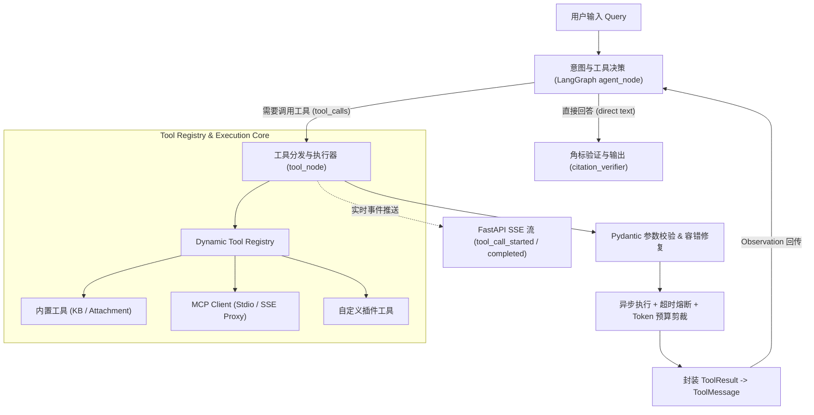
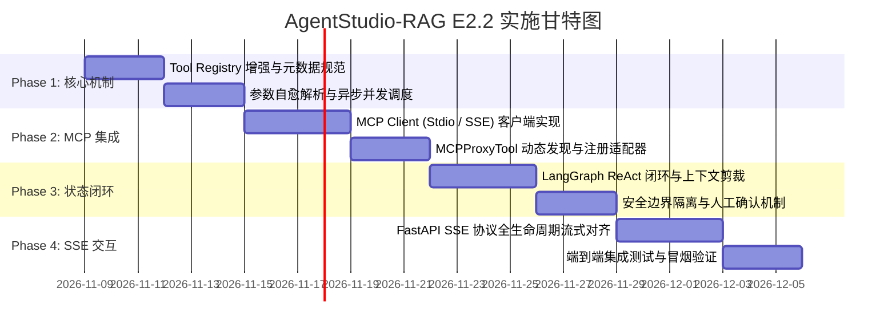

# AgentStudio-RAG E2.2：Agent 工具调用与执行能力实施计划

**阶段名称**：E2.2 - Agent Tool Calling & Execution Engine  
**文档性质**：技术架构设计与分阶段实施方案（非破坏性规划，暂不执行业务代码变更）  
**前序阶段**：E2.1（RAG 生成质量与全链路性能评测已正式冻结 FROZEN）  
**主要目标**：构建自主决策、高鲁棒性、具备原生 MCP（Model Context Protocol）协议扩展能力与实时流式反馈的工业级 LangGraph Agent 工具执行引擎。

---

## 一、现有代码架构梳理与基础资产

在 E2.1 之前的迭代中，AgentStudio-RAG 已经在 `backend/app/agent/` 目录沉淀了初步的 Agent 运行时与工具结构。梳理现有资产如下：

```text
backend/app/agent/
├── runtime/
│   ├── graph.py        # LangGraph StateGraph 拓扑图构建
│   ├── nodes.py        # agent_node, tool_node, citation_verifier_node, force_stop_node
│   ├── routing.py      # route_agent_decision (根据 tool_calls 进行条件分支路由)
│   ├── runtime.py      # LangGraphAgentRuntime 核心执行器与 astream_events 流式分发
│   └── state.py        # AgentState (TypedDict, 消息序列与运行状态)
├── tools/
│   ├── base.py         # BaseTool 抽象基类 (Pydantic 参数校验, to_openai_function)
│   ├── registry.py     # ToolRegistry (工具注册、名称唯一性、OpenAI schema 导出)
│   ├── schemas.py      # ToolResult, OpenAIToolDefinition 数据模型
│   ├── evidence.py     # EvidenceRegistry (运行域事实与角标同步)
│   ├── knowledge_search.py     # search_knowledge_base 内置知识库检索工具
│   └── attachment_search.py  # search_conversation_attachments 内置附件检索工具
└── api/v1/agent.py     # FastAPI 路由，暴露 /agents/{id}/runs/stream SSE 端点
```

### 现有资产的技术亮点
1. **统一的状态机拓扑**：基于 LangGraph `StateGraph`，定义了 `START -> agent_node -> route -> tool_node -> agent_node` 的标准循环结构；
2. **规范化的工具模型**：`BaseTool` 基于 Pydantic V2 `BaseModel` 导出 `tools=[{"type": "function", "function": ...}]` 标准 OpenAI JSON Schema；
3. **初具雏形的 SSE 事件分发**：`astream_events` 支持分发 `agent_step_completed`、`tool_call_started`、`tool_call_completed`。

---

## 二、核心技术差距分析与针对性设计方案

围绕用户提出的六大关键能力要求，对现有架构进行深度差距比对并制定落地设计方案：



---

### 1. LangGraph Agent 如何根据用户问题决定是否调用工具

#### 现有差距
- 当前实现依赖大模型自身的 `tool_choice="auto"` 原生能力，缺乏针对 DeepSeek-Flash 等国产模型的系统级提示词约束与负向控制；
- 当问题无需外部数据（如日常问候、一般性常识解释）时，模型偶发出现“强行幻觉调用工具”的倾向；或者在底库未检索到时，陷入无意义的重复搜索循环。

#### 解决方案与技术设计
1. **决策提示词工程（Decision Prompting）**：
   - 在 System Prompt 中注入明确的 **工具决策指导原则**：
     - *正向触发*：涉及特定领域实体、企业业务规则、技术配置参数、需要实时状态或外部 API 时，必须优先调用工具；
     - *负向抑制*：纯语言问候、逻辑推导、通用编程语法解释时，严禁调用工具，直接给出回答；
     - *收敛条件*：当已经获得充分事实或上一次工具调用返回“未检索到相关内容”时，严禁对同一关键词重复调用，应立即综合现有事实或进入合规拒答。
2. **动态 `tool_choice` 控制策略**：
   - `tool_choice="auto"`：默认模式，由大模型自主决定；
   - `tool_choice="none"`：当执行步数达到上限 `max_steps` 或累计工具调用数达到 `max_tool_calls` 时，强行锁定为 `"none"`，逼近最终回答；
   - `tool_choice="required"`（可选）：在用户明确指定特定工作流模式时，首轮强制要求调用指定工具。
3. **模型 Function Calling 协议降级与容错**：
   - 针对部分非原生支持 Function Calling 的开源小模型，提供 **ReAct 文本解析器作为 Fallback**（解析 `Action: <tool_name>\nAction Input: {...}`），保证协议向下兼容。

---

### 2. 如何设计 Tool Registry 和工具注册机制

#### 现有差距
- 现有的 `ToolRegistry` 是一个静态的单例内存容器，仅内置了 2 个固化工具；
- 缺乏**动态发现**、**作用域隔离**（User / Run / Agent 级别隔离）、**分类筛选**以及**权限分级**（只读查询 vs 破坏性操作）。

#### 解决方案与技术设计
1. **分层式 Tool Registry 架构**：
   - `SystemToolRegistry`（全局静态）：内置知识库检索、附件检索、时间日期查询、计算器等核心只读工具；
   - `AgentToolRegistry`（代理级动态）：根据具体 Agent 的配置绑定可用的工具白名单；
   - `UserSessionToolRegistry`（会话级沙箱）：动态加载用户通过 MCP 或插件临时挂载的工具。
2. **工具元数据与权限规范**：
   ```python
   class ToolMetadata(BaseModel):
       category: Literal["retrieval", "code_exec", "mcp_service", "web_search", "utility"]
       risk_level: Literal["read_only", "idempotent_write", "dangerous_mutation"]
       require_confirmation: bool = False  # 是否需要人工在 UI 上确认 (Human-in-the-Loop)
       timeout_seconds: float = 30.0
       max_output_tokens: int = 2048       # 防止工具输出巨量数据撑爆上下文
   ```
3. **动态注册与热插拔接口**：
   - 提供 `registry.register_tool(tool: BaseTool, metadata: ToolMetadata)`；
   - 支持根据标签过滤：`registry.get_tools_by_category(...)` 或根据权限过滤 `registry.get_safe_tools(...)`。

---

### 3. 如何让 Agent 调用 MCP Server 提供的工具

#### 现有差距
- 现有代码库完全没有 MCP（Model Context Protocol）客户端基础设施，无法直接对接标准 MCP Server（如 GitHub MCP, Postgres MCP, Filesystem MCP 等）。

#### 解决方案与技术设计
1. **构建轻量级异步 `MCPClientManager`**：
   - 支持两种核心传输层协议：
     - **Stdio Transport**：通过 `asyncio.create_subprocess_exec` 启动本地进程，使用 JSON-RPC 2.0 读写 stdin / stdout；
     - **SSE Transport**：基于 `httpx.AsyncClient` 建立长连接，连接远程 HTTP/SSE MCP 服务。
2. **MCP 工具动态适配器（`MCPProxyTool`）**：
   - 实现生命周期握手：`initialize` -> `notifications/initialized` -> `tools/list`；
   - 将 MCP 返回的工具定义转换为内部 `BaseTool` 实例：
     ```python
     class MCPProxyTool(BaseTool):
         """
         将任意标准 MCP Server 提供的 Tool 动态代理为 AgentStudio 的 BaseTool
         """
         def __init__(self, mcp_client: MCPClient, tool_def: MCPToolDefinition):
             self._client = mcp_client
             self._name = f"mcp__{mcp_client.server_name}__{tool_def.name}"
             self._description = tool_def.description
             self._input_schema = tool_def.inputSchema
             
         async def execute(self, **kwargs) -> ToolResult:
             # 将参数通过 JSON-RPC 转发给 tools/call
             response = await self._client.call_tool(self._tool_name, kwargs)
             return ToolResult(tool_name=self._name, success=True, data=response.content)
     ```
3. **统一注册进 Tool Registry**：
   - Agent 启动时扫描已配置的 MCP Servers，调用 `tools/list` 批量实例化 `MCPProxyTool` 并注册到 `AgentToolRegistry`。LLM 无需感知底层是本地 Python 代码还是远程 MCP Server。

---

### 4. 工具参数如何生成、校验、执行及返回结果

#### 现有差距
- 目前如果 LLM 生成的参数存在类型轻微错位（如 `limit="10"` 传入需要 `int` 的字段），直接抛出 `ValidationError` 导致整个链路崩溃；
- 工具返回的内容如果过长（如检索返回几十条富文本或巨型 JSON），缺乏 Token 预算控制与压缩机制。

#### 解决方案与技术设计
1. **参数容错与智能修复管道（Robust Parameter Pipeline）**：
   - *第一道防线：Pydantic 宽松模式与类型强转*（使用 `model_validate` 配合 Pydantic 的宽松类型转换）；
   - *第二道防线：JSON 语法修复*（利用 `json_repair` 处理大模型偶尔缺失闭合括号或存在单引号的畸变字符串）；
   - *第三道防线：反思重试提示*（校验失败不抛异常中断，而是将校验错误信息封装为 `ToolResult(success=False, error="参数校验失败...")`，由下一轮 LLM 自动修正参数重新调用）。
2. **工具输出 Token 预算与防撑爆剪裁（Token Budget Clipping）**：
   - 在将 `ToolResult` 写入 `ToolMessage` 之前，执行 Token 预算估算：
     - 若输出 $< 2048$ Tokens：原样保留 JSON / Markdown 文本；
     - 若输出 $> 2048$ Tokens：执行**结构化截断与摘要**，截取关键字段，末尾添加 `[Warning: Output truncated to fit context budget]`，避免消耗过量 Context。
3. **异步并发执行与超时隔离**：
   - 当一轮对话中模型输出了多个并发的 `tool_calls` 时，使用 `asyncio.gather` 并行执行独立的工具调用；
   - 每项工具执行严格包裹 `asyncio.wait_for(timeout=tool_timeout)`，超时后返回标准的超时错误说明，严禁单个工具阻塞全图。

---

### 5. 如何将工具执行结果重新交给 LLM，形成完整的 Reasoning + Acting 闭环

#### 现有差距
- 状态机中消息序列必须保证严格的格式对齐：每一个包含 `tool_calls` 的 `AIMessage` 之后，必须严格紧随对应 `tool_call_id` 的 `ToolMessage`；
- 当前多轮对话在多次工具调用后，消息序列不断膨胀，缺乏对历史轮次冗余 Observation 的上下文精简策略。

#### 解决方案与技术设计
1. **严格的 ReAct 状态契约**：
   ```text
   Step 0: HumanMessage("查询知识库中关于超时配置并在系统中修改它")
   Step 1: AIMessage(content="我需要先查询知识库中的超时配置...", tool_calls=[{id: "call_1", name: "search_knowledge_base", args: {...}}])
   Step 2: ToolMessage(tool_call_id: "call_1", content="{'timeout': 5000, ...}")  <-- 观察值 (Observation)
   Step 3: AIMessage(content="根据知识库，超时时间为5000ms。接下来修改系统配置...", tool_calls=[{id: "call_2", name: "update_config", args: {...}}])
   Step 4: ToolMessage(tool_call_id: "call_2", content="{'status': 'success'}")
   Step 5: AIMessage(content="已成功将系统超时时间更新为 5000ms [Ref-1]。")  <-- 最终回答 (Final Answer)
   ```
2. **LangGraph Reducer 幂等追加**：
   - 使用 LangGraph 标准 `Annotated[Sequence[BaseMessage], add_messages]`，确保消息序列的天然追溯性与不可变性；
3. **上下文智能剪裁与记忆保留（Observation Pruning）**：
   - 当步数 $> 3$ 且总 Token 接近上限时，将前序早期轮次的 `ToolMessage` 冗余 JSON 替换为紧凑的单行事实摘要，仅保留最新的 Observation 全文，防止跨步数导致 Context 爆炸。

---

### 6. 如何在 FastAPI 中实现工具执行过程的 SSE 实时反馈

#### 现有差距
- 现有的 `astream_events` 仅在工具执行完毕后发出一个简单的事件，前端无法实时看到“模型当前正在想什么”、“准备调用什么参数”、“正在调用什么工具”以及“执行进度”。

#### 解决方案与技术设计
制定完整的 **Agent Tool Calling SSE 协议规范**（与前端严格约定协议字段）：

| SSE 事件名 (`event`) | 触发时机 | 数据载荷核心字段 (`data`) | 前端交互呈现 |
| :--- | :--- | :--- | :--- |
| `run_started` | Agent 启动执行 | `run_id`, `query`, `enabled_tools` | 开启流式响应会话 |
| `agent_thinking` | 模型生成思维链或决定调用工具前的推导 | `delta`, `thought` | 显示折叠的“思考过程”浮层 |
| `tool_call_started` | 模型决定调用某工具并输出参数 | `tool_call_id`, `tool_name`, `arguments` | 弹出工具调用卡片，显示参数骨架屏与执行中动效 |
| `tool_call_progress` | 长耗时工具（如 MCP 执行、爬虫）心跳 | `tool_call_id`, `percent`, `message` | 显示进度条或状态文字 |
| `tool_call_completed` | 工具执行完毕返回结果 | `tool_call_id`, `tool_name`, `success`, `duration_ms`, `summary` | 工具卡片打勾/变绿，展示折叠的执行结果 |
| `final_answer` | 模型综合 Observation 输出最终回答 | `delta`, `accumulated_text` | 逐字打字机输出正文 |
| `citation_verified` | 终验角标与事实溯源完成 | `citations_count`, `citations` | 渲染角标卡片与原文高亮 |
| `run_completed` | 全链路结束 | `total_duration_ms`, `tool_call_count`, `steps` | 结束流式连接，记录性能面板 |
| `run_failed` | 发生不可恢复致命异常 | `error`, `error_type` | 渲染错误提示卡片 |

- **断连与取消安全（Cancellation Safety）**：
  - 在 FastAPI 中监听 `request.is_disconnected()`；
  - 一旦客户端断开连接，立即触发 `asyncio.Task.cancel()`，中断正在等待的 LLM API 与后台 MCP 子进程，释放线程与内存资源。

---

## 三、分阶段实施路线图 (E2.2 Implementation Milestones)



### 阶段一：Tool Registry 增强与参数自愈执行闭环 (Week 1)
- **任务 1.1**：重构 `backend/app/agent/tools/base.py` 与 `registry.py`，支持 `ToolMetadata` 分类管理、动态作用域注册与白名单过滤；
- **任务 1.2**：实现参数宽容解析器（Pydantic 宽容模式 + `json_repair` 容错），并在参数无效时生成自愈式 `ToolMessage`；
- **任务 1.3**：在 `tool_node` 中引入并发调度（`asyncio.gather` 并行执行多 tool_calls）与单工具执行超时熔断；
- **交付物**：Tool Registry 增强单元测试集（覆盖参数校验、并发调度、超时隔离）。

### 阶段二：MCP (Model Context Protocol) 客户端与工具动态代理 (Week 2)
- **任务 2.1**：在 `backend/app/agent/mcp/` 下构建异步轻量级 MCP 客户端，实现 Stdio（子进程 JSON-RPC）与 SSE 两种传输协议；
- **任务 2.2**：实现 `MCPProxyTool`，自动将 MCP `tools/list` 转换为 `BaseTool` 接口，无缝挂载到 AgentToolRegistry；
- **任务 2.3**：编写 Mock MCP Server（包含天气查询、代码执行计算、数据库只读检索 3 个典型工具）用于离线与回归测试；
- **交付物**：MCP 集成端到端测试，验证 Stdio 与 SSE 模式下工具的动态发现与成功调用。

### 阶段三：LangGraph ReAct 完整闭环与上下文 Token 预算管理 (Week 3)
- **任务 3.1**：优化 `backend/app/agent/runtime/nodes.py`，完善 `agent_node` 和 `tool_node` 的上下文消息对齐协议；
- **任务 3.2**：引入 Token 预算剪裁器（`ToolOutputClipper`），防止工具返回数十 KB 的庞大数据冲垮上下文；
- **任务 3.3**：针对破坏性操作工具（`dangerous_mutation`），设计 Human-in-the-Loop 中断与恢复挂起机制（基于 LangGraph `interrupt`）；
- **交付物**：复杂多跳工具调用集成测试（连续多步工具执行闭环）。

### 阶段四：FastAPI SSE 实时反馈与端到端集成 (Week 4)
- **任务 4.1**：在 `backend/app/api/v1/agent.py` 中完整对齐 9 项标准 SSE 生命周期事件；
- **任务 4.2**：添加参数脱敏与敏感信息过滤（对密码、Access Token、手机号进行打码后再发射给前端）；
- **任务 4.3**：完善客户端断连监控与后台任务优雅取消机制；
- **交付物**：端到端真实 TCP SSE 冒烟测试套件与前端调用范式文档。

---

## 四、安全边界与风险防控矩阵

| 风险场景 | 潜在威胁 | 技术防线与规避措施 |
| :--- | :--- | :--- |
| **SSRF 攻击** | 远程 SSE MCP Server 指向内部内网敏感 IP（如 `169.254.169.254`） | 强制复用 `app/core/ssrf.py` 进行 IP 黑名单过滤与域名安全解析，禁止连接本地回环与内网私有地址。 |
| **Subprocess 资源耗尽** | Stdio MCP 子进程发生死锁或死循环，占用主机 CPU / 内存 | 启动子进程时设置全局超时控制，退出时发送 `SIGTERM` / `SIGKILL`；限制并发启动的最大子进程数量。 |
| **Token Context 爆炸** | 工具输出几万行日志或巨量数据，超出模型上下文窗口 | 设置 `max_output_tokens` 阈值（默认 2048），超限时执行就地结构化采样与文本截断。 |
| **恶意参数注入** | 模型受提示词注入攻击，在工具参数中传入 `rm -rf` 或 SQL 注入字符串 | 工具参数使用 Pydantic 强类型严格白名单，禁止直接在底层进行未参数化的字符串拼接。 |

---

## 五、验收标准与交付产物规范 (Definition of Done)

E2.2 阶段完成的正式标志包括：

1. **协议合规性**：系统能至少成功连接 1 个标准 Stdio MCP Server 和 1 个标准 SSE MCP Server，动态提取工具并在对话中正确调用；
2. **多轮闭环率**：在 10 道需要工具调用的基准测试中，Agent 能够连续执行 2~3 步工具调用并最终合成正确回答，闭环率达到 $\ge 90\%$；
3. **容错自愈率**：当人为注入畸变参数（如类型错误、缺失字段）时，系统不崩溃，LLM 能够在收到错误反馈后自愈重试成功率 $\ge 80\%$；
4. **流式透明度**：FastAPI SSE 端点能够以标准事件格式流式发射工具调用的输入参数、执行状态与输出摘要，耗时打点完整。
