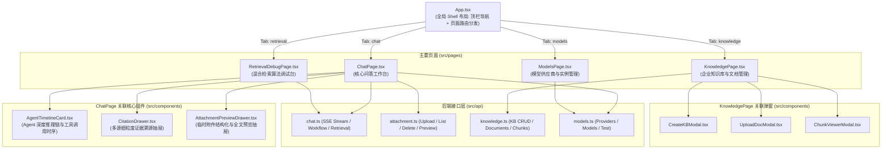
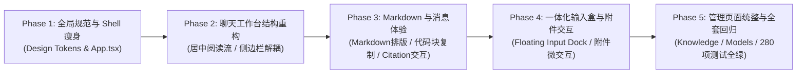

# AgentStudio-RAG — 前端 UI/UX 全面审查报告与改造实施规划

**审查日期**: 2026-11-03  
**审查性质**: 前端代码与真实运行界面只读审计（Read-Only UI/UX Audit & Renovation Blueprint）  
**界面参考**: 用户提供的实际运行截图（包含顶部导航、双模式切换、执行链路调试栏、会话列表、调试标签栏与输入区域）  
**核心目标**: 从「开发者内部调试台（Playground）」全面跃升为「成熟、简洁、专业的企业级 AI 智能知识助手」  

---

## 目录

1. [当前前端组件架构与页面关系图谱](#1-当前前端组件架构与页面关系图谱)
2. [当前 UI 存在的问题（按严重程度倒序排序）](#2-当前-ui-存在的问题按严重程度倒序排序)
3. [建议的页面布局与企业级视觉设计规范](#3-建议的页面布局与企业级视觉设计规范)
4. [具体改造方案与涉及文件修改清单](#4-具体改造方案与涉及文件修改清单)
5. [分阶段实施路径与顺序规划](#5-分阶段实施路径与顺序规划)
6. [各阶段功能回归测试要求](#6-各阶段功能回归测试要求)

---

## 1. 当前前端组件架构与页面关系图谱

系统前端采用 **React 18 + TypeScript + Vite + Ant Design 5** 技术栈。

### 1.1 组件依赖与数据流拓扑



### 1.2 源码文件结构与功能定位

| 文件路径 | 对应角色 | 当前代码量 | 核心职责 |
| :--- | :--- | :---: | :--- |
| `frontend/src/App.tsx` | 全局外壳 | 158 行 | 顶栏导航、全局 Branding、系统运行状态监控、主视图 Tab 切换。 |
| `frontend/src/pages/ChatPage.tsx` | 问答工作台 | 1475 行 | 包含会话历史列表、知识库挂载、双模式切换、模型选择、消息流式渲染、调试信息栏、附件上传与输入坞。 |
| `frontend/src/components/AgentTimelineCard.tsx` | 推理时序卡片 | 258 行 | 深度分析模式下，展示 Agent 步骤推进、工具调用状态、参数预览、耗时与证据命中。 |
| `frontend/src/components/CitationDrawer.tsx` | 引用抽屉 | 192 行 | 呈现回答中 `[Ref-X]` 对应的分块原文、相似度得分、格式细粒度标签（PDF/DOCX/MD/TXT）。 |
| `frontend/src/components/AttachmentPreviewDrawer.tsx` | 附件预览抽屉 | 240 行 | 抽屉内分页/分块切换展示已上传临时附件的结构化解析文本与提取全文。 |
| `frontend/src/pages/KnowledgePage.tsx` | 知识库管理 | 410 行 | 知识库列表、统计卡片、文档上传状态、分块钻取查看、删除与调试跳转。 |
| `frontend/src/pages/ModelsPage.tsx` | 模型管理中心 | 864 行 | 模型服务商（云端/本地）配置、API Key 掩码录入、连接测试、默认模型设置。 |
| `frontend/src/pages/RetrievalDebugPage.tsx` | 检索调试台 | 296 行 | 针对单知识库进行 Dense/Sparse/RRF/Rerank 四种模式对比，查看原始相关度分数。 |
| `frontend/src/main.tsx` | 注入入口 | 27 行 | 注入 Antd `ConfigProvider`、中文化与全局主题基础 Token（`colorPrimary: #1677ff`）。 |

---

## 2. 当前 UI 存在的问题（按严重程度倒序排序）

结合真实界面截图与前端源码，提炼出当前系统的 4 个严重级别、共 12 处典型问题：

### 🔴 P0 级严重缺陷：破坏基本可用性与企业级专业感

#### 1. Markdown 渲染完全缺失（裸露 Markdown 原始语法符号）
- **对应源码**: `frontend/src/pages/ChatPage.tsx` 第 1037～1051 行：
  ```tsx
  <div style={{ whiteSpace: 'pre-wrap', wordBreak: 'break-word' }}>
    {msg.content}
    {!isUser && sending && msg.id.startsWith('assistant-') && (
      <span style={{ display: 'inline-block', width: 3, height: 15, backgroundColor: '#1677ff' }} />
    )}
  </div>
  ```
- **实际表现**: 大模型生成内容直接被当做纯文本输出。截图中的粗体全部显示为 `**5000 毫秒（即 5 秒）**`、`**5 秒**`；代码块、Markdown 列表、结构化对比表格 `| --- |` 均无法渲染为美观的排版结构。
- **严重影响**: 无法阅读复杂技术对比表、无法排版代码块、缺失代码一键复制，彻底背离现代 AI 产品的基本阅读体验。

#### 2. 底层调试参数高密度轰炸主界面（工程内部参数越界泄露）
- **对应源码**:
  - `frontend/src/App.tsx` 第 42～62 行：顶栏导航强行展示 `执行追踪 (M4 开发中)`、`效果评测 (M5 开发中)` 两个灰色 Disabled 占位标签；
  - `frontend/src/App.tsx` 第 146～148 行：顶栏右侧常驻 `Tag: Python 3.12 · FastAPI · pgvector`（纯后端技术栈声明）；
  - `frontend/src/pages/ChatPage.tsx` 第 902～906 行：聊天顶部操作区赫然显示 `执行链路: 向量+BM25 混合召回 → RRF 融合 → 精排 → 上下文预算组装` 长文本彩色 Tag；
  - `frontend/src/pages/ChatPage.tsx` 第 1112～1186 行：每条 AI 回答下方默认常驻长达 8~10 个紧凑彩虹色 Tag（`耗时: 3587.72ms`、`RRF融合`、`精排 481.81ms`、`Query已重写`、`Token预算: 1269 tokens`、`deepseek-chat`）。
- **实际表现**: 界面充斥着密密麻麻的算法内部调试数据，让普通业务用户产生认知负担，视觉严重杂乱，极其像内部技术人员的压测控制台（Benchmark Dashboard）。

#### 3. 聊天内容排版失衡与屏幕宽度失控（无居中容器）
- **对应源码**: `frontend/src/pages/ChatPage.tsx` 第 951～958 行（全屏无最大宽度限制）及第 1013 行（`maxWidth: '75%'`）。
- **实际表现**: 
  - 用户气泡极度靠右，AI 回答从极左撑到全屏 75%，视线跨度长达 1500+ 像素；
  - 缺乏 ChatGPT / Claude 等产品标准的 `max-width: 800px ~ 860px` 垂直居中容器（Centered Reader View）；
  - 在宽屏和笔记本屏幕下，用户视线需频繁在最左与最右之间大幅来回移动，容易视觉疲劳。

---

### 🟠 P1 级中度体验缺陷：设计语言陈旧、交互生硬

#### 4. 微信式生硬气泡与刺眼配色
- **对应源码**: `frontend/src/pages/ChatPage.tsx` 第 1003～1022 行。
- **实际表现**: 
  - 用户消息使用高饱和度纯蓝背景 `#1677ff`，字体纯白，四角是不对称棱角 `12px 2px 12px 12px`；
  - 用户头像使用了刺眼的纯绿背景 `#52c41a`；
  - AI 消息带有生硬的灰白卡片边框与突兀阴影；
  - 这种高对比度的“老式即时通讯气泡”破坏了企业级知识文档严肃、沉浸的阅读感。现代产品更推崇优雅、柔和、以文字排版为主的内容流设计。

#### 5. 输入框与附件交互区割裂（四方四正无现代设计感）
- **对应源码**: `frontend/src/pages/ChatPage.tsx` 第 1198～1450 行。
- **实际表现**: 
  - 底部输入区划分为上、中、下三个独立区块：顶部孤立的“添加附件”按钮行 $\rightarrow$ 中间独立的矩形文本框 $\rightarrow$ 右侧独立的方块发送按钮；
  - 附件卡片堆叠在输入框上方，使得输入区域高度剧烈跳变；
  - 缺乏现代 AI 产品标准的“一体化浮动胶囊输入卡片（Integrated Floating Prompt Box）”，即把附件图标、模式切换、输入框、发送按钮融为一体的现代圆角容器。

#### 6. 侧边栏（Sidebar）信息层级混乱
- **对应源码**: `frontend/src/pages/ChatPage.tsx` 第 727～839 行。
- **实际表现**: 
  - 顶部塞入巨大的“新建智能问答”按钮；
  - 紧接着塞入一个“当前挂载知识库”下拉框，导致会话历史的展示区域被严重压缩；
  - 底部孤零零地贴着一个“当前模式: Workflow”标签；
  - 历史会话项的选中态使用了较粗的实线描边和亮蓝色背景，视觉过渡偏硬。

#### 7. Agent 推理链（AgentTimelineCard）呈现过重
- **对应源码**: `frontend/src/components/AgentTimelineCard.tsx`。
- **实际表现**: 
  - 采用灰蓝色厚重边框，展开后呈现虚线分隔条与多层嵌套方块；
  - 缺乏类似 Claude 的“Thinking / 思维过程”轻量级折叠器美感，层级过于突出，喧宾夺主地压制了主回答文本。

---

### 🟡 P2 级轻度视觉与一致性问题：细节质感欠缺

#### 8. Citation 引用标记与抽屉视觉过重
- **对应源码**: `frontend/src/pages/ChatPage.tsx` 第 1055～1108 行，`frontend/src/components/CitationDrawer.tsx`。
- **实际表现**: 
  - 消息正文底部的 `真实引用事实依据 (1 处):` 占用了过多垂直空隙；
  - 引用抽屉中的卡片边框较重，分块 ID、得分标签显得机械生硬。

#### 9. 缺乏统一的设计 Token 与全局浅色主题
- **对应源码**: `frontend/src/main.tsx`，各组件内联样式（`style={{ ... }}`）。
- **实际表现**: 
  - 散落着数百处内联写死的色值（`#f5f7fa`, `#fafbfc`, `#ffffff`, `#e8e8e8`, `#cbd5e1`, `#1677ff`, `#52c41a`, `#722ed1`）；
  - 边框圆角在 2px, 4px, 6px, 8px, 12px 之间随意切换；
  - 缺乏标准化的 Design Tokens（字体梯度、表面层级 Surface、文本阶梯 Text Levels、间距规格 Spacing Scale）。

#### 10. 管理页面（知识库、模型中心、检索调试）视觉分裂
- **对应源码**: `KnowledgePage.tsx`, `ModelsPage.tsx`, `RetrievalDebugPage.tsx`。
- **实际表现**: 
  - 各管理页面的卡片留白、操作按钮样式、表单对齐逻辑不一致；
  - 检索调试台（`RetrievalDebugPage`）作为纯技术排查工具，在一级导航中与面向终身用户的问答系统平起平坐，未做专业分层。

---

## 3. 建议的页面布局与企业级视觉设计规范

针对上述问题，确立 **AgentStudio 2.0 企业级设计规范**（融合现代 AI 工具的极简、留白、通透体验，并保留企业级知识助手的严谨与信任感）。

### 3.1 核心设计原则

1. **内容优先（Content-First）**: 移除一切不属于终端用户的技术链路标记与后端参数，把最干净的排版留给正文。
2. **渐进式披露（Progressive Disclosure）**: 耗时、分块数、重写参数、Agent 步骤默认以轻盈微型标签或可折叠面板收拢；只有当用户主动悬停或点击时，才展开详细事实抽屉。
3. **呼吸感与居中聚焦（Breathing Room & Centered Reading）**: 聊天消息与输入框严格约束在居中 `840px` 黄金阅读宽度内，两侧留白自适应。
4. **统一设计变量（Design Tokens）**: 建立统一的色彩层级、圆角体系、排版字号。

---

### 3.2 色彩与材质规范 (Light Theme Design Tokens)

| Token 类别 | 建议参数 / 变量 | 对应用途与说明 |
| :--- | :--- | :--- |
| **主品牌色 (Primary)** | `#1e293b` (Slate 800) / `#2563eb` (Royal Blue) | 告别廉价的高亮荧光蓝，采用沉稳内敛的深石板蓝作为品牌基调，科技蓝 `#2563eb` 仅用于交互高亮与关键操作。 |
| **背景层 (Canvas)** | `#ffffff` (纯白主界面) / `#f8fafc` (极浅灰侧栏) | 主聊天区采用纯白/极淡灰，与输入盒形成自然的前后空间景深。 |
| **表面层 (Surface)** | `#f1f5f9` (Slate 100) / `#ffffff` | 消息卡片、引用胶囊、工具栏浅灰底色，微弱对比，不刺眼。 |
| **边框分割 (Border)** | `#e2e8f0` (常规) / `#f1f5f9` (极淡) | 0.5px ~ 1px 细线边框，摒弃老式粗重描边。 |
| **正文文本 (Text Main)**| `#0f172a` (Slate 900) | 高对比度、防眩光，行高 1.75，字号 15px。 |
| **次级文本 (Text Muted)**| `#64748b` (Slate 500) | 用于时间戳、副标题、引用源、辅助提示。 |
| **强调与状态 (Accents)**| 成功: `#10b981` / 警告: `#f59e0b` / 错误: `#ef4444` / Agent: `#8b5cf6` | 柔和现代的马卡龙饱和度，避免原生 RGB 刺目感。 |

---

### 3.3 页面骨架与三栏布局重构

```text
┌────────────────────────────────────────────────────────────────────────────────────────┐
│ [⚡ AgentStudio]  智能问答    知识库管理    模型管理中心    | [检索调试]     [用户头像/设置]  │ <- 干净顶栏 (无调试标签)
├───────────────┬────────────────────────────────────────────────────────────────────────┤
│ 侧边栏 (260px) │ 顶部工具栏 (挂载知识库: [M3.3 规范库 ▾]  |  [⚡快速问答 / 🧠深度分析]  [模型 ▾]) │ <- 聚焦当前上下文
│               ├────────────────────────────────────────────────────────────────────────┤
│ [+ 新建对话]   │                                                                        │
│               │                      【 840px 居中阅读流 】                             │
│ 历史会话 (分组)│                                                                        │
│ - 今天 (3)    │    👤 用户提问 (自然靠右 / 极淡灰紫气泡，现代圆角)                      │
│ - 昨天 (5)    │                                                                        │
│ - 过去7天 (11)│    🤖 智能回答 (优雅 Markdown 标题 / 代码高亮 / 对比表格)                │
│               │       [思维链折叠: ⚡ 已检索 2 个来源 · 耗时 3.5s ▾]                     │
│               │       [引用胶囊: 📄 2026架构规范 P.3 · 📄 网关通信规范 P.1]              │
│               │                                                                        │
│               ├────────────────────────────────────────────────────────────────────────┤
│ [清理所有会话] │      ╭──────────────────────────────────────────────────────────╮      │
│ [存储空间使用] │      │ 📎 [已挂载附件.pdf ✕]                                    │      │ <- 一体化圆角输入坞
│               │      │ 请输入您的问题... (Shift+Enter换行)             [⚡模式]  [↑发送] │      │    (内嵌附件与操作)
│               │      ╰──────────────────────────────────────────────────────────╯      │
└───────────────┴────────────────────────────────────────────────────────────────────────┘
```

---

## 4. 具体改造方案与涉及文件修改清单

### 方案 1：全局 Shell 与顶栏瘦身（`App.tsx`）
1. **清理顶栏干扰信息**:
   - 移除 `执行追踪 (M4 开发中)` 和 `效果评测 (M5 开发中)` 的 Tab 按钮（禁止将工程待开发项暴露在主导航中）；
   - 移除右侧技术栈声明标签 `Python 3.12 · FastAPI · pgvector`；
   - 将 `检索质量调试台` 移入二级工具菜单或右上角轻量图标（Tooling Dropdown），使企业主导航仅保留 **「智能知识问答」**、**「知识库管理」**、**「模型管理中心」** 三大业务核心。
2. **优化 Branding**:
   - 优化左上角 Logo：采用精致扁平图标，标题加粗，副标题从长串“企业级 Agentic RAG 智能知识问答系统”精简为“企业级智能知识助手”。

---

### 方案 2：会话侧边栏重塑（`ChatPage.tsx`）
1. **解耦知识库挂载与历史侧栏**:
   - 将“当前挂载知识库”从左侧边栏顶部移除，移至主聊天窗口的顶部 Context Header（它属于对话环境上下文，不属于历史列表）；
   - 左侧边栏专注于**会话组织**：
     - 顶部：轻量紧凑的 `+ 新建对话` 按钮（支持快捷键 `Ctrl+K` 或 `⌘+K` 提示）；
     - 中间：会话历史按时间自然分组（`今天`、`昨天`、`前7天`）；
     - 鼠标悬停（Hover）时才显现重命名与删除图标，去除日常界面杂色；
     - 会话条目采用极简平滑背景高亮，去除粗糙边框。

---

### 方案 3：聊天消息区居中与现代化排版（`ChatPage.tsx`）
1. **约束居中阅读流**:
   - 消息滚动容器采用 `max-width: 840px; margin: 0 auto; width: 100%;`；
   - 自适应响应式宽度：小屏（<768px）自适应 100%，大屏居中，杜绝视线跨屏拉扯。
2. **气泡重构**:
   - **用户消息**: 采用极浅灰蓝/沉稳深色渐变（如 `#f1f5f9` 配深色字，或 `#1e293b` 配纯白字），圆角 `18px`，去除生硬棱角与刺目纯蓝；
   - **AI 消息**: 移除外围卡片描边与生硬投影，直接自然融入白色背景，依靠微弱留白与内容结构区分，贴近 Claude / ChatGPT 的原生阅读感。
3. **收拢技术调试信息（渐进式披露）**:
   - 将每条 AI 回答下方的 8~10 个技术 Tag（RRF、精排耗时、Token 预算等）全部收归一个精致的下拉折叠条：
     ```html
     ⚡ 生成完毕 · 耗时 3.5s · 引用 2 处事实 [查看检索分析 ▾]
     ```
   - 仅当点击或悬停时弹出 Popover / 折叠卡，完整展示精排分、Token 预算、重写 Query。普通用户看到的是极致清爽，工程师点击展开依然能看到所有底层数据。

---

### 方案 4：引入专业 Markdown 与代码块渲染（`ChatPage.tsx` / `MarkdownRenderer`）
1. **建立结构化渲染组件**:
   - 封装 `MarkdownRenderer.tsx` 独立组件；
   - **标题**: `#` ~ `###` 建立清晰的层级字阶（1.4em, 1.25em, 1.1em），自动增加微间距；
   - **粗体**: `**文本**` 正确渲染为加粗强调；
   - **表格 (Table)**: 渲染为美观的圆角条纹表格，带有表头淡灰底色与细边框；
   - **代码块 (Code Block)**:
     - 独立深色/浅灰背景容器（`#1e293b` 或 `#f8fafc`）；
     - 顶部携带语言标牌（Language badge，如 `python`、`json`、`sql`）；
     - 右上角常驻 **「一键复制代码」** 按钮，点击即时提示“已复制”。
2. **内嵌 Citation 标记交互**:
   - 正文中的 `[Ref-1]`, `[Ref-2]` 转换为微型交互胶囊链接；
   - 鼠标悬停在 `[Ref-1]` 上即时弹出浮动 Tooltip（展示来源文档名、页码与原句预览）；
   - 点击直接触发对应证据定位或呼出 `CitationDrawer`。

---

### 方案 5：一体化浮动输入卡片与附件体验升级（`ChatPage.tsx`）
1. **一体化圆角容器（Integrated Prompt Card）**:
   - 废除原有的“散落三段式”，重构为类似 Claude / Perplexity 的一体化圆角浮动卡片（`border-radius: 16px; border: 1px solid #e2e8f0; box-shadow: 0 4px 20px rgba(0,0,0,0.05);`）；
   - 输入框自动随文字行数自适应增高（最小 2 行，最大 6 行）；
   - 内部集成：
     - 左下角：附件图标 📎、模式选择开关（⚡ 快速 / 🧠 深度）；
     - 右下角：圆形发送按钮 ↑（输入内容时高亮激活，生成中变为方形中止停止按钮 ⏹）；
2. **附件卡片轻量化**:
   - 拖拽或上传的文件直接呈现在输入框内部上方，作为轻量胶囊标签（文件图标 + 名字 + 大小 + 进度小菊花 + ✕ 删除键），不突兀占用额外大块版面；
   - 保留点击卡片呼出 `AttachmentPreviewDrawer` 查看全文预览功能。

---

### 方案 6：Agent 推理时序卡片升级（`AgentTimelineCard.tsx`）
1. **借鉴思维链折叠器（Thought & Tool Disclosure）**:
   - 默认以一条细致的紫色徽标展开条呈现：“`🧠 Agent 思考过程 (调用 2 个工具 · 耗时 1.9s) ▾`”；
   - 展开后采用平滑时间轴（Timeline），清晰标注各步工具输入、输出要点与分块分配，去除粗重嵌套框。

---

### 方案 7：管理页面风格统整（`KnowledgePage.tsx` / `ModelsPage.tsx`）
1. **统整间距与设计 Token**:
   - 统一卡片圆角为 `12px`，统一表格表头为浅灰底色 `#f8fafc`；
   - 统一使用规范的状态徽章（Badge / Tag）；
   - 模型管理页面（`ModelsPage.tsx`）优化 Provider 卡片列表排版，强化连接测试与默认模型状态的高亮展示。

---

## 5. 分阶段实施路径与顺序规划

为确保工程安全与零回归，建议分 5 个阶段稳步推进改造，每一阶段均以自动化构建与人工验收为里程碑：



### 实施路线图明细

| 阶段 | 改造重点 | 涉及的核心文件 | 交付产物与标准 |
| :---: | :--- | :--- | :--- |
| **Phase 1** | **全局规范与顶栏瘦身** | `frontend/src/main.tsx`<br/>`frontend/src/App.tsx` | 移除开发状态标签；统一 Antd Token 主题；顶栏清爽企业化；TypeScript 0 错误。 |
| **Phase 2** | **主工作台与侧边栏重构** | `frontend/src/pages/ChatPage.tsx` | 会话侧栏去干扰化；实现 840px 居中消息阅读流；优化气泡与头像配色体系。 |
| **Phase 3** | **Markdown 渲染与消息层级** | `frontend/src/pages/ChatPage.tsx`<br/>`frontend/src/components/MarkdownRenderer.tsx`<br/>`frontend/src/components/AgentTimelineCard.tsx` | 彻底解决裸露 Markdown 问题；表格美化；代码高亮与一键复制；收拢调试标签；Agent 思考过程轻量折叠。 |
| **Phase 4** | **一体化输入盒与附件卡片** | `frontend/src/pages/ChatPage.tsx`<br/>`frontend/src/components/AttachmentPreviewDrawer.tsx` | 重构一体化浮动 Prompt 容器；多附件微型卡片；拖拽视觉微动效；发送/停止无缝切换。 |
| **Phase 5** | **管理页面风格统整与全链路验收** | `frontend/src/pages/KnowledgePage.tsx`<br/>`frontend/src/pages/ModelsPage.tsx`<br/>`frontend/src/pages/RetrievalDebugPage.tsx` | 统整知识库与模型管理视觉规范；全套 280 项测试回归验证；前端生产环境构建无警告。 |

---

## 6. 各阶段功能回归测试要求

在进行任何 UI 升级时，**必须严守现有业务逻辑零退化防线**。各阶段必须通过以下 10 项严苛的回归测试验收：

| 校验序号 | 功能核心场景 | 回归验证指标与要求 |
| :---: | :--- | :--- |
| **REG-01** | **Workflow 快速问答流式输出** | 问答流式打字效果流畅，首字延迟正常，光标闪烁无卡顿。 |
| **REG-02** | **LangGraph Agent 深度分析** | 多步工具调用时序卡片能正常展开，工具参数、执行状态与耗时准确。 |
| **REG-03** | **纯知识库问答** | 绑定知识库场景下，能准确召回分块，正文正确引用并在抽屉中溯源。 |
| **REG-04** | **纯附件问答 (未选知识库)** | 仅上传临时附件（PDF/DOCX/MD/TXT）即可直接提问，命中附件内容。 |
| **REG-05** | **附件与知识库混合问答** | 同时挂载知识库与上传附件，大模型能跨两源比对并分别生成引用。 |
| **REG-06** | **多轮会话历史与上下文记忆** | 切换会话正常拉取历史消息；上下文多轮代词重写功能依然稳定。 |
| **REG-07** | **Citation 引用核验与抽屉展示** | 点击正文 `[Ref-X]` 标签即时呼出 `CitationDrawer`，页码与章节准确。 |
| **REG-08** | **附件生命周期完整保留** | 附件上传状态推进正常（就绪/解析中/失败），支持点击预览和点击删除。 |
| **REG-09** | **模型动态切换能力** | 下拉框切换云端 DeepSeek 或本地模型生效，模型不支持工具调用时有友好提示。 |
| **REG-10** | **中断生成与页面刷新恢复** | 点击停止生成即刻中断流式连接；刷新页面后历史会话与附件完整恢复。 |

---

## 7. 结语

本报告对当前前端架构与视觉体验完成了全面客观的只读审查。当前 AgentStudio-RAG 的底层能力（检索算法、Agent 运行时、模型适配、附件引擎）已经高度成熟可靠，通过本次以「成熟 AI 产品理念」为准绳的前端重构方案，系统将彻底撕掉“内部调试原型”的标签，蜕变为高质感、易使用、企业级信赖的知识智能体产品。

**当前状态已就绪，等待您的指示与实施确认。**
