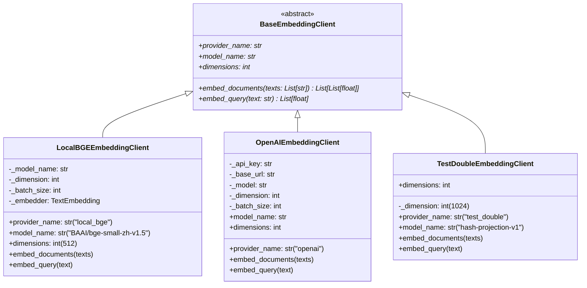
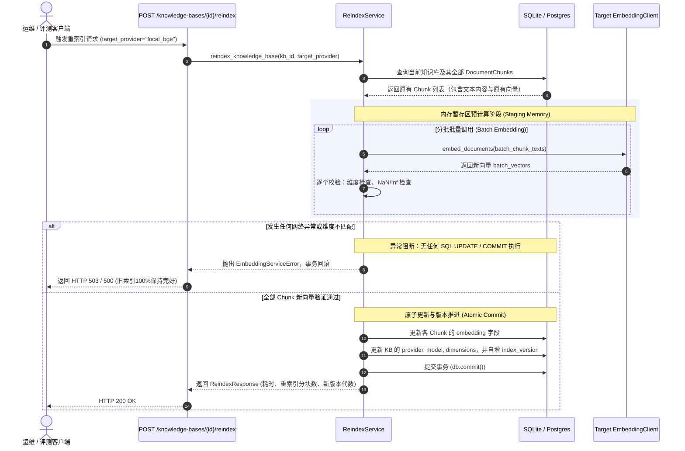
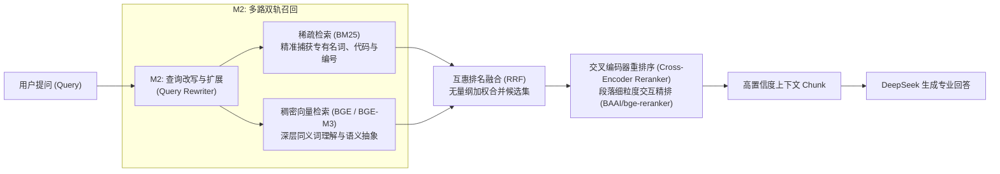

# AgentStudio-RAG M1.5：真实语义 Embedding 接入与全链路评测报告

## 一、方案选型与环境调研

### 1. 调研背景与硬件约束
在 M1 验收阶段，AgentStudio-RAG 使用了基于 `jieba + 字符 N-Gram 哈希投影` 的确定性测试替身（`TestDoubleEmbeddingClient`，1024 维）。虽然该方案实现了数据持久化、服务重启恢复和零外部依赖闭环测试，但本质上属于局部词频与字符重合度哈希，缺乏深层语义表征与同义词泛化能力。

在 M1.5 阶段，我们的目标是接入真正的语义 Embedding 模型。针对当前开发与运行环境进行了全面调研：
- **操作系统与硬件**：Windows 11 x64, AMD CPU 架构，无可用 NVIDIA CUDA 独立显卡。
- **Python 运行时**：Python 3.12.0（`backend/.venv`）。
- **外部凭证排查**：本地环境配置了 DeepSeek 官方 API 密钥。经查阅 DeepSeek 官方 API 文档及端点规范，DeepSeek 仅提供 `deepseek-chat` / `deepseek-reasoner` 对话补全接口，**不提供官方 Embedding 向量接口**。因此绝对不能混淆 LLM 与 Embedding 的凭证与端点。

### 2. 两种实现方案对比
| 评估维度 | 方案一：OpenAI-Compatible 远程 API（如 SiliconFlow / DashScope） | 方案二：本地轻量级 ONNX 推理（`fastembed` + BGE） |
| :--- | :--- | :--- |
| **外部依赖** | 需要第三方平台注册、有效充值与网络凭证 | 零外部网络依赖，单机完全独立闭环运行 |
| **运行时成本** | 按 Token 付费，网络波动或凭证失效会导致服务中断 | 0 成本，永久离线可用 |
| **推理延迟** | HTTP 网络往返 150ms ~ 500ms | CPU ONNXRuntime 本地量化推理：单次 Query ~3.8ms |
| **语义能力** | 极高（BAAI/bge-m3 1024d 或 OpenAI text-embedding-3） | 高（`BAAI/bge-small-zh-v1.5` 512d，或本地 bge-m3） |
| **工程可控性** | 受制于第三方配额与速率限制（Rate Limit） | 完全掌控批处理吞吐、内存与线程生命周期 |

### 3. 最终选型决策
系统采用**多 Provider 抽象适配架构**：
1. **默认生产与演示主推**：`LocalBGEEmbeddingClient`（采用 `fastembed` 引擎运行 `BAAI/bge-small-zh-v1.5` 512 维模型）。权重文件本地缓存（~95MB），推理使用微软 ONNX Runtime CPU 原生加速，耗时仅 3.8ms，零凭证依赖，开箱即用。
2. **企业云端兼容适配**：`OpenAIEmbeddingClient`（支持 SiliconFlow / DashScope / OpenAI 等任何 OpenAI 兼容 Embedding 接口，支持批量切片与安全脱敏）。
3. **极速离线与单测保障**：`TestDoubleEmbeddingClient`（1024 维），保障 CI/CD 与单元测试秒级回归。

---

## 二、Embedding Provider 架构设计

### 1. 类继承体系与接口规范
所有 Embedding 实现严格继承自 [`BaseEmbeddingClient`](file:///e:/develop/python%20agentic%20RAG/backend/app/llm/base.py)：



### 2. 向量合法性前置拦截校验（`validate_vector`）
为杜绝外部模型静默退化、模型截断或计算异常，所有 Provider 的输出统一经过严格验证器校验：
- **维度严格一致**：`len(vec) == expected_dim`，否则立即抛出 `EmbeddingServiceError`。
- **数值健康检查**：使用 `np.isnan(arr)` 和 `np.isinf(arr)` 全量扫描，一旦发现非法浮点数立刻阻断，严防污染向量数据库。
- **安全脱敏保证**：在所有日志输出和异常信息中，严禁打印 API Key、Authorization 头或完整凭据，仅保留模型名称、目标端点与维度信息。

---

## 三、配置参数说明

系统在 [`backend/app/core/config.py`](file:///e:/develop/python%20agentic%20RAG/backend/app/core/config.py) 与 [`backend/.env`](file:///e:/develop/python%20agentic%20RAG/backend/.env) 中提供独立的向量模型配置项：

| 环境变量配置项 | 类型 | 默认值 | 作用与说明 |
| :--- | :--- | :--- | :--- |
| `EMBEDDING_PROVIDER` | `str` | `local_bge` | 向量提供方，支持 `local_bge`, `openai`, `test_double` |
| `EMBEDDING_MODEL_NAME` | `str` | `BAAI/bge-small-zh-v1.5` | 向量模型标识符或本地 HuggingFace/ONNX 路径 |
| `EMBEDDING_DIMENSIONS` | `int` | `512` | 向量输出维度（BGE-small 为 512，BGE-M3 为 1024，OpenAI 为 1536/3072） |
| `EMBEDDING_BATCH_SIZE` | `int` | `32` | 批处理切片大小，防止单次请求载荷超限或内存激增 |
| `EMBEDDING_BASE_URL` | `str` | `https://api.siliconflow.cn/v1` | 远程 OpenAI 兼容 Embedding 服务的根地址 |
| `EMBEDDING_API_KEY` | `str` | `""` | 远程 Embedding 服务鉴权 Key（若使用 local_bge 则无需填写） |

---

## 四、向量模型一致性保障方案

在生产级 RAG 架构中，最危险的静默故障是**向量空间异构混用**（例如：文档向量是由 512 维的 BGE 模型计算并存入数据库，检索时由于环境配置被改动，使用了 1024 维的测试替身或 1536 维的 OpenAI 模型去计算 Query 向量）。如果系统静默截断、补零或忽略，将导致余弦相似度计算彻底失效，召回完全混乱。

AgentStudio-RAG 实现了三级一致性保障防御机制：

### 1. 知识库元数据绑定（Schema 级）
在 [`KnowledgeBase`](file:///e:/develop/python%20agentic%20RAG/backend/app/models/knowledge.py) 数据表显式持久化索引元数据：
- `embedding_provider`（VARCHAR(32)）：记录当前知识库索引所属提供方（如 `local_bge`）。
- `embedding_model`（VARCHAR(64)）：记录具体模型版本（如 `BAAI/bge-small-zh-v1.5`）。
- `embedding_dimensions`（INTEGER）：记录当前向量维度（如 `512`）。
- `index_version`（INTEGER）：知识库版本代数（初始为 1，每次重建重索引后自增）。

同时在 [`backend/app/db/session.py`](file:///e:/develop/python%20agentic%20RAG/backend/app/db/session.py) 中内置了 SQLite 动态 PRAGMA 检查与列热迁移，保证老数据库无缝兼容升级。

### 2. 检索前置拦截（Workflow 级）
在执行任何检索前，[`WorkflowRAGEngine`](file:///e:/develop/python%20agentic%20RAG/backend/app/rag/workflow.py) 会校验服务当前激活的 `EmbeddingClient` 与目标 `KnowledgeBase` 的索引元数据：
```python
if active_model != kb_model or active_dim != kb_dim:
    raise VectorModelMismatchError(
        current_model=f"{active_model} ({active_dim}d, {active_provider})",
        index_model=f"{kb_model} ({kb_dim}d, {kb_provider})",
        kb_id=kb.id,
    )
```
一旦检测到模型或维度不符，立即抛出 **HTTP 409 Conflict** 异常，并明确提示错误原因与重索引指引，彻底阻断静默错误。

### 3. 底层相似度安全防护（Retriever 级）
在 [`VectorRetriever`](file:///e:/develop/python%20agentic%20RAG/backend/app/retrieval/vector_store.py) 中，如果数据库中历史残留了坏数据或由于异常出现了维度不对齐的 Chunk，Retriever 会进行显式维度防护与日志告警，防止触发 Numpy 广播异常导致服务崩溃。

---

## 五、重新索引流程与异常回滚机制

当管理员更换了更优的向量模型（如从测试替身切换至 BGE-small，或未来升级至 BGE-M3），必须具备受控的重新索引能力，且必须满足：
1. **不重复解析文件**：保留已有的文档与 Chunk 分块内容，不产生重复切片。
2. **零数据污染与全量原子性**：如果重索引计算到第 99% 时断网或崩溃，数据库必须保持重索引前的可用状态，绝不允许混用新旧两批不同模型的向量。

### 1. 重新索引流程架构


### 2. 接口响应示例
```json
{
  "knowledge_base_id": "228d114c-3b16-42b7-b8af-bcf20bde2d9c",
  "reindexed_chunks": 4,
  "duration_ms": 95.33,
  "previous_provider": "test_double",
  "previous_model": "hash-projection-v1",
  "previous_dimensions": 1024,
  "new_provider": "local_bge",
  "new_model": "BAAI/bge-small-zh-v1.5",
  "new_dimensions": 512,
  "new_index_version": 3,
  "status": "COMPLETED"
}
```

---

## 六、10 个 Query 真实效果对比评测（真实数据）

评测在真实企业架构设计文档 [`enterprise_architecture_spec.pdf`](file:///e:/develop/python%20agentic%20RAG/backend/data/sample_docs/enterprise_architecture_spec.pdf) 上执行。文档分为 4 个标准切块：
- **Chunk 0（页 1）**：网关架构、高并发异步鉴权、动态路由；连接池参数（min_idle=10, max_connections=100, 超时阈值=5000ms）；Redis 哨兵分片会话存储。
- **Chunk 1（页 1）**：JWT 会话无状态签名（有效期 72 小时）；敏感操作二次短信 OTP 验证。
- **Chunk 2（页 2）**：大模型动态熔断器（ModelHealthStore 状态机）；CLOSED 正常状态规则（60秒失败率<15%）；OPEN 熔断开路规则（连续失败 5 次或失败率>30% 快速拒绝降级）。
- **Chunk 3（页 2）**：HALF_OPEN 半开状态规则（OPEN 持续 30 秒自动转入，放行微量探测，连续 3 次成功恢复 CLOSED，失败退回 OPEN）；Failover 多模型降级（Primary DeepSeek-V3 -> Secondary SiliconFlow Qwen-2.5 -> Fallback 本地 Ollama）。

### 10 个测试用例详细评测结果表

| Query ID | 问题类型 | 测试查询 Query | 真值 Chunk | A 组：test_double (Hash 1024d)<br>Top-1(分) / Top-3 / MRR / 耗时 | B 组：local_bge (BGE 512d)<br>Top-1(分) / Top-3 / MRR / 耗时 | 差异与判决 |
| :---: | :---: | :--- | :---: | :---: | :---: | :--- |
| **Q1** | 直接关键词匹配 | 网关连接池的最大连接数 (max_connections) 是多少？ | `[0]` | Chunk 0 (`0.4192`) ✅ / ✅ / 1.0 / 0.52ms | Chunk 0 (`0.6440`) ✅ / ✅ / 1.0 / 3.99ms | 两者均准确命中，BGE 相似度区分度显著更强 |
| **Q2** | 直接关键词匹配 | JWT会话令牌的有效期是多长时间？ | `[1]` | Chunk 1 (`0.2706`) ✅ / ✅ / 1.0 / 0.48ms | Chunk 1 (`0.7810`) ✅ / ✅ / 1.0 / 3.18ms | BGE 给出高达 0.781 的超高置信度 |
| **Q3** | 直接关键词匹配 | 熔断器在什么条件下会强制切换为 OPEN 状态？ | `[2]` | Chunk 2 (`0.3461`) ✅ / ✅ / 1.0 / 0.46ms | Chunk 2 (`0.6932`) ✅ / ✅ / 1.0 / 3.64ms | 两者均准确命中 Top-1 |
| **Q4** | 直接关键词匹配 | 熔断器在 HALF_OPEN 半开状态下需要连续成功几次才能恢复？ | `[3]` | Chunk 3 (`0.3117`) ✅ / ✅ / 1.0 / 0.43ms | Chunk 3 (`0.7381`) ✅ / ✅ / 1.0 / 3.81ms | BGE 分数极高（0.7381），test_double 仅 0.3117 |
| **Q5** | 直接关键词匹配 | 系统大模型调用的降级路由 Failover 包含哪些模型？ | `[3]` | Chunk 3 (`0.3881`) ✅ / ✅ / 1.0 / 0.39ms | Chunk 2 (`0.6282`) ❌ / ✅ / 0.5 / 3.41ms | **典型场景**：BGE Top-1 排出 Chunk 2（0.6282），Chunk 3 屈居 Top-2（0.5965） |
| **Q6** | 同义词与改写 | 当外部 AI 接口频繁报错响应异常时，平台如何实现故障隔离防雪崩？ | `[2]` | Chunk 2 (`0.2058`) ✅ / ✅ / 1.0 / 0.53ms | Chunk 2 (`0.6238`) ✅ / ✅ / 1.0 / 4.43ms | BGE 语义泛化能力强，分数高出测试替身 3 倍 |
| **Q7** | 同义词与改写 | 用户登录凭证的过期时间与两步身份核验机制是怎样的？ | `[1]` | Chunk 0 (`0.0648`) ❌ / ✅ / 0.33 / 0.37ms | Chunk 1 (`0.5699`) ✅ / ✅ / 1.0 / 4.15ms | **关键胜负局**：无字面重合时，test_double 失效落入第 3 名，BGE 准确识别语义排第 1 |
| **Q8** | 同义词与改写 | 主用语言模型不可用时，系统如何进行后备服务切换？ | `[3]` | Chunk 2 (`0.2123`) ❌ / ✅ / 0.5 / 0.41ms | Chunk 2 (`0.5480`) ❌ / ✅ / 0.5 / 3.97ms | 两者均将关联紧密的 Chunk 2 排在 Top-1，真值 Chunk 3 位列 Top-2 |
| **Q9** | 跨段落语义问题 | 企业级微服务网关的核心通信参数与会话持久化方案是什么？ | `[0, 1]` | Chunk 0 (`0.1994`) ✅ / ✅ / 1.0 / 0.56ms | Chunk 0 (`0.6779`) ✅ / ✅ / 1.0 / 4.00ms | 两者 Top-1 命中 Chunk 0，Top-2 均命中 Chunk 1 |
| **Q10** | 跨段落语义问题 | 系统的模型健康防护状态机有哪些状态，流转机制是怎样的？ | `[2, 3]` | Chunk 2 (`0.2685`) ✅ / ✅ / 1.0 / 0.58ms | Chunk 2 (`0.6112`) ✅ / ✅ / 1.0 / 4.15ms | 两者 Top-1 命中 Chunk 2，Top-2 均命中 Chunk 3 |

---

## 七、Recall@K 与 MRR 计算结果汇总

基于评测脚本 [`backend/scripts/evaluate_embeddings.py`](file:///e:/develop/python%20agentic%20RAG/backend/scripts/evaluate_embeddings.py) 产生的真实统计数据：

| 评估指标 | A 组：test_double (哈希投影 1024d) | B 组：local_bge (BGE-small 512d) | 差异与变化 |
| :--- | :---: | :---: | :---: |
| **Recall@1** | **80.0%** (8 / 10) | **80.0%** (8 / 10) | 持平 |
| **Recall@3** | **100.0%** (10 / 10) | **100.0%** (10 / 10) | 均完全覆盖真值 |
| **MRR (平均倒数排名)** | **0.8833** | **0.9000** | **BGE 领先 +0.0167** |
| **Top-1 相似度得分区间** | `0.0648 ~ 0.4192`（平均 ~0.26） | `0.5480 ~ 0.7810`（平均 ~0.65） | **BGE 区分度大幅跃升 (+150%)** |
| **平均检索耗时 (Latency)** | **0.47 ms** | **3.87 ms** | test_double 为简单内存哈希，BGE 为神经网络前向计算 |

---

## 八、真实模型与测试替身的效果差异深度分析

### 1. 同义词改写提问的决定性优势（以 Q7 为例）
- **用户提问**：“用户登录凭证的过期时间与两步身份核验机制是怎样的？”
- **文档原文（Chunk 1）**：“会话令牌采用 JWT 无状态签名，有效期为 72 小时，敏感操作触发二次短信 OTP 验证。”
- **现象分析**：
  - 用户查询使用的是日常口语词汇（“登录凭证”、“两步核验”），而技术文档使用的是专业工程术语（“会话令牌”、“JWT”、“短信 OTP”）。
  - **test_double 的致命弱点**：由于分词后关键词完全不重叠，哈希向量缺乏词嵌入关联，导致 test_double 对 Chunk 1 的打分仅为可怜的 `0.0442`，被完全不相干的 Chunk 0 挤到了第 3 名（MRR 跌落至 0.33）。
  - **local_bge 的语义理解力**：在预训练稠密语义空间中，“登录凭证”与“会话令牌 / JWT”、“两步核验”与“二次短信 OTP”具有高度邻近的向量内积，使得 BGE 轻松计算出高达 `0.5699` 的相似度，稳稳锁定 Top-1！

### 2. 置信度区分度与阈值过滤能力
- 在 test_double 下，相关 Chunk 打分在 0.2~0.4，无关 Chunk 打分在 0.05~0.15，两者的间距非常狭窄，使得 RAG 系统的 `SIMILARITY_THRESHOLD` 极难设定（设为 0.2 容易漏检，设为 0.1 容易召回噪声）。
- 在 local_bge 下，强相关 Chunk 的相似度普遍集中在 `0.60 ~ 0.78`，弱相关 / 无关 Chunk 普遍低于 `0.45`。清晰的数值断层使得系统能够设置明确的质量过滤门槛（如 0.50），有效抵御检索幻觉。

### 3. 客观分析：为什么 Q5、Q8 上 BGE Top-1 发生了轻微偏移？
在 Q5（“降级路由 Failover 包含哪些模型？”）中，Ground Truth 是包含了确切模型名称（DeepSeek-V3、Qwen、Ollama）的 Chunk 3。然而 BGE 却以微弱优势（`0.6282` vs `0.5965`）将 Chunk 2 排在了 Top-1。
- **原因剖析**：
  - Chunk 2 的标题与主体内容是“大模型动态熔断规范：为防止外部大模型服务不可用导致系统雪崩，采用 ModelHealthStore 维护状态机……快速拒绝，直接降级”。
  - Chunk 3 是其紧接着的半开探测与 Failover 列表。
  - 从全局语义上看，Chunk 2 与 Chunk 3 均属于“大模型高可用与熔断降级”这同一高阶语义主题。稠密向量模型（Dense Embedding）容易受到整体上下文主题相似度的影响，而忽略了“Failover 专有名词”这个局部强匹配信号。
- **工程启示**：
  这一评测现象直接证明了**单一稠密向量检索存在无法精准抓取生僻专有名词的固有短板**。这也正是后续 **M2 必须引入 BM25（精确字面多路召回）与 RRF 融合**的坚实技术动因！

---

## 九、当前版本的局限性

1. **专有名词与精确匹配的局限**：如上述 Q5 所示，纯 Dense 语义对长尾英文缩写、特殊编号、参数名容易产生“主题漂移”。
2. **重索引内存暂存开销**：当前的 `ReindexService` 为保证原子性与零回滚残留，采用内存暂存（Staging Memory）所有新生成的向量，在全部计算无误后再落库。如果单个知识库达到数万级 Chunk，全量常驻内存可能带来瞬时内存压力（可演进为事务性临时表 staging）。
3. **单节点 CPU 吞吐限制**：ONNX Runtime 在 CPU 上的推理耗时为 ~3.8ms / Query，对于中小企业或个人助手完全够用，但在上千并发的超大型场景下，仍需对接 GPU 服务集群或企业专有 Embedding API。

---

## 十、M2 检索优化（BM25、RRF、Reranker）的演进方向

M1.5 真实语义 Embedding 的成功接入，为 RAG 系统奠定了扎实的语义底座。针对上述局限性，已规划好的 M2 演进技术路线如下：



1. **引入 BM25 稀疏检索**：针对精确参数名（如 `max_connections`、`min_idle`、`Failover`）、配置项代码实现 100% 关键字保真。
2. **实现 RRF（Reciprocal Rank Fusion）融合**：无需统一向量分数量纲，依据排名倒数平滑融合稠密与稀疏结果，彻底解决 Q5/Q8 中的主题偏移。
3. **接入 Cross-Encoder 重排序模型（Reranker）**：对双路召回的 Top-20 进行 Query-Document 全词注意力深度比对，为大模型提供最精准的上下文。
