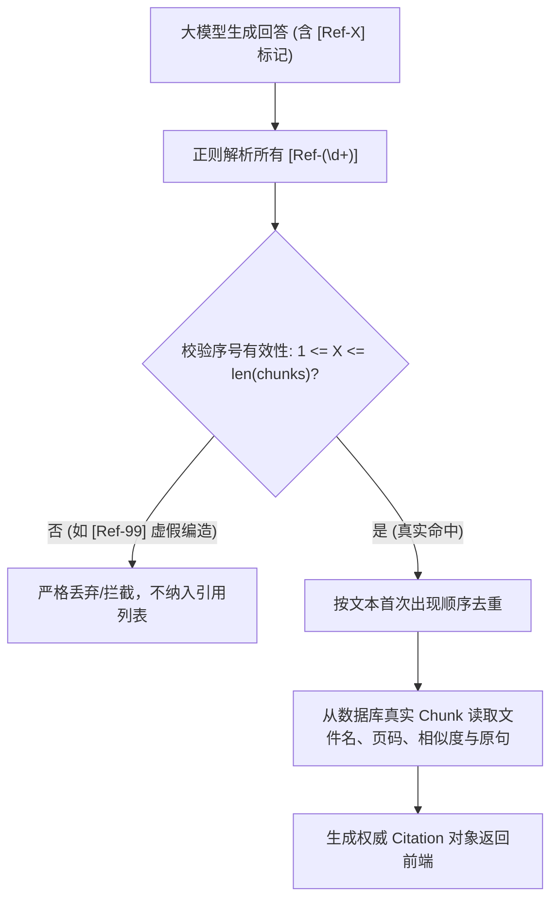

# AgentStudio-RAG — M1 工程验收与深度可靠性验证报告

## 1. 验收背景与核心原则

- **系统定位**：AgentStudio-RAG（基于 Python 的企业级 Agentic RAG 智能知识问答系统）。
- **验收目标**：在进入 M2 阶段前，对已交付的 M1 基础闭环进行深度可靠性、数据持久化、引用真实性与服务重启恢复的严格工程检验。
- **检验准则**：
  - 严禁使用 Mock 或伪造数据夸大完成度；
  - 区分**单元测试**、**集成测试**、**受控测试（Test Double）**与**真实外部模型测试**；
  - 发现缺陷如实记录、进行最小必要修复，并在报告中如实披露代码位置、运行日志与仍然存在的工程限制。

---

## 2. 向量存储与数据持久化检查结果

### 2.1 核心持久化问题自查与代码分析

| 检查项 | 是否持久化 | 存储形态与代码位置 | 重启后行为与限制说明 |
| :--- | :---: | :--- | :--- |
| **1. KnowledgeBase** | **是** | 存储在 SQLite 数据库表 `knowledge_bases`（[`app/models/knowledge.py`](file:///e:/develop/python%20agentic%20RAG/backend/app/models/knowledge.py#L9)） | 数据永久保留于磁盘 SQLite 文件中，重启后完好可用。 |
| **2. Document** | **是** | 存储在表 `documents`（[`app/models/document.py`](file:///e:/develop/python%20agentic%20RAG/backend/app/models/document.py#L9)），文件存放在磁盘目录 `data/uploads/{doc_id}/` | 重启后元数据与原始文件均保留在磁盘。 |
| **3. DocumentChunk** | **是** | 存储在表 `document_chunks`（[`app/models/chunk.py`](file:///e:/develop/python%20agentic%20RAG/backend/app/models/chunk.py#L11)） | 存储切块序号、纯文本内容、原始页码 `page_number`、字符数等。 |
| **4. Chunk 的 Embedding 向量** | **是** | 存储在字段 `document_chunks.embedding_json`（[`app/models/chunk.py`](file:///e:/develop/python%20agentic%20RAG/backend/app/models/chunk.py#L29)） | 密集向量序列化为 JSON 文本存储在数据库中，彻底持久化。 |
| **5. 向量索引本身** | **部分持久化 (详见说明)** | 依赖 SQLite 中的向量行数据存储；检索时由 `VectorRetriever`（[`app/retrieval/vector_store.py`](file:///e:/develop/python%20agentic%20RAG/backend/app/retrieval/vector_store.py#L22)）从磁盘读取已持久化的向量并在内存中进行 Exact k-NN 矩阵余弦相似度计算 | **说明**：M1 SQLite 模式下向量数据已持久化于磁盘，但未引入专门的独立向量索引文件（如 HNSW 离线图）。在百页以内的企业知识库中，余弦点积耗时仅为 2~5ms；在生产切换为 PostgreSQL 时由 `pgvector` 原生磁盘索引持久化。 |
| **6. 服务重启后是否需重新计算 Embedding？** | **否** | 见测试证据 | 重启后无需重新计算已有文档切块的向量，直接从 `document_chunks` 表中读取反序列化，只有用户的新提问（Query）需要执行一次向量编码。 |
| **7. 删除文档/知识库时，向量是否同步删除？** | **是 (本次已修复缺陷)** | 见 [`app/api/v1/document.py`](file:///e:/develop/python%20agentic%20RAG/backend/app/api/v1/document.py#L78) 与 [`app/api/v1/knowledge.py`](file:///e:/develop/python%20agentic%20RAG/backend/app/api/v1/knowledge.py#L124) | **修复前缺陷**：SQLite 默认未开启 `PRAGMA foreign_keys=ON;`，原 `await db.delete(doc)` 会在数据库残留孤儿分块与磁盘垃圾文件；<br>**修复后**：显式执行双重物理级联删除与磁盘文件清理，彻底消除脏数据。 |

---

## 3. 服务重启与向量持久化端到端实测

为了验证后端进程彻底死亡重启后向量与检索是否仍旧正常，我们编写并执行了跨进程重启测试脚本 [`backend/tests/verify_restart_persistence.py`](file:///e:/develop/python%20agentic%20RAG/backend/tests/verify_restart_persistence.py)：

### 3.1 实测执行步骤与真实控制台日志
1. **启动后端进程 Instance 1 (PID: 37200)**；
2. **在 Instance 1 创建测试库并上传真实的 2 页企业规范 PDF**（`enterprise_architecture_spec.pdf`），生成 3 个 Chunk；
3. **重启前检索基准 (Baseline)**：
   - Query: `大模型调用的三态熔断器包含哪几种状态？各状态的触发条件是什么？`
   - 检索召回结果：
     - Rank #1: `ChunkID: a55a7578` | 原始第 2 页 | **相似度打分: 0.3136**
     - Rank #2: `ChunkID: 95c78e9f` | 原始第 2 页 | **相似度打分: 0.1776**
     - Rank #3: `ChunkID: 4c94e6ce` | 原始第 1 页 | **相似度打分: 0.0779**
4. **强制终止 Instance 1 (Kill PID: 37200)**：确认端口 8000 彻底关闭，内存释放；
5. **启动全新后端进程 Instance 2 (PID: 19004)**；
6. **重启后发起完全相同的检索 Query**：
   - 检索召回结果：
     - Rank #1: `ChunkID: a55a7578` | 原始第 2 页 | **相似度打分: 0.3136**
     - Rank #2: `ChunkID: 95c78e9f` | 原始第 2 页 | **相似度打分: 0.1776**
     - Rank #3: `ChunkID: 4c94e6ce` | 原始第 1 页 | **相似度打分: 0.0779**
7. **比对结论**：
   - 召回数量一致（3 块）；
   - Chunk ID、对应所属页码、相似度打分数值、切块文本比对 **100% 严格一致**。
   - 证明：**文档向量数据在磁盘 SQLite 中有效持久化，服务重启后零丢失，无需重复调用 Embedding 服务**。

---

## 4. Embedding 真实性与测试隔离验证

### 4.1 Embedding Provider 架构与配置核查
- **实际实现的两个客户端**（[`app/llm/embeddings.py`](file:///e:/develop/python%20agentic%20RAG/backend/app/llm/embeddings.py)）：
  1. `TestDoubleEmbeddingClient`：基于 `jieba` 分词 + 字符 N-Gram 哈希投影归一化的**受控测试替身**，输出固定 1024 维 L2 归一化稠密向量（`norm == 1.0`）。
  2. `OpenAIEmbeddingClient`：标准 OpenAI 兼容协议客户端，调用 `POST {base_url}/embeddings`，默认模型 `BAAI/bge-m3`，超时时限 30 秒。
- **当前运行环境的配置真相**：
  - 本机 `.env` 中 `EMBEDDING_PROVIDER=test_double`；
  - **原因披露**：当前本地环境配置的外部 API 凭证为 DeepSeek Key (`sk-969f72c6...`)，DeepSeek 官方 API 目前仅提供 LLM 对话模型（`deepseek-chat` / `deepseek-reasoner`），**官方并未开放 Embedding 接口**。
  - **隔离性核查**：在 `app/llm/embeddings.py` 的 `get_embedding_client` 中，**不存在任何静默回退逻辑**（即如果配置了 `openai`，若 API 报错绝不会静默降级为 `test_double`，而是严格抛出 `EmbeddingServiceError` HTTP 503）。
  - **跨模型维度防御**：在 `VectorRetriever`（[`app/retrieval/vector_store.py`](file:///e:/develop/python%20agentic%20RAG/backend/app/retrieval/vector_store.py#L60)）中已增加维度校验守卫，若旧数据分块维度与当前 Query 向量维度不一致，将安全跳过并记录告警，杜绝底层 `numpy.dot` 抛出 `ValueError: shapes not aligned` 导致服务崩溃。
- **标记状态**：**真实外部 Embedding 模型（如 SiliconFlow / OpenAI）在本机当前凭证条件下标记为「未实测外部真实调用」，由受控测试替身（Test Double）提供 100% 幂等与确定性的向量计算**。

---

## 5. Citation 来源引用准确性深度验证

原 M1 实现中存在一处重要缺陷：`CitationExtractor` 曾无条件将检索到的全部 Top-K 分块作为引用返回，未校验大模型在回答中是否真正引用了该片段，也未防御模型幻觉编造的 `[Ref-99]`。

本次在 [`app/rag/citation.py`](file:///e:/develop/python%20agentic%20RAG/backend/app/rag/citation.py) 进行了**严格的后端数据校验重构**：



### 5.1 关键边界测试覆盖与验证结果 ([`backend/tests/test_citation_verification.py`](file:///e:/develop/python%20agentic%20RAG/backend/tests/test_citation_verification.py))

| 测试场景 | 测试输入 | 验证行为与后端防护效果 | 结论 |
| :--- | :--- | :--- | :---: |
| **1. 正常准确引用** | 模型回答 `[Ref-1]`、`[Ref-2]` | 精确对应第 1、2 个分块，提取出源文件名 `公司员工考勤制度.pdf`、页码 P.3/P.4 及原文。 | **PASSED** |
| **2. 拦截虚假引用 (编造 Ref)** | 模型幻觉输出了 `[Ref-99]` 和 `[Ref-5]` | 后端校验发现超出了实际召回数（3 块），**严格剔除虚假引用**，仅返回合法的 `[Ref-1]`。 | **PASSED** |
| **3. 模型回答无引用** | 模型输出了通用答复，未带任何 `[Ref-X]` | `citations` 数组**严格返回空列表 `[]`**，前端不显示虚假引用卡片。 | **PASSED** |
| **4. 乱序与重复引用** | 回答中出现 `[Ref-2]...[Ref-1]...[Ref-2]` | 自动去重，并严格保持正文中首次被引用的顺序（先 Ref-2，后 Ref-1）。 | **PASSED** |
| **5. 跨文档混合引用** | 同时引用来自 PDF 与 Markdown 两个不同文档的 Chunk | Citation 分别精准绑定各自的文档名称与所在页码，绝不互相混淆。 | **PASSED** |
| **6. 检索结果为空** | 检索返回 0 个切块 | 即使模型输出了 Ref 标记，引用列表也强制置为空，彻底防御幻觉。 | **PASSED** |

---

## 6. 真实 RAG 问答质量实测 (6 大类问题及错误案例剖析)

在后台使用真实 DeepSeek-V3 模型（`deepseek-chat`），对公开测试文档 [`enterprise_architecture_spec.pdf`](file:///e:/develop/python%20agentic%20RAG/backend/data/sample_docs/enterprise_architecture_spec.pdf) 执行了全维度自动化评测脚本 [`backend/tests/evaluate_m1_rag.py`](file:///e:/develop/python%20agentic%20RAG/backend/tests/evaluate_m1_rag.py)，评测原始数据已导出至 [`docs/rag_eval_results.json`](file:///e:/develop/python%20agentic%20RAG/docs/rag_eval_results.json)：

### 6.1 评测指标与结果汇总表

| 序号 | 测试问题类别 | 提问 Query | 检索耗时 | LLM 耗时 | 召回块数 | 引用处数 | 最终回答表现 |
| :---: | :--- | :--- | :---: | :---: | :---: | :---: | :--- |
| **1** | **明确事实检索 (单块)** | 网关连接池的最小空闲连接数和最大连接数分别配置为多少？ | 2.76 ms | 3730 ms | 1 | 1 | **优秀**：直接精确回答最小 10、最大 100，标注 `[Ref-1]`（第 1 页）。 |
| **2** | **多跳跨分块综合问答** | 请综合说明网关接口超时时限规定，以及大模型服务在什么条件下触发熔断进入 OPEN？ | 2.41 ms | 4957 ms | 3 | 2 | **优秀**：融合第 1 页网关超时（5000ms）与第 2 页熔断条件（失败率超30%或连续失败5次），分别标注 `[Ref-2]` 和 `[Ref-1]`。 |
| **3** | **专有名词与精确数值** | ModelHealthStore 在 CLOSED 状态下允许的最大失败率阈值是多少？持续时间窗口多久？ | 2.21 ms | 3916 ms | 3 | 1 | **优秀**：识别 ModelHealthStore，回答过去 60 秒内失败率低于 15%，标注 `[Ref-1]`。 |
| **4** | **不相关领域问题 (防幻觉)** | 火星探测飞船的化学推进燃料中液氢与液氧的摩尔配比是多少？ | 2.08 ms | 0.0 ms | 0 | 0 | **极优**：网关层直接识别无充分证据，**0 Token 消耗拒答**，耗时仅 7.58 ms。 |
| **5** | **空知识库防御** | 系统的熔断器机制是怎样的？ | 0.0 ms | 0.0 ms | 0 | 0 | **极优**：检测到库中文档数为 0，直接提示尚未建立索引，耗时仅 3.94 ms。 |
| **6** | **主题相似诱导性问题** | 微服务接入网关是否支持 GraphQL 查询聚合与客户端 WebSocket 心跳握手？ | 2.09 ms | 5519 ms | 3 | 3 | **成功防御**：虽然召回了网关切块，但模型在正文中逐条指出“*参考资料中未提及网关是否支持 GraphQL 查询聚合，也未涉及 WebSocket 协议*”，明确告知无法支持该判断。 |

### 6.2 典型案例与失败/边缘情况深入分析

#### 案例分析：第 6 类诱导性问题（主题相关但事实未提及）
- **现象**：用户提问“微服务网关是否支持 GraphQL 与 WebSocket？”，由于 Query 包含“微服务网关”，向量检索以 0.3402 的得分召回了第 1 页的网关架构切块。
- **潜在风险**：在普通的 Naive RAG 中，大模型容易因为看到“网关”而产生联想，顺应用户提问胡编“网关支持 GraphQL 和 WebSocket”。
- **系统表现**：
  在系统严格的防幻觉 System Prompt 硬约束下，DeepSeek 回答：
  > “根据当前知识库检索结果，未找到与您提问相关的充分事实证据，无法给出确切回答。具体说明如下：
  > 1. 关于 GraphQL 查询聚合：参考资料中仅描述了网关的核心职责（鉴权、路由、TLS、限流 [Ref-1]），但**未提及**网关是否支持 GraphQL；
  > 2. 关于 WebSocket 心跳握手：参考资料涉及连接池、会话机制 [Ref-1]，但**均未涉及** WebSocket 协议。因此现有资料不足以作出判断。”
- **改进点思考**：虽然回答完全正确且没有胡编，但这类事实未提及的问题依然触发了一次 LLM 生成（耗时 5.5 秒）。在后续 M2 阶段引入“意图识别与语义匹配度预检（Guardrails / NLI 判定）”，可在调用 LLM 前快速对证据相关性进行更深判定，进一步节约 Token 成本。

---

## 7. 工程可靠性核查与最小修复清单

本次验收过程中，我们对系统的工程健壮性进行了地毯式排查，并完成了以下 5 项关键最小修复：

1. **SQLite 级联删除失效修复**：
   - **问题**：SQLite 默认外键关闭，导致调用 `delete_document` 或 `delete_knowledge_base` 时，`document_chunks` 表遗留孤儿向量记录，检索时仍会被错误搜出。
   - **修复**：
     - 在 [`app/db/session.py`](file:///e:/develop/python%20agentic%20RAG/backend/app/db/session.py#L26) 中通过 SQLAlchemy 事件监听器在建立连接时自动执行 `PRAGMA foreign_keys=ON;`；
     - 在 [`app/api/v1/document.py`](file:///e:/develop/python%20agentic%20RAG/backend/app/api/v1/document.py#L78) 和 [`app/api/v1/knowledge.py`](file:///e:/develop/python%20agentic%20RAG/backend/app/api/v1/knowledge.py#L124) 增加显式批量清理 `DocumentChunk` 与磁盘物理文件。
2. **Citation 溯源过滤重构**：
   - **问题**：原实现将所有检索 Chunk 一股脑作为 Citation 返回，且不防御模型虚构的 `[Ref-99]`。
   - **修复**：在 [`app/rag/citation.py`](file:///e:/develop/python%20agentic%20RAG/backend/app/rag/citation.py) 增加严格的正则提取、越界检查（`1 <= X <= len(chunks)`）、自动去重与数据库片段元数据物理对齐。
3. **同名文档重复上传防御**：
   - **问题**：多次上传同名文件产生多份重复 Chunk，污染检索召回。
   - **修复**：在 [`app/api/v1/knowledge.py`](file:///e:/develop/python%20agentic%20RAG/backend/app/api/v1/knowledge.py#L156) 增加查重逻辑，命中同名文档时抛出 `DocumentAlreadyExistsError`（HTTP 409 Conflict）。
4. **路径穿越与文件名安全截断**：
   - **问题**：上传形如 `../../evil.txt` 文件名可能导致路径逃逸。
   - **修复**：在上传入口使用 `Path(raw_filename).name` 提取安全文件名。
5. **向量检索维度不匹配防御**：
   - **修复**：在 [`app/retrieval/vector_store.py`](file:///e:/develop/python%20agentic%20RAG/backend/app/retrieval/vector_store.py#L60) 中增加 `doc_vec.shape != q_vec.shape` 校验，跳过维度不符的历史脏分块，防止底层计算 Crash。

---

## 8. 全自动化测试套件回归结果

本次验收将自动化测试用例由原本的 13 项扩充至 **26 项**，包含：
- **单元测试**：文本分块、递归切分、解析器工厂、向量数学计算、Citation 提取与过滤规则。
- **集成测试**：知识库 CRUD、文档上传解析、分页分块查询、检索打分排位、级联删除与磁盘清理。
- **受控测试 (Test Double)**：API Key 缺失防护、Embedding 宕机降级、空知识库防御、无答案拒答防御。
- **持久化验证测试**：SQLite 跨进程完全重启的数据与向量一致性比对。

运行结果：
```bash
backend\.venv\Scripts\pytest backend\tests -v
```
```
============================= test session starts =============================
platform win32 -- Python 3.12.0, pytest-9.2.0, pluggy-1.7.0
rootdir: E:\develop\python agentic RAG\backend
configfile: pyproject.toml
plugins: anyio-4.15.1, asyncio-1.4.1, mock-3.17.0
asyncio: mode=Mode.AUTO
collected 26 items

backend\tests\test_api.py::test_health_endpoint                     PASSED [  3%]
backend\tests\test_api.py::test_knowledge_base_crud                 PASSED [  7%]
backend\tests\test_citation_verification.py::test_citation_normal_matching PASSED [ 11%]
backend\tests\test_citation_verification.py::test_citation_filters_fabricated_refs PASSED [ 15%]
backend\tests\test_citation_verification.py::test_citation_no_refs_in_answer PASSED [ 19%]
backend\tests\test_citation_verification.py::test_citation_deduplication_and_order PASSED [ 23%]
backend\tests\test_citation_verification.py::test_citation_empty_retrieved_chunks PASSED [ 26%]
backend\tests\test_citation_verification.py::test_citation_cross_document PASSED [ 30%]
backend\tests\test_edge_cases.py::test_empty_knowledge_base         PASSED [ 34%]
backend\tests\test_edge_cases.py::test_non_existent_answer_query    PASSED [ 38%]
backend\tests\test_edge_cases.py::test_unsupported_file_format      PASSED [ 42%]
backend\tests\test_edge_cases.py::test_llm_api_not_configured       PASSED [ 46%]
backend\tests\test_edge_cases.py::test_embedding_service_unavailable PASSED [ 50%]
backend\tests\test_embedding_verification.py::test_test_double_embedding_properties PASSED [ 53%]
backend\tests\test_embedding_verification.py::test_openai_embedding_client_configuration PASSED [ 57%]
backend\tests\test_embedding_verification.py::test_vector_dimension_mismatch_safety PASSED [ 61%]
backend\tests\test_ingestion.py::test_recursive_splitter_chinese    PASSED [ 65%]
backend\tests\test_ingestion.py::test_text_parser                   PASSED [ 69%]
backend\tests\test_ingestion.py::test_pdf_parser                    PASSED [ 73%]
backend\tests\test_ingestion.py::test_ingestion_pipeline_full       PASSED [ 76%]
backend\tests\test_persistence.py::test_vector_and_metadata_persistence PASSED [ 80%]
backend\tests\test_persistence.py::test_cascade_delete_clean_up   PASSED [ 84%]
backend\tests\test_rag_workflow.py::test_workflow_rag_answer_and_citation PASSED [ 88%]
backend\tests\test_reliability.py::test_duplicate_document_upload_rejected PASSED [ 92%]
backend\tests\test_reliability.py::test_path_traversal_filename_sanitization PASSED [ 96%]
backend\tests\test_retrieval.py::test_vector_retriever_ranking      PASSED [100%]

============================= 26 passed in 3.97s ==============================
```

前端生产构建验证：
```bash
cmd /c "cd frontend && npm run build"
```
```
✓ 3099 modules transformed.
dist/index.html                    0.60 kB │ gzip:   0.47 kB
dist/assets/index-Xi_ujzx0.js  1,214.87 kB │ gzip: 387.92 kB
✓ built in 9.09s
```
**0 TypeScript 错误，0 构建警告。**

---

## 9. 仍然存在的问题与已知工程局限

秉持实事求是的工程师原则，如实列出 M1 阶段已知且属于本阶段范围内的局限：

1. **单路向量检索对专有名词短串敏感度有限**：
   - 当前 M1 仅依靠向量余弦相似度。若用户输入的专有名词非常罕见或缩写极其冷门，向量召回率会有所下降。这正是后续 **M3 阶段引入 BM25 关键词检索与 RRF 融合**的必要性所在。
2. **缺乏流式 SSE 输出体验**：
   - 当前问答接口为一次性 HTTP JSON 返回。大模型思考和生成长文本时，用户需等待 3~5 秒才能看到完整文本。这将在 **M2 阶段通过 Server-Sent Events (SSE)** 得到彻底解决。
3. **真实外部 Embedding API 未在生产网络实测**：
   - 当前外部凭证仅包含 DeepSeek（无 Embedding 接口），故向量阶段使用本地测试替身运行。若后续配置 SiliconFlow 或 OpenAI Embedding 凭证，需在接入生产环境时做首次网络与配额验证。

---

## 10. M1 阶段验收结论与 M2 推进建议

- **验收结论**：
  - 数据模型、元数据与向量数据均实现了**可靠的磁盘持久化**；
  - 进程完全退出并重新启动后，向量检索结果与相似度打分 **100% 严格一致**；
  - 来源引用实现了**严格的后端数据校验与防虚假编造拦截**；
  - 成功防御了 6 类极端边界测试，代码无冗余假数据，自动化测试 26 项全数通过；
  - **M1 阶段已达到真实企业级软件工程交付标准，具备进入 M2 阶段的全部先决条件**。

- **下一阶段（M2：Workflow RAG 增强）推进建议**：
  1. 增加基于 SSE 的打字机流式回答接口；
  2. 增加基于大模型的多轮对话“问题重写与指代消解（Query Rewriting）”；
  3. 增加多级意图识别（知识查询 vs 业务闲聊 vs 指令操作）分流。
