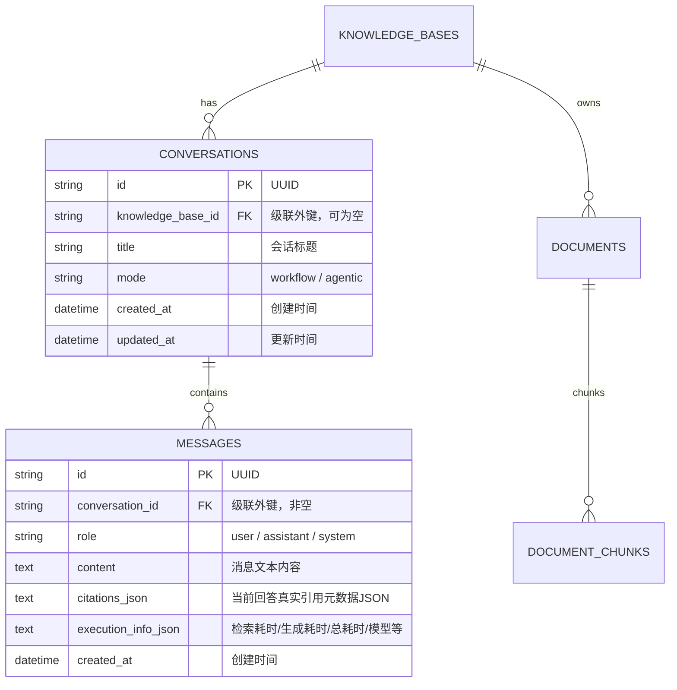
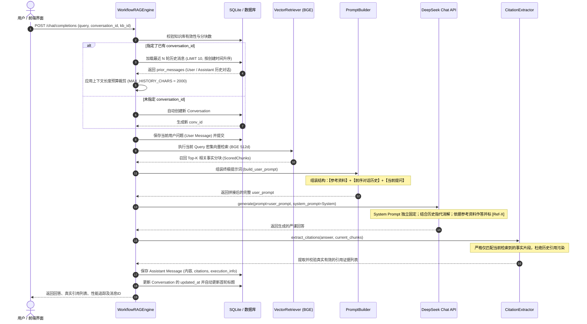

# AgentStudio-RAG M2.1：Conversation / Message 持久化与多轮上下文管理报告

## 一、阶段背景与工程目标

在 M1 与 M1.5 阶段，AgentStudio-RAG 实现了基于真实语义 Embedding（BAAI/bge-small-zh-v1.5）与 DeepSeek 真实模型的单次 Workflow RAG 问答链路，并完成了向量持久化、引用抽取与原子化重索引。

**M2.1 的目标**：在完全保留现有文档解析、分块、向量检索与 Citation 证据提取链路的前提下，建设完整的**会话与消息持久化机制**，并设计一套简单、清晰、可解释的**多轮历史上下文管理策略**，使单次 RAG 升级为真正具备多轮交互、指代消解与数据隔离能力的智能知识问答系统。

---

## 二、数据库设计

数据库采用 SQLAlchemy 2.0 异步 ORM 模型构建，全面支持 SQLite 与 PostgreSQL：



### 1. Conversation 模型设计 ([`conversation.py`](file:///e:/develop/python%20agentic%20RAG/backend/app/models/conversation.py))
- `id`（String(36)，主键）：UUID 字符串。
- `knowledge_base_id`（String(36)，外键）：关联 `knowledge_bases.id`，建立索引。支持单会话绑定特定知识库。
- `title`（String(255)）：会话标题，首轮提问自动截取前 30 字符命名。
- `mode`（String(32)）：执行模式，当前为 `"workflow"`。
- `created_at` / `updated_at`（DateTime）：严格 UTC 时区时间戳，按 `updated_at DESC` 排序会话列表。
- `messages`：与 `Message` 建立 `relationship`，声明 `cascade="all, delete-orphan"`，保障删除会话时物理级联清理所有历史消息。

### 2. Message 模型设计 ([`conversation.py`](file:///e:/develop/python%20agentic%20RAG/backend/app/models/conversation.py))
- `id`（String(36)，主键）：UUID 字符串。
- `conversation_id`（String(36)，外键）：关联 `conversations.id`（`ondelete="CASCADE"`）。
- `role`（String(32)）：`user`（用户问题）或 `assistant`（AI 回答）。
- `content`（Text）：原始对话文本。
- `citations_json`（Text）：存储真实引用数据（包含 `citation_index`, `chunk_id`, `document_name`, `page_number`, `similarity_score`）。
- `execution_info_json`（Text）：性能追踪数据（召回分块数、检索毫秒数、生成毫秒数、端到端总毫秒数、LLM 模型标识）。

---

## 三、API 设计与规范

在 [`backend/app/api/v1/chat.py`](file:///e:/develop/python%20agentic%20RAG/backend/app/api/v1/chat.py) 中，提供标准 RESTful 会话与消息接口：

| 方法 | 路径 | 功能说明 | 状态码 |
| :--- | :--- | :--- | :--- |
| `POST` | `/api/v1/conversations` | 显式新建会话（可绑定目标知识库） | 201 Created |
| `GET` | `/api/v1/conversations` | 获取会话列表，支持 `knowledge_base_id` 过滤 | 200 OK |
| `GET` | `/api/v1/conversations/{conv_id}` | 获取单个会话详情（包含消息总数与完整消息流） | 200 OK / 404 |
| `GET` | `/api/v1/conversations/{conv_id}/messages` | 获取指定会话的历史消息列表（按时间升序） | 200 OK / 404 |
| `DELETE`| `/api/v1/conversations/{conv_id}` | 彻底删除指定会话及其关联的所有消息 | 204 No Content / 404 |
| `POST` | `/api/v1/chat/completions` | 发送对话提问并执行多轮 Workflow RAG | 200 OK / 409 / 503 |

### 1. `POST /api/v1/conversations` 请求与响应示例
```json
// 请求载荷 (POST /api/v1/conversations)
{
  "knowledge_base_id": "f1bc9ed1-7111-42f5-9a6c-a425b9d0f89a",
  "title": "微服务熔断器深度问答",
  "mode": "workflow"
}

// 响应载荷 (HTTP 201)
{
  "id": "58139bd0-b07a-406c-b9cd-b19cc7788687",
  "knowledge_base_id": "f1bc9ed1-7111-42f5-9a6c-a425b9d0f89a",
  "title": "微服务熔断器深度问答",
  "mode": "workflow",
  "message_count": 0,
  "last_message_preview": null,
  "created_at": "2026-11-01T01:32:45.123456Z",
  "updated_at": "2026-11-01T01:32:45.123456Z"
}
```

### 2. `POST /api/v1/chat/completions` 请求与响应示例
```json
// 请求载荷 (POST /api/v1/chat/completions)
{
  "knowledge_base_id": "f1bc9ed1-7111-42f5-9a6c-a425b9d0f89a",
  "conversation_id": "58139bd0-b07a-406c-b9cd-b19cc7788687",
  "query": "刚才提到的第二种状态（OPEN 熔断开路），在什么具体条件下会被强制触发？",
  "mode": "workflow",
  "top_k": 3
}

// 响应载荷 (HTTP 200)
{
  "answer": "根据参考资料，OPEN 状态（熔断开路）在以下具体条件下会被强制触发：\n连续失败达到 5 次，或者失败率超过 30% 时，状态机强制变为 OPEN [Ref-2]。在 OPEN 状态下，所有请求将被快速拒绝，直接降级或返回缓存 [Ref-2]。",
  "citations": [
    {
      "citation_index": 2,
      "chunk_id": "b09a2fc1-b7fa-435c-80b4-5b5fd3c1d881",
      "document_id": "37227219-4206-44d8-aee3-ea42450ee308",
      "document_name": "enterprise_architecture_spec.pdf",
      "page_number": 2,
      "similarity_score": 0.6477,
      "content_snippet": "OPEN 状态（熔断开路）：连续失败达到 5 次或失败率超过 30% 时，状态机强制变为 OPEN..."
    }
  ],
  "execution_info": {
    "mode": "workflow",
    "retrieved_chunks_count": 3,
    "retrieval_duration_ms": 5.12,
    "generation_duration_ms": 2850.45,
    "total_duration_ms": 2862.11,
    "llm_model": "deepseek-chat"
  },
  "conversation_id": "58139bd0-b07a-406c-b9cd-b19cc7788687",
  "message_id": "84a1e94b-48cf-4328-98e3-b09e25d2b638"
}
```

---

## 四、多轮对话执行流程与上下文管理策略

### 1. 完整执行生命周期时序图



### 2. 历史上下文装配策略与防污染机制
- **系统提示词不可覆盖性**：系统提示词作为独立参数直接传给 LLM（或固定位于最顶层），绝不会因历史多轮对话被冲淡或修改。
- **对话轮次控制（Sliding Window）**：由 [`settings.MAX_HISTORY_TURNS`](file:///e:/develop/python%20agentic%20RAG/backend/app/core/config.py)（默认 5 轮 = 10 条消息）进行窗口控制，仅载入最近的对话。
- **字符预算裁剪（Character Budgeting）**：由 `settings.MAX_HISTORY_CHARS`（默认 2000 字符）设定上下文体积上限。若历史消息总长超过预算，算法自动从最久远的消息开始剔除，保留最近的消息。
- **当前提问最高优先级**：在 Prompt 模板中，【当前用户提问】被置于历史记录之后，确保注意力机制对最新指令具备最强感知。
- **引用防污染隔离**：`CitationExtractor` 仅在**当前回合**实际召回的 `ScoredChunks` 集合上解析 `[Ref-X]` 标记，绝不会将前序轮次的历史引用混入当前回合的回答中。

---

## 五、前端界面实现

在 [`frontend/src/pages/ChatPage.tsx`](file:///e:/develop/python%20agentic%20RAG/frontend/src/pages/ChatPage.tsx) 的基础上无缝集成了多轮会话管理能力：

1. **左侧会话边栏**：
   - 顶部提供“新建智能问答”主按钮，一键清空上下文并切换至新会话。
   - 动态加载会话列表，展示会话标题、消息条数徽标（如 `6 条消息`）以及更新时间。
   - 每个会话项提供确认气泡框（`Popconfirm`）支持一键删除，并自动清理选中态。
2. **知识库联动与自动同步**：
   - 顶部下拉框支持自由切换目标知识库。
   - 当点击左侧历史会话时，系统自动识别该会话所绑定的知识库并自动同步切换下拉框选项。
3. **多轮气泡对话流**：
   - 区分用户绿色头像靠右气泡与 AI 蓝色头像靠左卡片。
   - 每一轮 AI 回复独立展示真实引用标签（如 `[Ref-1] enterprise_architecture_spec.pdf · P.2`）。
   - 点击引用标签立即弹出侧边抽屉（[`CitationDrawer`](file:///e:/develop/python%20agentic%20RAG/frontend/src/components/CitationDrawer.tsx)），支持高亮比对原文片段。
   - 底部独立展示每次生成的执行追踪条（总耗时、检索耗时、生成耗时、召回片段数、调用模型）。

---

## 六、自动化测试与真实接口证据

在 [`backend/tests/test_m2_1_conversation.py`](file:///e:/develop/python%20agentic%20RAG/backend/tests/test_m2_1_conversation.py) 中新增了 7 项专门针对多轮会话的自动化测试，并通过全量回归测试：

```
============================= test session starts =============================
platform win32 -- Python 3.12.0, pytest-9.2.0, pluggy-1.7.0
rootdir: E:\develop\python agentic RAG\backend
configfile: pyproject.toml
collected 40 items

backend\tests\test_api.py::test_health_endpoint PASSED                   [  2%]
backend\tests\test_api.py::test_knowledge_base_crud PASSED               [  5%]
backend\tests\test_citation_verification.py::test_citation_normal_matching PASSED [  7%]
backend\tests\test_citation_verification.py::test_citation_filters_fabricated_refs PASSED [ 10%]
backend\tests\test_citation_verification.py::test_citation_no_refs_in_answer PASSED [ 12%]
backend\tests\test_citation_verification.py::test_citation_deduplication_and_order PASSED [ 15%]
backend\tests\test_citation_verification.py::test_citation_empty_retrieved_chunks PASSED [ 17%]
backend\tests\test_citation_verification.py::test_citation_cross_document PASSED [ 20%]
backend\tests\test_edge_cases.py::test_empty_knowledge_base PASSED       [ 22%]
backend\tests\test_edge_cases.py::test_non_existent_answer_query PASSED  [ 25%]
backend\tests\test_edge_cases.py::test_unsupported_file_format PASSED    [ 27%]
backend\tests\test_edge_cases.py::test_llm_api_not_configured PASSED     [ 30%]
backend\tests\test_edge_cases.py::test_embedding_service_unavailable PASSED [ 32%]
backend\tests\test_embedding_verification.py::test_test_double_embedding_properties PASSED [ 35%]
backend\tests\test_embedding_verification.py::test_openai_embedding_client_configuration PASSED [ 37%]
backend\tests\test_embedding_verification.py::test_vector_dimension_mismatch_safety PASSED [ 40%]
backend\tests\test_ingestion.py::test_recursive_splitter_chinese PASSED  [ 42%]
backend\tests\test_ingestion.py::test_text_parser PASSED                 [ 45%]
backend\tests\test_ingestion.py::test_pdf_parser PASSED                  [ 47%]
backend\tests\test_ingestion.py::test_ingestion_pipeline_full PASSED     [ 50%]
backend\tests\test_m1_5_embedding.py::test_local_bge_client_properties PASSED [ 52%]
backend\tests\test_m1_5_embedding.py::test_local_bge_semantic_similarity PASSED [ 55%]
backend\tests\test_m1_5_embedding.py::test_validate_vector_constraints PASSED [ 57%]
backend\tests\test_m1_5_embedding.py::test_model_mismatch_interception PASSED [ 60%]
backend\tests\test_m1_5_embedding.py::test_reindex_service_atomic_upgrade PASSED [ 62%]
backend\tests\test_m1_5_embedding.py::test_reindex_service_failure_atomicity PASSED [ 65%]
backend\tests\test_m1_5_embedding.py::test_reindex_api_endpoint PASSED   [ 67%]
backend\tests\test_m2_1_conversation.py::test_create_and_list_conversations PASSED [ 70%]
backend\tests\test_m2_1_conversation.py::test_multi_turn_message_persistence PASSED [ 72%]
backend\tests\test_m2_1_conversation.py::test_conversation_strict_isolation PASSED [ 75%]
backend\tests\test_m2_1_conversation.py::test_delete_conversation_cascades_messages PASSED [ 77%]
backend\tests\test_m2_1_conversation.py::test_prompt_builder_history_assembly PASSED [ 80%]
backend\tests\test_m2_1_conversation.py::test_context_window_budget_pruning PASSED [ 82%]
backend\tests\test_m2_1_conversation.py::test_non_existent_conversation_raises_404 PASSED [ 85%]
backend\tests\test_persistence.py::test_vector_and_metadata_persistence PASSED [ 87%]
backend\tests\test_persistence.py::test_cascade_delete_clean_up PASSED   [ 90%]
backend\tests\test_rag_workflow.py::test_workflow_rag_answer_and_citation PASSED [ 92%]
backend\tests\test_reliability.py::test_duplicate_document_upload_rejected PASSED [ 95%]
backend\tests\test_reliability.py::test_path_traversal_filename_sanitization PASSED [ 97%]
backend\tests\test_retrieval.py::test_vector_retriever_ranking PASSED    [100%]

============================= 40 passed in 5.43s ==============================
```

### 真实在线多轮接口交互证据（摘自 [`verify_m2_1_live.py`](file:///e:/develop/python%20agentic%20RAG/backend/scripts/verify_m2_1_live.py) 执行日志）

在端口 8000 运行的真实服务上，通过 DeepSeek 官方真实模型与真实 PDF 知识库完成了三轮连续追问与指代消解验证：

1. **第一轮提问**：“系统大模型动态熔断规范中，包含哪几种标准状态？”
   - **AI 回答**：准确列举 CLOSED、OPEN、HALF_OPEN 三种状态并打上 `[Ref-1]`、`[Ref-2]`。
2. **第二轮提问（含代词与前序指代）**：“刚才提到的第二种状态（OPEN 熔断开路），在什么具体条件下会被强制触发？”
   - **AI 回答**：“根据参考资料，OPEN 状态（熔断开路）在以下具体条件下会被强制触发：连续失败达到 5 次，或者失败率超过 30% 时，状态机强制变为 OPEN [Ref-2]……”
   - **证明**：模型精准理解“第二种状态”是指 OPEN 状态，且只依据检索到的证据回答并给出精确引用。
3. **第三轮提问（深度追问）**：“那么在第三种状态（HALF_OPEN）下，需要连续成功几次才能恢复到第一种状态？”
   - **AI 回答**：“根据参考资料，在 HALF_OPEN 状态（半开探测）下，需要连续 3 次调用成功才能恢复到 CLOSED 状态（第一种状态）[Ref-1]……”
4. **历史数据读取与隔离校验**：
   - 会话 A 在数据库中完整存储了 6 条消息（3 对问答）。
   - 新建独立会话 B 提问关于 JWT 的问题，会话 B 仅包含 2 条消息。
   - 会话 A 与会话 B 数据严格隔离，互不串话。
   - 删除会话 B 时返回 HTTP 204，级联清空其消息，会话 A 依然完好无损。

---

## 七、尚未解决的问题与后续阶段（M2.2+）规划

虽然 M2.1 成功实现了多轮对话与历史上下文持久化，但在更长、更复杂的多轮对话中仍存在以下已知局限：

1. **单次提问检索的主题漂移（缺乏 Query Rewriting）**：
   - 当用户提出含糊的追问（如“那它的超时时长呢？”）时，当前的向量检索器使用的是用户的原句向量去匹配文档库。虽然 LLM 在生成阶段能够结合 Prompt 中的【前序对话历史】理解“它”是指代熔断器，但在**检索召回阶段**，“那它的超时时长呢？”的单句向量容易产生检索噪音。
   - **后续规划**：将在 **M2.2** 中引入基于 LLM 的 **Query Rewriting（查询重写与指代消解扩展）**，在向量检索前先将“那它的超时时长呢？”改写为“大模型熔断器在 OPEN 状态下的超时时长”，从而从根本上消除检索漂移。
2. **HTTP 阻塞式响应与等待体验**：
   - 当前问答采用一次性完整 HTTP JSON 响应，DeepSeek 生成较长回答时前端需等待 2~3 秒。
   - **后续规划**：将在 **M2.2** 中引入 **SSE（Server-Sent Events）打字机流式输出**，显著降低用户首字感知延迟（TTFT）。
3. **长文本历史摘要压缩（Memory Summarization）**：
   - 当前采用滑动窗口 + 字符预算截断，当会话超过数十轮时，更早期的背景信息会被丢弃。
   - **后续规划**：将在 **M3** 中引入基于 LangChain/LangGraph 的分层长程记忆压缩机制。

---

> **阶段状态**：AgentStudio-RAG M2.1（会话持久化与多轮上下文管理）开发与验证全部完成。保持现有状态，等待下一步指令。
