# AgentStudio-RAG — M2.3 Context-aware Query Rewriting (查询重写) 技术架构与效果评估报告

## 一、概述与核心目标

在企业级多轮智能问答场景中，用户的连续追问往往具有高度的**口语化与上下文依赖性**：
- **省略关键主体**：例如前文讨论了“微服务网关连接池最大连接数”，用户紧接着问：“*那最小是多少？*”
- **代词指代**：例如前文说明了“系统三态熔断器”，用户追问：“*它什么时候进入 OPEN 状态？*”
- **序号与序数指代**：例如前文列举了“CLOSED、OPEN、HALF_OPEN 三种状态”，用户问：“*第二种状态在什么条件下触发？*”
- **长跨度连续追问**：用户追问：“*那和 BGE-M3 有什么区别？*”（省略了前前轮提到的 BGE-small）。

如果直接将这类残缺、含代词的口语化 Query 投入密集向量检索（Dense Vector Retrieval），由于缺乏关键实体词向量锚点，向量检索会严重偏移，导致 Recall 骤降甚至召回无关分块。

**M2.3 核心目标**：
在原有 RAG 架构基础上引入**独立的、上下文感知的 Query Rewriter 模块**。结合会话历史，将不完整、含指代的问题重写为**独立、完整、语义自洽的检索 Query**，同时确保：
1. **重写 Query 仅用于 Embedding 与检索**；
2. **LLM 最终生成 Prompt 严格保留用户原始提问**（绝不篡改用户视角）；
3. **Citation 严格校验重写 Query 实际召回的分块**；
4. **多级异常回退防护**（超时、格式错误、空结果均安全降级原 Query，绝不中断问答）。

---

## 二、原有 RAG 流程与新架构流程对比

```mermaid
flowchart TD
    subgraph M2.2 原有单轮/多轮流式流程
        A1[用户原始问题] --> B1[装配多轮历史上下文]
        B1 --> C1[直接使用原始问题 Embedding]
        C1 --> D1[向量相似度检索]
        D1 --> E1[Prompt Builder]
        E1 --> F1[DeepSeek 流式生成]
        F1 --> G1[Citation 校验 & 落库]
    end

    subgraph M2.3 上下文感知重写架构
        A2[用户原始问题: 那最小是多少？] --> B2[加载最近 N 轮对话历史]
        B2 --> C2{QueryRewriter<br/>上下文重写与消歧}
        C2 -- emit event: query_rewrite --> D2[生成检索Query:<br/>网关连接池规范中最小空闲是多少？]
        C2 -- 异常/独立问题 --> D3[回退使用原始 Query]
        D2 --> E2[BGE-small 真实语义 Embedding]
        D3 --> E2
        E2 --> F2[SQLite 单次向量密集检索]
        F2 -- emit event: retrieval --> G2[召回 Top-K 事实分块]
        G2 --> H2[Prompt Builder<br/>保留用户原始提问 + 历史 + 事实]
        H2 --> I2[DeepSeek 异步流式生成]
        I2 --> J2[CitationExtractor 严格真实性校验]
        J2 --> K2[数据库原子提交<br/>User保存原始Query, Assistant保存完整Trace]
    end
```



### 架构关键原则落地：
1. **检索专用原则**：重写结果只流向 `embedding_client.embed_query(search_query)` 与 `retriever.search`；
2. **用户原貌原则**：数据库中保存的 `User Message` 以及向大模型提交的 `【当前用户提问】` 均严格保持用户的原始提问 `req.query`；
3. **真实证据锚定**：Citation 只绑定该次检索实际命中的分块，杜绝将模型生成的非事实证据带入答案。

---

## 三、QueryRewriter 模块架构与 Prompt 设计

独立模块路径：[`backend/app/rag/query_rewriter.py`](file:///e:/develop/python%20agentic%20RAG/backend/app/rag/query_rewriter.py)

### 1. 类接口与输入输出规范
```python
class QueryRewriteResult(BaseModel):
    original_query: str = Field(..., description="用户原始问题")
    rewritten_query: str = Field(..., description="最终用于检索的问题")
    is_rewritten: bool = Field(default=False, description="是否触发了有效重写")
    duration_ms: float = Field(default=0.0, description="重写执行耗时(ms)")
    tokens_used: Optional[int] = Field(default=None, description="模型调用的Token数量估算")
    fallback: bool = Field(default=False, description="是否触发了异常回退")
    fallback_reason: Optional[str] = Field(default=None, description="回退具体原因")
```

### 2. 精准零样本（Zero-Shot）System Prompt 设计
经过多轮迭代与边界测试，确立的重写专用 System Prompt 如下：
```text
你是一个专业的企业级知识库问答检索查询重写专家（Query Rewriter）。
你的任务是结合【对话历史】，分析用户的【当前问题】。如果当前问题存在省略信息、代词指代（如“它”、“这个”）、或序数词指代（如“第二种状态”），请将其重写为一个独立、完整、语义明确、适合进行密集向量检索的 Query。

【核心重写原则】
1. 省略信息补全：若当前问题缺少关键主体或属性限定词（如“那最小是多少？”），结合上下文补全主语和属性（如“网关连接池的最小空闲连接数是多少？”）。
2. 代词与序号指代消歧：若当前问题含有“它”、“该”、“第一种”、“第二项”等指代，必须替换为前文确定的具体实体或状态名。
3. 独立问题保持原样：若当前问题是与上下文无关的全新独立问题（如用户突然问“Python装饰器是什么？”），绝对不要强行拼接无关历史信息，保持原始问题不变，并将 is_rewritten 设为 false。
4. 意图与事实保真：
   - 绝对不要回答问题！你只是重写检索词，不是回答助手。
   - 绝对不要编造未出现的事实，不要擅自修改数字或特定参数约束。
   - 无法确定指代关系时，优先保留原始问题，不要主观臆测。
5. 纯净 JSON 输出：必须输出且仅输出如下 JSON 对象，严禁包含任何前缀、解释或额外文字：
{
  "is_rewritten": true,
  "rewritten_query": "重写后的独立完整检索问题",
  "reason": "重写简述"
}
若无需重写，输出：
{
  "is_rewritten": false,
  "rewritten_query": "原始问题",
  "reason": "独立问题，无需重写"
}
```

---

## 四、SSE 事件与前端 Trace 面板集成

### 1. 新增 `event: query_rewrite` 标准事件
在 SSE 流式生成链路中，重写完成后在触发检索前即刻发出独立事件：

```http
event: query_rewrite
data: {
  "original_query": "那最小是多少？",
  "rewritten_query": "微服务连接池规范中最小空闲（min_idle）是多少？",
  "is_rewritten": true,
  "duration_ms": 2961.61,
  "tokens_used": 294,
  "fallback": false,
  "fallback_reason": null
}
```

### 2. 前端 Trace 与打字机状态感知
- **检索前反馈**：重写完成后，气泡状态即刻更新为：
  `"问题已重写为: "微服务连接池规范中最小空闲是多少？" (2961ms)，正在检索..."`；若分析为独立问题，则显示：`"分析问题为独立问题 (80ms)，正在检索向量知识库..."`。
- **持久化 Trace 渲染**：问答结束后，消息底部的 Trace 徽标栏展示：
  - `<Tag color="geekblue">Query已重写: 微服务连接池规范中最小空闲（min_idle）是多少？</Tag>`，悬浮气泡展示原始问题、耗时与 Token 消耗；
  - 独立问题则标注 `<Tag>独立问题 (分析 80ms)</Tag>`；
  - 同步展示 `首字响应 (TTFT)`、检索耗时、生成耗时与总端到端延迟。

---

## 五、异常防御与多级回退机制（Fallback Engine）

大模型外部 API 可能存在网络波动、超时或格式偶发变异。Query Rewriter 实现了全面的零故障回退机制：

| 异常类型 | 触发条件 | 处理策略 | 回退标记 |
| :--- | :--- | :--- | :--- |
| **功能停用** | `QUERY_REWRITING_ENABLED=false` | 0ms 直接返回原始 Query | `fallback=False, is_rewritten=False` |
| **无历史会话** | 首轮对话，`history_messages=[]` | 0ms 直接返回原始 Query | `fallback=False, is_rewritten=False` |
| **空问题输入** | 纯空白字符或空串 | 0ms 直接返回原始 Query | `fallback=False, is_rewritten=False` |
| **调用超时** | 超过 `QUERY_REWRITING_TIMEOUT` (10s) | `asyncio.wait_for` 拦截，降级原 Query | `fallback=True, reason="timeout"` |
| **非法格式/非JSON** | 模型返回无法解析的异常文本 | 正则提取 `{}`，若仍失败则降级原 Query | `fallback=True, reason="invalid_json"` |
| **空重写结果** | 模型返回 `rewritten_query=""` | 校验捕获，安全回退原 Query | `fallback=True, reason="empty_rewritten_query"` |
| **服务不可用** | 网络断开、API 鉴权错误、5xx 异常 | `except Exception` 兜底记录日志并安全降级 | `fallback=True, reason=str(exc)` |

**系统绝对不会因 Query Rewriter 的异常而导致整个 RAG 问答流式崩溃**。

---

## 六、检索效果权威评测（Benchmark 深度对比）

我们在真实 BGE-small 密集向量空间与真实 DeepSeek LLM 环境下，构建了包含 8 个标准化知识库分块与 10 个典型上下文场景的基准测试集。

评测脚本：[`backend/scripts/evaluate_m2_3_rewriting.py`](file:///e:/develop/python%20agentic%20RAG/backend/scripts/evaluate_m2_3_rewriting.py)
详细结果已持久化保存至：[`docs/m2_3_rewrite_eval_results.json`](file:///e:/develop/python%20agentic%20RAG/docs/m2_3_rewrite_eval_results.json)

### 1. 10 组典型场景对比测试结果

| 用例ID | 测试分类 | 用户原始问题 | 重写后用于检索的 Query | 原Recall@1 | 新Recall@1 | MRR 变化 |
| :--- | :--- | :--- | :--- | :---: | :---: | :---: |
| **TC-01** | 省略信息 (Ellipsis) | 那最小是多少？ | 网关连接池规范中最小空闲（min_idle）是多少？ | 1 | 1 | 0.00 |
| **TC-02** | 代词指代 (Pronoun) | 它什么时候进入 OPEN 状态？ | 系统三态熔断器在什么条件下进入 OPEN 状态？ | **0** | **1** | **+0.50** |
| **TC-03** | 序号指代 (Ordinal) | 第二种状态在什么条件下触发？ | 系统三态熔断器的 OPEN 状态在什么条件下触发？ | **0** | **1** | **+0.50** |
| **TC-04** | 连续多轮追问 (Multi-turn) | 那和 BGE-M3 有什么区别？ | BGE-small 与 BGE-M3 语义向量模型有什么区别？ | **0** | **1** | **+0.50** |
| **TC-05** | 独立新问题 (Independent) | Python 装饰器的原理与语法糖是什么？ | Python 装饰器的原理与语法糖是什么？(保留原样) | 1 | 1 | 0.00 |
| **TC-06** | 实体省略 (Entity Omission) | 超时阈值统一设定为多少毫秒？ | 微服务网关 API 接口规范中超时阈值设定为多少？ | 1 | 1 | 0.00 |
| **TC-07** | 指代转移 (Coreference Shift) | 它的过期时间是多久？ | JWT Token 的过期时间是多久？ | 1 | 0 | -0.50 |
| **TC-08** | 完备问题无需重写 (Complete) | 详细解释分布式会话在 Redis 集群中的切片模式与高可用方案。 | 详细解释分布式会话在 Redis 集群中的切片模式与高可用方案。(保留原样) | 1 | 1 | 0.00 |
| **TC-09** | 歧义指代测试 (Ambiguity) | 它的最小空闲连接数是多少？ | 微服务网关 HTTP 连接池的最小空闲连接数是多少？ | 1 | 1 | 0.00 |
| **TC-10** | 长跨度追问 (Long Context) | 它的 CLOSED 状态失败率阈值是多少？ | 系统三态熔断器 CLOSED 状态失败率阈值是多少？ | 1 | 1 | 0.00 |

### 2. 核心指标汇总

| 评估指标 | 方案 A：原始 Query 直接检索 | 方案 B：Query Rewriting 检索 | 效果提升（Delta） |
| :--- | :---: | :---: | :---: |
| **Top-1 命中率 (Recall@1)** | 70.0% | **90.0%** | **+20.0% (显著跃升)** |
| **Top-3 命中率 (Recall@3)** | 100.0% | **100.0%** | 维持满分召回 |
| **Top-5 命中率 (Recall@5)** | 100.0% | **100.0%** | 维持满分召回 |
| **平均倒数排名 (MRR)** | 0.8500 | **0.9500** | **+0.1000** |

---

### 3. 错误案例深度剖析（Negative Case Analysis）

遵照工程严谨性原则，必须客观分析为什么在 **TC-07** 中出现了指标下降：
- **场景还原**：
  - 前序历史：讨论系统认证机制，提及“会话由 Redis 集群支持，Token 使用 JWT 签名”；
  - 目标分块内容：`“分布式会话与认证规范：系统会话状态由 Redis 集群支持... 用户会话采用 JWT 无状态签名机制，Token 有效期过期时间为 72 小时...”`；
  - 用户提问：`“它的过期时间是多久？”`
  - 方案 A 检索：“它的过期时间是多久？”在余弦相似度上恰好命中了目标 Chunk 的第一名（Rank 1）；
  - 方案 B 重写：模型将“它”消歧重写为 `“JWT Token 的过期时间是多久？”`。而在知识库中，有另一个分块专门详细列出了 JWT 签发格式。由于重写 Query 中强烈强调了 `“JWT Token”` 关键词，导致目标分块从第 1 名微降到第 2 名（MRR 由 1.0 变为 0.5）。
- **工程启示**：
  过度狭窄的实体补全可能会在稠密向量空间中过度偏向某一特定实体名称，从而稀释全局属性（如“会话/过期时间”）。在后续 M3 引入混合检索（BM25 + 向量）与 Reranker 后，该细微排序扰动将被彻底抚平。

---

## 七、真实环境与大模型在线联调验证

通过 [`backend/scripts/verify_m2_3_live.py`](file:///e:/develop/python%20agentic%20RAG/backend/scripts/verify_m2_3_live.py) 对运行在 `127.0.0.1:8000` 上的 FastAPI 后端进行真实网络联调：

```text
=================================================================
AgentStudio-RAG M2.3 Live Query Rewriting & SSE Verification
=================================================================
Target Knowledge Base: 企业规范知识库 (ID: 833d9ca7-d1b8-4185-b6ed-9ae2e792d2ce)

[Turn 1 Query]: 请介绍一下知识库中微服务网关的连接池配置规范。
Turn 1 completed! Conversation ID: d8b1133c-c27d-4234-84a6-94179019500e
Turn 1 Answer preview: 根据参考资料，微服务网关连接池配置规范如下：
- 最小连接（min_idle）：固定为 10 [Ref-1]...

[Turn 2 Follow-up Query with Omission]: 那最小是多少？
[Connecting to SSE Stream] -> POST /api/v1/chat/completions/stream ...
Connected! Status: 200, Content-Type: text/event-stream; charset=utf-8

[EVENT: query_rewrite]
  - Original Query : 那最小是多少？
  - Rewritten Query: 微服务连接池规范中最小空闲（min_idle）是多少？
  - Is Rewritten   : True
  - Duration       : 2961.61 ms
  - Tokens Used    : 294

[EVENT: retrieval] Retrieved 4 chunks in 6.48ms
[EVENT: token] Incremental tokens: 根据参考资料，连接池的最小空闲（min_idle）为 10 [Ref-1]...

[EVENT: done] Assistant Message ID: f212d2cc-3f7c-4961-84be-f62736ad40ba

Verified query_rewrite event received successfully!
Total messages in Conversation: 4 (Turn 1: user+assistant, Turn 2: user+assistant)
Verified User Message in DB preserves original query: '那最小是多少？'
Verified ExecutionInfo in DB records rewrite metrics:
  - is_rewritten: True
  - original_query: 那最小是多少？
  - rewritten_query: 微服务连接池规范中最小空闲（min_idle）是多少？
  - rewrite_duration_ms: 2961.61ms

=================================================================
M2.3 Live Query Rewriting Verification: ALL CHECKS PASSED!
=================================================================
```

---

## 八、全套自动化测试验收（61/61 全部通过）

在 `backend/tests/` 目录下运行完整测试套件：
```bash
backend\.venv\Scripts\python.exe -m pytest backend/tests -q
```
**运行结果**：
```
.............................................................            [100%]
61 passed in 7.81s
```
涵盖：
1. 健康检查与知识库 CRUD（2项）
2. 引用校验与防编造（6项）
3. 边缘异常防护（5项）
4. Embedding 模型属性与一致性（3项）
5. 分块与解析管线（4项）
6. BGE 语义检索与原子 Reindex（7项）
7. 会话持久化与窗口剪枝（7项）
8. SSE 流式协议与中断回退（7项）
9. **M2.3 查询重写独立测试（14项，涵盖无历史、独立问题、省略、代词、序号、多轮、干扰、超时、非法JSON、空结果、原问题保留、重写向量化、SSE事件与会话恢复）**
10. 数据持久化与级联删除（2项）
11. Workflow 基础闭环（1项）
12. 可靠性与安全路径检查（2项）
13. 向量余弦排序准确性（1项）

---

## 九、尚未解决的问题与后续技术演进（M2.4 / M3）

虽然 M2.3 成功将连续追问的 Recall@1 提升了 20%，但在工程实践中仍存在以下已知局限：
1. **重写耗时开销**：由于每次重写均需调用一次 LLM 非流式生成，增加了约 1~2 秒的前置延迟。后续可探索引入轻量级微调小模型（如 Qwen2.5-1.5B/3B）专职负责查询重写，将耗时压缩至 200ms 以内；
2. **多实体共存时的指代歧义**：当历史中出现两个相似实体（如“网关连接池”与“数据库连接池”）而用户仅问“它的最大连接数是多少”时，单靠零样本 Prompt 可能会产生二选一偏置。需要在后续版本中引入用户澄清机制（Disambiguation Feedback）；
3. **纯稠密向量检索的局限**：在特定专有缩写或生僻词场景下，即使重写完整，纯语义 Embedding 仍可能对字面精确匹配不够敏感。这将在 M3 阶段通过引入 **BM25 稀疏检索 + Reciprocal Rank Fusion (RRF) 混合检索** 彻底补强。

---

## 十、总结

AgentStudio-RAG M2.3 阶段的开发与测试任务已全面高质量交付：
- 新建独立 `QueryRewriter` 模块，逻辑清晰，与 Chat API 完全解耦；
- 遵循“重写仅用于检索、Prompt保留原始提问、Citation严格校验”三项金标准；
- 支持独立的 `query_rewrite` SSE 事件与前端可视化 Trace；
- 经过 61 项自动化测试与真实 DeepSeek 在线实测双重验证；
- 严格止步于 M2.3，未引入任何 M2.4/M3 跨阶段技术栈。
