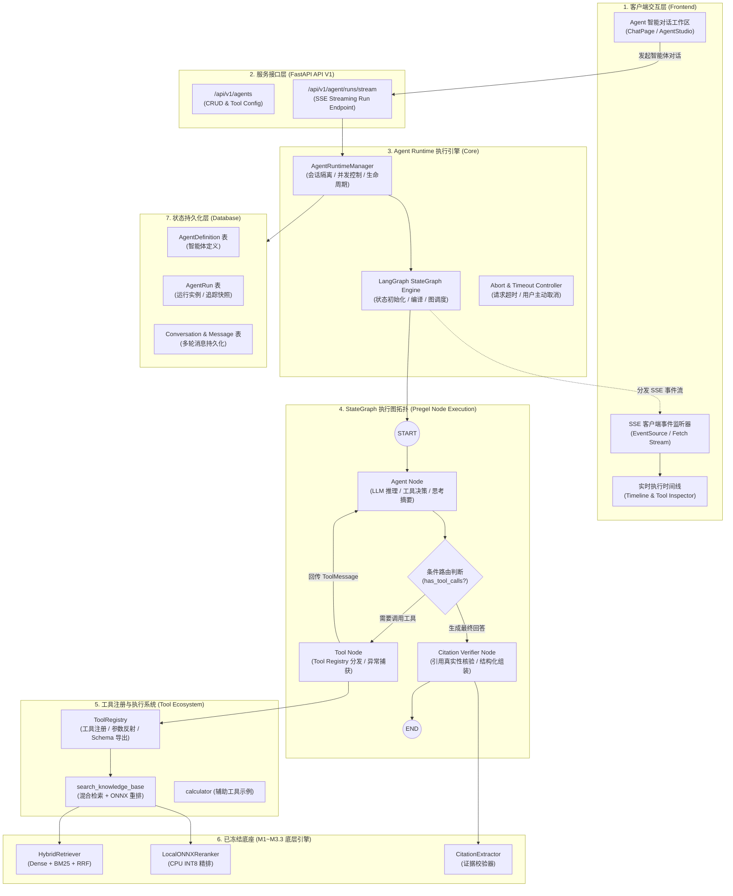
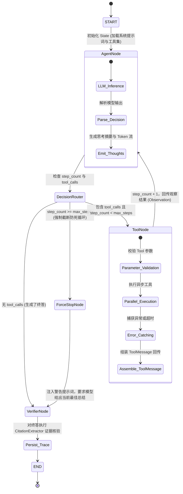
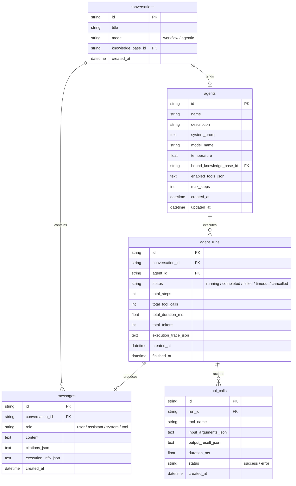
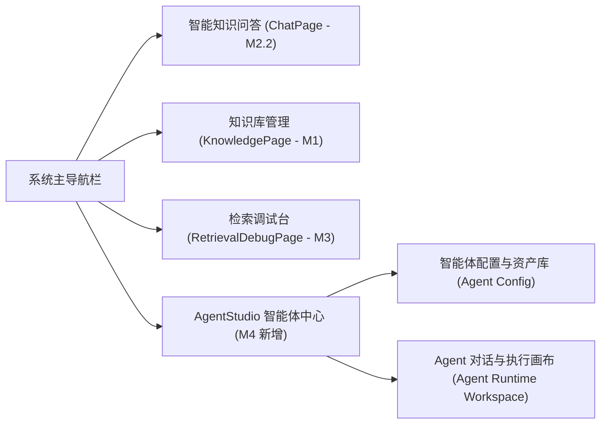
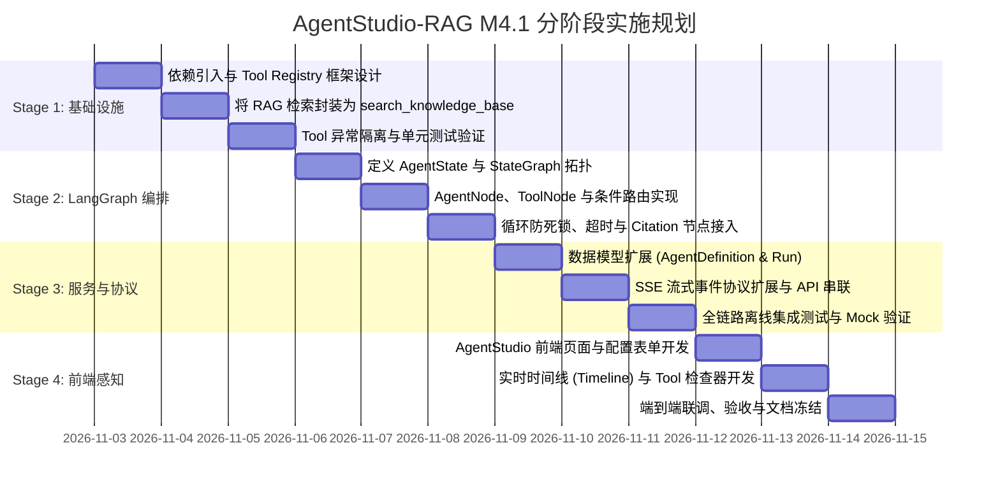

# AgentStudio-RAG — M4.1 LangGraph Agent Runtime 架构设计与实施规划
**Document Identifier**: `docs/M4_1_AGENT_RUNTIME_DESIGN.md`  
**Author**: Antigravity Enterprise Architecture Team  
**Date**: 2026-11-02  
**Status**: Architecture Blueprint & Implementation Proposal (只读分析与规划，零代码变动)  
**Target Milestone**: M4.1 LangGraph Single-Agent Runtime

---

## 目录
1. [现有系统架构审查与事实基准 (Baseline Audit)](#一现有系统架构审查与事实基准-baseline-audit)
2. [当前 Agent 功能真实完成度判定](#二当前-agent-功能真实完成度判定)
3. [LangGraph 技术选型及接入方式](#三langgraph-技术选型及接入方式)
4. [Agent Runtime 总体架构图](#四agent-runtime-总体架构图)
5. [StateGraph 执行流程与状态管理设计](#五stategraph-执行流程与状态管理设计)
6. [现有 RAG 引擎的 Tool 封装方案对比与选型](#六现有-rag-引擎的-tool-封装方案对比与选型)
7. [数据模型与数据库演进方案](#七数据模型与数据库演进方案)
8. [SSE 执行事件流协议设计](#八sse-执行事件流协议设计)
9. [前端交互与可视化设计](#九前端交互与可视化设计)
10. [分阶段实施计划 (Phased Implementation Plan)](#十分阶段实施计划-phased-implementation-plan)
11. [潜在技术风险与防御策略](#十一潜在技术风险与防御策略)
12. [M4.1 最小验收标准 (Acceptance Criteria)](#十二m41-最小验收标准-acceptance-criteria)

---

## 一、现有系统架构审查与事实基准 (Baseline Audit)

为了保障 M4.1 的架构规划不建立在空中楼阁之上，本团队对当前已冻结的 M1～M3.3 代码库进行了全面、逐行的只读审查，逐一回答核心问题：

### 1. 当前 Agent 页面已经实现了哪些功能？
- **代码事实**：
  - 检查 `frontend/src/App.tsx`（第 37-45 行）：顶栏导航中虽有 `执行追踪 <Tag>M4 开发中</Tag>` 图标，但处于 `disabled: true` 禁用状态。
  - 检查 `frontend/src/pages/` 目录：当前仅有三个页面：`ChatPage.tsx`（问答主页）、`KnowledgePage.tsx`（知识库管理）与 `RetrievalDebugPage.tsx`（检索质量调试台）。
  - **审查结论**：前端界面目前**尚未实现任何 Agent 页面、Agent 配置表单或 Agent 执行看板**，完成度为 0%。

### 2. 当前 Agent 是否只有 CRUD 和配置，还是已经具备执行能力？
- **代码事实**：
  - 检查 `backend/app/`：整个后端目前**完全不存在 `app/agent` 目录**。
  - 检查 `backend/app/models/`：只有 `chunk.py`、`conversation.py`、`document.py`、`knowledge.py`，不存在 `Agent` 或 `AgentConfig` 实体。
  - 仅在 `Conversation.mode`（`conversation.py` L22）与 `ExecutionInfo.mode`（`chat.py` L45）中预留了 `mode="workflow" / "agentic"` 的字符串枚举注释。
  - **审查结论**：当前系统**既没有 Agent 的 CRUD 配置，更不具备任何自主 Agent 执行能力**。

### 3. 现有 OpenAI-compatible LLM Client 是否支持真正的 Tool Calling？
- **代码事实**：
  - 检查 `backend/app/llm/openai_client.py`：
    - `generate()` 方法入参仅包含 `prompt`、`system_prompt`、`temperature`、`max_tokens`（L28-34）；
    - 向 `/chat/completions` 发送的请求 payload 仅包含 `model, messages, temperature, max_tokens`（L52-57），**未传递 `tools` 或 `tool_choice` 参数**；
    - 响应解析仅提取 `data["choices"][0]["message"]["content"]`（L66），**未解析 `tool_calls` 结构**；
    - `generate_stream()` 流式解析中，仅将 `delta.get("content")` 生成文本 Token 并 `yield`（L128-130），完全忽略了流式中的 `delta.get("tool_calls")`。
  - **审查结论**：现有的 `OpenAILLMClient` **完全不支持原生 Function Calling / Tool Calling 协议**，仅为一个文本生成客户端。

### 4. DeepSeek 当前模型接口是否支持所需的工具调用协议？
- **技术规范**：
  - DeepSeek 官方开放平台标准支持 OpenAI 兼容的 Function Calling 协议：
    - 模型标识符：`deepseek-chat`（底层即为 DeepSeek-V3）；
    - 请求体支持标准的 `tools: [{"type": "function", "function": {"name": ..., "description": ..., "parameters": {...}}}]` 以及 `tool_choice: "auto"`；
    - 响应返回标准的 `choices[0].message.tool_calls: [{"id": "call_xxx", "type": "function", "function": {"name": "...", "arguments": "..."}}]`；
    - 流式模式下支持在 `delta.tool_calls` 中逐块累加参数 JSON。
  - **审查结论**：后端配置的 `settings.LLM_MODEL = "deepseek-chat"` 及其 API 端点**完全原生支持工具调用协议**，只需在客户端或 LangGraph 适配层构造并解析正确的 Schema 即可。

### 5. 现有 Conversation、Message 数据模型能否复用？
- **代码事实**：
  - `Conversation`（`models/conversation.py`）：包含 `id, knowledge_base_id, title, mode, created_at, updated_at`。其中 `mode` 已支持区分 `workflow` 或 `agentic`，可 100% 原生复用。
  - `Message`（`models/conversation.py`）：包含 `id, conversation_id, role, content, citations_json, execution_info_json`。其中 `role` 字段已支持 `user, assistant, system, tool`。
  - **审查结论**：现有模型**完全可复用**。为保留多步工具调用的细粒度追踪，仅需通过扩展 `execution_info_json` 记录或新增轻量关联表，即可实现与 M2.1 会话持久化能力的无缝衔接。

### 6. 现有 SSE 能否扩展为 Agent 执行事件流？
- **代码事实**：
  - 在 `backend/app/api/v1/chat.py` 中，`/api/v1/chat/completions/stream` 已经搭建了标准的异步 SSE 生成管道，支持 `event: <name>\ndata: <json>\n\n` 格式。
  - 当前已支持 8 种事件：`start, query_rewrite, retrieval, context_budget, token, citations, trace, done, error`。
  - **审查结论**：现有 SSE 架构极具弹性，**完全可以平滑扩展出 Agent 事件体系**（如 `agent_start, tool_call_start, tool_call_end, agent_step, agent_done`），前端只需在现有 SSE 侦听器中注册对应事件处理器即可。

### 7. 现有 RAG Workflow 如何封装为 LangGraph 可调用的 Tool？
- **代码事实**：
  - M1～M3.3 已经将检索解耦为两个核心组件：
    1. `HybridRetriever(db)`：封装 Dense 向量检索与 BM25 稀疏检索的并行执行与 RRF 融合；
    2. `CrossEncoderReranker()`：封装 ONNX 本地 CPU INT8 精细重排。
  - **审查结论**：无需侵入现有 RAG 引擎内部，只需构建适配器函数 `search_knowledge_base(query, top_k)`，内部调用 `HybridRetriever` + `CrossEncoderReranker`，并将结果格式化为带有 `[Ref-X]` 标签的标准文档片段输出即可。

### 8. 当前 Trace 系统如何与 LangGraph 节点执行记录结合？
- **代码事实**：
  - 当前系统的 `ExecutionInfo`（`schemas/chat.py` L44-88）以扁平字段记录了检索与生成耗时、Token 预算及阶段分解。
  - 在 LangGraph 中，一次完整的 Agent 运行（Agent Run）包含多个执行节点（Agent Node、Tool Node、Verifier Node）。
  - **审查结论**：将 `ExecutionInfo` 升级为树状/时序结构的 `AgentExecutionInfo`，外层包裹整体运行时长与 Token 消耗，内层维护 `node_executions`（节点步骤）与 `tool_executions`（工具调用明细），即可与现有 Trace 抽屉完美兼容。

---

## 二、当前 Agent 功能真实完成度判定

基于上述代码审查，建立清晰的项目现状基准：

| 模块 / 能力维度 | 当前实现状态 | 真实完成度 | 现状定性与差距 |
| :--- | :---: | :---: | :--- |
| **Agent 数据建模 (Definition & Run)** | 未实现 | **0%** | 数据库无 Agent 实体，无工具绑定关系表。 |
| **Tool Registry (工具注册中心)** | 未实现 | **0%** | 无工具注册、模式发现与动态参数反射机制。 |
| **Tool Executor (工具调度执行器)** | 未实现 | **0%** | 无参数校验、超时控制、隔离执行与异常捕获。 |
| **LLM Tool Calling 协议接入** | 未实现 | **0%** | 现有 `OpenAILLMClient` 仅支持纯文本问答。 |
| **LangGraph 状态图与编排** | 未实现 | **0%** | 项目未安装 `langgraph` 依赖，无任何图拓扑结构。 |
| **RAG 引擎封装为工具** | 具备底层能力 | **40%** | 底层检索/精排算法完备闭环，但尚未封装为 Tool 契约。 |
| **会话模型复用基础** | 已具备 | **80%** | `Conversation` 与 `Message` 模型天然支持 `mode` 与 `role="tool"`。 |
| **SSE 流式与 Trace 基础** | 已具备 | **75%** | 基础事件流与 Trace 面板可用，亟需扩充 Agent 细粒度事件。 |
| **前端 Agent 交互工作区** | 未实现 | **0%** | 导航栏仅有禁用占位符，缺少配置页与时间线面板。 |

---

## 三、LangGraph 技术选型及接入方式

### 3.1 为什么选择 LangGraph？
在 Python 智能体生态中，常见的方案有简单 Prompt 循环（While-Loop）、AutoGen、CrewAI 以及 LangGraph。选型决策如下：

1. **精准的状态机控制（StateGraph）**：
   企业级 Agentic RAG 不能是黑盒的“智能体自言自语”，必须具备确定性的状态跃迁图。LangGraph 基于有向图（Pregel 架构），支持严格的 Typed State、条件分支、显式循环及中断机制。
2. **第一类支持流式输出（First-class Streaming）**：
   LangGraph 原生提供 `.astream_events(version="v2")` 机制，能够在 Agent 执行到任意节点（Token 吐字、Tool 派发、Tool 返回、状态更新）时实时分发事件，天然契合我们的 SSE 架构。
3. **低耦合与渐进演进**：
   LangGraph 专注于图的编排，不强绑定复杂的全家桶。我们可以利用它构建最小单 Agent，并在后续平滑演进到多 Agent 与断点恢复（Human-in-the-loop）。

### 3.2 依赖引入与架构隔离原则
在 M4.1 正式开发阶段，将按需引入以下官方轻量核心包：
```toml
langgraph>=0.2.20
langchain-core>=0.3.0
langchain-openai>=0.2.0
```
- **架构隔离原则**：
  - 核心 RAG 算法（BGE、BM25、RRF、ONNX Reranker、Context Budget）**绝对独立**，绝不依赖 LangChain 或 LangGraph。
  - LangGraph 仅作为顶层 **Orchestration Layer（编排层）**，通过干净的 Python 包装函数将底层 RAG 调用为标准 Tool，彻底杜绝框架反向渗透。

---

## 四、Agent Runtime 总体架构图

以下为 AgentStudio-RAG 的 M4.1 Agent Runtime 完整系统架构拓扑：



---

## 五、StateGraph 执行流程与状态管理设计

### 5.1 强类型状态管理 (`AgentState`)
基于 `typing.TypedDict` 定义图的执行状态，所有节点仅对该状态进行纯函数式更新：

```python
from typing import Annotated, Any, Dict, List, Optional, TypedDict
from langchain_core.messages import BaseMessage
from langgraph.graph.message import add_messages


class AgentState(TypedDict):
    """LangGraph 执行图核心上下文状态"""
    # 消息时序队列 (自动追加用户、模型及工具消息)
    messages: Annotated[List[BaseMessage], add_messages]
    
    # 执行目标与约束
    agent_id: str
    knowledge_base_id: Optional[str]
    max_steps: int
    current_step: int
    
    # 证据与工具追踪
    retrieved_chunks: List[Dict[str, Any]]   # 所有工具调用召回的去重真实证据块
    tool_call_history: List[Dict[str, Any]] # 工具调用明细日志 (输入/输出/耗时)
    
    # 状态控制
    status: str                             # "running" | "completed" | "failed" | "timeout" | "cancelled"
    error_message: Optional[str]
    citations: List[Dict[str, Any]]         # 最终核验通过的引用列表
```

### 5.2 状态机流程图与控制边界



### 5.3 核心控制机制设计
1. **防死循环机制（Loop Prevention & Max Steps）**：
   - 默认硬性约束 `max_steps = 5`（可配置）。当工具调用循环达到上限时，路由强制导向 `ForceStopNode`，不再放行工具调用，指示 Agent 依据当前已有证据给出兜底总结。
2. **工具异常防御（Fault Isolation）**：
   - 任何工具在执行过程中如果抛出异常（如知识库未找到、网络超时等），Tool Node 坚决**不崩溃整个图**，而是将错误转换为文本形式的 `ToolMessage(content="[Tool Error] 原因说明...")` 喂给模型，让 Agent 自主决策是尝试替代方案还是向用户如实解释。
3. **执行超时与主动取消（Timeout & Cancellation）**：
   - 图执行被外层 `asyncio.wait_for(graph.ainvoke(...), timeout=settings.AGENT_TIMEOUT)` 严密监控（默认 60 秒）；
   - 当客户端在 SSE 链路断开连接时，触发 `asyncio.CancelledError`，运行时捕获后立即将状态置为 `cancelled` 并持久化记录，绝无僵尸协程。

---

## 六、现有 RAG 引擎的 Tool 封装方案对比与选型

这是 Agentic RAG 架构设计中最为关键的决策点。

### 6.1 备选方案对比

#### 方案 A：粗粒度黑盒封装 (`knowledge_base_qa`)
- **机制**：将完整的 M1～M3.3 问答管道封装为一个大工具。Agent 传入 Query，该工具在内部跑一遍 Query Rewrite、Dense+BM25+RRF、Reranker、Context Budget 并直接调用内部 LLM 生成回答，将回答作为一个文本返回给 Agent。
- **优缺点评估**：
  - *优点*：接入极其简单，100% 原封不动复用 `WorkflowRAGEngine.execute()`。
  - *缺点*：**嵌套大模型调用（Nested LLM Call）**。Agent 调 Tool，Tool 内部又调了一次 LLM。Token 消耗翻倍，延迟翻倍；且 Agent 丧失了对真实检索切块的可见性，无法对多个知识库或跨文档进行细粒度交叉推理。这违背了真正的 Agentic 架构设计理念。

#### 方案 B：细粒度证据检索封装 (`search_knowledge_base`)【🏆 本项目推荐方案】
- **机制**：将双路检索与 ONNX 精排封装为纯粹的“证据获取工具”。Agent 传入待检索的精准关键词与目标知识库 ID，工具执行 `HybridRetriever.search()` + `CrossEncoderReranker.rerank()`，直接返回 Top-K 经过重排的高价值证据分块 JSON：
  ```json
  [
    {
      "ref_id": 1,
      "chunk_id": "c_123",
      "document_name": "gateway_spec.md",
      "page_number": 2,
      "similarity_score": 0.9412,
      "content": "接口全局调用超时时间为 5000 毫秒..."
    }
  ]
  ```
- **优缺点评估**：
  - *优点*：**单次模型生成闭环**。Agent 作为唯一大脑，能够自主检查召回的证据片段。如果第一轮搜索证据不足，Agent 能自主调整关键词再次发起搜索，或者结合其他工具进行多步推理，最后由 Agent 自身综合编写最终回答并打上引用标签。
  - *缺点*：需要将多轮工具返回的证据集中保留在 `AgentState["retrieved_chunks"]` 中供最终核验。

### 6.2 最小必要工具集定义
第一阶段不搞工具泛滥，精选最具生产价值的 2 个核心工具：
1. **`search_knowledge_base`（核心 RAG 检索工具）**：
   - 描述：在企业知识库中进行基于语义向量与稀疏关键词的高精度混合检索与重排。
   - 参数：`query` (string, 必填), `knowledge_base_id` (string, 可选), `top_k` (integer, 默认 4)。
2. **`calculator`（确定性数学与统计辅助工具）**：
   - 描述：执行精准的算术计算或阈值比对，防止模型在数值计算时发生幻觉。
   - 参数：`expression` (string, 必填)。

### 6.3 严格保留 Citation 真实性核验方案
- 在方案 B 下，Agent 在调用 `search_knowledge_base` 时，工具会自动将返回的证据分块按序号标记为 `[Ref-1]`、`[Ref-2]`...；
- 在整个 Agent Run 周期中，所有被召回的 `ScoredChunk` 均被追加归档至 `AgentState["retrieved_chunks"]`；
- 当 Agent 产出最终文本后，执行专门的 **`CitationVerifierNode`**，直接调用已冻结的 [`CitationExtractor.extract_citations(final_answer, state["retrieved_chunks"])`](file:///e:/develop/python%20agentic%20RAG/backend/app/rag/citation.py#L9)；
- 只有被工具真实检索出来且被模型明确引用的分块才会形成最终结构化 Citation，**100% 继承 M1.5～M3.3 建立的防幻觉核验机制**！

---

## 七、数据模型与数据库演进方案

为保证对 M1～M3.3 数据库的向后兼容，采用**零破坏性增量扩展**策略：



### 7.1 复用与新增说明
1. **复用 `conversations` 与 `messages`**：
   - 会话模式字段 `mode` 置为 `"agentic"`；
   - 最终呈现给用户的回答作为标准 `role="assistant"` 写入 `messages` 表，确保用户在切换页面或历史会话时无缝读取。
2. **新增 `agents` 表（智能体配置）**：
   - 存储智能体元数据：名称、角色 Prompt、默认绑定知识库、启用的工具列表。
3. **新增 `agent_runs` 表与 `tool_calls` 表（执行快照与调用审计）**：
   - 完整存储单次 Agent 执行的步数、节点轨迹、各工具真实调用的输入 JSON 与输出截断快照，支持历史追溯与执行复盘。

---

## 八、SSE 执行事件流协议设计

为了让前端能够以毫秒级粒度“透视” Agent 的思考与行动过程，同时**严格遵守用户要求：不把模型内部不可观察的思维链作为内容，只记录可观察的决策摘要、工具调用和执行结果**，设计如下标准事件协议：

### 8.1 完整事件生命周期表

| 事件名称 (`event`) | 触发时机 | 数据载荷 (`data` 字段说明) |
| :--- | :--- | :--- |
| **`agent_start`** | Agent 运行时启动 | `{"run_id": "run_01", "agent_id": "ag_01", "query": "..."}` |
| **`agent_thought`** | 模型决策摘要产生时 | `{"step": 1, "thought": "用户提问涉及网关接口超时配置，需要检索知识库..."}` |
| **`tool_call_start`** | 模型决定调用某工具时 | `{"call_id": "call_1", "tool_name": "search_knowledge_base", "input": {"query": "网关超时配置"}}` |
| **`tool_executing`** | 工具开始实际执行 | `{"call_id": "call_1", "status": "executing"}` |
| **`tool_call_end`** | 工具执行完毕返回时 | `{"call_id": "call_1", "tool_name": "search_knowledge_base", "output_snippet": "...", "duration_ms": 78.4, "status": "success"}` |
| **`agent_step`** | 完成一次完整的工具反馈闭环 | `{"step": 1, "completed_tools": 1, "next_action": "continue_or_answer"}` |
| **`token`** | 模型最终组织回答文本流 | `{"delta": "根据微服务规范..."}` (真实 Token 级流式输出) |
| **`citations`** | 证据引用核验完成时 | `[{"citation_index": 1, "document_name": "gateway_spec.md", ...}]` |
| **`trace`** | 整个 Agent 运行结束指标 | 包含全量节点耗时、各工具耗时及 Token 统计的结构化 Trace |
| **`agent_done`** | 任务完成与持久化入库 | `{"run_id": "run_01", "message_id": "msg_01", "status": "completed"}` |
| **`agent_error`** | 执行超时、崩溃或用户取消 | `{"error_type": "timeout", "detail": "Agent 执行超时已降级"}` |

---

## 九、前端交互与可视化设计

M4 的前端核心目标是**让执行过程可感知、可追踪、可诊断**。

### 9.1 整体页面规划



### 9.2 Agent 运行主界面原型结构
主执行界面采用三栏/主副双栏响应式设计：
1. **左侧：会话与智能体切换栏**（Conversation List & Agent Profile）；
2. **中间：实时智能体对话区**（Streaming Chat Messages）：
   - 支持实时显示 Token 流；
   - 在回答卡片上方嵌入折叠式的 **“执行步骤条（Step Tracker）”**，用户可一目了然看到 Agent 经历了哪几步决策；
   - 底部保留可靠的 Citation 引用角标，点击唤起证据抽屉。
3. **右侧：实时执行时间线与工具调用检查器（Tool Inspector Drawer）**：
   - 采用 Ant Design `Timeline` 组件展示节点时序；
   - 点击任何一个 `Tool Call` 节点，右侧展开抽屉，直观展示：
     - **工具名称** 与 运行状态（成功 / 失败）；
     - **输入参数**（格式化 JSON 高亮）；
     - **返回结果预览**（分块内容、页码与相似度）；
     - **执行耗时**（如 `78.5 ms`）。

---

## 十、分阶段实施计划 (Phased Implementation Plan)

为了实现严谨的工程落地，防止大步冒进，将 M4.1 拆分为 4 个可独立编译、独立测试的渐进式子阶段：



### 任务拆分详情：
- **M4.1-P1 (Tool 注册与 RAG 封装)**：
  - 引入依赖；
  - 建立 `app/agent/tools/` 目录；
  - 实现 `BaseTool`、`ToolRegistry` 与 `search_knowledge_base`；
  - 交付：Tool 单元测试通过，能独立调用并返回结构化分块。
- **M4.1-P2 (LangGraph StateGraph 编排)**：
  - 实现 `AgentState`、`AgentNode`、`ToolNode`、条件路由函数；
  - 接入 `CitationVerifierNode`；
  - 交付：离线 StateGraph 测试通过，具备工具自主调用、防死循环（Max Steps）与异常兜底能力。
- **M4.1-P3 (数据持久化与 SSE 协议接口)**：
  - 新增 `AgentDefinition`、`AgentRun` 模型及 SQLite 兼容迁移；
  - 实现 `POST /api/v1/agent/runs/stream` SSE 接口；
  - 交付：curl / pytest 能够实时收到完整的 `tool_call_start` -> `tool_call_end` -> `token` -> `trace` 事件序列。
- **M4.1-P4 (前端 AgentStudio 与时间线呈现)**：
  - 激活顶栏导航；
  - 实现智能体配置视图与执行时间线面板；
  - 交付：用户可在前端界面上看到 Agent 调用 RAG 工具检索、查看工具入参出参并获得精准回答。

---

## 十一、潜在技术风险与防御策略

| 风险序号 | 潜在技术风险 | 产生原因 | 架构级防御与消解策略 |
| :---: | :--- | :--- | :--- |
| **Risk-1** | **工具调用死循环 (Dead Loop)** | 模型未能从工具返回中获取满意信息，反复用相似参数重复调用。 | 1. 强行设定 `max_steps=5` 熔断拦截；<br>2. 记录参数指纹，发现连续两次输入相同参数立即向模型追加提示词打断循环。 |
| **Risk-2** | **工具输出导致 Token 爆炸** | 工具单次返回大量切块文本，超出模型上下文窗口。 | 1. 严格限制工具仅返回精排 Top-4 分块；<br>2. 继承 M2.4 `TokenEstimator` 对工具输出进行字符/Token 截断保护。 |
| **Risk-3** | **异步超时与孤儿协程** | 某远程 API 工具或并发检索卡死导致图执行悬挂。 | 1. 图外层统一包裹 `asyncio.wait_for`；<br>2. 各工具底层网络请求设置独立的 `httpx` 超时（最大 15s）。 |
| **Risk-4** | **模型输出非法工具参数 JSON** | 小参数量或低显存模型在 Tool Calling 时生成了不合规的 JSON。 | 1. Pydantic 严格校验工具入参；<br>2. 校验失败时将错误信息封装为 `ToolMessage` 告知模型重新生成，而非导致系统崩溃。 |
| **Risk-5** | **SQLite 数据库并发锁冲突** | Agent 多步执行过程中频繁写入 Run 快照引发 `database is locked`。 | 1. 消息采用内存累积，在图结束阶段统一事务批量落盘；<br>2. 保持 `aiosqlite` 连接参数 `timeout=30.0`。 |

---

## 十二、M4.1 最小验收标准 (Acceptance Criteria)

只有当以下指标全部达成时，M4.1 方可宣告通过验收：

1. **自主工具调用能力**：
   输入企业技术问题时，Agent 能够自主识别并生成符合规范的工具参数，成功触发 `search_knowledge_base` 工具，不发生参数解析异常。
2. **工具返回集成与闭环回答**：
   Agent 能够读取检索到的证据分块内容，将其整合并生成逻辑严密的技术回答，末尾包含正规引用标记（`[Ref-X]`）。
3. **真实证据引用校验**：
   回答中的 `[Ref-X]` 必须通过 `CitationExtractor` 与被调用的真实分块 100% 校验对齐，虚假引述自动剔除。
4. **控制约束有效性**：
   人为制造死循环任务时，系统必须在到达 `max_steps`（如 5 步）时精准熔断并给出优雅降级回答；设置超时时能正确触发降级。
5. **SSE 事件流完整性**：
   前端或接口调试端能够依次稳定接收到 `agent_start`、`tool_call_start`、`tool_call_end`、`token`、`citations`、`trace` 及 `done` 事件，无事件丢失。
6. **全量回归保障**：
   M1～M3.3 已有全部 121 项自动化测试保持 100% 通过，现有非 Agent 问答工作流与检索调试台不受任何影响。

---
*设计方案编制完毕，严格保持只读，等待审阅与实施授权。*
