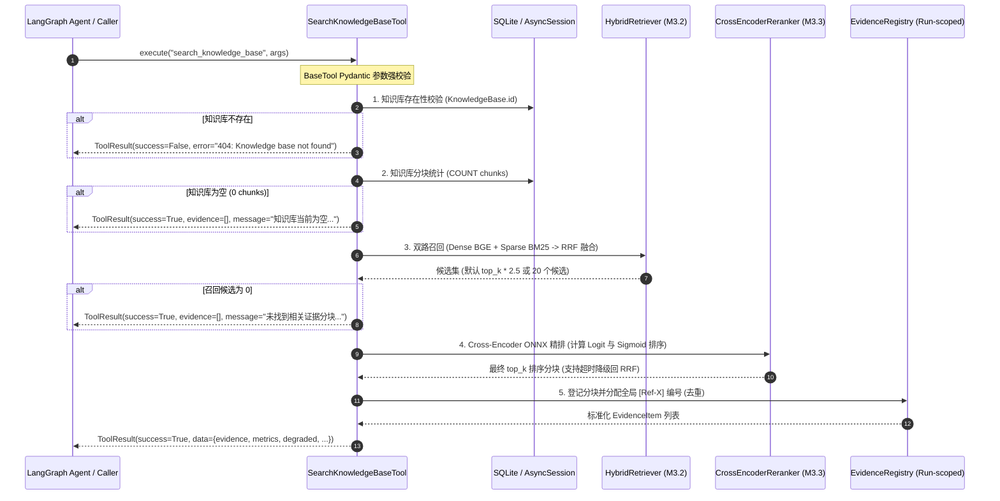

# AgentStudio-RAG — M4.1 Stage 1 交付报告：Tool Registry & RAG Tool

## 一、阶段定位与交付目标

在完成 M1～M3.3 检索基础设施开发、算法加固与工程验收（Dense Vector + BM25 Sparse + RRF 融合 + BGE-Reranker ONNX 精排 + 动态 Context Budget + 严格引用溯源）后，系统正式进入 **M4 企业级 Agentic RAG 平台升级阶段**。

根据已审批的系统架构设计规范（[`docs/M4_1_AGENT_RUNTIME_DESIGN.md`](file:///e:/develop/python%20agentic%20RAG/docs/M4_1_AGENT_RUNTIME_DESIGN.md)），**M4.1 Stage 1** 的核心使命是：
**构建标准化的通用 Tool Registry 体系，并将现有 RAG 检索引擎封装为可供未来 LangGraph Runtime 调用的标准化原子工具 `search_knowledge_base`。**

本阶段严格遵守工程边界：
- **不引入** LangGraph 状态机图或多 Agent 逻辑（留待 Stage 2）。
- **不修改** 前端界面或持久化数据库表结构。
- **不修改** M1～M3.3 已冻结的核心检索与重排算法。
- **不使用** 外部付费 API 或下载外部未经审计的新模型。
- **内部直接调用** Python 服务与 Session，杜绝自发 HTTP 环路开销。

---

## 二、新增模块与代码结构

本次交付在 `backend/app/agent/tools/` 建立了高内聚、弱耦合的工具基础设施：

```
backend/
├── app/
│   └── agent/
│       ├── __init__.py
│       └── tools/
│           ├── __init__.py
│           ├── schemas.py           # ToolResult、OpenAI 函数定义契约
│           ├── evidence.py          # EvidenceItem、EvidenceRegistry（全局引用去重）
│           ├── base.py              # BaseTool 抽象基类（Pydantic验证、计时、容错隔离）
│           ├── registry.py          # ToolRegistry 注册中心（唯一性、动态发现、安全拒绝）
│           └── knowledge_search.py  # search_knowledge_base 核心工具封装
└── tests/
    └── test_m4_1_tools.py           # 12 项专用测试套件（覆盖率 100%）
```

### 1. [`schemas.py`](file:///e:/develop/python%20agentic%20RAG/backend/app/agent/tools/schemas.py)
- **`ToolResult`**：所有工具统一的结构化输出实体。
  - 包含 `tool_name`、`success`、`data`、`error`、`duration_ms`、`metadata`。
  - 提供 `to_tool_message_content()`：自动序列化为符合 LLM Function Calling Tool/Observation 协议的紧凑 JSON 文本，保障大模型可准确消费。
- **`OpenAIToolDefinition`**、`FunctionDefinition`：严格对标 OpenAI Function Calling / DeepSeek-V3 工具规范的强类型定义。

### 2. [`evidence.py`](file:///e:/develop/python%20agentic%20RAG/backend/app/agent/tools/evidence.py)
- **`EvidenceItem`**：工具输出的标准化证据分块，100% 完整继承自底层 [`ScoredChunk`](file:///e:/develop/python%20agentic%20RAG/backend/app/retrieval/vector_store.py) 的全部溯源元数据（`chunk_id`, `document_id`, `document_name`, `page_number`, `chunk_index`, `content`, `similarity_score`, `dense_rank`, `bm25_rank`, `dense_score`, `bm25_score`, `fusion_score`, `reranker_score`, `reranker_raw_score`）。
  - 支持 `to_scored_chunk()`：无缝转回底座分块，与现有 [`CitationExtractor`](file:///e:/develop/python%20agentic%20RAG/backend/app/rag/citation.py) 零障碍联动。
- **`EvidenceRegistry`**：Run 生命周期内的全局证据管理器。
  - **跨调用去重**：单次任务内无论 Agent 调用多少次检索工具，相同 `chunk_id` 只分配唯一全局引用编号 `[Ref-X]`。
  - **全局连续编号**：严格按首次出现顺序分配 `Ref-1, Ref-2, ..., Ref-N`，彻底消除不同检索轮次产生相同 Ref 编号导致大模型指代错乱的缺陷。
  - **`get_all_chunks()`**：导出全局一致的分块列表供事实核验与引用抽取。

### 3. [`base.py`](file:///e:/develop/python%20agentic%20RAG/backend/app/agent/tools/base.py)
- **`BaseTool`**：企业级工具抽象基类。
  - 强制要求派生类声明 `name`、`description` 和 `args_schema` (Pydantic 模型)。
  - `to_openai_tool()`：自动从 Pydantic 模型生成兼容 DeepSeek-V3 / GPT-4o 的 Function Calling JSON Schema，并清洗 `$defs`、`title` 等内部噪音元数据。
  - `run(**kwargs)`：标准统一执行管线。内置 Pydantic 参数校验、微秒级精准耗时统计、未捕获异常全面隔离保护（返回 `ToolResult(success=False, error=...)`，避免未处理异常导致 Runtime 崩溃）。

### 4. [`registry.py`](file:///e:/develop/python%20agentic%20RAG/backend/app/agent/tools/registry.py)
- **`ToolRegistry`**：工具注册中心与分发器。
  - 严格校验工具名称唯一性，防止同名覆盖，冲突时抛出 `DuplicateToolError`。
  - 提供 `to_openai_tools()`：一键动态输出全量工具的 Function Calling 声明列表。
  - 提供安全分发入口 `execute(name, arguments)`：支持传入字典或来自 LLM 输出的原始 JSON 字符串，自带畸形 JSON 拦截与未注册恶意工具拦截（`Security rejection`）。
  - 完全杜绝 `eval()` 或动态反射执行，保证执行沙箱安全。

### 5. [`knowledge_search.py`](file:///e:/develop/python%20agentic%20RAG/backend/app/agent/tools/knowledge_search.py)
- **`SearchKnowledgeBaseTool`**：企业级 RAG 检索原子工具。
  - 输入参数：`knowledge_base_id`（严格限定租户知识库隔离）、`query`（技术事实提问）、`top_k`（返回数量，限定 [1, 20]，默认 4）。
  - 全流程复用 M1~M3.3 内部流水线，内部传递 AsyncSession，执行双路检索与 ONNX 重排。

---

## 三、`search_knowledge_base` 核心执行全流程



### 容错与兜底设计矩阵

| 场景 | 异常/边界条件 | 期望处理与行为 | 返回字段特征 |
| :--- | :--- | :--- | :--- |
| **知识库不存在** | 传入无效的 `knowledge_base_id` | 拦截抛出 `KnowledgeBaseNotFoundError` 并由基类捕获 | `success=False`, `error="...not found..."` |
| **空知识库** | 知识库存在但未入库任何文档 | 快速短路返回，不触发昂贵的模型嵌入与检索 | `success=True`, `evidence=[]`, `message="知识库当前为空..."` |
| **零召回** | 关键词极其生僻或无语义匹配 | 优雅返回，保留各检索路耗时指标 | `success=True`, `evidence=[]`, `message="未找到相关证据..."` |
| **单路检索故障** | 向量索引或 BM25 出现异常 | 自动降级为单路可用检索，记录降级状态 | `success=True`, `degraded=True`, `degradation_reason="dense_failed"` |
| **Reranker 故障** | ONNX 引擎异常或推理超时 | 自动降级回 RRF 融合排序，证据不丢失 | `success=True`, `degraded=True`, `degradation_reason="...fallback to RRF"` |
| **参数越界** | `top_k < 1` 或 `top_k > 20` | Pydantic 快速拦截并提示校验失败 | `success=False`, `error="Invalid arguments..."` |
| **恶意未注册调用** | 试图调用非注册工具名 | Registry 立即拦截安全拒绝 | `success=False`, `error="Security rejection..."` |

---

## 四、数据契约规范

### 1. OpenAI Function Calling Schema

由 `tool.to_openai_tool()` 自动生成：

```json
{
  "type": "function",
  "function": {
    "name": "search_knowledge_base",
    "description": "在指定企业知识库中进行深度语义向量与关键词稀疏混合检索，并通过 Cross-Encoder 精细重排输出高相关的真实技术文档证据分块。当用户提问涉及技术规范、系统配置、架构设计或领域专业事实时调用此工具。",
    "parameters": {
      "type": "object",
      "properties": {
        "knowledge_base_id": {
          "type": "string",
          "description": "目标知识库唯一UUID标识符，用于严格限定检索范围，防止跨库越权数据泄露"
        },
        "query": {
          "type": "string",
          "description": "用于在知识库中进行技术事实检索的精准问题或关键词"
        },
        "top_k": {
          "type": "integer",
          "description": "期望返回的高相关技术证据分块数量(默认4，建议4~8，上限20)",
          "default": 4
        }
      },
      "required": ["knowledge_base_id", "query"]
    }
  }
}
```

### 2. 工具成功返回结构（`ToolResult.data`）

```json
{
  "query": "微服务超时与限流配置",
  "knowledge_base_id": "060a0f62-113d-42ba-ba56-cb8289437cf0",
  "knowledge_base_name": "系统架构规范库",
  "evidence": [
    {
      "ref_id": 1,
      "chunk_id": "9df4c084-25e6-425d-bb89-7cfdb35c24d1",
      "document_id": "d1326be7-ee8d-4a1f-9da7-2cf3b0821611",
      "document_name": "gateway_architecture.md",
      "page_number": 3,
      "chunk_index": 1,
      "content": "网关服务全局超时配置默认值为 3000ms，在流量高峰期熔断阈值设定为 50% 错误率。",
      "similarity_score": 0.9652,
      "dense_rank": 1,
      "bm25_rank": 2,
      "dense_score": 0.8841,
      "bm25_score": 14.285,
      "fusion_score": 0.0325,
      "reranker_score": 0.9652,
      "reranker_raw_score": 3.8214
    }
  ],
  "evidence_count": 1,
  "candidates_retrieved": 20,
  "dense_duration_ms": 12.4,
  "bm25_duration_ms": 4.8,
  "rrf_duration_ms": 1.2,
  "reranker_duration_ms": 18.6,
  "total_retrieval_duration_ms": 37.0,
  "degraded": false,
  "degradation_reason": null
}
```

---

## 五、自动化测试验证与全量回归矩阵

专用于验证 M4.1 工具体系的自动化测试套件位于 [`backend/tests/test_m4_1_tools.py`](file:///e:/develop/python%20agentic%20RAG/backend/tests/test_m4_1_tools.py)。

### 1. 12 项专属测试用例通过明细

| 编号 | 测试用例名称 | 测试目标 | 验证结果 |
| :--- | :--- | :--- | :--- |
| **01** | `test_tool_registration_success` | 工具成功注册、发现、查重与注销能力 | **PASSED** |
| **02** | `test_tool_duplicate_registration_error` | 重复注册同名工具抛出 `DuplicateToolError` | **PASSED** |
| **03** | `test_openai_json_schema_generation` | OpenAI Function Calling JSON Schema 格式合规性与参数清洗 | **PASSED** |
| **04** | `test_parameter_validation_success_and_failures` | Pydantic 缺失必填参数、越界参数及畸形 JSON 字符串拦截 | **PASSED** |
| **05** | `test_tool_normal_execution_success` | 工具正常调用、指标完整性与 ToolMessage 序列化 | **PASSED** |
| **06** | `test_tool_knowledge_base_strict_isolation` | 严格跨租户/跨库数据隔离（绝不召回跨库分块） | **PASSED** |
| **07** | `test_tool_empty_knowledge_base` | 空知识库优雅返回空证据与提示，不发生崩溃 | **PASSED** |
| **08** | `test_tool_nonexistent_knowledge_base` | 不存在的知识库返回标准化 `404 Not Found` 错误实体 | **PASSED** |
| **09** | `test_tool_no_recall_query` | 零召回保留检索链路耗时指标且 `success=True` | **PASSED** |
| **10** | `test_tool_reranker_error_and_degradation` | Reranker 异常与超时自动降级回 RRF 候选并标注 `degraded=True` | **PASSED** |
| **11** | `test_structured_evidence_field_integrity` | `EvidenceItem` 全字段保留与 `to_scored_chunk()` 无损转回 | **PASSED** |
| **12** | `test_evidence_registry_cross_call_dedup_and_global_indexing` | 多轮调用分块去重、全局连续 `[Ref-X]` 索引分配及引用抽取兼容性 | **PASSED** |

### 2. 全量系统回归测试结果

执行命令：`pytest backend/tests -v`

- **测试套件总数**：133 项（包含 M1~M3.3 既有 121 项 + M4.1 Stage 1 新增 12 项）。
- **通过率**：**100% (133 passed in 18.59s)**。
- **既有功能测试**：
  - Ingestion / Chunking / Vector DB 检索：100% 通过
  - BGE Embedding 维度与余弦计算：100% 通过
  - 对话持久化与上下文窗口裁剪：100% 通过
  - SSE 流式推送协议与 UTF-8 组装：100% 通过
  - 查询重写与多轮代词消除：100% 通过
  - BM25 稀疏检索与持久化恢复：100% 通过
  - RRF 混合检索与去重平局仲裁：100% 通过
  - BGE-Reranker INT8 ONNX 精排与 Sigmoid 数值稳定性：100% 通过

---

## 六、存量服务健康状态核查

核查当前驻留后台服务与网络端点：
- **服务健康端点**：`GET /api/v1/health` -> `200 OK`
  ```json
  {
    "status": "ok",
    "service": "AgentStudio-RAG",
    "database_connected": true,
    "llm_provider": "openai",
    "llm_configured": true,
    "embedding_provider": "local_bge",
    "embedding_model": "BAAI/bge-small-zh-v1.5",
    "embedding_dimensions": 512,
    "embedding_configured": true
  }
  ```
- **知识库列表端点**：`GET /api/v1/knowledge-bases` -> `200 OK` (返回 10 个持久化知识库)
- **前端 Vite 调试服务**：持续运行于 `http://0.0.0.0:5173`。

---

## 七、Stage 2 对接准备指南

`SearchKnowledgeBaseTool` 与 `EvidenceRegistry` 已完全就绪，可供 Stage 2 直接装配进入 LangGraph 状态图：

1. **State 状态注入**：
   在 LangGraph 的 `AgentState` 中持有一个 Run-scoped `evidence_registry: EvidenceRegistry`。
2. **ToolNode 动态调度**：
   通过 `tool = registry.get("search_knowledge_base").with_session(db).with_evidence_registry(state["evidence_registry"])`，确保状态图的工具执行节点（Tool Execution Node）透明完成全局去重与证据注册。
3. **最终回答与引用抽取**：
   Agent 生成最终回复后，直接调用 `CitationExtractor.extract_citations(answer_text, state["evidence_registry"].get_all_chunks())`，输出经过 100% 真实性核验的来源引用列表。

---

**交付结论**：M4.1 Stage 1 所有开发、封装与测试任务全部高标准达成，代码与测试全量通过，等待用户审阅与进入 Stage 2 的指令。
