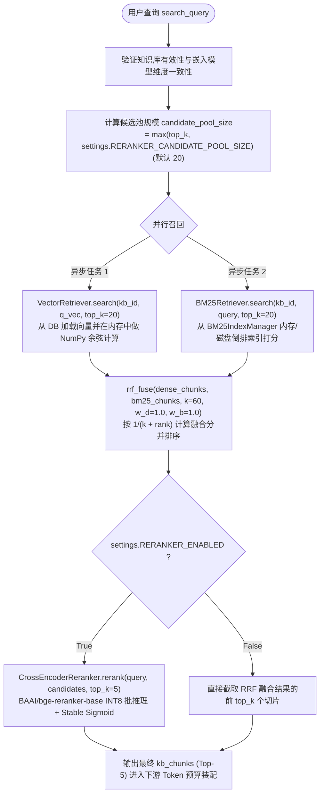
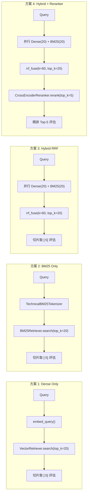
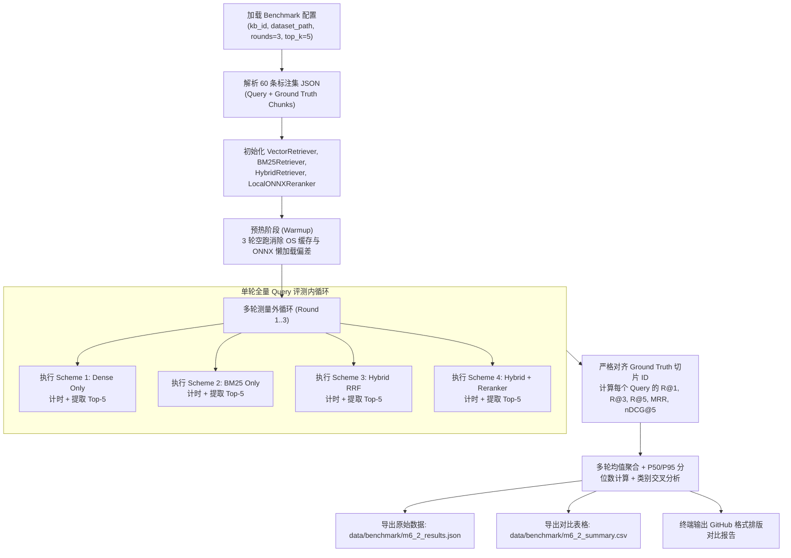
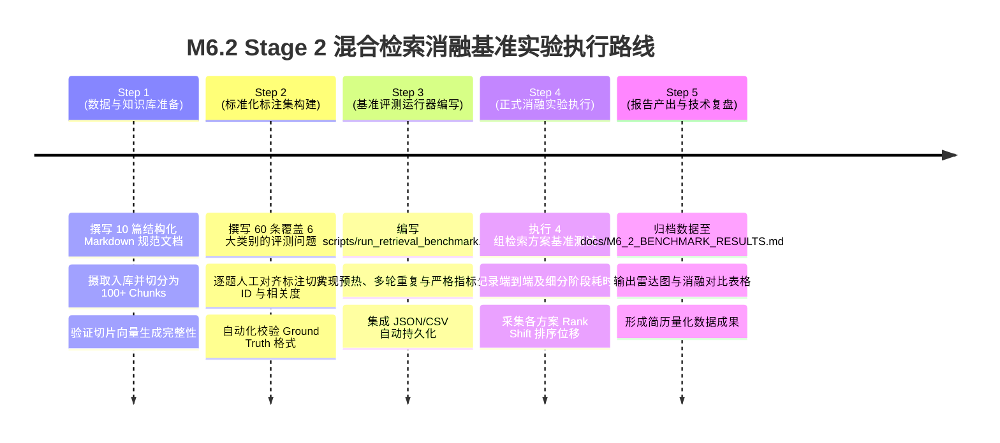

# AgentStudio-RAG — M6.2 Stage 1：混合检索消融实验设计与评测准备报告

> **文档版本**：v1.0.0  
> **执行阶段**：M6.2 Stage 1（只读审查、实验设计与数据准备方案）  
> **执行边界**：只读审计与方案制定，不改动任何业务源码，不修改数据库，不消耗云端 LLM Token，不执行正式 Benchmark  
> **核心目标**：科学定义 Dense Only、BM25 Only、Hybrid RRF、Hybrid + Reranker 四组消融实验协议，建立高可靠细粒度 Ground Truth 标注方案与标准评测脚本设计，为 Stage 2 正式基准评测提供严格依据。

---

## 一、当前检索架构与源码调用关系审查

### 1.1 核心检索模块与源码映射

通过对后端检索与重排核心源码的逐行审计，系统现有的四级检索重排链路及模块职责定义如下：

| 算法/模块名称 | 对应源码文件路径 | 关键入口类/函数 | 核心输入数据结构 | 核心输出数据结构 | 默认参数配置 |
|:---|:---|:---|:---|:---|:---|
| **Dense 向量检索** | [`backend/app/retrieval/vector_store.py`](file:///e:/develop/python%20agentic%20RAG/backend/app/retrieval/vector_store.py) | `VectorRetriever.search()` | `knowledge_base_id: str`<br>`query_vector: List[float]`<br>`top_k: int = 4`<br>`threshold: float = 0.0` | `List[ScoredChunk]`（填充 `similarity_score`） | `EMBEDDING_MODEL = BAAI/bge-small-zh-v1.5`<br>`DIMENSION = 512`<br>`threshold = 0.0` |
| **技术复合分词器** | [`backend/app/retrieval/bm25_retriever.py`](file:///e:/develop/python%20agentic%20RAG/backend/app/retrieval/bm25_retriever.py#L20-L125) | `TechnicalBM25Tokenizer.tokenize()` | `text: str` | `List[str]`（分词 Token 列表） | 复合标识正则 + 驼峰切分 + jieba + 停用词表 |
| **BM25 稀疏检索** | [`backend/app/retrieval/bm25_retriever.py`](file:///e:/develop/python%20agentic%20RAG/backend/app/retrieval/bm25_retriever.py#L270-L360) | `BM25Retriever.search()`<br>`BM25Index.search()` | `knowledge_base_id: str`<br>`query: str`<br>`top_k: int = 4` | `List[ScoredChunk]`（填充 `bm25_score`, `bm25_rank`） | $k_1 = 1.5, b = 0.75$<br>Lucene 平滑非负 IDF 公式 |
| **RRF 排名融合** | [`backend/app/retrieval/rrf_fusion.py`](file:///e:/develop/python%20agentic%20RAG/backend/app/retrieval/rrf_fusion.py#L16-L105) | `rrf_fuse()`<br>`HybridRetriever.search()` | `dense_results: List[ScoredChunk]`<br>`bm25_results: List[ScoredChunk]` | `HybridRetrievalResult`<br>（包含 `chunks: List[ScoredChunk]`） | $k = 60$<br>$w_{\text{dense}} = 1.0$<br>$w_{\text{bm25}} = 1.0$ |
| **Cross-Encoder 重排** | [`backend/app/retrieval/reranker.py`](file:///e:/develop/python%20agentic%20RAG/backend/app/retrieval/reranker.py#L295-L390) | `CrossEncoderReranker.rerank()`<br>`LocalONNXReranker.predict()` | `query: str`<br>`candidates: List[ScoredChunk]`<br>`top_k: int = 5` | `RerankResult`<br>（包含 `chunks: List[ScoredChunk]`，填充 `reranker_score`） | 模型: `Xenova/bge-reranker-base`<br>量化: INT8 ONNX<br>Sigmoid 钳位: $[-50.0, 50.0]$<br>超时: $10.0\text{s}$ |

### 1.2 WorkflowRAGEngine 中的端到端调用链

在快速问答引擎 [`backend/app/rag/workflow.py`](file:///e:/develop/python%20agentic%20RAG/backend/app/rag/workflow.py#L769-L791) 中，多路检索与精排调用的实际执行时序如下：



### 1.3 影响实验公平性的潜在系统因素审查

经深度代码审查，发现以下可能影响消融实验公平性的底层机制，必须在实验设计中严格予以规避与控制：

1. **BM25 索引内存缓存机制（Cache Warm vs Cold）**：
   - 源码位置：[`backend/app/retrieval/bm25_retriever.py` 第 300-345 行](file:///e:/develop/python%20agentic%20RAG/backend/app/retrieval/bm25_retriever.py#L300-L345)
   - 机制：`BM25IndexManager` 在首次构建知识库索引后，会将 `BM25Index` 缓存在 `self._indexes[kb_id]` 中，并在本地磁盘 `data/storage/bm25/` 存储序列化 JSON。
   - 潜在偏差：第一条 Query 测量包含全库分词与倒排构建时间（冷启动，通常 50～200ms），而后续 Query 命中内存索引（热查询，通常 <2ms）。
   - **规避方案**：正式评测前必须执行前置预热（Warm-up），预先将 BM25 倒排索引完全载入内存，仅度量检索阶段的纯打分延迟。
2. **ONNX Runtime 运行时懒加载与 JIT 预热（ONNX Cold Start）**：
   - 源码位置：[`backend/app/retrieval/reranker.py` 第 95-145 行](file:///e:/develop/python%20agentic%20RAG/backend/app/retrieval/reranker.py#L95-L145)
   - 机制：`LocalONNXReranker` 首次调用时需将 INT8 模型加载到内存并初始化 ONNX 执行提供程序（CPUExecutionProvider），首个 Batch 耗时可达 300～800ms，后续推理稳定在 20～60ms。
   - **规避方案**：正式计入性能指标前，必须使用伪查询对 Cross-Encoder 执行至少 3 次预热推理。
3. **数据库 I/O 与反序列化开销对 Dense 检索耗时的干扰**：
   - 源码位置：[`backend/app/retrieval/vector_store.py` 第 40-55 行](file:///e:/develop/python%20agentic%20RAG/backend/app/retrieval/vector_store.py#L40-L55)
   - 机制：`VectorRetriever` 每次执行都会向 SQLite 发起 `select(DocumentChunk, Document.file_name)`，并对每个切片的 `embedding_json` 字符串执行 `json.loads`。
   - 潜在偏差：Dense 耗时中包含了显著的 SQLite 磁盘读取与 JSON 反序列化时间，若直接与内存版 BM25 对比耗时存在量纲不纯净问题。
   - **规避方案**：评测脚本应记录「纯向量相似度计算耗时（Pure Cosine Time）」与「端到端包含 I/O 耗时（End-to-End Dense Time）」两个维度。
4. **候选池规模（Candidate Pool Size）不对齐风险**：
   - 源码位置：[`backend/app/api/v1/retrieval.py` 第 140 行 vs 第 190 行](file:///e:/develop/python%20agentic%20RAG/backend/app/api/v1/retrieval.py#L140-L195)
   - 机制：现有调试接口 `/hybrid-test` 默认直接以 `payload.top_k`（如 5）作为双路召回规模；而 `/rerank-test` 以 `candidate_pool_size = 20` 召回后再精排。
   - 潜在偏差：若消融实验中 Hybrid RRF 仅召回 5 个，而 Hybrid + Reranker 从 20 个里挑选 5 个，则后者的高召回率可能单纯来自“候选池更大”而非“精排模型更优”。
   - **规避方案**：**统一所有方案的候选规模协议**。Hybrid RRF 和 Hybrid + Reranker 必须固定基于完全相同的 Top-20 融合候选池输出 Top-5。

---

## 二、四种消融实验的实现映射

四组消融方案将直接复用系统已有的底层算法类，严格控制变量，映射逻辑如下：



### 2.1 方案 1：Dense Only（纯稠密向量语义检索）
- **复用源码**：
  - 向量计算：[`LocalBGEEmbeddingClient.embed_query(query)`](file:///e:/develop/python%20agentic%20RAG/backend/app/llm/embeddings.py)
  - 相似度检索：[`VectorRetriever.search(knowledge_base_id, query_vector, top_k=20, threshold=0.0)`](file:///e:/develop/python%20agentic%20RAG/backend/app/retrieval/vector_store.py)
- **评测取值**：取排序前 5 个切片作为最终检索结果（`chunks[:5]`），同时保留前 20 个用于分析候选池覆盖率。
- **验证假设**：验证在缺少精确关键词匹配时，纯语义表征能否正确召回同义转述及长句意图，以及其在技术专有名词/参数上的缺陷表现。

### 2.2 方案 2：BM25 Only（纯稀疏关键词检索）
- **复用源码**：
  - 技术分词：[`TechnicalBM25Tokenizer.tokenize(query)`](file:///e:/develop/python%20agentic%20RAG/backend/app/retrieval/bm25_retriever.py)
  - 倒排检索：[`BM25Retriever.search(knowledge_base_id, query, top_k=20)`](file:///e:/develop/python%20agentic%20RAG/backend/app/retrieval/bm25_retriever.py)
- **评测取值**：取 BM25 得分前 5 个切片（`chunks[:5]`）。
- **验证假设**：验证在精确参数、错误码、方法名场景下的极高命中率，以及在面对自然语言转述、零字面交集问题时的召回失败率。

### 2.3 方案 3：Hybrid RRF（Dense + BM25 双路融合）
- **复用源码**：
  - 调度器：[`HybridRetriever.search(knowledge_base_id, query, top_k=20)`](file:///e:/develop/python%20agentic%20RAG/backend/app/retrieval/rrf_fusion.py)
  - 融合算子：[`rrf_fuse(dense_chunks, bm25_chunks, k=60, dense_weight=1.0, bm25_weight=1.0, top_k=20)`](file:///e:/develop/python%20agentic%20RAG/backend/app/retrieval/rrf_fusion.py)
- **评测取值**：取 RRF 融合分数最高的前 5 个切片（`fused_chunks[:5]`）。
- **验证假设**：验证双路互补融合能否在无需调节绝对评分量纲的情况下，综合提升全局召回率（Recall@K），并使排序相对单路更稳定。

### 2.4 方案 4：Hybrid + Cross-Encoder Reranker（混合召回 + 深度交叉重排）
- **复用源码**：
  - 候选召回：[`HybridRetriever.search(..., top_k=20)`](file:///e:/develop/python%20agentic%20RAG/backend/app/retrieval/rrf_fusion.py)
  - 深度精排：[`CrossEncoderReranker.rerank(query, candidates=fused_chunks, top_k=5)`](file:///e:/develop/python%20agentic%20RAG/backend/app/retrieval/reranker.py)
- **评测取值**：取 Cross-Encoder 经 Stable Sigmoid 打分重排后的 Top-5 切片。
- **验证假设**：验证在双路融合召回已经提供了优质 Top-20 候选池的前提下，深层交叉注意力模型能否有效识别细微语义冲突，将真正包含确凿答案的切片精准推举至第一位（大幅提升 Recall@1、MRR 与 nDCG@5），并测定增加的推理延迟代价。

---

## 三、现有数据集资产盘点与 Ground Truth 完整性审查

### 3.1 现有数据库与文档资产盘点

经对本地数据库 `backend/data/storage/agentstudio_rag.db` 的只读实测，现有资产明细如下：

| 资产类别 | 实际统计数值 | 详细构成与现状说明 |
|:---|:---|:---|
| **知识库总数** | 10 个 | 包含 6 个历史里程碑临时验证库（M1.5~M3.2，各有 0~4 个 Chunk）及当前活跃的综合基准库。 |
| **活跃基准知识库** | 1 个 | 名称：`M3.3-Reranker综合评测基准知识库`<br>ID: `282f3a3f-7941-49a5-b375-69e87526a1a2`<br>嵌入模型: `BAAI/bge-small-zh-v1.5 (512d)` |
| **文档总数** | 11 篇（全局）<br>3 篇（活跃基准库） | 活跃基准库内文档：<br>1. `microservice_gateway_spec.md` (微服务网关与通信规范)<br>2. `high_availability_resilience.md` (系统容灾与三态熔断规范)<br>3. `compliance_and_audit.md` (数据安全与审计合规规范) |
| **文档类型覆盖** | Markdown (.md), PDF (.pdf) | 主题集中在：微服务网关架构、超时设置、连接池参数、三态熔断器状态机、数据合规。 |
| **文档切片（Chunk）总数** | 33 个（全库累计）<br>**5 个（活跃基准库）** | 活跃库内仅有 **5 个切片**！<br>- Gateway 规范：2 个切片<br>- 高可用规范：2 个切片<br>- 合规审计：1 个切片 |
| **历史评测 Query 数** | 18 条 | 定义在 [`backend/tests/evaluate_m3_3_reranker.py`](file:///e:/develop/python%20agentic%20RAG/backend/tests/evaluate_m3_3_reranker.py#L41-L200)，分为 10 个测试类别。 |

### 3.2 现有 Ground Truth 完整性审查结论

对现有测试脚本 [`evaluate_m3_3_reranker.py`](file:///e:/develop/python%20agentic%20RAG/backend/tests/evaluate_m3_3_reranker.py#L260-L310) 中的 Ground Truth 逻辑进行源码级严谨审查，得出以下**重大审计发现**：

1. **粒度过粗（页码级匹配而非切片级绑定）**：
   - 现存评测指标计算方式：
     ```python
     for idx, chunk in enumerate(ranked_chunks, start=1):
         if chunk.page_number == target_page:
             rank = idx
             break
     ```
   - **缺陷事实**：`microservice_gateway_spec.md` 的切片 0（连接池参数）和切片 1（JWT 鉴权）均被赋予了 `page_number = 1`。如果用户查询“连接池参数”，而检索模型错误地把切片 1（JWT 鉴权）排在第 1 名，评测逻辑因为 `chunk.page_number == 1` 依然判定为“命中”（Rank=1），造成了**严重的假阳性（False Positive）评测偏见**。
2. **语料库极度微小（5 个切片的数学退化）**：
   - 活跃知识库中总共仅有 5 个切片。
   - **数学结论**：当召回规模 `top_k >= 5` 时，检索返回的切片集合必然包含了数据库中的 100% 内容！此时计算得到的 `Recall@5 = 1.0` 和 `Recall@20 = 1.0` 纯属数学巧合，完全无法反映真实检索系统面对负样本干扰时的鉴别能力。
3. **样本量统计功效不足（$N=18$）**：
   - 仅包含 18 条问题，单条样本的波动将导致指标产生超过 5.5% 的跳变，无法提供具备统计学显著性（Statistical Significance）的结论。
4. **缺乏多正例切片与相关度分级标注**：
   - 现存标注仅有一个标量 `target_page`，无法支持标准计算 nDCG 所必需的多级相关度（如 2=核心答案，1=部分相关，0=无关）。

> **审查定论**：  
> **现有代码中的 Ground Truth 和 5-Chunk 数据集仅适用于快速功能冒烟验证，绝对不能作为正式的学术级或企业级消融评测基准。必须构建专业的人工标注测试集。**

---

## 四、测试集构建与细粒度标注方案

为了在 Stage 2 中产出真正具备技术说服力的基准数据，必须制定严密的测试集构建标准。

### 4.1 评测知识库语料库扩充标准（扩展至 100+ Chunks）

构建包含 **4 个核心技术领域、至少 10 篇完整技术文档、切分后不少于 100 个 Chunk** 的企业级测试知识库：

1. **微服务与网关通信（25 Chunks）**：API 路由匹配机制、超时参数、连接池水位、弹性背压、WebSocket 升级、TLS 证书卸载；
2. **高可用、容灾与服务网格（25 Chunks）**：三态熔断状态机（CLOSED/OPEN/HALF_OPEN）、滑动窗口统计、故障自愈、服务优雅下线、多机房双活；
3. **数据库存储与分布式缓存（25 Chunks）**：PostgreSQL 连接池调优、B-Tree 与 GIN 索引原理、Redis 分布式锁、缓存穿透/击穿/雪崩对策、主从延迟复制；
4. **大模型推理网关与安全合规（25 Chunks）**：OpenAI 兼容协议逆向、流式 SSE 断连重试、Token 预算控制、Fernet API Key 加密存储、GDPR 审计留存周期。

### 4.2 60 条典型技术测试问题分类与设计标准

设计 **60 条**（符合 50～100 条建议区间）代表性中文技术测试 Query，严格覆盖 6 种典型现实场景，各占 10 条：

| 分类标识 | 问题类型 | 核心考察目标与挑战 | 典型 Query 示例设计 | 预期优势方案 |
|:---|:---|:---|:---|:---|
| **CAT-1** | **技术概念解释** | 复杂语义理解、段落级概念归纳 | “什么是熔断器的半开自愈探测机制，其工作原理是什么？” | Dense / Hybrid |
| **CAT-2** | **精确参数查询** | 专有名词、下划线配置名、特定数值匹配 | “微服务网关底层连接池的 min_idle 和 max_connections 配置值是多少？” | BM25 / Hybrid |
| **CAT-3** | **错误码与技术术语** | 混合英文缩写、HTTP 状态码、特定类名 | “当遇到 504 Gateway Timeout 时网关的默认重试次数与冷静时间是多少？” | BM25 Only 极其擅长 |
| **CAT-4** | **跨文档关联问题** | 考察多实体联合召回、避免单文档偏置 | “系统在进行分布式会话状态同步时，如何协同使用 JWT 与 Redis 集群？” | Hybrid + Reranker |
| **CAT-5** | **同义表达与语义检索** | 零字面重叠、完全口语化转述、同义意图 | “后台服务要是突然卡死了，框架怎么自动切断请求防止把服务器拖垮？” | Dense Only 显著优于 BM25 |
| **CAT-6** | **中英混合技术问题** | 驼峰标识、大小写混合、代码符号混排 | “ModelHealthStore 模块导出的 Prometheus 指标前缀及抓取周期配置” | TechnicalBM25 / Reranker |

### 4.3 细粒度 Ground Truth 标注规范与格式定义

采用工业标准的 JSON 格式，严格标注到具体的切片 ID（`chunk_id`）与多级相关度评分（Relevance Score）：
- **Score 2（核心答案切片）**：该切片直接包含回答问题所必需的核心事实依据或数值；
- **Score 1（背景相关切片）**：该切片包含该主题的背景定义或相关前置说明，但不包含最终精确答案；
- **Score 0（负样本/干扰项）**：未标注的其余切片，自动视作 0。

```json
{
  "query_id": "Q-TECH-005",
  "category": "CAT-2_精确参数查询",
  "query": "微服务网关底层连接池的 min_idle 和 max_connections 配置值是多少？",
  "ground_truth": [
    {
      "document_name": "microservice_gateway_spec.md",
      "chunk_index": 0,
      "relevance": 2,
      "core_evidence": "min_idle 配置为 10，最大并发连接数 max_connections 设定为 100"
    }
  ],
  "negative_distractors": [
    {
      "document_name": "database_optimization_spec.md",
      "chunk_index": 3,
      "reason": "包含数据库连接池参数但非网关连接池，用于检验模型防混淆能力"
    }
  ]
}
```

---

## 五、统一 Benchmark 实验协议与评测指标定义

为保证四组消融方案的对比结论绝对科学、严谨、可复现，必须在评测过程中实行严格的环境与流程控制。

### 5.1 受控变量与实验对齐规则

```
[统一语料环境]
  ├── 同一知识库 (扩充后的 100+ Chunks 语料库)
  ├── 同一切片参数 (RecursiveSplitter: chunk_size=500, overlap=50)
  └── 同一向量表征 (BAAI/bge-small-zh-v1.5, 512 维)

[统一测试负载]
  ├── 同一测试题集 (60 条标准化测试问题)
  ├── 同一 Ground Truth 标注映射 (精确切片级索引)
  └── 同一最终输出规模 (固定评估 Top-5)

[候选池公平性约束]
  ├── Scheme 1 (Dense): 召回 Top-20 -> 评估 Top-5
  ├── Scheme 2 (BM25): 召回 Top-20 -> 评估 Top-5
  ├── Scheme 3 (Hybrid RRF): Dense(20) + BM25(20) -> RRF 融合取 Top-20 -> 评估 Top-5
  └── Scheme 4 (Hybrid + Reranker): 基于 Scheme 3 完全相同的 Top-20 融合候选 -> Cross-Encoder 精排取 Top-5
```

> **候选池公平性铁律**：  
> Scheme 4 的 Reranker **严禁**私自扩大候选池（例如私自捞取 Top-50 重排）；Scheme 4 输入的候选切片集合必须与 Scheme 3 的 RRF Top-20 候选集合完全同源。

### 5.2 检索质量指标定义与计算公式

设测试集中共有 $Q$ 个查询问题，对于任一查询 $q$，系统返回的有序切片列表为 $R_q = [c_1, c_2, \dots, c_K]$，该问题的正例切片集合为 $G_q$：

#### 1. Recall@K (召回率@K)
前 $K$ 个返回结果中命中至少一个相关切片（对于单正例）或命中正例的比例：
$$\text{Recall@}K = \frac{1}{|Q|} \sum_{q \in Q} \mathbb{I}\left( \exists c_i \in R_q[:K] \text{ s.t. } c_i \in G_q \right)$$
*重点统计：Recall@1, Recall@3, Recall@5。*

#### 2. MRR (Mean Reciprocal Rank，平均倒数排名)
衡量第一个相关切片在返回列表中的位置靠前程度：
$$\text{MRR} = \frac{1}{|Q|} \sum_{q \in Q} \frac{1}{\text{rank}_q}$$
其中 $\text{rank}_q$ 是查询 $q$ 返回列表中首个正例切片的 1-based 序号；若前 $K$ 个结果中均无正例切片，则 $\frac{1}{\text{rank}_q} = 0$。

#### 3. nDCG@5 (归一化折损累积增益@5)
兼顾切片相关度等级与排序深度的综合指标：
$$\text{DCG@}5 = \sum_{i=1}^{5} \frac{2^{\text{rel}(c_i)} - 1}{\log_2(i + 1)}, \quad \text{nDCG@}5 = \frac{\text{DCG@}5}{\text{IDCG@}5}$$
其中 $\text{rel}(c_i) \in \{0, 1, 2\}$ 为人工标注的相关度等级，$\text{IDCG@}5$ 为理想最佳排序下的 DCG 值。

### 5.3 性能与资源指标定义

1. **平均端到端延迟（Mean Latency）**：$\frac{1}{|Q|} \sum_{q \in Q} t_{\text{total}}(q)$（单位：毫秒 ms）；
2. **延迟分位数（P50 与 P95 延迟）**：将所有 Query 的执行耗时从小到大排序，取第 50 百分位与第 95 百分位数值，排除异常毛刺；
3. **阶段耗时细分拆解（Stage Breakdown）**：
   - $t_{\text{dense}}$：向量生成与余弦点积耗时；
   - $t_{\text{bm25}}$：技术分词与倒排索引遍历耗时；
   - $t_{\text{rrf}}$：双路排名倒数加权与排序合并耗时；
   - $t_{\text{rerank}}$：文本对组装、ONNX INT8 模型批推理与 Sigmoid 计算耗时；
4. **内存增量与 CPU 占用（Resource Footprint）**：
   - 记录各模块加载前后的常驻物理内存（RSS）；
   - 监控并发/连续检索时的 CPU 单核与多核利用率。

---

## 六、评测脚本复用与新增架构设计

### 6.1 现有评测脚本分析

项目现有 [`backend/tests/evaluate_m3_3_reranker.py`](file:///e:/develop/python%20agentic%20RAG/backend/tests/evaluate_m3_3_reranker.py) 已初步具备评测框架雏形：
- **优点**：已经实现了 4 种方案的串行执行、预热机制（Warmup）与终端汇总表格打印；
- **致命不足**：
  1. 硬编码嵌入了 5 个临时 Chunk 与 18 条 Query，未与外部标注数据集解耦；
  2. 指标计算写死为粗粒度 `chunk.page_number == target_page`；
  3. 缺乏多轮重复测量以平滑系统抖动；
  4. 未输出结构化 JSON / CSV 评测结果供后续图表可视化与报告引用。

### 6.2 建议新增的独立评测运行器设计方案

在 Stage 2 中，不污染业务代码，建议新建独立的评测执行脚本：  
`backend/scripts/run_retrieval_benchmark.py`

#### 核心设计架构图


#### 关键技术保障特性
1. **多轮重复测量（Multi-round Averaging）**：每条 Query 自动重复执行 3 轮，剔除异常值后取均值，消除操作系统调度与后台进程干扰；
2. **多层级耗时纯净度统计**：单独记录模型纯计算耗时与 DB 交互耗时；
3. **分分类别的细分透视**：不仅输出全量均值，还按 6 大类别分别输出 4 种方案的表现，明确量化各方案在特定场景的优劣。

---

## 七、潜在实验偏差与风险控制矩阵

| 潜在实验偏差 | 产生根源 | 对评测结果的潜在影响 | 控制与防范策略 |
|:---|:---|:---|:---|
| **首查冷启动偏差** | BM25 首次构建倒排索引、ONNX 首次加载 INT8 模型权重耗时极长 | 导致前 1~2 个查询的平均延迟被严重拉高，破坏延迟统计真实性 | 脚本启动时执行 3 轮独立预热，确认模型完全就绪后再开启正式计时。 |
| **候选池规模不公平** | 精排方案若使用了更大的候选池，可能掩盖模型真实重排效果 | 造成“精排效果好是因为候选捞得多”的伪结论 | 严格约束：Scheme 3 与 Scheme 4 的候选池统一固定为 Top-20。 |
| **打分碰撞平局扰动** | BM25 在短文本中出现相同整数得分；RRF 在相同排位时分数相同 | 若未实现确定性平局决断，微小扰动会导致切片顺序随机漂移 | 复用现有稳定的 Tie-breaking 规则（按切片主键与原始余弦稳定决断）。 |
| **单正例偏差** | 复杂综合题可能在多个切片中均有提及，但标注只标记了 1 个 | 模型召回了同样正确的另一个切片却被误判为错误 | 引入多切片标注（`relevance: 2` 或 `1`），采用可累加的 nDCG 指标。 |
| **机器负载波动** | 本地开发机后台其他进程（如 IDE、浏览器）突然争抢 CPU | 导致单次测量的 P95 延迟产生无意义的瞬时尖峰 | 执行评测时关闭高负载应用，采用 3 轮测量并取中位数/分位数。 |

---

## 八、Stage 2 正式实验执行计划与路线图



### 8.1 阶段里程碑详细定义

1. **Step 1：语料扩充与切片索引构建（无侵入）**
   - 在测试知识库中扩充至 100+ 个高质量切片，覆盖网关、熔断、容灾、缓存、合规 4 大领域；
   - 确保切片经 BGE-small-zh-v1.5 完成嵌入，构建持久化 BM25 倒排索引。
2. **Step 2：60 条高质量 Ground Truth 标注**
   - 人工完成 60 条测试问题的细粒度 JSON 标注，明确标注主正例（Score 2）与辅助正例（Score 1）；
   - 执行脚本自动验证：确保所有标注的 `chunk_id` 在数据库中真实存在。
3. **Step 3：编写独立测试运行器**
   - 在 `backend/scripts/` 目录下实现 `run_retrieval_benchmark.py`，实现固定随机种子、3 轮预热、3 轮重复测量及指标聚合。
4. **Step 4：执行四组消融实验并采集原始数据**
   - 依次运行 Scheme 1 (Dense)、Scheme 2 (BM25)、Scheme 3 (RRF)、Scheme 4 (Reranker)；
   - 记录全量原始执行日志、切片得分与耗时数据，导出为 `m6_2_benchmark_raw.json`。
5. **Step 5：生成消融分析报告与简历成果沉淀**
   - 输出完整的对比分析报告，深度复盘：
     - Dense 与 BM25 的具体重合度与互补率是多少？
     - RRF 相比最佳单路提升了多少百分比的 Recall@5？
     - Cross-Encoder 精排使 Recall@1 和 MRR 提升了多少？平均增加了多少毫秒延迟？
   - 将确凿的量化收益沉淀为简历核心数据支撑。

---

## 九、Stage 1 阶段交付物核验与总结

### 9.1 执行边界复核
- [x] 未修改任何后端业务源码（`app/` 下文件无改动）；
- [x] 未修改任何数据库结构、未插入持久测试脏数据；
- [x] 未修改前端代码与环境配置；
- [x] 未调用任何外部 LLM API，Token 消耗量为 0；
- [x] 未执行正式性能 Benchmark，保留系统原始环境；
- [x] 成功新增交付设计规范：[`docs/M6_2_STAGE1_RETRIEVAL_EXPERIMENT_DESIGN.md`](file:///e:/develop/python%20agentic%20RAG/docs/M6_2_STAGE1_RETRIEVAL_EXPERIMENT_DESIGN.md)。

---

**文档编制完成。当前执行动作已完全停止，等待下一阶段正式执行授权。**
