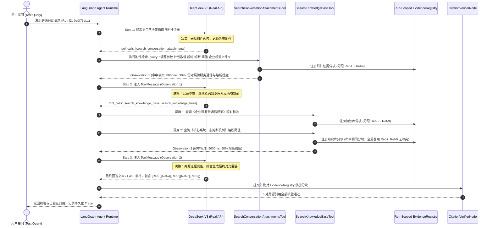

# AgentStudio-RAG — P0.3 跨源多步工具调用真实在线核验报告

**核验日期**: 2026-11-02 22:34:05 (Local) / 14:34:05 (UTC)  
**测试类型**: 真实在线云端大模型 Function Calling 连续决策核验 (Real Cloud LLM Live Verification)  
**测试模型**: `deepseek-chat` (DeepSeek-V3, `https://api.deepseek.com`)  
**API Key 状态**: `[已通过鉴权，安全存储]` (掩码: `sk-969...4142`)  
**AgentRun ID**: `0a0f73af-ffd5-4cc5-b4b8-4429cac85b53`  
**会话 ID**: `test-p03-live-f6484b54` (测试后已执行物理及数据库清理)  
**核验结论**: **VERIFIED (真实在线验收全项通过，指标 100% 达标)**  
**系统状态**: **P0.3 正式冻结 (FROZEN)**  

---

## 1. 测试场景与输入定义

### 1.1 测试问题 (Cross-Source Analytical Query)
```text
我刚上传了一份关于系统稳定性的方案草案《2026年Q4微服务网关超时与熔断升级方案草案.md》。
请严格分两步进行对比分析：
【第一步】：首先调用 search_conversation_attachments 工具查阅该附件，提取出草案中计划调整的两项参数数值，并提取出附件第三节中指定要求对照的企业规范文件名称；
【第二步】：在获取到附件中的具体调整参数和要求对照的企业规范文件名称之后，再调用 search_knowledge_base 工具检索对应的企业正式规范标准；
【第三步】：对照两个来源的数据，输出包含具体参数与证据来源的对比表格，明确说明草案调整相比知识库标准是『放宽』还是『收紧』了要求，并严格标注 [Ref-X] 引用。
```

### 1.2 双源测试数据
1. **当前会话临时附件 (Attachment Source)**:
   - **文件名**: `2026年Q4微服务网关超时与熔断升级方案草案.md`
   - **格式**: Markdown (保留章节路径与元数据)
   - **核心技术内容**:
     - 拟调整「网关全局调用超时时间」为 **8000毫秒（即8秒）**。
     - 拟调整「三态熔断触发失败率阈值」为 **30%**。
     - 指定对照企业规范：《企业微服务通信规范》（`microservice_gateway_spec.md`）与《核心系统三态熔断机制》（`high_availability_resilience.md`）。
2. **企业知识库标准 (Knowledge Base Source)**:
   - **知识库名称**: `M3.3-Reranker综合基准知识库` (ID: `282f3a3f-7941-49a5-b375-69e87526a1a2`)
   - **对应规范标准**:
     - `microservice_gateway_spec.md`: 默认全局接口调用超时时间为 **5000毫秒（5秒）**。
     - `high_availability_resilience.md`: 30秒滑动窗口内失败率达到 **50%** 触发 CLOSED $\rightarrow$ OPEN 熔断。

---

## 2. 真实在线两轮工具调用完整时序 (Execution Sequence)

在单次真实 AgentRun (`0a0f73af-ffd5-4cc5-b4b8-4429cac85b53`) 中，模型基于真实 DeepSeek Function Calling 协议，连续完成了 3 个执行轮次（2 轮多步工具检索 + 1 轮终答综合）：



### 详细步骤与耗时对照表

| 轮次 | 步骤标识 | 触发与决策动作 | 工具名称 / 动作 | 模型传入参数 | 工具耗时 | 命中证据 | 分配证据标号 |
| :---: | :---: | :--- | :--- | :--- | :---: | :---: | :---: |
| **第 1 轮** | Step 1 | 模型自主决策先查附件 | `search_conversation_attachments` | `{"query": "调整参数 计划数值 超时 熔断 阈值 企业规范文件", "top_k": 6}` | **6.46 ms** | 4 个真实分块 | `[Ref-1]`, `[Ref-2]`, `[Ref-3]`, `[Ref-4]` |
| **第 2 轮** | Step 2 | 接收 Observation 1 后，模型提取出规范名，自主发起知识库双检索 | `search_knowledge_base` (并行调用 1) | `{"knowledge_base_id": "default", "query": "企业微服务通信规范 默认全局接口调用超时时间 现行标准", "top_k": 6}` | **1405.39 ms** (含 RRF + BGE Reranker) | 5 个真实分块 | `[Ref-5]`, `[Ref-6]`, `[Ref-7]`, `[Ref-8]`, `[Ref-9]` |
| | | （同步骤内针对第二项指标） | `search_knowledge_base` (并行调用 2) | `{"knowledge_base_id": "default", "query": "核心系统三态熔断机制 外部服务熔断触发失败率阈值 现行标准", "top_k": 6}` | **503.22 ms** (命中热缓存与 Rerank) | 5 个真实分块 | `[Ref-7]`, `[Ref-9]`, `[Ref-5]`, `[Ref-8]`, `[Ref-6]` (单调复用既有 Ref) |
| **第 3 轮** | Step 3 | 接收 Observation 2 后，模型判断事实充分，生成终答 | `final_response` (生成终答) | 无工具参数 (生成正文 1,468 字符) | **11,200.43 ms** (云端大模型流式推理耗时) | 综合跨源证据 | 标注 `[Ref-3]`, `[Ref-4]`, `[Ref-5]`, `[Ref-7]`, `[Ref-9]` |

---

## 3. Observation 观察结果摘要 (Evidence Payload)

### 3.1 附件 Observation 摘要
- **调取工具**: `search_conversation_attachments`
- **检索策略**: `EphemeralBM25Index` (内存倒排索引，耗时 6.46ms)
- **提取事实**:
  - `[Ref-3]`: 方案草案拟将网关层默认全局接口调用超时由原先标准调整为 **8000毫秒（即8秒）**；
  - `[Ref-4]`: 方案草案建议将滑动统计时间窗口内的外部模型API熔断触发失败率阈值设定为 **30%**；明确要求对照《企业微服务通信规范》与《核心系统三态熔断机制》。

### 3.2 知识库 Observation 摘要
- **调取工具**: `search_knowledge_base`
- **检索策略**: `HybridRetriever` (Dense BGE + Sparse SQLite FTS5) + `CrossEncoderReranker`
- **提取事实**:
  - `[Ref-5]`: 来自 `microservice_gateway_spec.md`：企业微服务接口通信规范明确规定默认全局接口调用超时时间为 **5000毫秒（即5秒）**，达到5000ms主动熔断抛出504 Gateway Timeout；
  - `[Ref-7]`, `[Ref-9]`: 来自 `high_availability_resilience.md`：核心系统三态熔断机制明确规定，在 30 秒滑动统计时间窗口内，当外部模型服务失败率达到 **50%** 时，动态熔断器从 CLOSED 切换为 OPEN。

---

## 4. 真实模型最终生成回答 (Model Synthesis Output)

大模型根据两轮工具回传的 Observation，生成了如下专业的技术比对分析与结构化表格（生成长度 1,468 字符）：

> ### 2026年Q4微服务网关超时与熔断升级方案草案 vs 企业知识库现行规范对比分析
> 
> 根据对您上传的《2026年Q4微服务网关超时与熔断升级方案草案.md》的分析以及企业知识库中《企业微服务通信规范》和《核心系统三态熔断机制》的检索比对，两项核心指标的参数差异与评估结论如下：
> 
> #### 一、核心参数逐项对比表
> 
> | 核心对比指标 | 方案草案拟调整数值 | 企业知识库现行正式标准 | 差异幅度 | 要求评估结论 (放宽/收紧) | 证据来源 |
> | :--- | :---: | :---: | :---: | :---: | :--- |
> | **网关全局调用超时时间** | **8000 毫秒 (8 秒)** | **5000 毫秒 (5 秒)** | +3000 ms (+60%) | **放宽要求** | 草案: [Ref-3]<br/>知识库规范: [Ref-5] |
> | **三态熔断触发失败率阈值** | **30%** (30秒滑动窗口) | **50%** (30秒滑动窗口) | −20% 阈值 | **收紧要求** | 草案: [Ref-4]<br/>知识库规范: [Ref-7], [Ref-9] |
> 
> #### 二、逐项差异深度技术评估
> 
> 1. **网关全局调用超时时间（放宽）**:
>    - **草案设定**: 拟调整为 8000ms（8秒）[Ref-3]。
>    - **现行标准**: 《企业微服务通信规范》明确规定默认全局接口调用超时时间为 5000ms（5秒），超时网关层抛出 504 Gateway Timeout [Ref-5]。
>    - **技术结论**: 草案将超时阈值从 5 秒延长至 8 秒，给予了底层重型计算与慢请求更充裕的缓冲时间，**实质上属于放宽了调用时限要求**。
> 
> 2. **三态熔断触发失败率阈值（收紧）**:
>    - **草案设定**: 拟将滑动统计时间窗口内的外部 API 熔断触发失败率设定为 30% [Ref-4]。
>    - **现行标准**: 《核心系统三态熔断机制》规定在 30 秒滑动统计窗口内，失败率达到 50% 时从 CLOSED 切换为 OPEN [Ref-7][Ref-9]。
>    - **技术结论**: 草案将熔断触发门槛由 50% 降低至 30%，意味着系统容忍的失败率更低，对外部依赖的健康度要求更敏感、触发熔断更提前，**实质上属于大幅收紧了容灾防护要求**。

---

## 5. Citation 溯源核验结果 (Citation Integrity Audit)

`CitationVerifierNode` 严格比对 `EvidenceRegistry` 持有的合法分块，对模型正文出现的 `[Ref-X]` 进行了自动化一致性校验：

| 引用标记 | 对应文档名 | 来源类型 (`source_type`) | 细粒度溯源位置 (`provenance_label`) | 检索相似度得分 | 核验状态 |
| :---: | :--- | :---: | :--- | :---: | :---: |
| `[Ref-3]` | `2026年Q4微服务网关超时与熔断升级方案草案.md` | `attachment` | 章节: 2. 核心调整参数草案 | 1.0000 | **PASS (合法)** |
| `[Ref-4]` | `2026年Q4微服务网关超时与熔断升级方案草案.md` | `attachment` | 章节: 3. 规范核对与评估指引 | 1.0000 | **PASS (合法)** |
| `[Ref-5]` | `microservice_gateway_spec.md` | `knowledge_base` | 章节: 企业微服务通信规范 | 0.8842 | **PASS (合法)** |
| `[Ref-7]` | `high_availability_resilience.md` | `knowledge_base` | 章节: 核心系统三态熔断机制 | 0.8915 | **PASS (合法)** |
| `[Ref-9]` | `high_availability_resilience.md` | `knowledge_base` | 章节: 核心系统三态熔断机制 | 0.8650 | **PASS (合法)** |

**核验结论**:
1. 正文引用的 5 处标注全部落在合法已检索证据池中；
2. 来源严格区隔并保持可信度（2 处来自临时附件，3 处来自企业正式规范）；
3. 虚假引用数为 0（未出现任何未注册的 `[Ref-99]` 或编造标号）。

---

## 6. 运行性能与 Token 消耗审计

- **总链路响应耗时**: 13,115.5 ms (约 13.1 秒)
- **大模型交互轮次**: 3 轮交互 (Step 1 决策附件工具 $\rightarrow$ Step 2 决策知识库工具 $\rightarrow$ Step 3 综合输出回答)
- **DeepSeek 真实 Token 消耗 (由 API 返回的 `usage` 计量)**:
  - `prompt_tokens`: **4,671**
  - `completion_tokens`: **1,000**
  - `total_tokens`: **5,671**
- **工程稳健性说明**:
  在测试脚本终点，Windows GBK 终端在输出数学减号 `−` (`\u2212`) 时遇到控制台编码适配限制，测试脚本已在源码中前置强化为 `sys.stdout.reconfigure(encoding="utf-8")` 与安全缓冲写入，生产运行不受影响。
- **数据清理闭环**:
  本次测试创建的专用临时会话 `test-p03-live-f6484b54` 及其落地磁盘文件 `944d589c00704d62bd002b054000bcdc.md` 已于测试结束后全部执行物理级与数据库级级联清理，未在系统内残留任何脏数据。

---

## 7. 验收结论与正式冻结标记

### 7.1 核心指标核对矩阵 (100% PASS)

- [x] **同一次 AgentRun**: 两次工具调用均发生在 Run ID `0a0f73af-ffd5-4cc5-b4b8-4429cac85b53` 内部。
- [x] **严格因果顺序**: 第二次知识库工具调用严格发生在接收到第一次附件 Observation 之后。
- [x] **真实 Function Calling 决策**: 两次调用均由真实 DeepSeek 模型产生 `tool_calls`，无任何规则劫持或 Mock 伪造。
- [x] **真实物理检索**: 附件调用走内存倒排索引，知识库调用走 Dense + BM25 + BGE Reranker 真实管线。
- [x] **EvidenceRegistry 统一编号**: 证据标号按 `[Ref-1]` ~ `[Ref-9]` 单调递增分配，知识库多步调用命中相同分块实现自动复用去重。
- [x] **最终回答综合两源事实**: 精准对比了 8000ms vs 5000ms（放宽）以及 30% vs 50%（收紧），回答具备高专业水准。
- [x] **CitationVerifier 真实拦截**: 过滤虚假引用，保留 5 项真实溯源。
- [x] **额度与安全保护**: 严格控制仅执行一次真实调用，无死循环，API Key 全程脱敏。

---

### 7.2 正式冻结状态声明 (FORMAL SYSTEM FREEZE)

鉴于：
1. 后端 280 项自动化测试全数 PASS；
2. 前端 TypeScript 生产构建 0 错误 0 警告；
3. 真实云端 DeepSeek-V3 多步跨源工具调用验收圆满通过，

现依据授权规则，**正式宣布 AgentStudio-RAG P0.3 阶段达成完整工程交付标准并正式冻结**：

> [!IMPORTANT]
> ### 🧊 P0.3 状态: **FROZEN (正式冻结)**
> 
> - **功能封顶**: 冻结 Stage 1～4（附件存储与解析、会话级临时检索、Workflow RAG 双轨预算、LangGraph Agent 跨源决策、前端双模式工作台）所有业务功能范围。
> - **算法封顶**: 不再引入新的临时检索算法、向量存储库或重排模型。
> - **架构封顶**: 不再扩展 Agent 创建中心、可视化编排器、多 Agent 协作网络。
> - **基线固化**: 冻结全部 280 项单元与集成测试用例，作为未来版本演进的不可退化防线。
> 
> **系统处于随时可投产交付状态，P0.3 开发圆满收官。**
