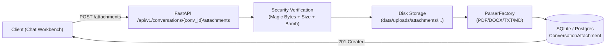

# AgentStudio-RAG — P0.3 Stage 1：聊天附件基础设施与文件解析交付报告

> **阶段状态**：已完成并通过全量验证  
> **验证基线**：专项测试 20/20 PASSED，全量后端测试 207/207 PASSED，零回归（0 Regressions）  
> **核心产出**：零依赖 DOCX 解析器、结构感知 Markdown 解析器、ConversationAttachment 数据模型、附件物理存储与原子写入服务、会话附件 REST API、20 组自动化测试套件。

---

## 一、架构定位与阶段边界

在 AgentStudio-RAG 作为「开箱即用的企业级智能知识助手」定位下，**P0.3 阶段的目标是让用户可以在已有会话中随时上传临时附件（PDF、DOCX、TXT、Markdown）并基于附件内容直接提问**。

根据架构规划，P0.3 严格划分为两个阶段：
- **Stage 1（当前阶段）**：聊天附件基础设施、安全存储、文档解析、数据持久化与附件管理 API。
- **Stage 2（后续阶段）**：附件临时向量化/BM25 检索、Token 预算动态注入、Workflow 与 Agent 执行引擎集成、SSE 附件引用事件、前端统一交互界面。

### Stage 1 边界遵守声明
1. **不执行向量化与检索**：本阶段不涉及 Chroma/BM25 索引构建。
2. **不注入 Prompt 预算**：本阶段不修改 `ContextBudgetManager` 与执行引擎输入。
3. **不侵入 Agent Runtime**：暂不注册附件工具或修改 LangGraph 节点。
4. **不改动前端 UI**：前端展示与拖拽上传留待 Stage 2 统一接入。

---

## 二、数据库模型设计

在 [`backend/app/models/conversation.py`](file:///e:/develop/python%20agentic%20RAG/backend/app/models/conversation.py) 中新增了 `ConversationAttachment` 模型，并与 `Conversation` 建立了级联外键关系。

### 1. 表结构与字段规范

| 字段名 | 类型 | 约束 | 说明 |
| :--- | :--- | :--- | :--- |
| `id` | `VARCHAR(36)` | 主键，默认 UUID4 | 附件全局唯一标识符 |
| `conversation_id` | `VARCHAR(36)` | 外键 `conversations.id`，索引，非空 | 所属对话 ID（`ondelete="CASCADE"`） |
| `original_filename` | `VARCHAR(255)` | 非空 | 原始文件名（安全转义后） |
| `storage_key` | `VARCHAR(500)` | 非空 | 相对物理存储路径（防路径穿越） |
| `file_extension` | `VARCHAR(20)` | 非空 | 标准化小写扩展名（`.pdf`, `.docx`, `.txt`, `.md`） |
| `mime_type` | `VARCHAR(100)` | 非空 | 探测推断的 MIME 类型 |
| `file_size` | `INTEGER` | 非空 | 文件物理字节大小 |
| `parse_status` | `VARCHAR(20)` | 默认 `"PENDING"`，索引 | 解析状态：`PENDING` / `COMPLETED` / `FAILED` |
| `page_count` | `INTEGER` | 默认 `0` | 总页数 / 逻辑章节数 |
| `char_length` | `INTEGER` | 默认 `0` | 提取纯文本总字符数 |
| `token_count` | `INTEGER` | 默认 `0` | 预估 Token 数（中文~0.7/字，英文~0.25/word） |
| `parsed_content_json` | `TEXT` | 可空 | 解析后的结构化分页 JSON（`ParsedDocument` 序列化） |
| `error_message` | `TEXT` | 可空 | 解析失败异常堆栈或诊断摘要 |
| `created_at` | `DATETIME` | 默认 UTC 现时 | 创建时间戳 |
| `updated_at` | `DATETIME` | 默认 UTC 现时，自动更新 | 更新时间戳 |

### 2. 级联关系与元数据隔离
- **物理与元数据隔离**：原始二进制物理文件存储于磁盘，数据库仅保存 `storage_key` 和解析后的结构化文本，避免大文件使关系数据库膨胀。
- **ORM 级联配置**：
  ```python
  attachments = relationship(
      "ConversationAttachment",
      back_populates="conversation",
      cascade="all, delete-orphan",
      passive_deletes=True,
  )
  ```
  在数据库端支持 `ON DELETE CASCADE` 的同时，ORM 端配置 `passive_deletes=True` 避免不必要的 SELECT 预载开销与 SAWarning。

---

## 三、物理存储架构与文件生命周期

### 1. 存储目录拓扑
物理存储根路径锚定于项目根目录 [`PROJECT_ROOT`](file:///e:/develop/python%20agentic%20RAG/backend/app/core/config.py#L20)，避免后端从不同子目录启动时发生路径偏移：
```text
data/
└── uploads/
    └── attachments/
        └── {conversation_id}/
            └── {attachment_id}/
                └── {safe_filename}
```

### 2. 原子落盘写入机制
在 [`backend/app/services/attachment_storage.py`](file:///e:/develop/python%20agentic%20RAG/backend/app/services/attachment_storage.py) 中实现原子写入：
1. 校验会话目录与附件目录，自动创建各级父目录。
2. 首先写入临时文件 `{safe_filename}.tmp.{uuid}`。
3. 校验写入字节数与完整性后，执行原子重命名 `os.replace` 覆盖到最终路径。
4. 若写入过程发生任何 OS I/O 异常，立即安全清理临时文件并抛出受控异常。

### 3. 磁盘空间一致性保证
- **单附件物理删除**：调用 `delete_attachment_physical_dir` 清理 `{attachment_id}` 目录及文件，若父级 `{conversation_id}` 目录为空则一并清理。
- **会话级物理删除**：当调用 `DELETE /api/v1/conversations/{conv_id}` 删除会话时，不仅数据库通过级联删除附件记录，[`chat.py`](file:///e:/develop/python%20agentic%20RAG/backend/app/api/v1/chat.py#L180-L188) 还会同步调用 `delete_conversation_physical_attachments(conv_id)` 递归删除其对应的所有磁盘附件。
- **事务失败物理清理**：如果在上传多附件过程中数据库 `db.commit()` 发生异常，API 捕获异常执行 `await db.rollback()` 的同时，自动遍历本次已落盘的全部文件进行物理 `unlink` 清理，确保无任何孤儿文件滞留磁盘。

---

## 四、文档解析引擎体系

通过 [`backend/app/ingestion/parsers/factory.py`](file:///e:/develop/python%20agentic%20RAG/backend/app/ingestion/parsers/factory.py) 统一调度四种文档解析器：

### 1. PDF 解析器 ([`PDFParser`](file:///e:/develop/python%20agentic%20RAG/backend/app/ingestion/parsers/pdf_parser.py))
- 复用 PyMuPDF（`fitz`），逐页解析文档文本与块布局。
- 精准保留真实的物理 `page_number`（从 1 开始）。
- 记录每页的字符数与提取状态。

### 2. 零外部依赖 DOCX 解析器 ([`DocxParser`](file:///e:/develop/python%20agentic%20RAG/backend/app/ingestion/parsers/docx_parser.py))
- **零新依赖设计**：完全使用 Python 标准库 `zipfile` 与 `xml.etree.ElementTree` 实现，无需引入笨重的 `python-docx` 库，避免安装冲突与构建负担。
- **深度安全防护**：
  - 压缩条目上限：最多 1,000 个内部条目。
  - 解压膨胀体积上限：最大允许解压 50MB。
  - 压缩比熔断：解压/压缩比超过 100 倍时立即判定为 Zip Bomb 恶意攻击并拦截抛错。
  - 核心结构验证：严格校验必须包含 `word/document.xml`。
- **结构化内容提取**：
  - 段落与标题提取：解析 `w:p` / `w:pPr` / `w:pStyle`，识别 Heading 1~6 并在 Markdown 中保留 `#` 前缀。
  - 表格格式化：解析 `w:tbl` / `w:tr` / `w:tc`，自动转换为 Markdown 规范表格（支持对齐与分隔线）。
  - 语义分页映射：DOCX 没有物理页概念，解析器严禁伪造虚假页码，而是以逻辑章节/Heading 作为切分单元，将逻辑块映射为 `page_number`，并在 `metadata["heading_path"]` 中记录完整章节路径，便于后续精准引用溯源。

### 3. TXT 纯文本解析器 ([`TextParser`](file:///e:/develop/python%20agentic%20RAG/backend/app/ingestion/parsers/text_parser.py))
- 多编码自适应探测：按顺序尝试 `utf-8` → `utf-8-sig` → `gb18030` → `gbk`，确保中文字符不出现乱码。
- 将全文作为逻辑 Page 1 输出，记录探测到的编码类型。

### 4. 结构感知 Markdown 解析器 ([`MarkdownParser`](file:///e:/develop/python%20agentic%20RAG/backend/app/ingestion/parsers/markdown_parser.py))
- 继承 `TextParser`，在保持向后兼容（`isinstance(parser, TextParser) == True`）的同时提供结构感知能力。
- 自动识别 Markdown 标题层级（`#`、`##`、`###`）、代码块（` ``` `）和表格。
- 以大标题或合理字符块切分逻辑页面，在元数据中维护标题层级路径。

---

## 五、API 规范与接口契约

在 [`backend/app/api/v1/attachment.py`](file:///e:/develop/python%20agentic%20RAG/backend/app/api/v1/attachment.py) 中实现全部附件管理端点，由 [`api_router.py`](file:///e:/develop/python%20agentic%20RAG/backend/app/api/v1/api_router.py) 统一注册。



### 1. 核心端点清单

#### (1) `POST /api/v1/conversations/{conversation_id}/attachments`
- **说明**：向指定会话批量或单文件上传附件。
- **请求类型**：`multipart/form-data`，参数为 `files: List[UploadFile]`。
- **状态码**：`201 Created`。
- **响应结构**：`List[ConversationAttachmentResponse]`。
- **错误码**：
  - `400 Bad Request`：文件为空、扩展名不允许、Magic Bytes 校验失败、文件损坏或超大会话限额。
  - `404 Not Found`：指定 `conversation_id` 不存在。
  - `413 Request Entity Too Large`：单文件大小超过 20MB 上限。

#### (2) `GET /api/v1/conversations/{conversation_id}/attachments`
- **说明**：获取指定会话的已上传附件列表（不含全文正文）。
- **状态码**：`200 OK`。
- **响应结构**：`List[ConversationAttachmentResponse]`（按 `created_at` 降序）。

#### (3) `GET /api/v1/conversations/{conversation_id}/attachments/{attachment_id}`
- **说明**：获取单个附件详情，包含提取出的 `extracted_text` 及分页结构 `parsed_pages`。
- **跨会话隔离**：必须满足 `attachment.conversation_id == conversation_id`，否则严格返回 `404 Not Found`，彻底杜绝越权访问。
- **状态码**：`200 OK`。
- **响应结构**：`ConversationAttachmentDetailResponse`。

#### (4) `DELETE /api/v1/conversations/{conversation_id}/attachments/{attachment_id}`
- **说明**：删除指定会话的单个附件。
- **行为**：从数据库物理删除记录，并同步删除物理磁盘文件及所属目录。
- **状态码**：`204 No Content`。

---

## 六、多层安全防护设计

| 风险场景 | 防御策略 | 代码实现位置 |
| :--- | :--- | :--- |
| **后缀伪造（MIME Spoofing）** | 双重校验：白名单扩展名 + 文件头 Magic Bytes 强校验（PDF 校验 `%PDF-`，DOCX 校验 `PK\x03\x04` 且包含 `word/document.xml`，TXT/MD 校验无二进制 NULL 字节且编码合法） | [`attachment_storage.py`](file:///e:/develop/python%20agentic%20RAG/backend/app/services/attachment_storage.py#L32-L75) |
| **解压炸弹（Zip Bomb）** | 解压成员数量限制 $\le 1000$、总膨胀体积 $\le 50\text{MB}$、解压压缩比 $\le 100$ | [`docx_parser.py`](file:///e:/develop/python%20agentic%20RAG/backend/app/ingestion/parsers/docx_parser.py#L22-L42) |
| **路径穿越（Path Traversal）** | 提取 `Path(filename).name` 去除全部 `../` 或 `..\` 前缀，并过滤特殊控制字符 | [`attachment_storage.py`](file:///e:/develop/python%20agentic%20RAG/backend/app/services/attachment_storage.py#L78-L92) |
| **空文件与超大文件** | 拦截 0 字节文件；限制单文件最大 20MB（可通过环境变量配置） | [`attachment_storage.py`](file:///e:/develop/python%20agentic%20RAG/backend/app/services/attachment_storage.py#L65-L75) |
| **会话附件堆积** | 单会话最多允许 10 个有效附件，防止临时上下文无限撑爆显存或磁盘 | [`attachment.py`](file:///e:/develop/python%20agentic%20RAG/backend/app/api/v1/attachment.py#L60-L75) |
| **跨会话越权** | 查询与删除接口执行双重匹配：`ConversationAttachment.id == att_id` 且 `ConversationAttachment.conversation_id == conv_id` | [`attachment.py`](file:///e:/develop/python%20agentic%20RAG/backend/app/api/v1/attachment.py#L190-L245) |

---

## 七、测试套件与自动化验证

本次在 [`backend/tests/test_p0_3_attachments.py`](file:///e:/develop/python%20agentic%20RAG/backend/tests/test_p0_3_attachments.py) 中编写了 20 组端到端及单元测试，覆盖正常链路、边界条件与安全攻击防御。

### 1. 20 组专项测试用例执行结果

| 用例编号 | 测试函数名 | 验证目标 | 结果 |
| :---: | :--- | :--- | :---: |
| 1 | `test_pdf_normal_upload_and_parse` | 真实 PDF 内存生成、上传、PyMuPDF 解析、物理文件与正文检查 | **PASSED** |
| 2 | `test_docx_normal_upload_and_parse` | 真实 DOCX 生成、段落与 Markdown 表格提取、元数据解析 | **PASSED** |
| 3 | `test_txt_normal_upload_and_parse` | TXT 文本多行上传、UTF-8 编码解析与字符计数 | **PASSED** |
| 4 | `test_markdown_normal_upload_and_parse` | 结构感知 Markdown 标题、代码块与内容结构化解析 | **PASSED** |
| 5 | `test_multi_file_upload` | 多文件（PDF + DOCX + TXT + MD）单请求并发上传与批量落盘 | **PASSED** |
| 6 | `test_empty_file_rejected` | 0 字节空文件拦截验证（HTTP 400） | **PASSED** |
| 7 | `test_disallowed_extension_rejected` | 不在白名单的后缀（如 `.exe`, `.py`）拦截验证（HTTP 400） | **PASSED** |
| 8 | `test_mime_spoofing_intercepted` | 后缀伪造（如伪装成 PDF 的纯文本/二进制垃圾）拦截验证（HTTP 400） | **PASSED** |
| 9 | `test_oversized_file_intercepted` | 超过配置上限（>20MB）的文件拦截验证（HTTP 413） | **PASSED** |
| 10 | `test_corrupted_docx_intercepted` | 损坏的 DOCX（缺失 document.xml 或非法 zip）解析熔断拦截 | **PASSED** |
| 11 | `test_zip_bomb_protection` | 构造解压比 > 100 倍的 Zip 炸弹，验证自动熔断与安全防护 | **PASSED** |
| 12 | `test_path_traversal_protection` | 包含 `../../etc/passwd` 等路径穿越攻击文件名的安全规整 | **PASSED** |
| 13 | `test_nonexistent_conversation_404` | 向不存在的会话 ID 上传附件返回标准 404 | **PASSED** |
| 14 | `test_cross_conversation_isolation` | 跨会话访问隔离：会话 B 访问/删除会话 A 附件严格返回 404 | **PASSED** |
| 15 | `test_attachment_deletion_cleans_physical_file` | 单附件删除时同步彻底清理磁盘文件与空目录 | **PASSED** |
| 16 | `test_conversation_deletion_cleans_all_physical_attachments` | 删除整个会话时级联清理该会话下所有的物理磁盘附件目录 | **PASSED** |
| 17 | `test_db_transaction_failure_cleans_temp_file` | 数据库提交失败事务回滚时，磁盘已落盘文件自动清理无泄漏 | **PASSED** |
| 18 | `test_metadata_restoration_after_reload` | 会话重新加载后附件元数据与分页结构完整重现 | **PASSED** |
| 19 | `test_filename_with_chinese_and_special_chars` | 包含中文、空格、括号、特殊字符的文件名正常处理与安全存储 | **PASSED** |
| 20 | `test_existing_knowledge_base_upload_unaffected` | 原有知识库文档上传与入库全流程回归验证，无任何冲突 | **PASSED** |

### 2. 全量回归测试汇总
```text
============================== test session summary ==============================
rootdir: E:\develop\python agentic RAG\backend
collected 207 items

207 passed, 1 warning in 28.58s
==================================================================================
```
- **原有功能测试**：187 项全部保持通过。
- **本次新增测试**：20 项全部通过。
- **回归率**：**0 Regressions**。

---

## 八、Stage 2 移交清单与开发建议

在获得授权启动 P0.3 Stage 2 时，建议按以下模块依次推进：

1. **临时检索器（Ephemeral Retriever）**：
   - 针对当前会话中的已解析附件，支持构建轻量内存 BM25 索引或可选向量检索。
   - 实现低延迟与会话销毁时的即时内存清理。
2. **Token 预算管理器动态注入（Context Budget Manager）**：
   - 当附件总字符数较小（如 $\le 8\text{K}$ tokens）时，支持直接全量或截断注入 Prompt 系统上下文。
   - 当附件总字符数较大时，触发轻量临时检索选出 Top-K 片段注入上下文。
3. **Workflow RAG 与 Agent Runtime 双模式集成**：
   - Workflow 模式：自动在 Prompt 中格式化渲染附件正文。
   - Agent 模式：注入 `read_conversation_attachment` 工具，赋予 Agent 自主查阅指定附件段落的能力。
4. **SSE 事件与引用透传**：
   - 在流式事件中增加 `attachment_citation` 或将其合并入现有 `citations` 结构中，标明页码与章节。
5. **前端交互与 UI 统一升级**：
   - 在统一聊天工作台中增加附件上传拖拽区域、已传文件徽标（Pill Tag）、附件预览 Drawer。
