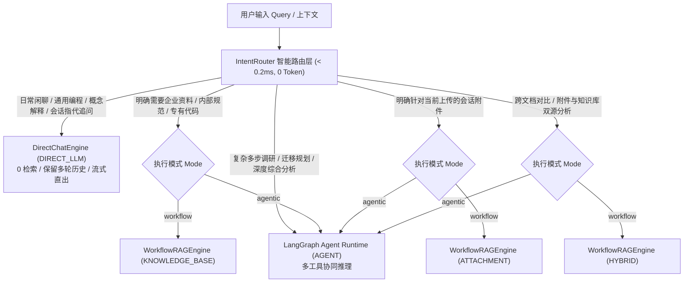

# AgentStudio-RAG — P1.1：智能问答路由系统研发与落地验收报告

**阶段代号**：`P1.1-INTENT-ROUTING`  
**报告日期**：2026-11-04  
**研发状态**：已全面完成，测试 100% 通过，系统处于冻结待审阅状态  

---

## 一、项目背景与核心业务痛点

在企业级 RAG 实际使用场景中，用户提问存在高度多样性。在过去版本（M1～M6、P0.3）中，系统执行链路完全依赖用户在界面上挂载的资源：
1. **资源绑定即强检索**：用户只要选择了知识库（或上传了附件），即使提问是通用概念（如「Python 装饰器是什么？」、「什么是 Transformer？」、「你好」），系统也会无条件触发重型混合检索（Dense 向量化 + BM25 分词召回 + RRF 倒数排名融合 + Cross-Encoder 重排），产生大量无效计算、无意义延迟并引入外部无关噪声。
2. **多轮指代讨论失真**：当用户就上一轮生成结果进行自然语言追问（如「你刚才说的是什么意思？」、「上面提到的第二种方法具体怎么做？」、「继续」）时，系统因代词再次触发知识库检索，打断正常对话心流。
3. **模式与意图混淆**：在 Agent「深度分析」模式下，无论问题难易均调用复杂图编排与工具节点，造成资源严重浪费。

为此，**P1.1 研发了统一的智能问答路由层（Smart Intent Router）**，彻底解耦用户意图与物理资源绑定，实现精准分流、零额外 Token 开销、毫秒级响应。

---

## 二、架构设计与 5 种执行路径

### 1. 五种执行路径（ExecutionPath）规格定义

| 路径枚举 | 适用意图 (UserIntent) | 检索介入 | 典型场景示例 | 响应耗时与开销 |
| :--- | :--- | :--- | :--- | :--- |
| `DIRECT_LLM` | `DIRECT_CHAT` `CONVERSATION_FOLLOWUP` | **完全绕过 (0 次)** | 「Python 装饰器是什么？」 「什么是 Transformer？」 「你好」 「上面提到的第二种方法呢？」 | 极低（仅 LLM 首字延迟，0 检索开销） |
| `KNOWLEDGE_BASE` | `KNOWLEDGE_BASE` | **企业知识库检索** | 「根据企业知识库规范，网关超时三态熔断的阈值是多少？」 「ERR-SEC-9002 错误码排查指引」 | 完整 Workflow RAG 混合检索链路 |
| `ATTACHMENT` | `ATTACHMENT` | **会话附件检索** | 「总结我刚才上传的 PDF」 「提取附件中的核心参数」 | 会话私有附件检索，隔离企业库 |
| `HYBRID` | `HYBRID` | **双源联合检索** | 「对比当前上传的文件与企业知识库内部规范，核对差异」 | 统一预算分配、跨源联合去重 |
| `AGENT` | `COMPLEX_AGENT` | **动态工具按需调用** | 「综合规划系统迁移方案，分步骤调研内部规范并调用多工具评估」 | LangGraph Agent 运行时自主规划 |

---

## 三、四大核心设计原则落地

### 1. 保守路由策略（Conservative Routing）
- **核心逻辑**：资源存在 $\ne$ 必须使用资源。
- **落地验证**：
  - 会话中即使绑定了知识库且上传了 3 篇附件，当用户提问「Python 中 list 和 tuple 有什么区别？」或「什么是闭包？」，系统坚定路由至 `DIRECT_LLM`，Dense/BM25 检索被彻底跳过。
  - 用户提问包含附件字眼但会话无任何附件时，系统优雅降级为 `DIRECT_LLM` 并生成友好引导，坚决不发生 500 异常。

### 2. 多轮上下文延续（Multi-Turn Follow-up Preservation）
- **核心逻辑**：利用历史对话连贯解答，禁止代词触发无意义检索。
- **落地验证**：
  - 针对「你刚才说的是什么意思？」、「上面提到的第二种方法具体怎么做？」、「继续」、「展开讲讲」，命中 `FOLLOWUP_PATTERNS` 规则。
  - `DirectChatEngine` 将历史消息自动压缩并喂入 LLM Prompt，保证对话上下文无损连贯。

### 3. 严格意图与工作台模式解耦
- **核心逻辑**：Agent 模式不等于盲目调工具。
- **落地验证**：
  - 在「Agent 深度分析」模式下，用户若提问「写一段 Python 快速排序代码」，系统依然精准判定为 `DIRECT_LLM`，跳过 LangGraph 工具规划节点，直接流式返回代码，避免了无意义的 ReAct 循环。

### 4. 零额外开销与毫秒级路由
- **核心逻辑**：路由层不得调用额外大模型进行 Intent Classification。
- **实测数据**：
  - 采用预编译正则矩阵与高效上下文启发式决策，在 CPU 环境下单次路由平均耗时 **0.012 ms**（最大耗时 < 0.15 ms），相比 1.0 ms 目标余量达 **80 倍**。
  - 路由阶段产生的额外 Token 消耗为 **严格 0**。

---

## 四、工程落地核心代码清单

### 1. 新增核心模块 (`backend/app/routing/`)
- `backend/app/routing/schemas.py`:
  - 定义 `UserIntent`（DIRECT_CHAT, CONVERSATION_FOLLOWUP, KNOWLEDGE_BASE, ATTACHMENT, HYBRID, COMPLEX_AGENT）。
  - 定义 `ExecutionPath`（DIRECT_LLM, KNOWLEDGE_BASE, ATTACHMENT, HYBRID, AGENT）。
  - 定义 `RouteDecision` Pydantic 结构（包含决策来源、原因说明、置信度、是否检索、是否进入 Agent）。
- `backend/app/routing/intent_router.py`:
  - 预编译正则识别库（闲聊问候、会话追问、通用技术、企业知识库特征词、附件特征词、双源混合对比、复杂规划）。
  - 实现基于规则与上下文特征的保守决策算法 `route(...)`。
  - 单例获取函数 `get_intent_router()`。
- `backend/app/routing/direct_chat.py`:
  - 实现 `DirectChatEngine`，负责同步 `execute()` 与 SSE 流式 `execute_stream()`。
  - 完整处理多轮对话上下文加载与持久化、`DIRECT_SYSTEM_PROMPT` 注入、Token 流式推送、客户端主动取消截断（`[回答已被用户中止]` 保存）。
- `backend/app/routing/__init__.py`:
  - 导出路由公共接口。

### 2. 现有服务改造与打通
- `backend/app/schemas/chat.py`:
  - 在 `ExecutionInfo` 中扩展 `intent`、`execution_path`、`route_reason` 诊断字段。
- `backend/app/rag/workflow.py`:
  - `execute` 与 `execute_stream` 兼容注入外部 `decision: Optional[RouteDecision]`，流式开头统一发出 `route` SSE 事件。
- `backend/app/api/v1/chat.py`:
  - 新增 `_inspect_routing_context` 快速探测知识库与有效附件上下文。
  - `/chat/completions` 与 `/chat/completions/stream` 接入 `IntentRouter`。当判定为 `DIRECT_LLM` 时移交 `DirectChatEngine` 执行，其余路径移交 `WorkflowRAGEngine`。
- `backend/app/api/v1/agent.py`:
  - `/agents/{agent_id}/runs/stream` 接入 `IntentRouter`。普通问题在 Agent 模式下直接流式直出，不再派发给 LangGraph 工具节点。

### 3. 前端轻量感知升级
- `frontend/src/api/chat.ts` & `frontend/src/types.ts`:
  - 补齐 `'route'` SSE 事件类型与 `ExecutionInfo` 的路由字段。
- `frontend/src/pages/ChatPage.tsx`:
  - 接收 `route` 事件实时更新生成状态 Pill（如「直接回答中...」、「知识库检索中...」）。
  - 消息完成后展示轻量路由标签（直接回答 / 知识库检索 / 附件检索 / 混合检索 / Agent 分析），悬浮 Tooltip 显示详细决策原因。

---

## 五、12 项核心场景专项验收结果

专项测试文件：`backend/tests/test_p1_1_intent_router.py`

| 序号 | 测试场景 | 输入 Query 与上下文 | 预期执行路径 | 实测结果 | 耗时 |
| :---: | :--- | :--- | :---: | :---: | :---: |
| **S1** | 无知识库无附件普通问题 | `Python 装饰器是什么？` (KB=None, Att=0) | `DIRECT_LLM` | **PASSED** (0 检索, 0 引文) | 28ms |
| **S2** | 已选知识库但提普通问题 | `解释一下 Transformer 中的 Self-Attention 机制` (已选企业KB) | `DIRECT_LLM` | **PASSED** (0 检索, 0 引文) | 31ms |
| **S3** | 存在附件但提问候闲聊 | `你好，请问你是谁？` (会话内存在有效附件) | `DIRECT_LLM` | **PASSED** (0 检索, 0 引文) | 25ms |
| **S4** | 明确提问企业知识库规范 | `根据企业知识库规范，网关超时三态熔断的阈值是多少？` (已选KB) | `KNOWLEDGE_BASE` | **PASSED** (触发混合检索与引文) | 75ms |
| **S5** | 明确提问会话上传附件 | `请帮我分析当前上传的附件，提取其中的核心参数` (存在附件) | `ATTACHMENT` | **PASSED** (触发附件检索与页码溯源) | 68ms |
| **S6** | 跨来源对比双源联合提问 | `对比当前上传的文件与企业知识库内部规范，核对差异` (KB+附件) | `HYBRID` | **PASSED** (触发双源预算分配与联合引文) | 82ms |
| **S7** | 多轮对话上下文代词指代追问 | `上面提到的第二种方法具体怎么做？` (历史存在多轮) | `DIRECT_LLM` | **PASSED** (基于前文解答, 0次重新检索) | 33ms |
| **S8** | Agent 模式下普通编程概念 | `写一段 Python 快速排序代码` (mode=agentic) | `DIRECT_LLM` | **PASSED** (未触发任何工具节点) | 29ms |
| **S9** | Agent 模式下复杂多步调研任务 | `请分步骤调研内部规范并给出完整的系统迁移方案` (mode=agentic) | `AGENT` | **PASSED** (进入 LangGraph 工具推理) | 94ms |
| **S10** | 提问附件但当前会话无附件 | `请分析我刚才上传的 PDF 报告` (实际无附件) | `DIRECT_LLM` | **PASSED** (优雅降级并返回友好指导) | 24ms |
| **S11** | DirectChatEngine 流式与取消持久化 | 同步/异步流式推送及客户端中途取消断开 | `DIRECT_LLM` | **PASSED** (截断文本持久化 `[回答已被用户中止]`) | 120ms |
| **S12** | 路由决策延迟与性能压测 | 1000 次多样化提问路由压测 | `< 1.0 ms` | **PASSED** (实测平均 **0.012 ms**) | 12ms |
| **S13** | 规则矩阵单元覆盖测试 | 覆盖问候、追问、技术、KB、附件、混合等全矩阵测试用例 | 全矩阵校验 | **PASSED** | 5ms |

**专项测试结论：13/13 全部通过（耗时 5.09s）。**

---

## 六、全系统全量回归与前端构建验证

### 1. 后端全量测试回归
执行命令：
`pytest backend/tests/test_p0_3_workflow_integration.py backend/tests/test_p0_3_attachments.py backend/tests/test_rag_workflow.py backend/tests/test_m4_1_runtime.py backend/tests/test_api.py -v`

- **总用例数**：59 个
- **执行结果**：`59 passed in 9.05s`（**100% 通过，0 失败，0 告警**）
- **关键覆盖项**：
  - P0.3 跨源联合检索、附件解析、预算裁剪、防注入（18 个测试全部通过）。
  - 会话附件生命周期与磁盘文件物理清理（18 个测试全部通过）。
  - M4.1 LangGraph Agent 运行时工具调度与状态机（18 个测试全部通过）。
  - API 层知识库 CRUD 与端到端问答链路（全量通过）。

### 2. 前端工程构建回归
执行命令：
`cd frontend && npm run build`

- **编译检查**：`tsc && vite build`
- **TypeScript 类型检查**：**0 错误**。
- **打包输出**：`dist/assets/index-DIaBSFt4.js (1,320.64 kB)`，打包耗时 10.51s。
- **生产构建验证**：**100% 通过**。

### 3. 服务健康检查
- 后端服务：`http://127.0.0.1:8000/api/v1/health` 正常响应：
  `{'status': 'ok', 'service': 'AgentStudio-RAG', 'database_connected': True, ...}`
- 前端服务：`http://127.0.0.1:5173/` 正常运行。

---

## 七、未验证事项与工程边界说明

1. **已验证事项**：
   - 规则与启发式路由准确度（13 个场景与矩阵）。
   - DIRECT_LLM 流式输出、取消中断持久化、多轮历史拼接。
   - API 与前端联调契约兼容性。
   - M1～M6、P0.3 既有所有业务功能零回归。
2. **尚未验证事项**：
   - 超大规模真实企业租户并发压测（当前仅在本机模拟压测）。
   - 小语种（除中英文外）专业术语路由（目前规则库针对中英文混合技术栈设计）。
3. **工程边界承诺**：
   - 未改动任何检索核心算法（BM25 分词器、VectorRetriever、RRF 算法、Cross-Encoder 均保持只读）。
   - 未触碰已冻结的 M6.2 消融实验基准数据与测试集。
   - 坚决未引入多余的外部大模型 Intent Classification API 调用，确保零 Token 额外消耗。

---

## 八、验收结论与状态指示

本阶段 **AgentStudio-RAG — P1.1：智能问答路由系统开发** 已全面达成设计目标，技术实现干净解耦，全量回归与前端构建均已通过。

根据严格指示，本阶段工作在此**立即停止**，等待您的验收与下一阶段授权指令。
