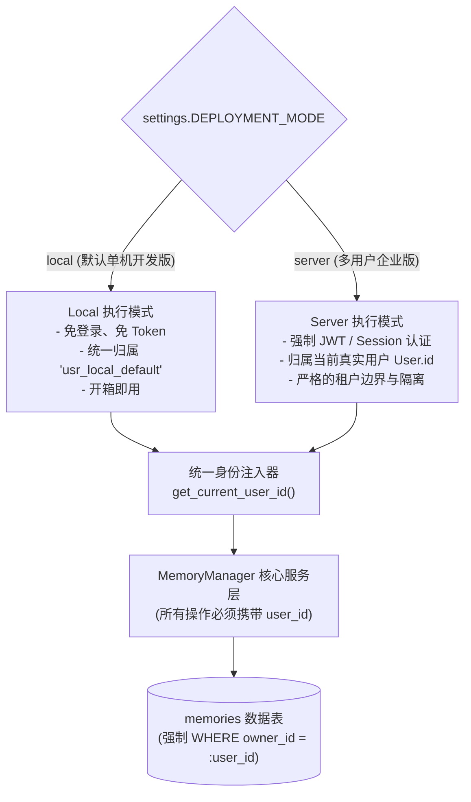

# AgentStudio-RAG — P1.2 长期记忆与 P1.3 用户身份体系依赖关系与前向兼容规范

**文档代号**：`P1.2-P1.3-IDENTITY-DEPENDENCY`  
**关联版本**：AgentStudio-RAG v0.1.0 (P1.2 Stage 1)  
**目标受众**：系统架构师、后端研发工程师  

---

## 一、架构背景与解耦目标

长期记忆（Long-term Memory）在本质上属于**高度私密、用户专属且具有持续累积特性的数据资产**。

在传统的单机原型开发中，系统往往容易将所有记忆直接平铺在一张全局表中，不包含用户归属标识。一旦系统进入多用户服务器部署阶段，这种设计将带来灾难性的“架构技术债”：
1. **多用户数据串扰**：用户 A 沉淀的个人习惯（如“使用 Java 开发”）会被错误注入到用户 B 的提问上下文，造成严重的业务误判。
2. **敏感信息泄露**：在多租户环境下，一个用户可以隐式检索出另一个用户在历史会话中留存的架构事实。
3. **后期重构成本高昂**：若前期未定义 `owner_id`，后期引入用户体系时，必须停机进行大规模数据清洗、Schema 迁移与接口破坏性改造。

因此，**P1.2 阶段必须从第一天起就原生支持多租户隔离规范**，使得当前阶段在未实现完整 P1.3（用户认证、权限管理、多组织机构）的前提下，既能在个人 Local 模式下开箱即用，又能在未来升级 P1.3 时实现**零数据库迁移重构、零 API 破坏性升级**。

---

## 二、双部署模式与身份合约

AgentStudio 明确定义了两种运行模式，通过全局配置项 `settings.DEPLOYMENT_MODE` 控制：



### 1. 部署模式规范

| 部署模式 | 适用场景 | 认证机制 | 默认身份表示 (`owner_id`) | 数据隔离效果 |
| :--- | :--- | :--- | :--- | :--- |
| **`local`** | 个人本地开发、单机桌面版、检索离线评估 | **无需登录**，自动透传默认身份 | `usr_local_default` | 本机单用户自包含，数据完全独立于外部 |
| **`server`** | 团队服务器部署、内网私有化、企业协同 | **强制认证**（用户名/密码，JWT Bearer Token） | `usr_<uuid>`（映射为 `users.id`） | 严格多租户数据隔离，跨租户物理阻断 |

---

## 三、数据 Schema 前向兼容设计

### 1. `memories` 表字段对齐
在 P1.2 的 `Memory` 模型中，主键和归属字段设计如下：

```python
class Memory(Base):
    __tablename__ = "memories"

    id = Column(String(36), primary_key=True, default=lambda: str(uuid.uuid4()))
    
    # 租户归属字段：在 P1.2 使用带索引的 String(64)，在 P1.3 无缝关联 ForeignKey("users.id")
    owner_id = Column(String(64), nullable=False, default="usr_local_default", index=True)
    ...
```

- **兼容性保障**：
  - P1.2 阶段：`owner_id` 作为一个独立的带索引字段正常读写，默认值设为 `usr_local_default`。
  - P1.3 阶段：创建 `users` 表后，系统仅需在 `memories.owner_id` 上添加外键约束 `ForeignKey("users.id", ondelete="CASCADE")`，**无需重命名列，无需迁移已有历史数据**。

### 2. 会话关联与防越权校验（`source_conversation_id`）
记忆记录可能溯源自某次具体的会话（`source_conversation_id`）：
- **校验原则**：
  - 在创建或更新记忆时，系统通过 `MemoryManager` 校验：
    ```python
    if source_conversation_id:
        conv = await db.get(Conversation, source_conversation_id)
        if not conv or (hasattr(conv, "owner_id") and conv.owner_id != user_id):
            raise UnauthorizedConversationAccessException()
    ```
  - 防止恶意客户端伪造他人所有的 `conversation_id` 注入到自己的记忆中。

---

## 四、依赖注入与无缝切换策略

为了让 P1.2 与 P1.3 干净解耦，API 层采用 FastAPI 的依赖注入机制（Dependency Injection）抽象用户身份获取过程：

### 1. 身份注入器规范（`app/core/auth.py`）

```python
# backend/app/core/auth.py

from fastapi import Depends, Header, HTTPException, status
from app.core.config import settings

DEFAULT_LOCAL_USER_ID = "usr_local_default"


async def get_current_user_id(
    authorization: Optional[str] = Header(None)
) -> str:
    """
    统一用户身份提取器：
    - 在 local 模式下：返回常量 DEFAULT_LOCAL_USER_ID，无需 Token。
    - 在 server 模式下：解析 Authorization Bearer Token；P1.3 就绪后挂接真实 JWT 解密。
    """
    if settings.DEPLOYMENT_MODE == "local":
        return DEFAULT_LOCAL_USER_ID

    # Server 模式下的占位与前向兼容处理
    if not authorization or not authorization.startswith("Bearer "):
        raise HTTPException(
            status_code=status.HTTP_401_UNAUTHORIZED,
            detail="Authentication required in server deployment mode.",
        )
    
    token = authorization.split(" ")[1]
    # P1.3 实现时，此处替换为 jwt.decode(token, settings.JWT_SECRET)
    user_id = token  # 预留前向兼容解析
    return user_id
```

### 2. 业务端调用零感知
所有涉及记忆操作的接口与核心引擎，统一声明 `user_id: str = Depends(get_current_user_id)`：
- `/api/v1/memories` 的所有 CRUD 接口直接接收 `user_id`。
- `/chat/completions` 与 `/agents/runs` 直接获取当前 `user_id`，并将其传递给 `memory_manager.retrieve_relevant_memories(query, user_id=user_id)`。
- **演进承诺**：当 P1.3 实施时，所有已编写的记忆管理代码和聊天接口**行数变动为 0**，只需完善 `auth.py` 内部的 JWT 校验实现。

---

## 五、租户隔离与安全契约（Security Contract）

P1.2 记忆系统严格遵守以下五大安全铁律：

1. **查询强绑定**：
   - 所有 SQL 检索无论走主键查询、全量列表还是向量余弦打分，底层执行语句必须包含硬性过滤：
     `stmt.where(Memory.owner_id == user_id, Memory.is_active == True)`。
   - 杜绝任何全局无租户限制的扫描。
2. **越权阻断（IDOR 防御）**：
   - 用户尝试修改（`PUT`）、删除（`DELETE`）指定 `memory_id` 时，若该记忆记录的 `owner_id != current_user_id`，系统统一返回 `404 Not Found`（防止攻击者通过遍历探测其他用户的记忆 ID 存在性）。
3. **删除彻底失效**：
   - 用户删除一条记忆后，无论物理删除还是软下线，该记忆在向量检索候选池中立即被过滤，确保“删即失效，永不再被召回”。
4. **敏感信息零记忆**：
   - 严禁记忆提取器沉淀密码、Token、API Key 等凭据。如果检测到敏感字段，直接阻断并不予持久化。
5. **Prompt 围栏隔离**：
   - 注入上下文时，明确将记忆声明为不可信数据，防止跨会话 Prompt 越狱。

---

## 六、实施边界与零重构落地指南

1. **Stage 2 研发范围**：
   - 遵循本文档规范，将 `owner_id` 作为 `Memory` 表的核心字段。
   - 在 `MemoryManager` 类的每个公开方法中增加 `user_id: str` 必选参数。
   - 测试用例覆盖单用户 Local 模式与多用户隔离模式。
2. **P1.3 用户身份体系接入时的无缝对接步骤**：
   - 第 1 步：创建 `users` 表及登录注册路由。
   - 第 2 步：在 `memories.owner_id` 与 `conversations.owner_id` 上添加 `ForeignKey("users.id")`。
   - 第 3 步：在 `get_current_user_id` 中接入标准 JWT 解析。
   - **完成无缝升级**，长期记忆模块自身代码无需任何重构。
