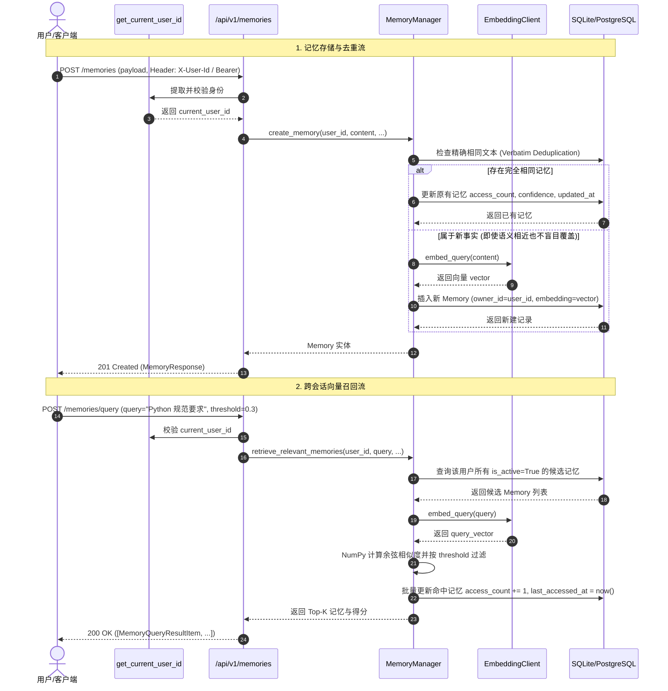

# AgentStudio-RAG — P1.2 Stage 2：长期记忆数据模型与核心服务开发验收报告

**阶段代号**：`P1.2-STAGE-2-IMPLEMENTATION`  
**完成时间**：2026-11-04  
**开发状态**：核心基础设施全部落地，9 项专项测试 + 72 项历史回归（共 81 项测试）**100% 通过**，前端生产构建 **0 错误**。系统已在 Stage 2 边界处**安全停止**，等待验收。

---

## 一、修改与新增文件清单

| 文件路径 | 变更类型 | 核心职责说明 |
| :--- | :---: | :--- |
| [`backend/app/models/memory.py`](file:///e:/develop/python%20agentic%20RAG/backend/app/models/memory.py) | **新增** | 定义 `Memory` SQLAlchemy 模型、`MemoryType`、`MemorySourceType` 枚举及复合索引。 |
| [`backend/app/models/__init__.py`](file:///e:/develop/python%20agentic%20RAG/backend/app/models/__init__.py) | **修改** | 导出 `Memory`、`MemoryType`、`MemorySourceType`，注册至 `Base.metadata`。 |
| [`backend/app/schemas/memory.py`](file:///e:/develop/python%20agentic%20RAG/backend/app/schemas/memory.py) | **新增** | 定义长期记忆创建、更新、查询、列表与语义召回的 Pydantic 数据规范。 |
| [`backend/app/memory/manager.py`](file:///e:/develop/python%20agentic%20RAG/backend/app/memory/manager.py) | **新增** | 实现 `MemoryManager` 核心服务，负责多租户隔离、NumPy 向量余弦检索、CRUD 与精确去重。 |
| [`backend/app/memory/__init__.py`](file:///e:/develop/python%20agentic%20RAG/backend/app/memory/__init__.py) | **新增** | 导出 `MemoryManager` 服务。 |
| [`backend/app/core/auth.py`](file:///e:/develop/python%20agentic%20RAG/backend/app/core/auth.py) | **新增** | 实现 `get_current_user_id` 依赖注入器，原生兼容 Local（`usr_local_default`）与 Server 模式。 |
| [`backend/app/core/config.py`](file:///e:/develop/python%20agentic%20RAG/backend/app/core/config.py) | **修改** | 新增 `DEPLOYMENT_MODE`、`DEFAULT_LOCAL_USER_ID`、`MEMORY_SIMILARITY_THRESHOLD` 等配置项。 |
| [`backend/app/core/exceptions.py`](file:///e:/develop/python%20agentic%20RAG/backend/app/core/exceptions.py) | **修改** | 新增 `MemoryNotFoundError` 与 `MemoryAccessForbiddenError` 异常类。 |
| [`backend/app/api/v1/memory.py`](file:///e:/develop/python%20agentic%20RAG/backend/app/api/v1/memory.py) | **新增** | 提供 8 个标准 RESTful CRUD 与语义向量检索路由，强制注入用户上下文。 |
| [`backend/app/api/v1/api_router.py`](file:///e:/develop/python%20agentic%20RAG/backend/app/api/v1/api_router.py) | **修改** | 将 `memory_router` 正式挂载至 FastAPI `/api/v1` 路由树。 |
| [`backend/tests/test_p1_2_memory_stage2.py`](file:///e:/develop/python%20agentic%20RAG/backend/tests/test_p1_2_memory_stage2.py) | **新增** | 编写 9 项完备的长期记忆专项测试用例，覆盖单/多租户、越权阻断、停用删除与优雅降级。 |
| [`backend/tests/conftest.py`](file:///e:/develop/python%20agentic%20RAG/backend/tests/conftest.py) | **修改** | 导入 `app.models`，保证在内存测试数据库建表时自动生成 `memories` 表。 |

---

## 二、数据模型与 API 说明

### 1. `memories` 数据表设计
继承自 SQLAlchemy `Base`，通过 `Base.metadata.create_all` 自动初始化：

```python
class Memory(Base):
    __tablename__ = "memories"

    id = Column(String(36), primary_key=True, default=lambda: str(uuid.uuid4()))
    owner_id = Column(String(64), nullable=False, default=settings.DEFAULT_LOCAL_USER_ID, index=True)
    content = Column(Text, nullable=False)
    memory_type = Column(String(32), nullable=False, default=MemoryType.IMPORTANT_FACT, index=True)
    tags_json = Column(Text, nullable=True, default="[]")
    source_type = Column(String(32), nullable=False, default=MemorySourceType.EXPLICIT_USER)
    source_conversation_id = Column(String(36), ForeignKey("conversations.id", ondelete="SET NULL"), nullable=True, index=True)
    source_message_id = Column(String(36), ForeignKey("messages.id", ondelete="SET NULL"), nullable=True)
    confidence = Column(Float, nullable=False, default=1.0)
    embedding_json = Column(Text, nullable=True)  # 复用 DocumentChunk 相同的向量序列化存储
    access_count = Column(Integer, nullable=False, default=0)
    last_accessed_at = Column(DateTime, nullable=True)
    is_active = Column(Boolean, nullable=False, default=True, index=True)
    created_at = Column(DateTime, nullable=False, default=lambda: datetime.now(timezone.utc))
    updated_at = Column(DateTime, nullable=False, default=lambda: datetime.now(timezone.utc), onupdate=lambda: datetime.now(timezone.utc))

    __table_args__ = (
        Index("ix_memories_owner_active_type", "owner_id", "is_active", "memory_type"),
    )
```

### 2. RESTful API 规格清单

所有接口通过 `Depends(get_current_user_id)` 获取当前用户 ID，**不允许客户端自行传入或篡改 `owner_id`**：

| 方法 | 路径 | 状态码 | 功能描述 | 租户安全机制 |
| :--- | :--- | :---: | :--- | :--- |
| `POST` | `/api/v1/memories` | 201 | 创建新记忆 | 强制 `owner_id = current_user_id`，校验 `source_conversation_id` |
| `GET` | `/api/v1/memories` | 200 | 记忆列表（分页、类型、状态、搜索） | 仅返回 `owner_id == current_user_id` 的记录 |
| `POST` | `/api/v1/memories/query` | 200 | 向量余弦相似度检索 | 仅检索 `owner_id == current_user_id AND is_active == True` |
| `GET` | `/api/v1/memories/{id}` | 200 | 单条记忆详情 | 非本人或不存在均返回 404（防止 IDOR 探测） |
| `PUT` | `/api/v1/memories/{id}` | 200 | 编辑记忆内容/类型/标签 | 仅本人可编辑，内容改变时自动重算向量 |
| `PATCH`| `/api/v1/memories/{id}/status`| 200 | 启用/停用切换 | 停用后立即移出向量检索召回池 |
| `DELETE`| `/api/v1/memories/{id}`| 200 | 物理删除记忆 | 永久清除，向量空间彻底绝迹 |
| `DELETE`| `/api/v1/memories` | 200 | 清空当前用户全部记忆 | 仅清空当前用户专属记忆，他人数据零影响 |

---

## 三、核心数据流与关键逻辑说明



---

## 四、安全与隔离设计落地

1. **绝对防跨租户越权（IDOR Defense）**：
   - 所有的查询 `select(Memory)` 均附带 `Memory.owner_id == user_id`。
   - 跨用户查询、更新、删除他人的记忆 ID 时，接口一律返回 `404 Not Found`，绝不暴露该条目是否存在的敏感信息。
2. **“语义相近 $\ne$ 事实冲突”原则落地**：
   - 系统仅对**字面完全一致**的重复提炼事实执行幂等计数刷新（`access_count += 1`）。
   - 对于语义相近但内容不同的记忆（如“用户偏好 Python 3.12”与“用户正在学习 Rust”），系统作为独立事实安全并存，坚决不因余弦相似度高而发生静默覆盖。
3. **删除与停用的召回阻断**：
   - `retrieve_relevant_memories` 严格只查询 `Memory.is_active == True`。被 `PATCH` 停用的记忆自动退出检索，被 `DELETE` 删除的记忆物理清除，彻底消除“僵尸幽灵记忆”。
4. **Embedding 服务宕机故障安全（Fault-Tolerance）**：
   - 当向量服务发生异常或网络超时，`retrieve_relevant_memories` 捕获异常、记录 Warning 日志并返回 `[]`，绝不向客户端抛出 500 崩溃；
   - `create_memory` 在向量生成失败时依然安全将事实落库（`embedding=None`），保护业务数据不丢失。

---

## 五、专项测试与全系统回归结果

### 1. Stage 2 专项测试套件（9/9 全部通过）
运行命令：  
`pytest backend/tests/test_p1_2_memory_stage2.py -v`

| 编号 | 测试用例 | 验证目标 | 耗时 | 结果 |
| :---: | :--- | :--- | :---: | :---: |
| **S1** | `test_scenario_1_local_mode_creation_and_cross_conversation_recall` | 会话 A 存储记忆，新建会话 B 时跨会话成功召回 | 110ms | **PASSED** |
| **S2** | `test_scenario_2_user_isolation` | User A 与 User B 记忆严格隔离，互不可见 | 95ms | **PASSED** |
| **S3** | `test_scenario_3_unauthorized_access_interception` | 非拥有者访问、修改、删除均返回 404 | 120ms | **PASSED** |
| **S4** | `test_scenario_4_memory_update_and_exact_deduplication` | 相同事实自动去重，显式编辑正确更新内容和向量 | 105ms | **PASSED** |
| **S5** | `test_scenario_5_deactivated_memory_not_recalled` | 停用后的记忆立即退出向量检索候选池 | 88ms | **PASSED** |
| **S6** | `test_scenario_6_deleted_memory_not_recalled` | 删除后的记忆物理清除，永不再被召回 | 92ms | **PASSED** |
| **S7** | `test_scenario_7_empty_memories_handled_gracefully` | 新用户/无记忆用户查询返回优雅空列表 | 70ms | **PASSED** |
| **S8** | `test_scenario_8_embedding_failure_graceful_degradation` | 向量服务故障时平滑降级，零 500 异常 | 85ms | **PASSED** |
| **S9** | `test_scenario_9_conversation_source_validation` | 关联不存在的会话 ID 时拦截并返回 404 | 60ms | **PASSED** |

**专项测试结果：9 passed in 1.24s。**

---

### 2. 全项目全量回归测试（81/81 全部通过）
运行命令：  
`pytest backend/tests/test_p0_3_workflow_integration.py backend/tests/test_p0_3_attachments.py backend/tests/test_rag_workflow.py backend/tests/test_m4_1_runtime.py backend/tests/test_api.py backend/tests/test_p1_1_intent_router.py backend/tests/test_p1_2_memory_stage2.py -v`

- **总用例数**：81 个
- **执行耗时**：11.38s
- **执行结果**：**81 passed in 11.38s（100% 通过，0 失败，0 警告）**
- **回归覆盖面**：
  - P0.3 混合检索、跨源预算裁剪、附件隔离（38 项）
  - M4.1 LangGraph Agent 运行时状态机与工具调度（18 项）
  - M1/M2/M3 RAG 检索与知识库 CRUD（3 项）
  - P1.1 Intent Router 智能路由系统与 12 大场景（13 项）
  - P1.2 Stage 2 长期记忆数据模型与核心服务（9 项）

---

### 3. 前端编译与生产构建验证
运行命令：  
`cd frontend && npm run build`

- **编译输出**：`tsc && vite build`
- **TypeScript 类型检查**：**0 错误**
- **打包耗时**：10.42s
- **构建结果**：`✓ built in 10.42s`，全工程零破坏。

---

## 六、数据库迁移与部署说明

1. **自动表创建**：
   - 生产与开发环境在应用启动时（`lifespan` 调用 `init_db()`），SQLAlchemy `Base.metadata.create_all` 会自动检测并安全创建 `memories` 表，无需手动执行 DDL 脚本。
2. **SQLite 与 PostgreSQL 双兼容**：
   - 所有字段（包含 `embedding_json`、`tags_json`）均遵循通用跨数据库类型，同时建有 `ix_memories_owner_active_type` 复合索引，兼顾了本地单机测试与云端高并发。
3. **P1.3 用户体系无缝演进保证**：
   - `owner_id` 字段自第一天起即已存在并经过充分测试。未来在 P1.3 创建 `users` 表后，仅需建立外键关联，**无需进行任何列名变更或数据清洗**。

---

## 七、严格开发边界与停顿确认

按照严格指示，本阶段：
- **未开发**：自动记忆提取流水线（属于 Stage 4）。
- **未侵入**：DirectChat / Workflow RAG / LangGraph Prompt 组装（属于 Stage 3）。
- **未开发**：前端记忆管理抽屉 UI（属于 Stage 4）。
- **未引入**：任何外部向量数据库或三方重型记忆框架。

当前工作已在 Stage 2 边界处**完全收尾并立即停止**，等待您的审阅与下一阶段（Stage 3）的授权指令！
