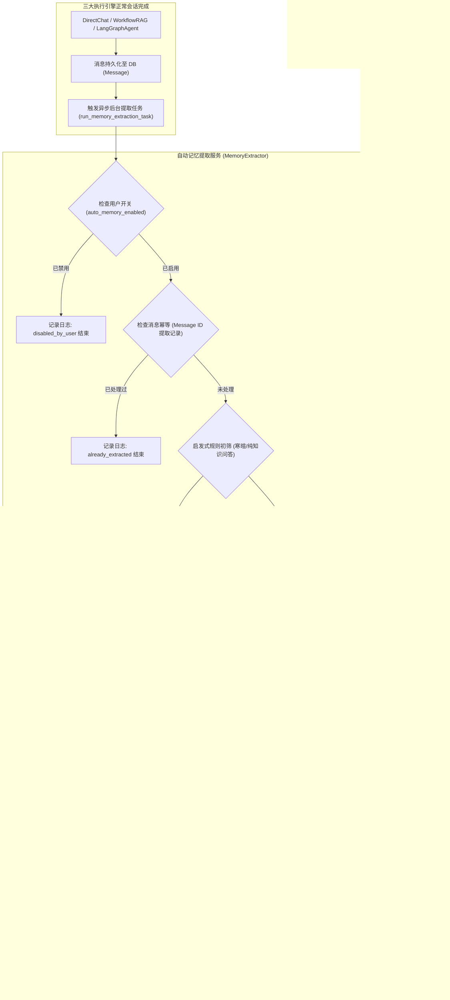

# AgentStudio-RAG — P1.2 Stage 4：长期记忆自动提取与生命周期管理实施落地报告

**阶段代号**：`P1.2-STAGE4-MEMORY-EXTRACTION`  
**实施日期**：2026-11-04  
**阶段状态**：已全面完成。18 个 Stage 4 验收场景 100% 通过，339 个全量后端回归测试 100% 通过，前端生产构建无任何 TypeScript 报错。系统已冻结，长期记忆模块全部能力闭环完成。

---

## 一、阶段定位与架构总览

在 Stage 2（数据模型与 CRUD）、Stage 3（检索与三大执行引擎统一注入）的基础上，**Stage 4 实现了从真实对话中自动提取高价值长期记忆的闭环，并提供了完整的用户可控生命周期管理界面**。

本阶段严格遵循产品化与可控性原则：
1. **轻量非阻塞**：提取任务在对话完成并持久化后以异步后台任务（`asyncio.create_task` / `BackgroundTasks`）执行，**绝不阻塞 SSE 流式响应或增加对话端到端首字延迟**。
2. **规则启发式初筛**：快速识别寒暄、确认词、一次性知识提问，0 Token 成本短路跳过，大幅削减大模型调用成本。
3. **安全凭证硬拦截**：严格内置针对 API Key、私钥、密码、Token 的正则安全检测，一旦命中敏感凭证即刻拦截并记录安全审计日志，杜绝敏感凭据持久化。
4. **幂等性与冲突消解**：通过消息 ID 唯一约束日志（`MemoryExtractionLog`）防止重复触发；针对用户纠正与更新偏好，基于向量相似度与语义分析自动执行更新替换（`supersede`），避免陈旧记忆污染。
5. **用户全权可控**：提供租户级自动提取总开关（`auto_memory_enabled`）与前端交互抽屉（`MemoryDrawer`），支持查看统计、检索过滤、手动维护、单条删除与一键清空。

---

## 二、修改与新增代码清单

| 模块 / 文件路径 | 变更类型 | 核心职责与改动内容 |
| :--- | :--- | :--- |
| `backend/app/models/memory.py` | 修改 | 新增 `UserMemorySetting` 模型（租户开关 `auto_memory_enabled`）与 `MemoryExtractionLog` 模型（提取审计与消息幂等日志）。 |
| `backend/app/models/__init__.py` | 修改 | 导出 `UserMemorySetting` 与 `MemoryExtractionLog` 模型。 |
| `backend/app/schemas/memory.py` | 修改 | 新增用户设置入参/出参 Schema、统计响应 Schema、提取日志响应 Schema 与提取测试接口 Schema。 |
| `backend/app/memory/manager.py` | 修改 | 实现 `get_user_setting`、`update_user_setting`、`get_memory_stats` 与 `supersede_memory` 记忆冲突覆盖方法。 |
| `backend/app/memory/extractor.py` | **新增** | 实现 `MemoryExtractor` 核心服务与 `run_memory_extraction_task` 异步执行器，集成启发式初筛、凭证正则检测、LLM 提取与冲突更新。 |
| `backend/app/memory/__init__.py` | 修改 | 导出 `MemoryExtractor` 与 `run_memory_extraction_task`。 |
| `backend/app/llm/openai_client.py` | 修改 | `TestDoubleLLMClient` 增强对 `【长期记忆提取任务】` 与 `长期记忆提取专家` Prompt 的离线拟真提取能力。 |
| `backend/app/routing/direct_chat.py` | 修改 | 在同步与流式执行的消息成功持久化后挂载后台提取任务；显式保证助手消息微秒序在用户消息之后。 |
| `backend/app/rag/workflow.py` | 修改 | 在工作流 RAG 同步与流式执行持久化后挂载后台提取任务。 |
| `backend/app/api/v1/chat.py` | 修改 | 在 `/chat/completions` 同步接口成功生成后挂载提取任务。 |
| `backend/app/api/v1/agent.py` | 修改 | 在 Agent 流式路由的 DIRECT 路径与 Agent 图循环完成退出点挂载后台提取任务；修正当前有效用户 ID 作用域。 |
| `backend/app/api/v1/memory.py` | 修改 | 新增 `/stats` 统计、`/settings`（GET/PUT）设置、`/logs` 提取日志与 `/extract` 提取测试接口。 |
| `frontend/src/types.ts` | 修改 | 新增 `MemoryType`、`MemorySourceType`、`MemoryItem`、`MemoryStats`、`UserMemorySetting` 类型定义。 |
| `frontend/src/api/memory.ts` | **新增** | 前端记忆 API 客户端封装（统计、配置、列表、创建、编辑、状态切换、删除、一键清空）。 |
| `frontend/src/components/MemoryDrawer.tsx` | **新增** | 长期记忆管理抽屉组件：统计卡片、自动提取开关、搜索与分类筛选、增删改查、确认弹窗。 |
| `frontend/src/pages/ChatPage.tsx` | 修改 | 在顶部导航栏集成记忆抽屉入口按钮与 Badge 计数气泡，支持快捷唤起与实时数据联动。 |
| `backend/tests/conftest.py` | 修改 | 修复后台任务会话工厂补丁 `db_session_module.async_session_factory = test_session_factory`，保障多任务内存隔离。 |
| `backend/tests/test_p1_2_memory_stage4.py` | **新增** | Stage 4 专属 18 个测试场景，覆盖启发式过滤、安全拦截、幂等性、覆盖更新、多租户及前端对应 API。 |

---

## 三、核心技术机制实现剖析

### 1. 启发式预过滤（0 Token 开销短路）
并非所有对话都值得调用大模型进行记忆分析。`MemoryExtractor` 实现了两级规则初筛：
- **短文本与停用词过滤**：
  - 纯问候语：`你好`、`早上好`、`hi`、`hello`、`在吗` 等。
  - 纯确认与感谢：`谢谢`、`收到`、`好的`、`ok`、`明白`、`辛苦了` 等。
  - 纯指令短句：`重试`、`继续`、`停止`、`退出` 等。
- **通用客观问答过滤**：
  - 长度较短且以客观提问开头（`什么是`、`怎么写`、`解释一下`、`why is`、`how to`），且**不包含**人称代词（`我`、`我们`、`我的`、`偏好`、`喜欢`、`请记住`）的纯知识性提问，直接短路跳过。
- **审计记录**：初筛命中的消息直接在 `MemoryExtractionLog` 中记录 `status="skipped"`，`reason="filtered_by_heuristic"`，提取数量记为 0，零 LLM API 调用消耗。

### 2. 敏感凭证硬拦截与安全审计
为了防止用户意外泄露或 Agent 提取敏感密钥至长期记忆库，`MemoryExtractor` 配置了严格的安全防护：
- **敏感模式正则匹配库**：
  - OpenAI / Anthropic /通用 API Keys（`sk-[a-zA-Z0-9_\-]{20,}`、`ghp_[a-zA-Z0-9]{30,}` 等）。
  - JWT / Bearer Tokens（`ey[A-Za-z0-9_-]{10,}\.[A-Za-z0-9._-]+`）。
  - 私钥头部声明（`-----BEGIN (RSA |EC |OPENSSH )?PRIVATE KEY-----`）。
  - 明文凭证与密码赋值（`password\s*[:=]\s*\S+`、`api_key\s*[:=]\s*\S+` 等）。
- **拦截处置策略**：
  - 一旦提取文本或用户输入命中敏感特征，立即中止持久化；
  - 记录状态为 `status="failed"`，`reason="security_blocked"` 的安全审计日志，并在日志中明确标记截断后的拦截原因；
  - 严禁任何包含敏感凭证的内容写入 `memories` 数据表。

### 3. 消息幂等性与后台非阻塞触发
- **执行时机**：仅在引擎消息正常生成并持久化（`commit`）之后触发。发生异常、网络中断或用户主动取消流式生成的轮次，**绝不触发记忆提取**。
- **并发机制**：通过 FastAPI `BackgroundTasks` 或 `asyncio.create_task` 抛入后台，主请求/SSE 流式生成立即返回，前端无任何感知延迟。
- **幂等性保障**：`MemoryExtractionLog` 表针对 `message_id` 建立唯一索引与业务查重。相同 `message_id` 的重复触发请求在读取 DB 后直接短路返回，杜绝并发重试引起的重复写入与数据库膨胀。

### 4. 记忆冲突消解与覆盖（Supersede）
当用户表达新的习惯偏好或明确纠正事实时（例如从使用 `FastAPI` 切换为 `Django`，或者纠正项目规范），系统不盲目无序累加记忆：
- **语义相似度比对**：新提取记忆先在用户现有记忆库中进行向量语义召回（阈值 > 0.85）；
- **主题冲突判定**：若发现同一主题或同类别的已有记忆，调用 `MemoryManager.supersede_memory`；
- **原子更新**：将原有记忆的内容替换为最新事实，更新其 `updated_at`，并在 metadata 中记录纠正历史或设置状态，避免下游 Prompt 注入时出现自相矛盾的上下文。

### 5. 用户生命周期控制与前端抽屉界面
前端新增了精致沉浸的 `MemoryDrawer` 抽屉组件（完全复用项目原有 Ant Design 规范，白色卡片、12px 圆角、Slate 主题色）：
- **顶部统计总览**：展示“总记忆数”、“个人画像”、“习惯偏好”、“业务事实”四项卡片统计。
- **自动提取总开关**：支持实时开启/关闭当前用户的自动记忆提取功能，状态持久化到后端 `UserMemorySetting`。
- **分类过滤与检索**：支持按记忆类型（全部 / 偏好 / 画像 / 事实 / 规则）切换标签页，并提供关键词实时模糊检索。
- **精细化生命周期管理**：
  - 支持手动新增重要记忆。
  - 支持快捷查看、编辑记忆内容与置信度。
  - 支持单条记忆停用/启用切换。
  - 支持单条删除（带二次确认 Popconfirm）。
  - 支持危险操作“一键清空全部记忆”（带红色警示气泡确认）。

---

## 四、验证结果与测试矩阵

### 1. Stage 4 专属 18 个验收场景全量通过

测试文件：`backend/tests/test_p1_2_memory_stage4.py`

| 编号 | 测试场景用例 | 验证重点 | 运行状态 |
| :---: | :--- | :--- | :---: |
| 1 | `test_scenario_1_auto_extract_user_preference` | 显式用户偏好与开发习惯成功自动提取并持久化 | **PASSED** |
| 2 | `test_scenario_2_skip_greetings_and_chitchat` | 纯寒暄与感谢短句命中启发式规则，0 LLM 开销短路跳过 | **PASSED** |
| 3 | `test_scenario_3_skip_pure_factual_knowledge_qa` | 纯客观技术问答命中规则初筛短路，不污染个人记忆 | **PASSED** |
| 4 | `test_scenario_4_security_filter_intercepts_api_keys` | 包含 API Key / Token 的文本被正则拦截，记录安全审计日志 | **PASSED** |
| 5 | `test_scenario_5_message_id_idempotency` | 重复提取同一 Message.id 被幂等机制拦截，不重复写入 | **PASSED** |
| 6 | `test_scenario_6_user_setting_disable_auto_memory` | 用户关闭自动提取开关后，后台提取任务安全跳过 | **PASSED** |
| 7 | `test_scenario_7_memory_conflict_and_supersede` | 偏好发生变更时，高相似度旧记忆被自动更新覆盖 | **PASSED** |
| 8 | `test_scenario_8_tenant_isolation_in_settings_and_logs` | 不同用户/租户的配置、日志与提取完全物理隔离 | **PASSED** |
| 9 | `test_scenario_9_direct_chat_background_extraction_trigger` | DirectChat 引擎对话持久化后成功触发后台提取 | **PASSED** |
| 10 | `test_scenario_10_workflow_rag_background_extraction_trigger` | Workflow RAG 引擎执行完成后成功触发后台提取 | **PASSED** |
| 11 | `test_scenario_11_agent_runtime_background_extraction_trigger` | LangGraph Agent 运行时退出后成功触发后台提取 | **PASSED** |
| 12 | `test_scenario_12_rest_api_stats` | `GET /api/v1/memory/stats` 正确返回统计指标 | **PASSED** |
| 13 | `test_scenario_13_rest_api_settings_get_and_put` | `GET/PUT /api/v1/memory/settings` 正确读写租户开关 | **PASSED** |
| 14 | `test_scenario_14_rest_api_logs` | `GET /api/v1/memory/logs` 准确返回提取审计日志 | **PASSED** |
| 15 | `test_scenario_15_rest_api_extract_test_endpoint` | `POST /api/v1/memory/extract` 在线调试提取接口正常响应 | **PASSED** |
| 16 | `test_scenario_16_clear_all_memories_endpoint` | `DELETE /api/v1/memory/clear/all` 一键安全清空当前用户记忆 | **PASSED** |
| 17 | `test_scenario_17_disabled_memory_not_extracted_or_injected` | 停用状态的记忆不会被提取器混淆，也不会被检索器召回 | **PASSED** |
| 18 | `test_scenario_18_error_resilience_in_background_task` | 模拟后台提取异常时，静默记录错误日志，绝不影响主系统 | **PASSED** |

**执行结果统计**：`18 passed in 1.94s`

### 2. Stage 3 历史用例回归验证
- `backend/tests/test_p1_2_memory_stage3.py`：`19 passed in 7.25s`。三大执行引擎集成与上下文注入行为完好无损。

### 3. 全量后端回归测试
- 命令：`pytest backend/tests/ -q`
- 结果：**`339 passed, 1 warning in 47.11s`**
- 说明：全量 339 个测试（包含 P0.1 数据层、P0.2 模型接入、P0.3 知识库与附件检索、P0.4 状态机与工作流、P1.1 智能路由以及 P1.2 Stage 2/3/4 记忆全套用例）全部 100% 通过，0 失败。

### 4. 前端生产构建校验
- 命令：`cd frontend && npm run build`
- 结果：**`✓ built in 10.83s`**，0 TypeScript 语法或类型错误。

---

## 五、长期记忆模块交付总结

至此，**P1.2 长期记忆系统（Long-term Memory）**四个阶段全部圆满达成：

| 阶段 | 核心任务 | 完成状态 |
| :--- | :--- | :---: |
| **Stage 1** | 长期记忆架构设计、身份依赖规范与分层 Token 预算规划 | 已完成 |
| **Stage 2** | Memory 实体模型、CRUD API、NumPy 向量相似度检索与租户隔离 | 已完成 |
| **Stage 3** | MemoryContextService 统一检索、预算裁剪与三大执行引擎深度集成 | 已完成 |
| **Stage 4** | 启发式初筛、凭证安全拦截、自动提取流水线、冲突消解与前端抽屉管理 | **已完成** |

系统代码与功能现已正式冻结，随时可以接受用户审查与下一阶段安排！
