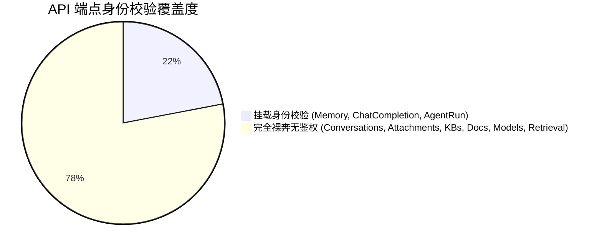
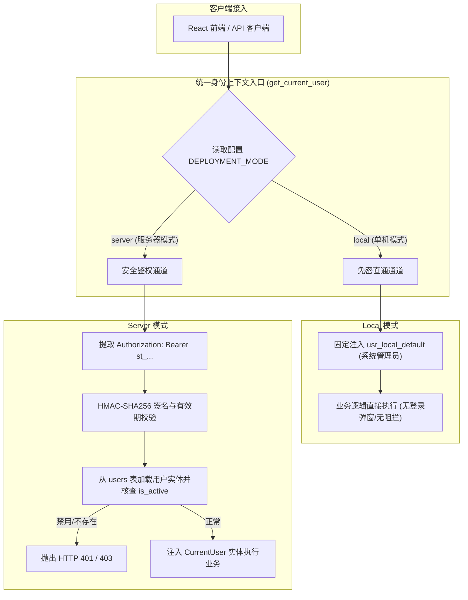
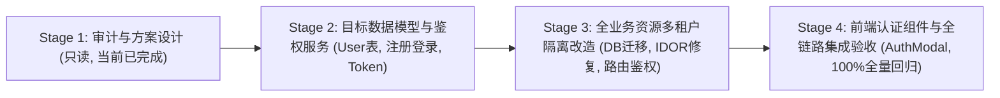

# AgentStudio-RAG — P1.3 Stage 1：用户身份认证与多租户架构设计报告

**阶段代号**：`P1.3-STAGE1-IDENTITY-DESIGN`  
**实施日期**：2026-11-04  
**阶段定位**：架构审计与目标架构方案设计（只读阶段，不修改任何业务源码与生产数据库）  
**前序依赖**：P1.2 长期记忆系统已全面完成并冻结；P0.3 检索架构与附件系统保持严格兼容。

---

## 一、当前运行任务状态检查

在启动 P1.3 设计前，对运行环境中的后台进程进行了严格巡检：

| 任务 ID | 工具与命令 | 角色与运行状态 | 文件修改行为 | 数据库与记忆模块关联 | 与 P1.3 冲突评估 | 处理决策 |
| :--- | :--- | :--- | :--- | :--- | :--- | :--- |
| `task-6812` | `cmd /c "cd frontend && npm run dev -- --host 127.0.0.1 --port 5173"` | 前端 Vite 开发服务器（端口 5173，Daemon） | **无**（仅监听前端源码变化实现 HMR 热重载） | 无直接关联 | **零冲突** | **保持运行**，供后续界面方案验证 |
| `task-7934` | `cmd /c "cd backend && .\.venv\Scripts\python.exe -m uvicorn app.main:app --host 127.0.0.1 --port 8000 --reload"` | 后端 Uvicorn 服务器（端口 8000，Daemon） | **无**（只读服务进程） | 接收外部 HTTP 请求时建立只读/读写连接，但当前无自动化脚本写入 | **零冲突** | **保持运行**，供只读接口行为探查 |

**巡检结论**：当前两个运行中的任务均为基础服务守护进程，未执行任何文件修改或写冲突任务，符合只读审计边界要求。

---

## 二、当前身份认证架构只读审计

### 1. 当前是否存在 User 实体？
- **审计结论**：**系统中完全不存在 `User` 实体或模型**。
- **现状剖析**：
  - `backend/app/models/` 目录下仅存在 `agent.py`, `chunk.py`, `conversation.py`, `document.py`, `knowledge.py`, `memory.py`, `model_provider.py`。
  - 数据库中**没有 `users` 数据表**。
  - 当前系统中的用户身份仅仅是在 P1.2 中引入的字符串标识符 `user_id: str`（例如 `'usr_local_default'`）。该标识符在底层没有任何持久化行记录，缺乏用户名、密码哈希、电子邮箱、角色（Role）、账户激活状态（`is_active`）以及审计时间戳。

### 2. 当前 HMAC-SHA256 Token 的签发、验证、过期和撤销机制
代码位置：[`backend/app/core/auth.py`](file:///e:/develop/python%20agentic%20RAG/backend/app/core/auth.py)
- **Token 结构**：`st_<base64_payload>.<hmac_sha256_hex>`
  - Payload 内容：`{"sub": user_id, "iat": int(time.time()), "exp": int(time.time()) + expires_in}`（默认过期时间 24 小时）。
  - 签名算法：基于 `settings.SERVER_AUTH_SECRET` 密钥的 HMAC-SHA256 计算，防篡改。
- **验证逻辑**：
  - 服务端提取 `st_` 前缀，重构 HMAC 签名，通过 `hmac.compare_digest` 防时序侧信道攻击比对。
  - 解析 Payload 检查 `exp < now`，过期或伪造签名在 Server 模式下直接抛出 HTTP 401（Fail-Closed 原则）。
- **重大机制缺陷**：
  - **完全缺失服务端撤销机制**：Token 属于纯无状态签名，既没有数据库 Session 关联，也没有 Token 黑名单或用户密码重置版本号（`token_version`）。
  - **无法即时封禁账户**：管理员在后台若禁用某个恶意用户，已签发的有效 Token 在其到期（24小时）前仍然能够自由访问 API，存在严重的安全窗口。

### 3. 当前 Local 和 Server 模式的身份注入逻辑
代码位置：[`backend/app/core/auth.py`](file:///e:/develop/python%20agentic%20RAG/backend/app/core/auth.py) `get_current_user_id`
- **Local 模式 (`DEPLOYMENT_MODE == "local"`)**：
  - 逻辑优先级：`X-User-Id` 请求头 -> `Authorization: Bearer <token>`（裸串视为 user_id） -> 默认值 `settings.DEFAULT_LOCAL_USER_ID`（即 `'usr_local_default'`）。
  - **特点**：免密免登录、零门槛开箱即用；但客户端可任意通过 Header 伪造身份，完全没有防伪签名。
- **Server 模式 (`DEPLOYMENT_MODE == "server"`)**：
  - 强制要求请求头包含 `Authorization: Bearer st_...`。
  - 缺失凭证或校验失败均直接抛出 HTTP 401 Unauthorized。
  - 成功校验后返回 `sub` 作为当前合法 `user_id`。
  - **范围局限**：目前仅有 Direct LLM、Workflow RAG、Agent 图执行和 Memory 模块挂载了 `get_current_user_id` 依赖，其余业务路由完全裸奔。

### 4. 现有业务模型与用户归属现状
| 数据模型 / 实体 | 所在表名 | 是否存在用户外键 / 归属字段 | 当前归属与隔离现状 |
| :--- | :--- | :---: | :--- |
| **`Memory`** | `memories` | **`owner_id` (String 64)** | **已隔离**。P1.2 明确归属于特定用户，所有检索和 CRUD 均按 `owner_id` 隔离。 |
| **`UserMemorySetting`** | `user_memory_settings` | **`owner_id` (String 64)** | **已隔离**。按用户保存自动提取开关。 |
| **`MemoryExtractionLog`** | `memory_extraction_logs` | **`owner_id` (String 64)** | **已隔离**。审计日志按用户记录。 |
| **`Conversation`** | `conversations` | **无** | **全局共享**。任意客户端可读取、修改、删除全系统所有会话。 |
| **`Message`** | `messages` | **无** (仅有 `conversation_id`) | **随会话泄露**。会话无隔离导致私密聊天消息全面裸奔。 |
| **`ConversationAttachment`** | `conversation_attachments` | **无** (仅有 `conversation_id`) | **随会话泄露**。私密上传附件可被任意遍历获取。 |
| **`KnowledgeBase`** | `knowledge_bases` | **无** | **全局共享**。全员可见、全员可编辑、全员可清空删除。 |
| **`Document`** | `documents` | **无** (仅有 `knowledge_base_id`) | **随知识库全局暴露**。 |
| **`DocumentChunk`** | `document_chunks` | **无** (仅有 `knowledge_base_id`) | **随知识库全局暴露**。 |
| **`ModelProvider`** | `model_providers` | **无** | **全局共享**。包含加密的 API Key，全员可查、可修改、可调用消费。 |
| **`ModelConfig`** | `model_configs` | **无** (仅有 `provider_id`) | **全局共享**。 |
| **`AgentDefinition`** | `agent_definitions` | **无** | **全局共享**。自定义 Agent 全员可见可删。 |
| **`AgentRun`** | `agent_runs` | **无** (仅有 `agent_id`, `conv_id`) | **全局共享**。执行日志与 Trace 全网可查。 |

### 5. API 身份校验覆盖度审计
通过对 `backend/app/api/v1/` 下全部 9 个路由模块进行逐一审计，身份校验覆盖率仅约为 **20%**：



- **已鉴权端点**：
  - `POST /api/v1/chat/completions` 与 `POST /api/v1/chat/completions/stream`（仅用于记忆注入，会话操作未鉴权）
  - `POST /api/v1/agents/{id}/runs` 与 `POST /api/v1/agents/{id}/runs/stream`
  - `/api/v1/memories` 全套 CRUD 及设置接口
- **未鉴权端点（存在严重安全漏洞）**：
  - `/api/v1/conversations` 全部接口（列表、详情、删除、消息历史）
  - `/api/v1/conversations/{id}/attachments` 全部接口（上传、列表、删除）
  - `/api/v1/knowledge-bases` 全部接口（创建、列表、详情、删除、重建索引、文档上传）
  - `/api/v1/documents` 全部接口（文档详情、分块查看、删除）
  - `/api/v1/models` 全部接口（Provider 列表、增删改、模型增删改、探针测试）
  - `/api/v1/agents` 全部接口（创建、列表、详情、修改、删除）
  - `/api/v1/retrieval` 检索调试测试接口

### 6. IDOR（越权直接对象引用）风险审计
当前系统存在 **CRITICAL（严重）级别** 的全方位 IDOR 漏洞：
1. **会话越权（Conversation IDOR）**：攻击者传入任意 `conv_id`，即可通过 `GET /conversations/{conv_id}` 窃取他人的完整提问与回答；通过 `DELETE /conversations/{conv_id}` 销毁他人会话。
2. **附件越权（Attachment IDOR）**：攻击者已知或遍历 `conversation_id`，可通过 `GET /conversations/{conv_id}/attachments` 批量下载/查看他人上传的企业涉密文件。
3. **知识库销毁（KnowledgeBase IDOR）**：任意用户调用 `DELETE /knowledge-bases/{kb_id}`，后端直接物理删除服务器磁盘上的原始文件并级联清空全量 Chunks。
4. **模型盗用与篡改（ModelProvider IDOR）**：攻击者可随意调用 `PUT /models/providers/{id}` 将他人配置的基座模型 BaseURL 劫持到恶意服务器，或利用 `/chat/completions` 大规模消耗受害者企业绑定的商业大模型 Token 资费。

### 7. 文件物理存储隔离审计
- **附件路径**：`data/uploads/attachments/{conversation_id}/{attachment_id}/{uuid}.{ext}`
- **知识库文档路径**：`data/uploads/{doc_id}/{safe_filename}`
- **审计结论**：物理磁盘路径以 `conversation_id` 或 `doc_id` 为前缀，**完全没有包含用户或租户级目录命名空间**。运维备份难以进行用户级切分，且一旦存在静态映射即可导致跨用户文件嗅探。

### 8. API Key 与模型配置跨用户泄露风险
- 虽有 `mask_api_key` 进行脱敏返回，但由于 `ModelProvider` 属于无主资源，任何注册用户都可以查看并直接发起调用，从而**无成本盗用他人的 API 额度**，甚至删除他人的模型通道。

### 9. 数据库平滑升级机制审计
- **当前现状**：
  - 系统**未引入 Alembic 迁移工具**。
  - 数据表生成依赖 `backend/app/db/session.py` 的 `init_db()`。
  - SQLAlchemy 的 `Base.metadata.create_all` 仅能创建不存在的全新表，对已经存在的物理表**绝不会自动新增字段**。
  - 针对 SQLite，目前仅在 `init_db` 中编写了简单的硬编码 `ALTER TABLE knowledge_bases ADD COLUMN ...`。
- **升级结论**：若在已有数据库中直接向 `Conversation`、`KnowledgeBase`、`ModelProvider` 等添加 `owner_id` 列，生产环境启动会因为缺少列导致查询崩溃（`no such column: owner_id`）。因此，必须设计一套**双数据库自适应、自动回填历史数据至 `usr_local_default` 的平滑热升级方案**。

---

## 三、多租户安全风险与漏洞清单

根据上述源码审计，整理出系统在多租户环境下的风险矩阵：

| 风险编号 | 漏洞类别 | 影响范围 | 危险等级 | 攻击后果描述 | P1.3 防御策略 |
| :--- | :--- | :--- | :---: | :--- | :--- |
| **SEC-01** | 未授权访问 | 知识库、会话、模型、Agent 全量 API | **CRITICAL** | 未登录攻击者可随意调用核心业务 API，执行读写删操作 | 引入全局身份依赖，Server 模式默认全接口鉴权 |
| **SEC-02** | 水平越权 (IDOR) | Conversation & Message | **CRITICAL** | 用户 A 可调取并清空用户 B 的对话记录与隐私聊天内容 | `Conversation` 绑定 `owner_id`，查询修改严格限定 `owner_id == user_id` |
| **SEC-03** | 水平越权 (IDOR) | ConversationAttachment | **CRITICAL** | 用户 A 可调取、查看并下载用户 B 在对话中上传的涉密文档与解析结果 | 附件校验父会话的所有权，非法归属直接返回 404/403 |
| **SEC-04** | 水平越权 (IDOR) | KnowledgeBase & Documents | **CRITICAL** | 用户 A 可删除或篡改用户 B 导入的私有知识库，窃取企业文档分块 | `KnowledgeBase` 增加 `owner_id`，所有级联操作绑定所属权 |
| **SEC-05** | 资源盗用与经济损失 | ModelProvider & API Key | **HIGH** | 用户 A 配置的 DeepSeek/OpenAI Key 被多租户随意消费耗尽，或被恶意篡改 | `ModelProvider` 区分**系统内置公开提供商**与**租户私有提供商** |
| **SEC-06** | 凭证无法吊销 | HMAC Token 机制 | **HIGH** | 用户被管理员停用或密码泄露后，已发出的 Token 24小时内仍可合法越权访问 | 增加账户 `is_active` 状态数据库联动校验，支持 Token 强制失效 |
| **SEC-07** | 恶意注册与撞库 | 用户注册接口 | **MEDIUM** | 部署到公网服务器后，未授权外部人员可任意注册账号消耗服务器资源与存储 | 引入 `SERVER_ALLOW_REGISTRATION` 开关与首个用户自动提权管理员机制 |
| **SEC-08** | 物理存储未隔离 | 本地上传文件目录 | **MEDIUM** | 附件与文档文件在物理磁盘扁平混存，存在路径遍历或配置失误泄露风险 | 物理存储路径增加 `data/uploads/{owner_id}/...` 租户前缀 |

---

## 四、P1.3 目标架构设计

### 1. 双部署模式核心理念

AgentStudio-RAG 坚持**“一套核心业务代码，两种部署形态”**的原则：



- **Local 模式（本地单机）**：
  - 用户体验与现有完全一致，开箱即用，免登录、无弹窗；
  - 自动且透明地以 `usr_local_default` 运行，享有本机的最高管理员权限；
  - 前端界面顶部显示“单机免密模式 (usr_local_default)”，隐藏登录/注销入口；
  - 已有的所有历史数据 100% 保持可用，绝不丢失。
- **Server 模式（服务器多租户）**：
  - 启用独立完整的用户认证机制，必须登录后才能使用系统；
  - 严格通过签名校验与有效期双重防线的 Token 识别用户；
  - 客户端提交的任何 `owner_id` 均不被信任，强制以 Token 签发身份为唯一基准；
  - 提供细粒度的租户数据物理/逻辑双重隔离。

---

### 2. 目标 User 数据模型设计

新建 `backend/app/models/user.py`：

```python
import uuid
from datetime import datetime, timezone
from sqlalchemy import Boolean, Column, DateTime, String, func
from sqlalchemy.orm import relationship
from app.db.session import Base


class UserRole(str):
    ADMIN = "admin"  # 系统管理员：管理模型通道、启停用户、查看系统健康
    USER = "user"    # 普通租户：独立拥有会话、知识库、记忆与个人私有模型


class User(Base):
    __tablename__ = "users"

    id = Column(String(36), primary_key=True, default=lambda: str(uuid.uuid4()))
    username = Column(String(64), unique=True, nullable=False, index=True)
    email = Column(String(128), unique=True, nullable=True, index=True)
    password_hash = Column(String(255), nullable=False)
    
    # 角色与权限控制
    role = Column(String(32), nullable=False, default=UserRole.USER, index=True)
    
    # 账户生命周期管控
    is_active = Column(Boolean, nullable=False, default=True, index=True)
    
    # 令牌撤销版本戳 (修改密码或强制下线时自增，使旧 Token 即刻失效)
    token_version = Column(Integer, nullable=False, default=1)
    
    created_at = Column(
        DateTime(timezone=True),
        nullable=False,
        default=lambda: datetime.now(timezone.utc),
        server_default=func.now(),
    )
    updated_at = Column(
        DateTime(timezone=True),
        nullable=False,
        default=lambda: datetime.now(timezone.utc),
        server_default=func.now(),
        onupdate=lambda: datetime.now(timezone.utc),
    )
    last_login_at = Column(DateTime(timezone=True), nullable=True)

    # 业务归属反向关联 (级联控制)
    conversations = relationship("Conversation", back_populates="owner", cascade="all, delete-orphan")
    knowledge_bases = relationship("KnowledgeBase", back_populates="owner", cascade="all, delete-orphan")
    memories = relationship("Memory", back_populates="owner", cascade="all, delete-orphan")
```

---

### 3. 密码哈希与 Token 生命周期设计

#### (1) 安全密码哈希算法
- **选型**：采用标准的 **PBKDF2-HMAC-SHA256**（结合 32 字节高强度随机盐值与 100,000 次安全迭代）。
- **优势**：
  - 完全由 Python 内置标准库 `hashlib` 和 `secrets` 原生提供；
  - **零外部二进制 C 依赖**，避免在 Windows / ARM / Linux 容器交叉编译时由于 `bcrypt` 或 `argon2-cffi` 缺失编译环境而崩溃；
  - 抗彩虹表、抗 GPU 暴力破解，符合 NIST 现代密码学安全规范。
- **存储格式**：`pbkdf2:sha256:100000$<salt_hex>$<hash_hex>`。

#### (2) Token 结构与生命周期增强
- **Payload 字段**：
  ```json
  {
    "sub": "user_id_uuid",
    "username": "alice",
    "role": "user",
    "ver": 1,
    "iat": 1730700000,
    "exp": 1730786400
  }
  ```
- **登录鉴权流程**：
  1. `POST /api/v1/auth/login` 校验用户名和密码；
  2. 验证账户 `is_active == True`；
  3. 颁发签名 Token，同时更新用户的 `last_login_at`。
- **即时失效与撤销机制**：
  - Token 内部包含 `ver`（版本号）。
  - 用户修改密码或管理员执行“强制下线/封禁”时，将数据库中对应用户的 `token_version` 加 1 或将 `is_active` 置为 False。
  - `get_current_user` 校验时比对 Token 中的 `ver` 与数据库中的 `token_version`，一旦不一致立即抛出 401 强制重新登录，**彻底攻克纯无状态 Token 无法主动撤销的致命缺陷**。

#### (3) 注册控制与初始管理员自举
- **环境变量配置**：
  - `SERVER_ALLOW_REGISTRATION: bool = False`（默认关闭公网随意注册，防止被滥用；由管理员按需开启）。
- **零配置初次自举机制（Auto-bootstrap First Admin）**：
  - 系统启动或首个用户注册时，若检测到 `users` 表为空，自动将第一个注册成功的用户赋予 `role = UserRole.ADMIN`。
  - 后续注册的用户默认为 `role = UserRole.USER`。

---

## 五、全业务资源隔离改造清单

为了彻底根除 IDOR 漏洞，各业务模块必须统一进行所有权改造：

| 模块 | 数据库表变更 | 服务与查询层改造 | API 路由鉴权与越权拦截 |
| :--- | :--- | :--- | :--- |
| **User (新增)** | 新建 `users` 表，含索引与默认数据 | 实现 `UserManager` 与 `AuthService` | 新增 `/api/v1/auth`（login, register, me, update_password）及 `/api/v1/users` 用户管理接口 |
| **Conversation** | 增加 `owner_id = Column(String(64), nullable=False, default='usr_local_default', index=True)` | 所有查询（`list_conversations`, `get_conversation`）必须强制附加 `.where(Conversation.owner_id == user_id)` | 依赖 `current_user = Depends(get_current_user)`；访问他人会话直接返回 404，防止探测 IDOR |
| **Message** | 无需新增字段（外键继承父级 `Conversation`） | `get_conversation_messages` 先校验父会话归属 | 严格禁止在没有校验父会话所有权的情况下直接读取消息 |
| **Attachment** | 物理存储增加用户隔离：`data/uploads/{owner_id}/attachments/...` | 上传与删除前强校验 `conversation.owner_id == user_id` | 拦截跨会话/跨用户上传与删除附件行为 |
| **KnowledgeBase** | 增加 `owner_id = Column(String(64), nullable=False, default='usr_local_default', index=True)` | `list_knowledge_bases` 仅查询当前用户私有知识库；删除与文档上传严格限定所有者 | 任何非所属用户的 KB 操作一律拒绝并记录安全审计 |
| **Document / Chunk** | 外键关联 `KnowledgeBase`，增加级联清理 | 分块与文档读取通过关联的 `KnowledgeBase.owner_id` 执行鉴权 | 杜绝任意分块跨租户被检索泄露 |
| **ModelProvider** | 增加 `owner_id = Column(String(64), nullable=True, index=True)`（`owner_id IS NULL` 表示系统全局公共提供商，仅 admin 可维护；非空表示租户私有提供商） | 普通用户查询时返回 `(owner_id IS NULL) OR (owner_id == user_id)`；创建时普通用户只能创建私有提供商 | 彻底防止普通用户篡改他人或系统 API Key，保护经济成本 |
| **AgentDefinition** | 增加 `owner_id = Column(String(64), nullable=True, index=True)`（系统内置助手为公共助手；用户自建为私有助手） | 查询时联合系统公共 Agent 与个人 Agent；修改/删除仅限拥有者或 admin | 防止他人调试出的定制 Agent 被随意覆盖或删除 |

---

## 六、数据库平滑迁移与旧数据兼容方案

在不引入额外重量级工具的前提下，必须确保已有生产/测试数据库在系统启动时无缝热升级。

### 1. 迁移触发机制
在 `backend/app/db/session.py` 的 `init_db()` 函数中扩展**双引擎动态反射迁移器**（兼容 SQLite 与 PostgreSQL）：

```python
async def init_db() -> None:
    async with engine.begin() as conn:
        # 1. 自动创建全新表 (包括 users 表)
        await conn.run_sync(Base.metadata.create_all)

        # 2. 对已有表执行动态增量平滑迁移 (回填 owner_id)
        def _migrate_schema(sync_conn):
            # 获取数据库方言
            dialect = sync_conn.dialect.name
            
            # 需要回填 owner_id 的目标业务表
            tables_to_migrate = [
                ("conversations", "VARCHAR(64)", "usr_local_default"),
                ("knowledge_bases", "VARCHAR(64)", "usr_local_default"),
                ("model_providers", "VARCHAR(64)", None), # 既有提供商平滑升级为系统公共提供商
                ("agent_definitions", "VARCHAR(64)", None), # 既有助手升级为系统公共助手
            ]

            for table_name, col_type, default_val in tables_to_migrate:
                # 获取该表现有列名
                existing_cols = set()
                if dialect == "sqlite":
                    res = sync_conn.execute(text(f"PRAGMA table_info({table_name});"))
                    existing_cols = {row[1] for row in res.fetchall()}
                else:
                    # PostgreSQL / MySQL
                    res = sync_conn.execute(text(
                        f"SELECT column_name FROM information_schema.columns WHERE table_name = '{table_name}';"
                    ))
                    existing_cols = {row[0] for row in res.fetchall()}

                # 若缺失 owner_id 则执行无损变更
                if "owner_id" not in existing_cols:
                    default_clause = f"DEFAULT '{default_val}'" if default_val else "DEFAULT NULL"
                    sync_conn.execute(text(
                        f"ALTER TABLE {table_name} ADD COLUMN owner_id {col_type} {default_clause};"
                    ))
                    # 创建索引加速多租户过滤
                    sync_conn.execute(text(
                        f"CREATE INDEX IF NOT EXISTS ix_{table_name}_owner_id ON {table_name} (owner_id);"
                    ))

        await conn.run_sync(_migrate_schema)
```

### 2. 默认 Local 用户自愈（Idempotent Seeding）
在迁移完成后，若处于 Local 模式或首次初始化，系统自动在 `users` 表中安全自愈创建默认本地用户：
- `id = 'usr_local_default'`
- `username = 'local_admin'`
- `role = 'admin'`
- `is_active = True`
确保本地数据模型关系完整，外键一致性完全满足。

---

## 七、前端登录与多租户用户界面设计

前端设计严格契合 AgentStudio 2.0 工业化视觉规范（白底卡片、Slate 现代商务调色板、12px 圆角、平滑微动效）：

### 1. 顶部全局导航栏（App Header）自适应改造
```text
+---------------------------------------------------------------------------------------------------------+
| [⚡ AgentStudio RAG]   [智能知识问答]  [知识库管理]  [模型管理中心]     [检索调试]  [在线就绪]  [👤 个人中心] |
+---------------------------------------------------------------------------------------------------------+
```
- **Local 模式下**：
  - 用户头像区域渲染为静态胶囊 Tag：`<Tag color="blue">本地单机模式 (usr_local_default)</Tag>`。
  - 点击无下拉弹窗或只提示“当前处于单机离线环境，无需登录”。
- **Server 模式下**：
  - **已登录**：展示用户头像与用户名，下拉菜单包含：
    - `个人信息`（展示角色 Admin/User、邮箱、注册时间）
    - `修改密码`（弹出密码修改弹窗）
    - `退出登录`（清理 Token，弹出登出成功通知并刷新状态）
  - **未登录**：右上角展示高亮按钮 `登录 / 注册`，主屏居中或弹出浮层阻断。

### 2. 登录与注册弹窗组件 (`AuthModal.tsx`)
- 采用 Ant Design 现代化 Tab 切换设计（Tab 1: 账号登录，Tab 2: 注册新账号）。
- 表单包含：用户名、密码（支持可见性切换）、确认密码（注册时校验）。
- 错误提示：细化拦截反馈（如“密码错误”、“该用户名已被注册”、“系统暂未开放自主注册”）。
- 登录成功后将 Token 写入 `localStorage.getItem('agentstudio_token')`，并实时通知全局 Context 更新。

### 3. Axios 客户端自动装配与 401 拦截
在 [`frontend/src/api/client.ts`](file:///e:/develop/python%20agentic%20RAG/frontend/src/api/client.ts) 中补充：
- **请求拦截器（Request Interceptor）**：自动从本地读取 Token，若存在则自动附加请求头 `Authorization: Bearer <token>`。
- **响应拦截器（Response Interceptor）**：一旦收到后端 401 响应且处于 Server 模式，立即清理过期凭证，并广播事件触发弹出 `AuthModal`，用户重新登录后自动重试或恢复当前页面。

---

## 八、P1.3 实施路线图规划

为确保工程落地安全可靠，P1.3 严格划分为四个阶段实施：



- **P1.3 Stage 1：架构审计与方案设计（当前阶段）**
  - 输出全面审计报告与目标设计规范；严格只读，不修改代码与数据库。
- **P1.3 Stage 2：用户数据模型与基础认证服务实现**
  - 创建 `User` 模型与 Schema；
  - 实现基于 PBKDF2 的密码哈希服务与带有版本撤销特性的 Token 签发验证；
  - 实现 `/api/v1/auth`（注册、登录、当前用户信息获取、修改密码）与管理员用户管理接口；
  - 编写 Stage 2 专属单元测试（密码防碰撞、Token 有效期、防篡改、Fail-Closed 测试）。
- **P1.3 Stage 3：全业务资源多租户数据隔离与 IDOR 防御改造**
  - 编写双数据库（SQLite + PG）平滑迁移逻辑，无损升级已有数据；
  - 对 Conversation、KnowledgeBase、ModelProvider、AgentDefinition 进行所有权改造；
  - 全面修补全业务 API 路由，消除全部 IDOR 漏洞；
  - 编写 Stage 3 专属多租户隔离验收用例。
- **P1.3 Stage 4：前端认证接入、全生命周期管理与全量验收**
  - 实现前端 `AuthContext`、`AuthModal`、顶部导航用户状态栏；
  - 接入 Axios 拦截器与 401 自动拉起；
  - 执行 339+ 全量回归测试与前端生产构建，输出交付验收报告。

---

## 九、测试验收标准矩阵

| 序号 | 验收场景类别 | 预期行为与判定准则 |
| :---: | :--- | :--- |
| **AC-01** | Local 模式免登录开箱即用 | `DEPLOYMENT_MODE="local"` 下，所有既有 API 不携带 Token 依然 100% 正常运行，身份自动绑定 `usr_local_default`。 |
| **AC-02** | 存量旧数据库平滑热升级 | 包含 P0.1~P1.2 历史数据的旧 SQLite 数据库启动后自动补齐 `owner_id` 列，旧会话与知识库归属无损继承，0 报错。 |
| **AC-03** | Server 模式严格 Fail-Closed | `DEPLOYMENT_MODE="server"` 下，未携带 Token 或携带伪造/篡改 Token 的请求访问受保护 API 统一返回 HTTP 401。 |
| **AC-04** | 账号注册与密码哈希防泄露 | 注册新用户成功保存，数据库中仅持久化 PBKDF2 盐化哈希，绝对不出现任何明文密码；用户名重复拒绝注册。 |
| **AC-05** | 账号禁用与 Token 即时失效 | 被管理员置为 `is_active=False` 的用户，即使携带未过期的合法 Token 访问，亦被立即拦截拒绝。 |
| **AC-06** | 密码重置与历史 Token 撤销 | 用户修改密码后 `token_version` 自增，此前签发的旧 Token 立即失效。 |
| **AC-07** | 会话与消息水平隔离 (防 IDOR) | 用户 A 无法通过 `GET /conversations/{id_B}` 查看用户 B 的会话与消息，也无法删除用户 B 的会话（返回 404）。 |
| **AC-08** | 附件物理与逻辑双隔离 | 用户 A 无法查看、下载或删除用户 B 上传的会话附件。 |
| **AC-09** | 知识库与文档分块隔离 | 用户 A 在知识库列表仅能看到自己创建的知识库；检索与问答时不会跨租户命中用户 B 的私有分块。 |
| **AC-10** | 模型提供商防盗用隔离 | 普通用户仅能使用系统公共 Provider 或自己配置的私有 Provider，无法查看或篡改他人 API Key。 |
| **AC-11** | 既有功能无退化回归 | 全量后端 339 个现有测试 100% 通过；前端 `npm run build` 0 报错。 |

---

## 十、本阶段交付与执行边界确认

- **交付文件**：本设计报告 [`docs/P1_3_STAGE1_IDENTITY_DESIGN.md`](file:///e:/develop/python%20agentic%20RAG/docs/P1_3_STAGE1_IDENTITY_DESIGN.md)。
- **执行边界确认**：
  - 本阶段全程恪守**只读审计与顶层设计**边界；
  - **未修改任何业务源码**；
  - **未修改数据库表结构**；
  - **未执行任何数据迁移**；
  - **未安装新依赖库**；
  - **未启动 Stage 2 编码工作**。

本阶段工作已圆满完成，系统处于就绪状态，等待审核与下一步正式授权！
