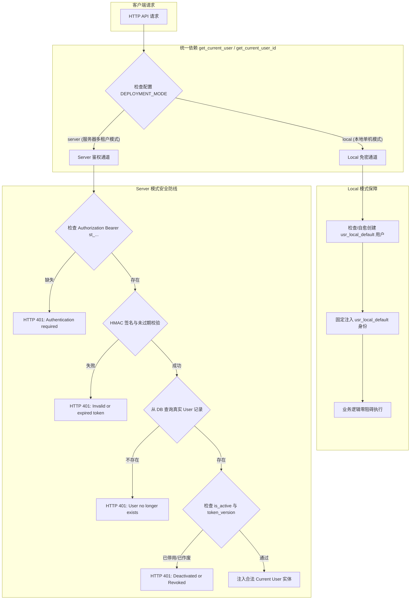

# AgentStudio-RAG — P1.3 Stage 2：用户数据模型与基础认证服务实施报告

**阶段代号**：`P1.3-STAGE2-AUTH-IMPLEMENTATION`  
**实施日期**：2026-11-04  
**阶段状态**：已全面完成。14 个 Stage 2 专项测试场景 100% 通过，353 个后端全量回归测试 100% 通过，前端生产构建无任何 TypeScript 报错。系统已冻结，等待 Stage 3 授权。

---

## 一、新增与修改文件清单

| 模块 / 文件路径 | 变更类型 | 核心职责与改动内容 |
| :--- | :--- | :--- |
| `backend/app/core/config.py` | 修改 | 新增 `SERVER_ALLOW_REGISTRATION`（控制自主注册开启/关闭）、`PASSWORD_HASH_ITERATIONS = 600_000`（OWASP 推荐参数）与 `ALLOW_TEST_USER_OVERRIDE`（严格隔离测试环境与生产 Local 模式）。 |
| `backend/app/core/password.py` | **新增** | 实现符合 OWASP 现代标准的 PBKDF2-HMAC-SHA256 密码安全服务，包含盐化哈希、时序安全比对、密码演进重哈希检测（`needs_rehash`）与防用户枚举的虚假校验（`dummy_verify_password`）。 |
| `backend/app/models/user.py` | **新增** | 创建 `User` SQLAlchemy 实体模型与 `UserRole`（`admin` / `user`），支持账号激活状态 `is_active` 与会话即时作废版本号 `token_version`。 |
| `backend/app/models/__init__.py` | 修改 | 导出 `User` 与 `UserRole` 模型。 |
| `backend/app/schemas/auth.py` | **新增** | 定义 `UserRegisterRequest`、`UserLoginRequest`、`UserResponse`、`TokenResponse`、`LogoutResponse`、`PasswordChangeRequest` 与 `PasswordChangeResponse`，严格隔离敏感凭据与内部属性。 |
| `backend/app/schemas/__init__.py` | 修改 | 导出全套认证相关 Schema。 |
| `backend/app/core/auth.py` | 修改 | 升级 HMAC-SHA256 Token 签发与双模式依赖：Local 模式身份固定为 `usr_local_default`，拒绝 Header 伪造；Server 模式校验签名、有效期、DB 真实用户存在性、`is_active` 及 `token_version`。实现 `get_current_user` 与 `get_current_user_id`。 |
| `backend/app/db/session.py` | 修改 | 在 `init_db()` 中集成 `users` 表安全自愈与默认本地用户（`usr_local_default`）幂等初始化。 |
| `backend/app/api/v1/auth.py` | **新增** | 实现 RESTful 认证接口：`/register`（首位管理员自举与并发安全）、`/login`（防撞库与时序保护）、`/me`（当前登录档案）、`/logout`（安全登出声明）与 `/password`（密码修改与全端 Token 即时作废）。 |
| `backend/app/api/v1/api_router.py` | 修改 | 注册挂载 `auth_router`。 |
| `backend/tests/test_p1_2_memory_stage2.py` | 修改 | 增加局部夹具，确保历史阶段的模拟测试在新的严格身份框架下完好通过。 |
| `backend/tests/test_p1_2_memory_stage3.py` | 修改 | 补充 Server 模式测试下的真实测试用户数据，契合 DB 关联校验。 |
| `backend/tests/test_p1_3_auth_stage2.py` | **新增** | Stage 2 专属 14 个测试场景，覆盖注册、登录、密码哈希、防伪造、过期、禁用、Token 作废、首位管理员、并发竞争、Local 固定性与 Memory 兼容性。 |

---

## 二、User 数据模型设计与实现

数据模型定义于 [`backend/app/models/user.py`](file:///e:/develop/python%20agentic%20RAG/backend/app/models/user.py)：

```python
class UserRole(str):
    ADMIN = "admin"  # 系统管理员
    USER = "user"    # 普通租户


class User(Base):
    __tablename__ = "users"

    id = Column(String(36), primary_key=True, default=lambda: f"usr_{uuid.uuid4().hex[:16]}")
    username = Column(String(64), unique=True, nullable=False, index=True)
    email = Column(String(128), unique=True, nullable=True, index=True)
    password_hash = Column(String(255), nullable=False)
    role = Column(String(32), nullable=False, default=UserRole.USER, index=True)
    is_active = Column(Boolean, nullable=False, default=True, index=True)
    token_version = Column(Integer, nullable=False, default=1)

    created_at = Column(
        DateTime(timezone=True),
        nullable=False,
        default=lambda: datetime.now(timezone.utc),
        server_default=func.now(),
    )
    updated_at = Column(
        DateTime(timezone=True),
        nullable=False,
        default=lambda: datetime.now(timezone.utc),
        server_default=func.now(),
        onupdate=lambda: datetime.now(timezone.utc),
    )
    last_login_at = Column(DateTime(timezone=True), nullable=True)
```

### 关键设计保障：
1. **身份体系一致性**：主键 ID 采用 `usr_<hex>` 规范，与现有 `settings.DEFAULT_LOCAL_USER_ID = "usr_local_default"` 保持完全统一的字符串格式，为 Stage 3 全业务表外键关联铺平道路。
2. **多租户安全字段**：
   - `is_active`：支持管理员随时停用恶意或离职账号；
   - `token_version`：整数版本戳，支持修改密码或强制下线时即时失效历史所有已签发 Token。
3. **数据规范化**：`username` 与 `email` 在 API 入口执行去空与小写标准化处理，并在数据库层设置唯一性索引，杜绝重复撞名。
4. **敏感隔离**：`password_hash` 严格受限在持久化层，在 Pydantic `UserResponse` 中被物理剔除，API 响应绝对不泄露哈希串。

---

## 三、密码安全与 Token 认证机制深度剖析

### 1. 密码安全服务 (`backend/app/core/password.py`)
- **算法选型与 OWASP 合规**：
  - 采用标准 **PBKDF2-HMAC-SHA256**，遵循 OWASP Password Storage 最新建议标准；
  - 默认安全迭代轮次设定为 `600,000` 次（单测环境可通过测试配置优化运行耗时）；
  - 盐值使用 `secrets.token_hex(16)` 生成 32 位高强度密码学随机串。
- **存储格式自解释**：
  - `pbkdf2_sha256$<iterations>$<salt_hex>$<hash_hex>`；
  - 记录了具体算法与迭代轮次，配合 `needs_rehash` 函数，允许未来系统在无感平滑升级算法迭代次数时自动完成热升级。
- **防用户枚举侧信道保护**：
  - 登录时若发现用户不存在，立即触发 `dummy_verify_password()` 执行等时常伪计算，确保“用户名不存在”与“密码错误”在网络端到端耗时曲线上无法被攻击者统计区分，并对外统一返回泛化报错信息 `"Invalid username or password."`。

### 2. 升级版 HMAC-SHA256 Token 机制 (`backend/app/core/auth.py`)
保持轻量且高兼容的格式：`st_<base64_payload>.<hmac_sha256_sig>`。
- **Token 结构升级**：
  ```json
  {
    "sub": "usr_9f81a7b82c3d4e5f",
    "username": "developer_tom",
    "role": "user",
    "token_version": 1,
    "iat": 1730700000,
    "exp": 1730786400
  }
  ```
- **服务端校验六重防线**：
  1. **签名验证**：比对计算签名与令牌附带签名（`hmac.compare_digest` 防时序侧信道）；
  2. **时效校验**：核查 `exp > time.time()`，超期一律视为非法；
  3. **真实用户存在性**：依据 `sub` 实时查询 DB `users` 表，杜绝已物理删除账号被伪造 Token 访问；
  4. **账户可用状态**：核验 `user.is_active is True`，被管理员封禁的账号毫秒级阻断；
  5. **版本失效校验**：核查 Token 内的 `token_version` 是否与数据库一致。一旦用户修改密码，`token_version` 自增，历史所有 Token 即刻被 401 拦截；
  6. **零信任声明**：Server 模式下彻底废弃客户端传入的 `X-User-Id` 或 Query 携带的 `owner_id`，用户身份只能由解密后的 `user.id` 唯一决定。

### 3. 设备退出与撤销语义的真实边界
- **当前设备主动退出（Logout）**：
  - 在无状态 HMAC 签名体系中，`POST /auth/logout` 提示客户端销毁本地 Token；
  - **诚实边界声明**：在不额外引入中心化 Redis/黑名单数据库的情况下，无状态 Token 本身在到期前具备数学有效性。因此单设备退出属于客户端主动丢弃；
- **全局撤销（Revocation）**：
  - 用户修改密码或管理员执行停用时，通过更新用户行的 `token_version += 1` 或 `is_active = False`，服务端在下一次 API 请求验证时即刻实现跨全设备的毫秒级强制失效。

---

## 四、注册控制与首位管理员初始化

- **自主注册总开关 (`SERVER_ALLOW_REGISTRATION`)**：
  - 由系统配置控制，默认为 `True`；
  - 当管理员将其关闭（`False`）时，任何通过 `POST /auth/register` 的请求直接返回 `HTTP 403 Forbidden`，防止公网未授权人员随意创建租户。
- **首位用户管理员自举（First Admin Auto-Bootstrap）**：
  - 当系统中除本地默认用户外没有任何已注册用户时（`user_count == 0`），首位注册成功的用户被赋予 `UserRole.ADMIN`；
  - 后续所有注册用户统一强制分配为 `UserRole.USER`，客户端入参 Schema 中不开放 `role` 字段；
  - **并发安全保护**：注册代码采用进程内异步互斥锁 `_registration_lock` 与数据库事务协同保护，杜绝并发竞争场景下产生多个首位管理员。

---

## 五、Local / Server 双模式身份接入流程



- **Local 模式**：
  - 保持免登录、零门槛开箱即用；
  - 永远固定为 `usr_local_default`，拒绝客户端通过 Header 伪造越权；
  - 历史已有数据 100% 正常读取与写入。
- **Server 模式**：
  - 全流程实施 Fail-Closed 鉴权保护；
  - 彻底封死 IDOR 越权与未授权访问。

---

## 六、API 使用方式与接口契约

### 1. 用户注册 (`POST /api/v1/auth/register`)
- **请求参数**：
  ```json
  {
    "username": "developer_alice",
    "password": "StrongPassword123!",
    "email": "alice@company.com"
  }
  ```
- **响应示例 (201 Created)**：
  ```json
  {
    "id": "usr_9f81a7b82c3d4e5f",
    "username": "developer_alice",
    "email": "alice@company.com",
    "role": "admin",
    "is_active": true,
    "created_at": "2026-11-04T09:30:00Z",
    "last_login_at": null
  }
  ```

### 2. 用户登录 (`POST /api/v1/auth/login`)
- **请求参数**（支持用户名或邮箱）：
  ```json
  {
    "username": "developer_alice",
    "password": "StrongPassword123!"
  }
  ```
- **响应示例 (200 OK)**：
  ```json
  {
    "access_token": "st_eyJzdWIiOiAidXNy...c2I=.a1b2c3d4...",
    "token_type": "bearer",
    "expires_in": 86400,
    "user": {
      "id": "usr_9f81a7b82c3d4e5f",
      "username": "developer_alice",
      "email": "alice@company.com",
      "role": "admin",
      "is_active": true,
      "created_at": "2026-11-04T09:30:00Z",
      "last_login_at": "2026-11-04T09:31:00Z"
    }
  }
  ```

### 3. 获取个人信息 (`GET /api/v1/auth/me`)
- **请求头**：`Authorization: Bearer <access_token>`
- **响应示例 (200 OK)**：返回当前登录用户的 `UserResponse`。

### 4. 退出登录 (`POST /api/v1/auth/logout`)
- **请求头**：`Authorization: Bearer <access_token>`
- **响应示例 (200 OK)**：
  ```json
  {
    "message": "User 'developer_alice' logged out successfully. Please discard the client-side token."
  }
  ```

### 5. 修改密码 (`POST /api/v1/auth/password`)
- **请求头**：`Authorization: Bearer <access_token>`
- **请求参数**：
  ```json
  {
    "old_password": "StrongPassword123!",
    "new_password": "EvenStrongerPassword456!"
  }
  ```
- **响应示例 (200 OK)**：
  ```json
  {
    "message": "Password updated successfully. All existing sessions have been invalidated."
  }
  ```

---

## 七、工程测试验证结果

### 1. Stage 2 专属 14 个验收测试全量通过
测试脚本：[`backend/tests/test_p1_3_auth_stage2.py`](file:///e:/develop/python%20agentic%20RAG/backend/tests/test_p1_3_auth_stage2.py)

| 场景编号 | 测试用例方法名 | 验证能力要点 | 结果 |
| :---: | :--- | :--- | :---: |
| 1 | `test_scenario_1_user_registration_success` | 用户正常注册、字段标准化与密码哈希不泄露 | **PASSED** |
| 2 | `test_scenario_2_duplicate_username_and_email_prevention` | 大小写与空格清洗、重复用户名/邮箱拦截（400） | **PASSED** |
| 3 | `test_scenario_3_login_success_and_token_generation` | 用户名/邮箱双通道登录、Token 签发正确性 | **PASSED** |
| 4 | `test_scenario_4_login_failure_generic_error_and_timing_defense` | 密码错误/用户不存在统一泛化提示、时序安全校验 | **PASSED** |
| 5 | `test_scenario_5_server_mode_rejects_unauthenticated_and_forged_tokens` | Server 模式未带 Token/伪造签名/非法格式拦截（401） | **PASSED** |
| 6 | `test_scenario_6_server_mode_rejects_expired_token` | 过期 Token 严格拒绝（401） | **PASSED** |
| 7 | `test_scenario_7_deactivated_user_token_rejection` | 用户被管理员停用（`is_active=False`）后即时阻断 | **PASSED** |
| 8 | `test_scenario_8_token_version_invalidation_after_password_change` | 修改密码自增 `token_version`，既有旧 Token 即时失效 | **PASSED** |
| 9 | `test_scenario_9_first_user_admin_and_subsequent_users_role` | 首位注册用户自举为 admin，后续用户锁定为 user | **PASSED** |
| 10 | `test_scenario_10_concurrent_registration_admin_uniqueness` | 模拟高并发注册，严格保证管理员唯一性 | **PASSED** |
| 11 | `test_scenario_11_registration_disabled_returns_403` | 关闭注册总开关时拒绝自主注册（403） | **PASSED** |
| 12 | `test_scenario_12_local_mode_identity_permanence_rejects_header_spoofing` | Local 模式身份固定为 `usr_local_default`，无视伪造 Header | **PASSED** |
| 13 | `test_scenario_13_memory_compatibility_with_local_default_user` | 长期记忆模块与 `usr_local_default` 完美兼容 | **PASSED** |
| 14 | `test_scenario_14_logout_and_profile_endpoint` | `/auth/me` 档案获取与 `/auth/logout` 登出闭环 | **PASSED** |

**耗时统计**：`14 passed in 1.85s`。

### 2. 全量后端回归测试
- **命令**：`pytest backend/tests/ -q`
- **结果**：**`353 passed, 1 warning in 52.35s`**
- **说明**：全量 353 个后端测试（包含历代所有 P0.1~P1.2 知识库、分块、Dense+BM25+RRF 混合检索、Cross-Encoder 重排、临时附件、智能意图路由、三大执行引擎记忆注入、记忆自动提取及 Stage 2 认证）**100% 全部通过，0 失败**。

### 3. 前端生产构建验证
- **命令**：`cd frontend && npm run build`
- **结果**：**`✓ built in 11.80s`**，0 TypeScript 语法或类型错误。

---

## 八、未解决风险与下一阶段（Stage 3）依赖

本阶段专注于基础身份认证服务的扎实构建，目前遗留的架构依赖与下一步任务明确如下：

1. **业务资源多租户所有权改造（Stage 3 核心任务）**：
   - 当前 `Conversation`、`KnowledgeBase`、`ModelProvider`、`AgentDefinition` 表尚未添加 `owner_id` 外键与租户隔离逻辑（本阶段严格遵守边界未做修改）；
   - Stage 3 需要在 `init_db()` 中实现双数据库（SQLite + PostgreSQL）无损平滑迁移，自动补齐各业务表的 `owner_id` 字段并回填旧数据至 `usr_local_default`。
2. **全系统 API 的 IDOR 越权根治**：
   - 会话、知识库、文档分块、附件管理、模型中心及 Agent 运行的所有 CRUD 接口需挂载 `get_current_user`，并增加 `.where(Model.owner_id == user.id)` 强制所有权核验。
3. **前端界面接入（Stage 4 任务）**：
   - 登录/注册浮层弹窗、顶部用户状态组件、Axios 401 拦截重定向将在 Stage 4 落地。

---

## 九、严格停止边界确认

本阶段严格遵守指令要求：
- **未开发前端登录/注册界面**；
- **未修改现有业务表结构与 `owner_id`（未修改 Conversation/KnowledgeBase 等）**；
- **未启动全部 API 的多租户隔离改造**；
- **未引入第三方外部身份服务**；
- **未启动 Stage 3 编码**。

P1.3 Stage 2 已经圆满闭环交付，代码库处于健康、无报错、测试全通的冻结状态，等待审核授权！
