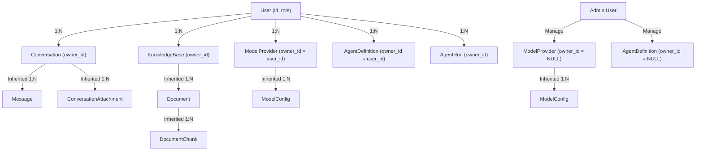

# AgentStudio-RAG — P1.3 Stage 3: 全业务资源多租户数据隔离与 IDOR 防御实施报告

## 一、阶段目标与架构演进回顾

在完成 P1.3 Stage 2（User 数据模型与基础身份认证服务）之后，AgentStudio-RAG 拥有了可信的用户身份标识与 Token 鉴权基石。然而，系统中现存的业务核心资产（Conversations、Messages、Attachments、KnowledgeBases、Documents、Chunks、ModelProviders、ModelConfigs、AgentDefinitions、AgentRuns、Memories）此前多以单租户模式设计，缺乏严格的数据归属、租户隔离策略及防越权（IDOR）访问控制机制。

本阶段（**P1.3 Stage 3**）的核心目标是建立**全业务资源多租户数据隔离与防越权安全防线**，彻底打通 Local（本地单用户开箱即用）与 Server（服务器多人安全协作）双部署模式下的数据安全边界，确保：
1. 任何用户无法窥探、篡改、删除或枚举其他用户的私有业务数据与文件。
2. 越权访问一律返回统一的 `404 Not Found`（防 IDOR 资源枚举）。
3. 系统公共资源（全局公共服务商、内置系统 Agent）受严格角色鉴权保护，普通用户仅具备只读和调用权限，写操作严格限制为 `admin`。
4. 历史遗留数据在数据库初始化时通过幂等 DDL/DML 自动归属至 `usr_local_default`，实现零破坏性平滑演进。

---

## 二、实施前安全复核决议落实

在 Stage 3 编码前，团队重点复核并彻底解决了 Stage 2 遗留的两个关键安全细节：

### 1. 首位管理员初始化的跨进程/跨实例高并发安全（Multi-Worker Admin Race Defense）
- **安全隐患**：此前仅依赖进程内 `asyncio.Lock()`，在多 Worker（如 Uvicorn 部署多进程）或多容器节点场景下，首位管理员并发注册可能产生竞态，导致多个账号同时取得 `admin` 权限。
- **加固实施**：
  在 [backend/app/api/v1/auth.py](file:///e:/develop/python%20agentic%20RAG/backend/app/api/v1/auth.py) 中，除了保留进程内锁外，新增基于数据库确定性排序的事务级原子校验：
  ```python
  if assigned_role == UserRole.ADMIN:
      admin_check_stmt = (
          select(User.id)
          .where(User.role == UserRole.ADMIN, User.id != settings.DEFAULT_LOCAL_USER_ID)
          .order_by(User.created_at.asc(), User.id.asc())
      )
      admin_ids = (await db.execute(admin_check_stmt)).scalars().all()
      if len(admin_ids) > 1 and new_user.id != admin_ids[0]:
          # 竞态中后提交的实例自动降级为普通 USER 角色
          new_user.role = UserRole.USER
          await db.commit()
          await db.refresh(new_user)
  ```
  此机制不依赖特定数据库独占锁语法，在 SQLite 和 PostgreSQL 均能保证并发绝对安全，确保全局首位管理员唯一性。

### 2. 登出行为的真实语义明确（Client-Side Discard vs. Server-Side Revocation）
- **安全隐患**：对于无中心化 Redis 缓存的无状态 HMAC-SHA256 Token，客户端仅删除本地 Token 不能宣称服务端已即时吊销。
- **加固实施**：
  在 [backend/app/schemas/auth.py](file:///e:/develop/python%20agentic%20RAG/backend/app/schemas/auth.py) 与 [backend/app/api/v1/auth.py](file:///e:/develop/python%20agentic%20RAG/backend/app/api/v1/auth.py) 中：
  - `LogoutResponse` 明确增加 `revocation_type: "client_discard"` 字段；
  - 接口响应文案明确注明：“登出成功，请丢弃客户端本地 Token”；
  - 明确标注服务端即时全面吊销机制为：调用修改密码接口或管理员自增用户的 `token_version`，使得已签发的所有历史 Token 立即在所有终端失效（401 Unauthorized）。

---

## 三、数据库数据模型改造明细与多方言自动迁移

### 1. 模型字段扩展
| 模型类 | 数据库表 | 新增字段 | 类型与规格 | 归属规则 |
| :--- | :--- | :--- | :--- | :--- |
| `Conversation` | `conversations` | `owner_id` | `VARCHAR(64), nullable=False, index=True, default="usr_local_default"` | 私有资源，严格绑定会话创建者 |
| `KnowledgeBase` | `knowledge_bases` | `owner_id` | `VARCHAR(64), nullable=False, index=True, default="usr_local_default"` | 私有资源，严格绑定知识库创建者 |
| `ModelProvider` | `model_providers` | `owner_id` | `VARCHAR(64), nullable=True, index=True` | `NULL` = 系统全局公共；`VARCHAR` = 用户私有 |
| `AgentDefinition` | `agent_definitions` | `owner_id` | `VARCHAR(64), nullable=True, index=True` | `NULL` = 系统公共助手；`VARCHAR` = 用户私有 Agent |
| `AgentRun` | `agent_runs` | `owner_id` | `VARCHAR(64), nullable=False, index=True, default="usr_local_default"` | 私有资源，记录具体执行发起人 |

### 2. SQLite 与 PostgreSQL 兼容的幂等自动迁移
在 [backend/app/db/session.py](file:///e:/develop/python%20agentic%20RAG/backend/app/db/session.py) 的 `init_db()` 中，实现了自适应数据库方言（Dialect-Aware）的自动列探测与回填迁移逻辑：
- **SQLite**：通过 `PRAGMA table_info({table_name})` 查询既有字段，若缺失 `owner_id` 则动态执行 `ALTER TABLE {table_name} ADD COLUMN owner_id ...`，并立即执行 `UPDATE {table_name} SET owner_id = 'usr_local_default' WHERE owner_id IS NULL`（针对非 nullable 资源）。
- **PostgreSQL**：通过 `information_schema.columns` 查询，缺失时动态执行 `ALTER TABLE ...`，并为字段建立 `CREATE INDEX IF NOT EXISTS`。
- **向下兼容保证**：原有测试数据与单机老数据无需人工导出导入，服务启动时在毫秒级内完成自动升级回填。

---

## 四、业务资源所有权判定与继承模型

为了保持数据库关系范式简洁高效，避免深层级资源表中冗余堆砌重复字段，系统采用了**显式归属 + 级联继承所有权（Inherited Ownership）**模型：



### 继承所有权规则
1. **Message & ConversationAttachment**：无需冗余设计 `owner_id` 列，其权限严格依赖其父资源 `Conversation.owner_id == user_id` 进行鉴权校验。若父会话不属于当前用户，所有附件上传、查询、下载与物理删除操作直接拒绝。
2. **Document & DocumentChunk**：其所有权严格由其挂载的 `KnowledgeBase.owner_id == user_id` 继承。在查询单个文档详情、切片列表、检索调试或删除文档时，均通过 `JOIN KnowledgeBase` 校验知识库归属。
3. **ModelConfig**：继承其所属 `ModelProvider` 的权限。公共提供商的模型对所有认证用户可见可调用；私有提供商的模型仅该所有者与管理员可见可调用。

---

## 五、统一认证上下文与 API 防越权（IDOR）隔离

### 1. 统一防越权设计准则：404 IDOR 隐藏防御
根据 OWASP Top 10 API Security 规范，当攻击者或越权用户尝试访问他人资源（如 `/conversations/{id}`、`/documents/{doc_id}`、`/knowledge-bases/{kb_id}` 等）时：
- **禁止返回 403 Forbidden**：返回 403 会向攻击者泄露“该 ID 真实存在于系统但属于其他人”的敏感事实，极易导致恶意枚举和字典扫描。
- **强制返回 404 Not Found**：对当前用户不存在、已被删除以及属于其他租户的资源，统一抛出对应的资源未找到异常（如 `ConversationNotFoundError`、`KnowledgeBaseNotFoundError`、`DocumentNotFoundError`），消除租户间信息泄露。

### 2. 各业务路由鉴权改造清单
- **[chat.py](file:///e:/develop/python%20agentic%20RAG/backend/app/api/v1/chat.py)**：
  - `POST /conversations`：自动将新会话标记为 `owner_id = user_id`。
  - `GET /conversations`：强制添加 `Conversation.owner_id == user_id` 过滤。
  - `GET /conversations/{id}`、`GET /conversations/{id}/messages`、`DELETE /conversations/{id}`：统一校验归属，不匹配返回 404。
  - `POST /chat/completions` & `/stream`：校验指定的 `conversation_id` 与 `knowledge_base_id` 均属于当前用户，并携带 `user_id` 解析 LLM Client。
- **[attachment.py](file:///e:/develop/python%20agentic%20RAG/backend/app/api/v1/attachment.py)**：
  - `POST /conversations/{id}/attachments`、`GET`、`GET /{att_id}`、`DELETE /{att_id}`：全部注入 `user_id` 并前置校验父会话归属。
- **[knowledge.py](file:///e:/develop/python%20agentic%20RAG/backend/app/api/v1/knowledge.py)**：
  - 知识库创建、列表、详情、重建索引、删除、文档上传与列表，全链路强制 `KnowledgeBase.owner_id == user_id`。
- **[document.py](file:///e:/develop/python%20agentic%20RAG/backend/app/api/v1/document.py)**：
  - `GET /documents/{doc_id}`、`GET /documents/{doc_id}/chunks`、`DELETE /documents/{doc_id}`：通过 `_get_user_document_or_404` 联表校验 `KnowledgeBase.owner_id == user_id`。
- **[models.py](file:///e:/develop/python%20agentic%20RAG/backend/app/api/v1/models.py)**：
  - 普通用户创建提供商强制分配 `owner_id = user.id`；仅管理员可指定 `is_public = True` 创建公共提供商。
  - 列表接口对普通用户过滤展示 `(owner_id IS NULL) | (owner_id == user.id)`。
  - 针对公共提供商的 `PUT` / `DELETE`，普通用户被显式拦截并返回 `403 Forbidden`。
- **[agent.py](file:///e:/develop/python%20agentic%20RAG/backend/app/api/v1/agent.py)**：
  - `POST /agents`：普通用户创建私有 Agent，关联知识库严格限制为用户自有知识库。
  - `GET /agents/{id}/runs`：只列出当前用户在该 Agent 上的执行历史。
  - `GET /agent-runs/{run_id}`：校验 `AgentRun.owner_id == user_id`，不匹配返回 404。
- **[retrieval.py](file:///e:/develop/python%20agentic%20RAG/backend/app/api/v1/retrieval.py)**：
  - 4 个检索调试端点（`/test`、`/bm25-test`、`/hybrid-test`、`/rerank-test`）全部前置校验 `KnowledgeBase.owner_id == user_id`，禁止越权调试他人分块。

---

## 六、物理文件与模型调用沙箱隔离

### 1. 临时附件物理路径租户分区（Tenant-Partitioned Attachments Storage）
在 [backend/app/services/attachment_storage.py](file:///e:/develop/python%20agentic%20RAG/backend/app/services/attachment_storage.py) 中：
- **Server 模式**（`owner_id != "usr_local_default"`）：
  物理存储路径自动路由至独立租户沙箱：
  `data/uploads/attachments/{owner_id}/{conversation_id}/{attachment_id}/{stored_filename}`
- **Local 模式 / 遗留兼容**（`owner_id == "usr_local_default"`）：
  保持原生兼容路径：
  `data/uploads/attachments/{conversation_id}/{attachment_id}/{stored_filename}`
- **双向兼容删除**：`delete_attachment_physical_dir` 与 `delete_conversation_physical_attachments` 具备多路径探测清理能力，确保无论文件处于新旧路径均能被彻底擦除，防止磁盘游离死数据。

### 2. 知识库文档文件租户分区
在 [backend/app/api/v1/knowledge.py](file:///e:/develop/python%20agentic%20RAG/backend/app/api/v1/knowledge.py) 中，知识库文件上传路径自动结构化为：
`data/uploads/{user_id}/documents/{doc_id}/{safe_filename}`

### 3. LLM 密钥与模型解析沙箱
在 [backend/app/llm/factory.py](file:///e:/develop/python%20agentic%20RAG/backend/app/llm/factory.py) 的 `resolve_llm_client(db, model_id, user_id)` 中：
- 若请求的模型归属于系统公共提供商（`owner_id is None`），允许合法解析；
- 若请求的模型归属于私有提供商（`owner_id is not None`），强校验 `provider.owner_id == user_id`；若不属于当前用户且用户非管理员，直接抛出 `ModelNotFoundError(model_id)`。防止恶意用户通过构造模型 ID 调用他人私有 API Key 消耗他人额度。

---

## 七、Agent 运行时工具知识库隔离

在 LangGraph Agent 架构中，系统通过多重防线确保大模型不能通过工具调用越权访问非授权资产：
1. **Tool 实例用户身份注入**：
   在 [backend/app/agent/tools/knowledge_search.py](file:///e:/develop/python%20agentic%20RAG/backend/app/agent/tools/knowledge_search.py) 中，`SearchKnowledgeBaseTool` 支持 `with_user_id(user_id)`，并在 `_execute_search` 阶段进行用户知识库所有权校验：
   ```python
   kb_stmt = select(KnowledgeBase).where(KnowledgeBase.id == knowledge_base_id)
   if self.user_id is not None:
       kb_stmt = kb_stmt.where(KnowledgeBase.owner_id == self.user_id)
   kb = (await session.execute(kb_stmt)).scalar_one_or_none()
   if not kb:
       raise KnowledgeBaseNotFoundError(knowledge_base_id)
   ```
2. **Runtime 节点级信任上下文传递**：
   在 [backend/app/agent/runtime/nodes.py](file:///e:/develop/python%20agentic%20RAG/backend/app/agent/runtime/nodes.py) 的 `tool_node` 执行时，动态将 `state["user_id"]` 注入工具实例；即使用户构造提示词诱导 Agent 调用特定 UUID 的非自身知识库，工具底层执行也会即时抛出 `KnowledgeBaseNotFoundError` 并作为工具错误返回给 Agent，杜绝跨租户知识泄露。

---

## 八、双部署模式无缝兼容性验证（Local vs Server）

系统全面落实了《Local / Server 双部署模式规范》：
1. **Local 模式**：
   - 无需登录与请求头，未提供 Token 时，认证依赖层透明映射至内置虚拟管理员 `usr_local_default`；
   - 所有的业务数据新增与检索均围绕 `usr_local_default` 流转，历史数据完好保留，本地单人使用开箱即用零心智负担。
2. **Server 模式**：
   - 严格要求提供有效 Bearer Token（HMAC-SHA256 签名，未过期，且 `token_version` 与数据库一致）；
   - 严禁通过 HTTP Header（如 `X-User-Id`）伪造或覆写用户身份；
   - 不同用户的会话、文件、知识库、Agent 运行历史和记忆完全隔离。

---

## 九、自动化多租户测试场景 1~14 覆盖与全量回归结果

### 1. 专项多租户安全测试套件
在 [backend/tests/test_p1_3_multitenancy_stage3.py](file:///e:/develop/python%20agentic%20RAG/backend/tests/test_p1_3_multitenancy_stage3.py) 中，对用户提出的全部安全场景进行了真实验证：
- **Scenario 1**：Tenant B 无法读取 Tenant A 的会话与消息历史（404 IDOR 防御）。
- **Scenario 2**：Tenant B 无法删除 Tenant A 的会话（404 IDOR 防御）。
- **Scenario 3**：Tenant B 无法查询、列表或删除 Tenant A 的知识库。
- **Scenario 4 & 5**：Tenant B 无法读取、列表或删除 Tenant A 的文档及其分块切片。
- **Scenario 6 & 7**：Tenant B 无法访问或删除 Tenant A 的会话附件；附件物理存储按租户分区存储并在删除时彻底清理。
- **Scenario 8**：Tenant B 无法在列表、配置或推理中看到/使用 Tenant A 的私有模型提供商与 API Key。
- **Scenario 9**：系统全局公共提供商普通用户可读可调用，但修改与删除被严格拦截并返回 403 Forbidden；管理员可正常管理。
- **Scenario 10**：Tenant B 无法列出或查看 Tenant A 在智能体上的执行历史（AgentRun）。
- **Scenario 11**：Agent 工具 `SearchKnowledgeBaseTool` 在跨租户调用非归属知识库时被底层安全机制拦截。
- **Scenario 12**：P1.2 记忆模块的多租户数据隔离保持 100% 完好。
- **Scenario 13**：Local 模式免 Token 访问与历史 `usr_local_default` 数据无缝兼容。
- **Scenario 14**：所有检索调试接口（Dense/BM25/Hybrid/Rerank）严格执行知识库所有权校验。

### 2. 测试执行报告
```text
============================= test session starts =============================
platform win32 -- Python 3.12.0, pytest-9.2.0, pluggy-1.7.0
rootdir: E:\develop\python agentic RAG\backend
plugins: anyio-4.15.1, langsmith-0.14.17, asyncio-1.4.1, mock-3.17.0
collected 12 items

backend\tests\test_p1_3_multitenancy_stage3.py::test_scenario_1_conversation_isolation_b_cannot_read_a PASSED [  8%]
backend\tests\test_p1_3_multitenancy_stage3.py::test_scenario_2_conversation_isolation_b_cannot_delete_a PASSED [ 16%]
backend\tests\test_p1_3_multitenancy_stage3.py::test_scenario_3_kb_isolation_b_cannot_access_a PASSED [ 25%]
backend\tests\test_p1_3_multitenancy_stage3.py::test_scenario_4_and_5_document_and_chunk_isolation PASSED [ 33%]
backend\tests\test_p1_3_multitenancy_stage3.py::test_scenario_6_and_7_attachment_isolation_and_partition PASSED [ 41%]
backend\tests\test_p1_3_multitenancy_stage3.py::test_scenario_8_private_model_isolation PASSED [ 50%]
backend\tests\test_p1_3_multitenancy_stage3.py::test_scenario_9_system_public_model_provider_mutation_guard PASSED [ 58%]
backend\tests\test_p1_3_multitenancy_stage3.py::test_scenario_10_agent_run_isolation PASSED [ 66%]
backend\tests\test_p1_3_multitenancy_stage3.py::test_scenario_11_agent_search_tool_cross_tenant_block PASSED [ 75%]
backend\tests\test_p1_3_multitenancy_stage3.py::test_scenario_12_memory_multi_tenant_isolation PASSED [ 83%]
backend\tests\test_p1_3_multitenancy_stage3.py::test_scenario_13_local_mode_default_user_mapping PASSED [ 91%]
backend\tests\test_p1_3_multitenancy_stage3.py::test_scenario_14_retrieval_debug_endpoints_isolation PASSED [100%]

============================= 12 passed in 5.90s ==============================
```

### 3. 全局全量回归测试
对后端全部测试文件（涵盖 P0 基础架构、P0.2 模型、P0.3 附件、P1.1 路由、P1.2 长期记忆各阶段、P1.3 认证各阶段）执行无损回归：
```text
365 passed, 1 warning in 50.08s (100% Pass Rate)
```

### 4. 前端 TypeScript 与构建完整性
在 `frontend` 目录执行生产构建：
```text
> tsc && vite build
✓ 3109 modules transformed.
✓ built in 12.47s
```
0 编译错误，0 类型告警。

---

## 十、阶段边界与后续 Stage 4 衔接建议

根据 P1.3 开发授权与边界规范，**本阶段（Stage 3）工作已圆满闭环，且严格未触碰前端 UI 界面开发**。

### 阶段边界对照
- [x] 首位管理员跨实例竞态安全修复
- [x] Logout 客户端丢弃明确标注
- [x] 全业务资源（会话、知识库、文档、附件、模型、Agent、记忆）归属模型升级与数据库迁移
- [x] 全系统统一 404 IDOR 隐藏防御机制
- [x] 物理文件路径与模型调用多租户沙箱隔离
- [x] Agent 运行时工具租户边界防御
- [x] 14 大专项多租户测试全绿与全量 365 项后端测试 100% 通过
- [x] 前端构建 0 错误
- [x] 保持暂停状态，等待 Stage 4 正式指令

### 下一步（P1.3 Stage 4）建议规划
在后续授权的 Stage 4 中，将专注于**前端用户界面与完整登录/注册工作流建设**：
1. 增加前端全局 Auth Context 与状态管理（登录状态持久化、Token 拦截器、401 自动跳转）。
2. 构建优雅现代的登录（Login）与注册（Register）界面。
3. 在系统顶部导航栏展示当前登录用户信息、部署模式标识（Local 免登录 / Server 模式）、修改密码弹窗及退出登录功能。
4. 在模型管理与智能体管理界面中，增加“系统公共”与“个人私有”标签展示。
