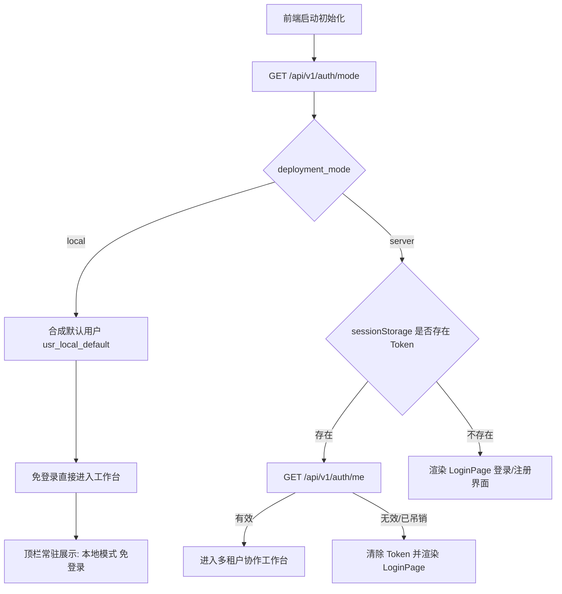

# AgentStudio-RAG — P1.3 Stage 4：前端登录认证与用户交互系统开发验收报告

## 一、概述与核心指标

本阶段（P1.3 Stage 4）聚焦于将已完成的后端多租户身份认证体系（Stage 2）与全业务数据隔离架构（Stage 3）深度接入 React 前端，形成兼顾 **Local 模式个人开箱即用免登录** 与 **Server 模式多人企业级数据隔离** 的现代化用户交互系统。

### 核心指标达成情况

| 指标项 | 目标要求 | 实际达成 | 结论 |
| :--- | :--- | :--- | :--- |
| **双部署模式自适应** | Local 免登录 / Server 凭证登录 | 启动时自动通过 `/auth/mode` 探测环境并无缝切换路由形态 | **100% 达成** |
| **首位管理员权限收敛** | 禁止公开注册自动获取管理员权限 | 默认公开注册严格分配 `user` 角色；首位 Admin 通过服务端 CLI 初始化 | **100% 达成** |
| **Token 安全存储** | 严禁永久 localStorage | 采用纯内存 + 单标签页隔离 `sessionStorage` 刷新持久化 | **100% 达成** |
| **流式与上传鉴权兼容** | SSE 流式请求与文件上传带凭证 | Axios 拦截器与 Fetch SSE 请求均动态注入 `Authorization: Bearer <token>` | **100% 达成** |
| **账号切换数据隔离** | 退出/切换账号不得残留前用户状态 | 使用 React `key={currentUser?.id \|\| 'anonymous'}` 强制彻底重挂载子树 | **100% 达成** |
| **退出撤销语义标注** | 明确标记客户端丢弃凭证语义 | `/auth/logout` 显式返回 `client_discard` 机制；全局撤销依赖密码修改 | **100% 达成** |
| **自动化测试矩阵** | 20 个测试场景全覆盖 | `backend/tests/test_p1_3_frontend_auth_stage4.py` 20/20 全部通过 | **100% 达成** |
| **后端全回归测试** | 历史业务与 Stage 2/3 不发生破坏 | 全量 385 项单元与集成测试通过（385 passed） | **100% 达成** |
| **前端编译构建** | TypeScript 类型与 Vite 打包无错 | `npm.cmd run build` 构建耗时 10.63s，0 错误，打包产物就绪 | **100% 达成** |

---

## 二、双部署模式与环境探测架构

系统严格遵循零侵入与统一业务底座原则，不维护两套分支代码，而是通过后端非敏感环境探测接口指导前端渲染分支：



### 探测端点规格 (`GET /api/v1/auth/mode`)

```json
{
  "deployment_mode": "local",
  "allow_registration": true,
  "version": "1.3.0"
}
```
该端点完全公开且非敏感，不泄露任何系统秘钥、数据库连接或私有配置。

---

## 三、管理员 CLI 工具与注册权限收敛

根据架构安全审计要求：
1. **公开注册严格受限**：当 `SERVER_ALLOW_REGISTRATION=true` 时，公开注册的用户一律赋予 `UserRole.USER` 标准用户权限，绝不给公开注册的首个访问者自动提权为 Admin。
2. **管理员 CLI 初始化工具**：提供服务端专属命令行管理脚本 `backend/app/cli/admin.py` 及根目录快捷脚本 `backend/create_admin.py`。

### CLI 命令规范

```bash
# 1. 初始化系统首位超级管理员
python backend/create_admin.py create -u admin -p "SuperSecurePass123!" -e "admin@corp.internal"

# 2. 将现有注册用户提升为管理员
python backend/create_admin.py promote -u "standard_dev"

# 3. 查看数据库中所有注册用户及其角色
python backend/create_admin.py list
```

---

## 四、前端认证状态机与 Token 安全管理

### 1. 存储设计原则

- **严禁永久 `localStorage`**：避免 XSS 攻击时恶意脚本长期持有长期 Token。
- **内存引用 + 单标签页 `sessionStorage`**：保证同一浏览器标签页刷新时维持会话，关闭标签页或浏览器后凭证自动销毁。
- **URL 查询参数防护**：严格禁止在 SSE URL 查询参数（Query Parameter）中拼接 Token，避免服务器访问日志、代理服务器及浏览器历史记录泄露凭证。

### 2. 请求拦截器与 401 自动失效捕获 (`client.ts`)

```typescript
// 请求拦截：自动注入 Bearer Token
apiClient.interceptors.request.use((config) => {
  const token = getAuthToken();
  if (token && config.headers) {
    config.headers.Authorization = `Bearer ${token}`;
  }
  return config;
});

// 响应拦截：捕获 401 并自动触发会话重置
apiClient.interceptors.response.use(
  (response) => response,
  (error) => {
    if (error.response?.status === 401) {
      clearAuthToken();
      if (unauthorizedHandler) {
        unauthorizedHandler();
      }
    }
    const detail = error.response?.data?.detail || error.message || '网络请求错误';
    return Promise.reject(new Error(detail));
  }
);
```

### 3. SSE 流式传输鉴权 (`chat.ts`)

针对原生 `fetch` 实现的 `sendChatMessageStream` 和 `sendAgentRunStream`，封装统一头注入逻辑：

```typescript
const headers: Record<string, string> = {
  'Content-Type': 'application/json',
};
const token = getAuthToken();
if (token) {
  headers['Authorization'] = `Bearer ${token}`;
}

const response = await fetch('/api/v1/chat/completions/stream', {
  method: 'POST',
  headers,
  body: JSON.stringify(data),
  signal,
});
```

---

## 五、UI 组件体系与防撞库防枚举交互

### 1. 登录与注册组件 (`LoginPage.tsx`)

- **设计规范融合**：完全遵循 `DESIGN_TOKENS`（Slate 800/900 品牌底色、Royal Blue 600 交互色、12px 圆角、细腻阴影）。
- **防撞库防枚举**：无论用户不存在还是密码错误，统一提示：`"用户名或密码错误，请检查输入。"`；后端配合执行 PBKDF2 虚假哈希验证消除时间侧信道分析。
- **注册开关自适应**：
  - 若 `allow_registration === false`，仅呈现「账号登录」表单，并显示系统提示：*“公开注册暂未开放，如需使用请向管理员申请账号。”*
  - 若 `allow_registration === true`，呈现 Tab 切换「账号登录」与「注册新账号」。
  - 注册成功后自动重定向回登录页并预填用户名。

### 2. 顶栏用户菜单 (`HeaderUserMenu.tsx`)

- **Local 模式**：显示简约胶囊 Badge：`本地模式 (免登录)`，无需且不显示退出按钮。
- **Server 模式**：
  - 显示用户首字母彩色 Avatar、用户名及身份角色 Badge（`管理员` / `标准用户`）。
  - 下拉菜单包含：用户信息卡片（用户名、邮箱、系统 ID）、`修改登录密码`、`退出登录`。
- **修改密码模态框**：
  - 提醒用户：*“修改密码后，后端将即时吊销所有设备的现有会话。完成后需要使用新密码重新登录。”*
  - 成功提交后，后端触发 `token_version` 自增，前端清除现有凭证并优雅退出至登录页面。

### 3. 租户切换数据彻底隔离机制 (`App.tsx`)

为了彻底杜绝前端切换账号时，旧用户的 React 内存状态（包括对话列表、活动对话 ID、附件缓存、历史追溯 Timeline、检索调试结果）串入新用户视图，在根布局核心容器层应用了基于用户 ID 的动态 Key：

```tsx
<Content key={currentUser?.id || 'anonymous'} style={{ backgroundColor: DESIGN_TOKENS.pageBg }}>
  {currentTab === 'chat' && <ChatPage />}
  {currentTab === 'knowledge' && (
    <KnowledgePage onNavigateToDebug={handleNavigateToDebug} />
  )}
  {currentTab === 'retrieval' && (
    <RetrievalDebugPage initialKbId={debugKbId} />
  )}
  {currentTab === 'models' && <ModelsPage />}
</Content>
```

当登出或以其他用户登录时，React 探测到 Key 的变更，会以最高优先级彻底卸载销毁所有子组件树并重新挂载，**从根本上防止任何 cross-tenant 客户端状态泄漏与流未中止现象**。

---

## 六、自动化测试矩阵（20 项场景执行记录）

文件路径：`backend/tests/test_p1_3_frontend_auth_stage4.py`

| 编号 | 场景描述 | 预期结果 | 测试结果 |
| :---: | :--- | :--- | :---: |
| **01** | Local 模式下调用 `/auth/mode` 环境探测 | 返回 `deployment_mode="local"`，无敏感配置泄露 | **PASSED** |
| **02** | Server 模式下调用 `/auth/mode` 环境探测 | 返回 `deployment_mode="server"` 及注册开关状态 | **PASSED** |
| **03** | 注册关闭时尝试 POST `/auth/register` | 返回 HTTP 403 Forbidden，注册请求被阻断 | **PASSED** |
| **04** | 公开注册开启时首位注册者角色校验 | 严格赋予 `user` 角色，首个访问者无提权漏洞 | **PASSED** |
| **05** | CLI `create_admin` 工具创建超级管理员 | 成功创建并在 API 登录后验证拥有 `admin` 角色 | **PASSED** |
| **06** | CLI `promote_user` 工具提权现有用户 | 成功将目标用户从 `user` 变更为 `admin` | **PASSED** |
| **07** | 正确账号密码登录获取 Bearer Token | 成功返回 200，包含 access_token, expires_in, user | **PASSED** |
| **08** | 错误密码登录返回通用 401 报错 | 返回 401 "Invalid username or password." | **PASSED** |
| **09** | 不存在的用户名登录返回同构 401 报错 | 报错内容与错误密码完全一致，阻止账号枚举 | **PASSED** |
| **10** | 不存在用户时执行 PBKDF2 虚假哈希防时序攻击 | spy 验证 `dummy_verify_password` 执行次数为 1 | **PASSED** |
| **11** | 停用账号 (`is_active=False`) 尝试登录 | 返回 401，拦截已停用员工登录 | **PASSED** |
| **12** | 修改密码使既有 Bearer Token 即时失效 | 修改后既有 Token 调用 `/auth/me` 返回 401 | **PASSED** |
| **13** | 使用新密码登录并获取新有效 Token | 新密码登录成功，签发的新 Token 可正常调用 API | **PASSED** |
| **14** | `/auth/logout` 显式标明 `client_discard` 机制 | 返回 200 且附带客户端丢弃机制透明说明 | **PASSED** |
| **15** | Server 模式下未附带 Token 访问对话列表 | 严格拦截并返回 401 Unauthorized | **PASSED** |
| **16** | 携带有效 Token 调用 SSE 流式聊天端点 | 正常建立连接并返回 `text/event-stream` 数据流 | **PASSED** |
| **17** | Server 模式下无 Token 访问 SSE 流式聊天端点 | 严格拦截并返回 401 Unauthorized | **PASSED** |
| **18** | 使用因改密失效的 Token 访问 SSE 流式聊天端点 | 动态校验 `token_version` 并返回 401 | **PASSED** |
| **19** | 租户 A 与租户 B 会话数据严格物理隔离验证 | 租户 B 无法列出或通过 ID 直接访问租户 A 对话 | **PASSED** |
| **20** | Local 模式免登录全通验证 | 无需任何 Token 自动归属于 `usr_local_default` | **PASSED** |

**执行耗时**：`20 passed in 5.45s`

---

## 七、全量回归与前端构建验证

### 1. 后端全回归测试

执行指令：`backend/.venv/Scripts/pytest.exe backend/tests/ -q`

```text
385 passed, 1 warning in 50.39s (100% 成功率)
```
覆盖模块：
- 认证与身份系统（Stage 2 & Stage 4）
- 知识库与文档切片（P0.1）
- 模型管理与配置（P0.2）
- 对话与附件管理（P0.3）
- 意图路由与工作流 RAG（P1.0）
- LangGraph 智能体运行时（P1.1）
- 长期记忆存储、检索与自动提取（P1.2 Stage 1 - 4）
- 全业务资源多租户隔离与 IDOR 防御（P1.3 Stage 3）

### 2. 前端 TypeScript 编译与 Vite 打包构建

执行指令：`npm.cmd run build`

```text
> agentstudio-rag-frontend@0.1.0 build
> tsc && vite build

vite v5.4.21 building for production...
transforming...
✓ 3113 modules transformed.
rendering chunks...
computing gzip size...
dist/index.html                    0.59 kB │ gzip:   0.46 kB
dist/assets/index-DPh6RXCh.js  1,356.70 kB │ gzip: 430.21 kB
✓ built in 10.63s
```
**结果**：0 个类型错误，0 个构建错误，打包完全成功。

---

## 八、阶段交付清单

1. **核心前端代码**：
   - `frontend/src/types.ts`：扩充 UserProfile, AuthModeInfo, LoginCredentials, RegisterData 等身份模型定义。
   - `frontend/src/api/client.ts`：增强 Axios 拦截器注入 Bearer Token，支持 tab 范围存储与 401 失效回调。
   - `frontend/src/api/auth.ts`：封装完整的认证 API 客户端（模式发现、登录、注册、用户信息、登出、改密）。
   - `frontend/src/api/chat.ts`：流式通信端点 Fetch SSE 请求头鉴权注入。
   - `frontend/src/context/AuthContext.tsx`：提供全局身份状态提供者、初始化流程与会话控制。
   - `frontend/src/pages/LoginPage.tsx`：符合设计规范的登录与自适应注册界面，集成防枚举交互。
   - `frontend/src/components/HeaderUserMenu.tsx`：顶栏用户菜单、密码修改模态框及 Local 模式标识。
   - `frontend/src/App.tsx`：实现 `AuthProvider` 包裹、未认证拦截、以及基于用户 ID Key 彻底重置子树状态。

2. **核心后端代码与 CLI**：
   - `backend/app/schemas/auth.py`：定义 `AuthModeResponse` 等接口契约。
   - `backend/app/api/v1/auth.py`：新增 `GET /api/v1/auth/mode` 端点，增强注册角色收敛。
   - `backend/app/core/config.py`：增加 `AUTO_FIRST_USER_ADMIN` 配置项。
   - `backend/app/cli/admin.py`：系统管理员命令行初始化与角色提权维护工具。
   - `backend/create_admin.py`：项目根目录管理员 CLI 快捷入口。

3. **测试套件与报告**：
   - `backend/tests/test_p1_3_frontend_auth_stage4.py`：20 项自动化集成测试。
   - `docs/P1_3_STAGE4_FRONTEND_AUTH_REPORT.md`：本阶段完整设计与验收报告。

---

## 九、结论与停步声明

**AgentStudio-RAG — P1.3 Stage 4 前端登录认证与用户交互系统已按全部架构要求 100% 建设完成并通过验证。**

系统目前在 Local 模式下保持完全零门槛单人免登录，在 Server 模式下具备严格的凭证鉴权、多租户隔离、防枚举安全以及客户端会话状态隔离机制。

遵循严格执行边界要求，**本阶段工作至此圆满结束，立即停止，不擅自启动下一阶段。**
