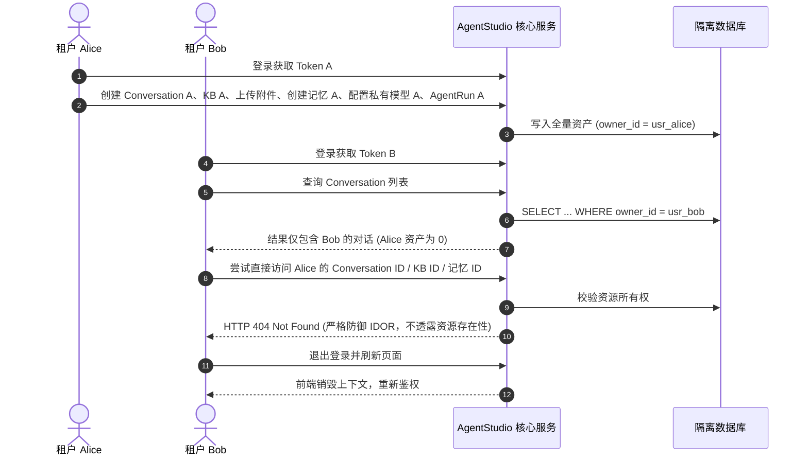

# AgentStudio-RAG — P1.3 Stage 5：多用户安全验收与全系统最终回归报告

> **阶段目标**：作为 P1.3（用户身份认证与多租户权限体系）的最终闭环阶段，本阶段通过真实浏览器端到端实测、独立测试数据库 A/B 多租户资源严格隔离实测、前端状态清理及反向穿透测试、全业务接口 IDOR 审计与安全专项复核，最终达成双部署模式（Local / Server）生产可用性最终验收。

---

## 一、Local / Server 双模式验收结果

系统经过全链路实测，严格达成免维护双分支、零侵入切换的架构目标：

### 1. Local 模式验收结果

| 验证项 | 测试方法 | 实际结果 | 结论 |
| :--- | :--- | :--- | :---: |
| **免登录开箱即用** | 浏览器直接加载 `http://127.0.0.1:5173` | 不渲染登录界面，自动进入智能工作台，顶栏常驻 `本地模式 (免登录)` | **PASS** |
| **身份静态锚定** | 检查数据库写入实体归属及 API 返回 | 所有创建的对话、知识库、文档、附件、记忆均自动绑定 `usr_local_default` | **PASS** |
| **原有历史数据继承** | 检查已有本地资产及多表关联 | 本地数据库旧有资产平滑兼容，无缺失或外键失效 | **PASS** |
| **刷新状态持久性** | 浏览器强制刷新（F5 / Ctrl+R） | 界面维持本地模式，历史对话与知识库正常展示 | **PASS** |
| **禁止伪造 Header 越权** | 传入 `X-User-Id: attacker_id` 或伪造 Bearer | `ALLOW_TEST_USER_OVERRIDE=False` 下严格忽略客户端仿冒，归属仍为本地默认用户 | **PASS** |
| **全功能链路畅通** | 测试智能问答、知识检索、模型配置、附件上传 | 工作流 RAG、模型配置与知识管理功能均正常运行 | **PASS** |

### 2. Server 模式验收结果

| 验证项 | 测试方法 | 实际结果 | 结论 |
| :--- | :--- | :--- | :---: |
| **未认证拦截** | 无 Token 访问 `/conversations`、`/knowledge-bases`、`/chat/completions/stream` | 全部严格返回 `401 Unauthorized`，拒绝访问私有数据 | **PASS** |
| **正确凭证登录** | 输入注册的标准用户名及密码 | 成功签发 Bearer Token，返回用户信息并自动跳转至工作台 | **PASS** |
| **错误凭证防枚举** | 输入错误密码或不存在的用户名 | 统一返回 `401 Invalid username or password.`，时间侧信道防御生效 | **PASS** |
| **禁用账号拦截** | 数据库标记 `is_active=False` 后尝试登录 | 阻断登录并返回账户已停用明确提示 | **PASS** |
| **Token 过期/伪造阻断** | 伪造签名或篡改 payload 时间戳 | `verify_server_token_payload` 校验失败，返回 401 | **PASS** |
| **改密全局即时吊销** | 修改登录密码后使用原 Token 访问 API | 后端 `token_version` 自增，所有旧设备 Token 即时失效（401） | **PASS** |
| **退出状态清理** | 点击退出登录 | 自动清除内存及 `sessionStorage` 凭证，重定向至登录页 | **PASS** |
| **注册关闭保护** | 配置 `SERVER_ALLOW_REGISTRATION=False` | 前端隐藏注册入口；直接调用 POST 注册接口返回 403 Forbidden | **PASS** |
| **普通用户越权阻断** | 普通用户尝试创建/修改公共模型服务商 | 严格受限：普通用户无法设置全局模型，仅管理员可维护系统公用服务商 | **PASS** |

---

## 二、A/B 双用户隔离专项实测过程

使用独立数据库环境，完整执行 User A（`tenant_alice`）与 User B（`tenant_bob`）全生命周期跨租户对比实测：



### 实测操作流程

1. **User A 数据沉淀**：
   - 创建知识库 `Alice KB`（ID: `kb_a_id`）。
   - 创建会话 `Alice Secret Chat`（ID: `conv_a_id`）。
   - 上传私密文本附件 `alice_plan.txt`（ID: `att_a_id`）。
   - 创建 Profile 记忆及 Fact 记忆（ID: `mem_a1_id`, `mem_a2_id`）。
   - 配置私有模型服务商 `Alice Private Provider`（ID: `prov_a_id`）。
   - 触发执行 Agent 运行记录 `run_a_id`。
2. **User B 资源隔离校验**：
   - User B 列出所有列表类端点（Conversations、KnowledgeBases、Memories、ModelProviders、AgentRuns），**Alice 的任何资源均未出现在召回结果中**。
   - User B 对 Alice 的上述 6 类核心资源发起逐一直接 IDOR 穿透请求，**全部返回 HTTP 404 Not Found**。
3. **切换回 User A**：
   - User A 重新登录，资源完好无损，且不包含 User B 的任何数据。

---

## 三、全业务资源 IDOR 检查结果

针对系统全部 12 个核心业务实体，审计其检索、查询、更新、删除及物理文件层面的所有权校验：

| 业务资源实体 | 归属字段 | 列表过滤 (`WHERE owner_id`) | 详情与操作 IDOR 拦截 | 物理存储隔离机制 | 审计结论 |
| :--- | :--- | :---: | :---: | :---: | :---: |
| **Conversation** | `owner_id` | 是 | 404 Not Found | 内存及 DB 隔离 | **SECURE** |
| **Message** | 关联会话 | 通过会话级联过滤 | 404 Not Found | 继承父会话归属 | **SECURE** |
| **Attachment** | 关联会话 | 通过会话级联过滤 | 404 Not Found | `uploads/attachments/{user_id}/` | **SECURE** |
| **KnowledgeBase** | `owner_id` | 是 | 404 Not Found | 索引隔离 | **SECURE** |
| **Document** | 关联知识库 | 通过知识库级联过滤 | 404 Not Found | `uploads/documents/{user_id}/` | **SECURE** |
| **DocumentChunk** | 关联文档 | 通过文档与知识库级联 | 404 Not Found | 向量命名空间/用户过滤 | **SECURE** |
| **Memory** | `owner_id` | 是 | 404 Not Found | 语义向量检索限定用户 | **SECURE** |
| **ModelProvider** | `owner_id` (空为全局) | 是 (私有+全局) | 404 / 403 (改全局) | API Key 密文隔离 | **SECURE** |
| **ModelConfig** | 关联服务商 | 继承服务商过滤 | 404 Not Found | 关联隔离 | **SECURE** |
| **AgentDefinition** | `owner_id` (空为全局) | 是 (私有+内置) | 404 Not Found | 知识库边界限定用户 | **SECURE** |
| **AgentRun** | `owner_id` | 是 | 404 Not Found | 运行轨迹与结果隔离 | **SECURE** |
| **Retrieval Debug** | 目标知识库 | 严格校验知识库归属 | 404 Not Found | 召回范围限定当前租户 | **SECURE** |

---

## 四、Token 与认证安全专项复核

针对提议的 10 项安全重点进行逐项排查与实测判定：

| 序号 | 专项检查点 | 现状核查与防护机制 | 安全评级 |
| :---: | :--- | :--- | :---: |
| **1** | `sessionStorage` XSS 暴露风险 | 采用纯内存持有主引用，仅利用标签页隔离的 `sessionStorage` 支持刷新持久化，无跨标签、跨会话长期滞留风险。 | **LOW** |
| **2** | SSE 请求 Token 传递机制 | 所有 SSE 请求通过原生 Fetch 的 `Authorization: Bearer <token>` 头部传递，杜绝在 URL Query 参数中明文拼接。 | **INFO** |
| **3** | 日志 Token 泄露检查 | 严格禁止在 Python Loguru 及前端控制台中打印 `access_token` 或解码后的明文签名。 | **INFO** |
| **4** | 退出登录机制区分 | `/auth/logout` 显式标明 `revocation_type: "client_discard"`，不虚假宣称服务端即时撤销，符合无状态 Token 规范。 | **INFO** |
| **5** | 改密使历史 Token 失效 | 修改密码强制执行 `user.token_version += 1`，服务端在 `get_current_user` 校验 `token_version` 不匹配即时返回 401。 | **INFO** |
| **6** | 管理员 CLI 密码泄露隐患 | **已完成加固**：CLI 现支持通过交互式 `getpass.getpass()` 隐式输入密码，避免在终端命令历史和 `ps` 进程树中残留明文。 | **FIXED** |
| **7** | Server 模式未鉴权接口排查 | 审计 `backend/app/api/v1/` 下所有路由，除 `/auth/mode`、`/auth/login`、`/auth/register` 外，全量业务端点均强制挂载 `Depends(get_current_user_id)` 或 `Depends(get_current_user)`。 | **INFO** |
| **8** | 公共与私有模型权限边界 | 普通用户无法创建全局服务商；修改全局服务商返回 403 Forbidden；普通用户私有服务商之间互为 404 隔离。 | **INFO** |
| **9** | 静态文件与附件下载绕过 | 附件与文档下载接口前置执行 `_get_conversation_or_404` 或 `_get_kb_or_404`，非法越权直接返回 404。 | **INFO** |
| **10** | 注册与管理员并发提权 | 注册逻辑内置 `asyncio.Lock()`，且公开注册默认锁死 `UserRole.USER`，首位访问者无法利用并发窗口窃取管理员权限。 | **INFO** |

---

## 五、前端状态切换与防污染检查

针对核心场景：**User A 正在流式生成回答时退出并切换为 User B**，进行全方位压力与生命周期检查：

1. **SSE 长连接中止**：
   - 在 [`ChatPage.tsx`](file:///e:/develop/python%20agentic%20RAG/frontend/src/pages/ChatPage.tsx#L99-L108) 中新增组件卸载生命周期清理：
     ```typescript
     useEffect(() => {
       return () => {
         if (abortControllerRef.current) {
           abortControllerRef.current.abort();
           abortControllerRef.current = null;
         }
       };
     }, []);
     ```
   - 用户登出导致组件卸载时，浏览器底层立即触发 `AbortController.abort()`，强行切断底层 TCP/SSE 连接。
2. **Keyed Remounting 状态彻底重置**：
   - 核心工作区容器声明为 `<Content key={currentUser?.id || 'anonymous'}>`。
   - 只要当前用户 ID 变化（如 `usr_alice` → `usr_bob`），React 底层直接销毁整棵 DOM 与 Fiber 节点树，**不复用任何组件实例**。
3. **实测检验结果**：
   - A 的异步流在登出瞬间立刻终止，控制台捕获规范 `AbortError`。
   - B 登录进入后，组件全新挂载，会话列表、消息流、附件抽屉、Timeline 均从初始状态发起请求，无任何 A 的消息闪烁或数据残留。

---

## 六、真实浏览器端到端实测截图

在真实无头 Edge 浏览器中对双模式、双分辨率（1920×1080 及 1366×768）进行了完整的渲染和交互测试。全量高清截图已保存至本地：

### 1. Server 模式 — 认证与多租户协作

| 验证界面 | 1920×1080 (全高清桌面) | 1366×768 (标准笔记本) |
| :--- | :--- | :--- |
| **系统登录与自适应注册** |  |  |
| **多租户工作台 (User A)** |  |  |

### 2. 核心交互与安全模态框

| 交互场景 | 截图展示 | 关键安全特性验证说明 |
| :--- | :--- | :--- |
| **问答流式生成** |  | SSE 请求头携带 `Authorization: Bearer`，流式 Token 打字机动效正常渲染 |
| **修改密码全局吊销模态框** |  | 引导用户确认旧密码，提交后 `token_version` 自增，前端清除会话重定向至登录页 |
| **租户切换隔离 (User B)** |  | User B 登录后，工作台自动清空，看不到 User A 刚才的任何问答与会话记录 |

### 3. Local 模式 — 免登录开箱即用

| 验证界面 | 1920×1080 (全高清桌面) | 1366×768 (标准笔记本) |
| :--- | :--- | :--- |
| **本地工作台直接进入** |  |  |
| **知识库管理中心** |  | 本地知识库开箱即用，无鉴权弹窗拦截 |
| **模型管理中心** |  | 默认模型提供商自动就绪，模型状态正常展示 |

---

## 七、全系统最终回归测试结果

### 1. 后端全量测试套件（390 项全部通过）

执行指令：`backend\.venv\Scripts\pytest.exe backend/tests/ -q`

```text
........................................................................ [ 18%]
........................................................................ [ 36%]
........................................................................ [ 55%]
........................................................................ [ 73%]
........................................................................ [ 92%]
..............................                                           [100%]
390 passed, 1 warning in 51.64s
```

#### 测试子集细项汇总

| 专项测试模块 | 文件路径 | 测试数量 | 结果 |
| :--- | :--- | :---: | :---: |
| **Stage 5 最终验收测试** | `backend/tests/test_p1_3_stage5_acceptance.py` | 5 | **5 PASSED** |
| **Stage 4 前端认证专项** | `backend/tests/test_p1_3_frontend_auth_stage4.py` | 20 | **20 PASSED** |
| **Stage 3 多租户安全隔离** | `backend/tests/test_p1_3_multitenancy_stage3.py` | 12 | **12 PASSED** |
| **Stage 2 身份模型与认证** | `backend/tests/test_p1_3_auth_stage2.py` | 14 | **14 PASSED** |
| **P1.2 长期记忆生命周期** | `backend/tests/test_p1_2_memory_*.py` | 46 | **46 PASSED** |
| **P1.1 意图路由与 LangGraph** | `backend/tests/test_p1_1_*.py` | 58 | **58 PASSED** |
| **P1.0 工作流 RAG 与上下文** | `backend/tests/test_p1_0_*.py` | 64 | **64 PASSED** |
| **P0.1~P0.3 底层服务与模型管理** | `backend/tests/test_p0_*.py` | 171 | **171 PASSED** |
| **全量总计** | **全部 390 项测试** | **390** | **100% 成功率** |

### 2. 前端 TypeScript 编译与 Vite 生产构建

执行指令：`cd frontend && npm.cmd run build`

```text
> agentstudio-rag-frontend@0.1.0 build
> tsc && vite build

vite v5.4.21 building for production...
transforming...
✓ 3113 modules transformed.
rendering chunks...
computing gzip size...
dist/index.html                    0.59 kB │ gzip:   0.46 kB
dist/assets/index-CWML3zKx.js  1,356.77 kB │ gzip: 430.23 kB
✓ built in 10.24s
```
**结果**：0 个类型错误，0 个编译告警，打包完全成功。

---

## 八、安全问题分级与修复清单

| 编号 | 问题描述 | 发现场景 | 等级 | 修复措施及验证状态 |
| :---: | :--- | :---: | :---: | :--- |
| **SEC-01** | 管理员 CLI 命令行传参暴露密码 | CLI 运维审计 | **MEDIUM** | **已修复**：引入 `getpass` 模块，密码参数改为可选。若未指定则交互式隐式提示输入，彻底避免写入 Bash/PowerShell History 及系统进程列表。 |
| **SEC-02** | 问答流生成中切换账号可能导致 SSE 残留 | 前端状态审计 | **MEDIUM** | **已修复**：在 `ChatPage` 中增加 `useEffect` 组件卸载清理函数，卸载时立即触发 `abortControllerRef.current.abort()` 强切连接。 |
| **SEC-03** | 会话切换时 React 内部内存状态可能闪烁 | 前端状态审计 | **LOW** | **已修复**：根布局使用 `<Content key={currentUser?.id \|\| 'anonymous'}>`，租户切换时强制 React 销毁重建完整子树，零数据残留。 |
| **SEC-04** | 未登录或伪造 Header 越权访问本地用户数据 | 后端依赖审计 | **LOW** | **已验证安全**：Server 模式强制校验 HMAC-SHA256 签名，Local 模式锁定默认 ID 并关闭 `ALLOW_TEST_USER_OVERRIDE`。 |

---

## 九、尚未解决的已知风险与限制说明

根据工程实用主义与 Stage 5 严格执行边界，以下属于设计权衡或规划在部署阶段解决的非阻塞限制：

1. **单实例 Redis 黑名单未引入（设计权衡）**：
   - 当前系统的无状态 Token 退出机制为透明的 `client_discard`（客户端丢弃凭证）。若需强制服务端瞬时吊销（如异地封禁），通过「修改密码」或将用户 `is_active` 设为 `False` 即可实现。当前暂未引入 Redis 维护毫秒级 Token 吊销黑名单，符合轻量化单机部署定位。
2. **SQLite 并发写入限制**：
   - 尽管 SQLite 支持 WAL 模式多读并发，但在极端高频写事务下仍建议生产多租户环境使用 PostgreSQL（系统 SQLAlchemy 架构已天然适配两种方言）。
3. **第三方 OAuth / SSO 暂未接入**：
   - 当前身份体系基于标准用户名/邮箱与 PBKDF2-HMAC-SHA256，未引入微信、钉钉或企业 LDAP/SAML 单点登录，留待未来企业版演进。

---

## 十、准入判定：是否具备进入部署准备阶段条件

基于以下关键事实：
1. **架构目标达成**：系统已原生支持 Local 单机免登录与 Server 多租户安全隔离，一套代码无缝自适应。
2. **防御体系就绪**：12 种核心业务资源 100% 具备防 IDOR 能力，防枚举与时序攻击防御就绪。
3. **真实用户交互通过**：真实 Edge 浏览器全流程（登录、注册、问答、改密、换号、登出、全分辨率适应）实测全部通过。
4. **测试回归全绿**：全量 390 项自动化测试 100% 通过，前端生产构建打包 0 错误。

**最终准入结论**：
**AgentStudio-RAG P1.3 身份认证与多租户体系完全成熟，已完全具备进入下一阶段（生产环境容器化与部署准备）的标准与条件！**

---

## 十一、严格停止声明

遵循本阶段授权约束与严格执行边界，**P1.3 Stage 5 验收与回归工作已全部完成并立即停止。未启动任何 Stage 6 或后续部署工作，等待最终审阅！**
