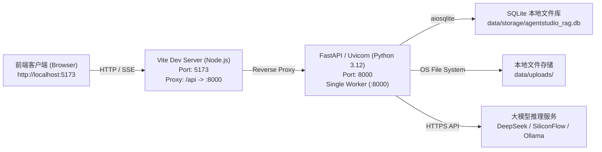
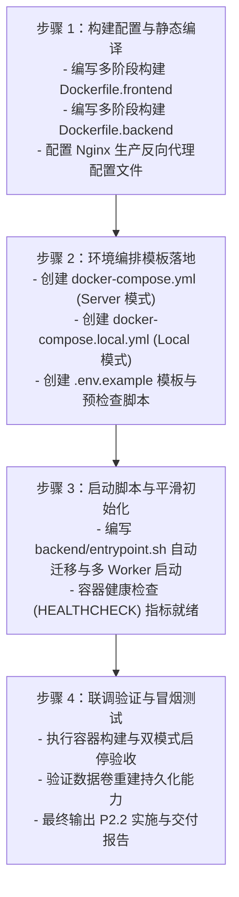

# AgentStudio-RAG — P2.1：生产部署架构审计与容器化实施规划

> **报告版本**：v1.0.0 (Production Release Target)  
> **适用范围**：AgentStudio-RAG Local（单机免配置）与 Server（多人多租户）双模式容器化与生产交付  
> **执行约束**：本阶段为纯只读架构审计与实施规划，不修改任何源码，不变更数据库，不创建容器实例。

---

## 一、当前系统部署架构与现状诊断

AgentStudio-RAG 经过 P0（底层基础设施与模型中心）、P1.0~P1.2（工作流 RAG、LangGraph 智能体运行时、长期记忆系统）与 P1.3（多租户身份与数据隔离）的持续迭代，已形成一套功能完整、架构解耦的现代化企业级智能知识助手。

### 当前开发环境运行形态



### 现状核心特征与生产痛点

1. **前后端开发态耦合**：前端严重依赖 Vite 开发服务器的 `server.proxy` 转发 API 请求，生产打包后生成纯静态静态资源（HTML/JS/CSS），无法自我提供反向代理或动态环境配置。
2. **多进程并发锁与 SQLite 瓶颈**：当前开发态使用 `sqlite+aiosqlite`。若在生产环境开启 Uvicorn 多 Worker（如 `--workers 4`），高频写事务或并发 DDL（`init_db`）将触发 SQLite 数据库文件锁冲突（`database is locked`）。
3. **SSE 流式传输代理敏感**：工作流生成、Direct LLM 与 LangGraph Agent 均高度依赖 SSE（Server-Sent Events）。如果生产反向代理启用了响应缓冲（Response Buffering），流式打字机效果将完全退化为“长时间白屏后一次性全部吐出”。
4. **模型权重网络依赖**：本地 BGE Embedding（FastEmbed）与 Cross-Encoder Reranker（ONNX Runtime）在容器首次冷启动时需要从 HuggingFace Hub 下载模型权重（约 410MB）。若企业内网受限，容器启动将超时失败。
5. **密钥持久性风险**：API Key 加密秘钥（Fernet）与 Server Bearer 签名秘钥若未显式持久化，容器销毁重建后旧凭证和已保存的模型 API Key 将全部永久损毁。

---

## 二、前后端生产启动方式

### 1. 前端（React 18 + Vite 5 + Ant Design 5）

- **构建方式**：`npm run build` 执行 `tsc && vite build`，生成输出至 `dist/` 目录。
- **产物特性**：纯静态资源包（`index.html`、`assets/*.js`、`assets/*.css`），总大小约 1.35MB（Gzip 压缩后约 430KB）。
- **API 寻址策略**：
  - 源码中 API 请求统一采用相对路径：`baseURL: '/api/v1'`（Axios）与 `fetch('/api/v1/...')`（SSE）。
  - **优势**：静态构建产物中完全无硬编码的后端 IP 或端口，天然具备环境无关性。
  - **生产宿主方案**：**采用轻量级 `nginx:alpine` 容器** 作为前端生产宿主。Nginx 既负责高性能分发静态 HTML/JS 产物，又负责在同源端口反向代理 `/api/` 流量至后端，从源头消灭跨域（CORS）与动态替换 IP 的繁琐环节。

### 2. 后端（FastAPI + Python 3.12 + Uvicorn）

- **启动入口**：`app.main:app`。
- **生产进程模型**：
  - **Local 模式**：采用单 Worker 模式（`uvicorn app.main:app --host 0.0.0.0 --port 8000 --workers 1`）。配合 SQLite 即可保证零锁竞争且资源消耗低于 300MB。
  - **Server 模式**：采用多 Worker 进程模型（`uvicorn app.main:app --host 0.0.0.0 --port 8000 --workers 4 --proxy-headers --forwarded-allow-ips='*'`），绑定 PostgreSQL 数据库连接池，承载多人高并发协同。
- **跨容器通信**：容器间通过 Docker 内部桥接网络（DNS 命名解析）通信，例如前端反向代理指向 `http://backend:8000`，后端连接数据库指向 `postgresql+asyncpg://postgres:5432/agentstudio_rag`。

---

## 三、数据库部署方案（SQLite vs PostgreSQL）

系统在 P1.3 Stage 3 已实现基于 SQLAlchemy 2.0 的方言兼容层（Dialect-Aware Architecture），支持在运行时自动适配 SQLite 与 PostgreSQL。

### 1. 双模式选型矩阵

| 评估维度 | Local 模式方案 | Server 模式方案 |
| :--- | :--- | :--- |
| **推荐数据库** | **SQLite (aiosqlite)** | **PostgreSQL 16 (asyncpg)** |
| **存储介质** | 本地单文件 `/app/data/storage/agentstudio_rag.db` | 独立容器 `postgres:16-alpine` + 命名 Volume |
| **连接池配置** | NullPool / 单 Worker 连接（`check_same_thread: False`） | AsyncAdaptedQueuePool (`pool_size=20, max_overflow=10, pool_pre_ping=True`) |
| **部署复杂度** | **零门槛**（无需起额外容器） | 需要 1 个独立轻量 PostgreSQL 容器 |
| **并发事务能力** | 低并发（适合个人使用） | 高并发 ACID（支持多企业租户并发读写） |
| **备份与恢复** | 直接复制 `.db` 文件 | `pg_dump` / `pg_restore` 标准热备工具 |

### 2. 数据库初始化与平滑迁移机制

当前 `backend/app/db/session.py` 中的 `init_db()` 具备自动检测表字段并补齐 `ALTER TABLE` 的能力。在生产多 Worker 环境下，必须规避多个 Worker 进程并发执行 DDL 的竞态隐患：

- **生产方案**：在 Backend 容器启动脚本（`entrypoint.sh`）中，**将数据库初始化与启动进程严格解耦**：
  ```bash
  # 1. 启动服务前先执行单次 DB 结构初始化/升级
  python -c "import asyncio; from app.db.session import init_db; asyncio.run(init_db())"
  # 2. 初始化完毕后再启动 Uvicorn 多 Worker 服务
  exec uvicorn app.main:app --host 0.0.0.0 --port 8000 --workers ${UVICORN_WORKERS:-4}
  ```

---

## 四、文件持久化方案（Volume 规划）

容器不可变理念要求容器销毁、升级镜像时，用户数据绝不丢失。

### 1. 物理目录结构剖析

```text
/app/data/
├── storage/
│   ├── agentstudio_rag.db      <-- [Local 模式] SQLite 数据库文件
│   └── .model_master_key       <-- [无 ENV 时的备用] 模型 API Key 加密私钥
└── uploads/
    ├── documents/              <-- 知识库原始文档 (按 tenant_id 隔离)
    │   └── {owner_id}/
    │       └── {doc_id}_{filename}.pdf
    └── attachments/            <-- 对话临时附件 (按 tenant_id 隔离)
        └── {owner_id}/
            └── {conv_id}/
                └── {att_id}/
                    ├── original.pdf
                    └── parsed.json
```

### 2. Docker Volume 持久化规划

| 挂载类型 | 容器内路径 | 宿主机/命名卷对应 | 作用与生命周期 |
| :--- | :--- | :--- | :--- |
| **数据与文件卷** | `/app/data` | `agentstudio_data` 或 `./data` | 持久化所有上传的知识库文档、临时会话附件、解析中间态及 SQLite 数据库。升级容器完全保留。 |
| **PostgreSQL 卷** | `/var/lib/postgresql/data` | `agentstudio_pgdata` | [Server 模式专属] 持久化 PostgreSQL 全量数据表、索引与事务日志。 |
| **模型缓存卷** | `/app/models_cache` | `agentstudio_models` | 缓存 BGE Embedding 与 Reranker 模型文件，避免重启容器重复下载。 |

---

## 五、模型与权重管理方案

### 1. 模型依赖全景

| 模型类型 | 代表模型 | 运行时引擎 | 权重大小 | 存储与加载机制 |
| :--- | :--- | :--- | :--- | :--- |
| **Dense Embedding** | `BAAI/bge-small-zh-v1.5` | FastEmbed (ONNX) | ~130 MB | 缓存于 `FASTEMBED_CACHE_PATH` |
| **Cross-Encoder Reranker** | `Xenova/bge-reranker-base` | ONNX Runtime (INT8) | ~280 MB | 缓存于 `HF_HOME` |
| **云端商业 LLM** | DeepSeek / Qwen / OpenAI | HTTP Client (httpx) | 0 MB (远程 API) | 仅需网络出网连接与 API Key |
| **本地私有推理 LLM** | Ollama / vLLM | HTTP Client (httpx) | 0 MB (远程 API) | 连接宿主机或局域网私有实例 |

### 2. 生产环境镜像制作策略推荐：**双层缓存烘焙**

- **问题**：若模型完全在运行时动态下载，首次启动可能因网络超时导致容器健康检查失败崩溃。
- **推荐架构**：在 Backend Dockerfile 构建阶段，通过简短的预热脚本在构建镜像时预先下载 `bge-small-zh-v1.5` 和 `bge-reranker-base` 权重并固化至镜像内置目录 `/opt/models_cache`。
- **运行时重定向**：
  ```bash
  ENV HF_HOME=/app/models_cache/huggingface
  ENV FASTEMBED_CACHE_PATH=/app/models_cache/fastembed
  ```
  启动时优先使用镜像预置模型，同时支持挂载外部目录热更新。

### 3. 密钥持久性与版本兼容审查

- **`MODEL_ENCRYPTION_KEY`**：用于对称加密数据库中保存的 API Key。**必须通过 Docker 环境变量或 `.env` 显式注入固定的 32 字节 Base64 字符串**，绝不能依赖容器内随机生成，否则镜像重新部署后，已有配置的模型将因解密失败全部瘫痪！
- **`SERVER_AUTH_SECRET`**：用于 HMAC-SHA256 签名 Bearer Token。必须在生产 `.env` 中配置强密钥，确保容器重启后已登录用户的会话维持有效。

---

## 六、Agent 与后台任务部署审查

### 1. 运行时与任务调度

- **LangGraph Agent 运行时**：当前 LangGraph 基于状态图在 FastAPI 进程内异步运转，单次执行最大步数受 `max_steps`（默认 5 步）与超时限制（默认 60s）严格控制，并在数据库事务中即时更新 `AgentRun.status`，不依赖常驻进程。
- **自动记忆提取任务（`run_memory_extraction_task`）**：在回答输出完毕后通过 `asyncio.create_task` 触发。
  - 使用独立的数据库 Session，互不干扰主链路。
  - 任务耗时短（LLM 提取约 1~2 秒），单机内存队列可良好消化。

### 2. 容器生命周期安全

- **优雅停机（Graceful Shutdown）**：
  Docker 停止容器时会先发送 `SIGTERM`，默认等待 10 秒后发送 `SIGKILL`。
  Uvicorn 接收到 `SIGTERM` 时会自动拒绝新连接，并等待已有流式请求和 `asyncio` 任务排空。
  建议在 Docker Compose 中配置 `stop_grace_period: 30s`，给长文本问答与 Agent 工具调用留出充足的自然收尾时间。
- **架构定论**：当前系统无需引入 Redis、Celery、RabbitMQ 等笨重队列中间件。保持轻量化架构不仅降低了系统总开销，还大幅提高了单机自愈稳定性。

---

## 七、SSE 反向代理（Nginx）配置标准

SSE 流式传输基于长连接持续推送 HTTP Chunked 数据块。标准 Nginx 默认会缓冲上游响应，导致流式打字机效果失效。

生产反向代理配置文件必须强制包含以下优化指令：

```nginx
# AgentStudio-RAG 核心反向代理规则
location /api/ {
    proxy_pass http://backend:8000/api/;
    proxy_set_header Host $host;
    proxy_set_header X-Real-IP $remote_addr;
    proxy_set_header X-Forwarded-For $proxy_add_x_forwarded_for;
    proxy_set_header X-Forwarded-Proto $scheme;

    # 针对 SSE 流式响应必须关闭代理缓冲
    proxy_buffering off;
    proxy_cache off;
    proxy_set_header Connection '';
    proxy_http_version 1.1;
    chunked_transfer_encoding on;

    # 超时保护：适配大模型长推理场景 (长上下文检索或推理模型生成耗时较长)
    proxy_read_timeout 600s;
    proxy_send_timeout 600s;
}
```

---

## 八、Local / Server 双模式部署架构设计

系统设计为共用同一套 Docker 镜像，通过环境变量 `DEPLOYMENT_MODE` 切换运作逻辑。

### 1. Local 模式（个人本地便携版）

- **目标人群**：个人研究员、单机本地知识库用户、离线私密场景。
- **服务编排**：单机极简栈（Nginx 静态前端 + FastAPI 单节点 + 挂载目录 SQLite）。
- **运行特征**：
  - `DEPLOYMENT_MODE=local`
  - 免注册、免登录、开箱直接进入工作台。
  - 数据全部保存在宿主机当前目录 `./data` 下。

### 2. Server 模式（企业多人团队版）

- **目标人群**：团队知识共享、多租户协作、私有化服务器部署。
- **服务编排**：标准企业级微服务栈（Nginx 前端网关 + FastAPI 后端集群 + PostgreSQL 16 数据库）。
- **运行特征**：
  - `DEPLOYMENT_MODE=server`
  - 强制多用户身份认证与 RBAC 权限隔离。
  - 支持管理员 CLI 账户管理工具。
  - 数据与索引物理隔离存储。

---

## 九、Docker Compose 目标服务拓扑图

### Server 模式标准拓扑

```mermaid
flowchart TD
    subgraph Host["宿主机网络 (Host)"]
        Client["客户端浏览器 (Client)"]
        Port80["对外暴露端口: 80 / 443"]
    end

    subgraph DockerNet["Docker 内部桥接网络 (agentstudio_net)"]
        Nginx["Nginx 网关与静态服务 (frontend)<br/>- 托管 React 静态构建产物<br/>- 反向代理 /api 到后端<br/>- proxy_buffering off 适配 SSE"]
        Backend["FastAPI 后端服务 (backend)<br/>- Uvicorn 多 Worker 运行<br/>- RAG 检索、Agent 运行时、记忆引擎<br/>- 非 Root 用户 (appuser) 运行"]
        Postgres["PostgreSQL 16 数据库 (postgres)<br/>- 仅在内部网络可达<br/>- 严禁端口暴露至宿主机公网"]
    end

    subgraph Volumes["Docker 持久化存储 (Named Volumes)"]
        VolData["agentstudio_data<br/>(/app/data)"]
        VolPG["agentstudio_pgdata<br/>(/var/lib/postgresql/data)"]
        VolModels["agentstudio_models<br/>(/app/models_cache)"]
    end

    Client -->|HTTP/HTTPS| Port80
    Port80 --> Nginx
    Nginx -->|/ (Static Files)| Nginx
    Nginx -->|/api/ (Proxy)| Backend
    Backend -->|asyncpg:5432| Postgres

    Backend -.->|Mount| VolData
    Backend -.->|Mount| VolModels
    Postgres -.->|Mount| VolPG
```

---

## 十、存储卷（Volume）规划清单

| Volume 标识 | 容器内挂载点 | 所属服务 | 读写权限 | 备份策略与必要性 |
| :--- | :--- | :--- | :---: | :--- |
| `agentstudio_data` | `/app/data` | `backend` | `rw` | **核心业务数据**。包含所有用户的原文档与切片附件。建议每日增量冷备。 |
| `agentstudio_pgdata` | `/var/lib/postgresql/data` | `postgres` | `rw` | **核心关系数据**。用户表、对话记录、记忆表、配置信息。建议每日执行 `pg_dump`。 |
| `agentstudio_models` | `/app/models_cache` | `backend` | `rw` | **缓存加速数据**。本地模型权重文件。无需备份，损坏可自动重新拉取。 |

---

## 十一、生产环境变量清单规范

| 环境变量名 | 默认值 / 示例 | 适用模式 | 敏感级别 | 作用与配置说明 |
| :--- | :--- | :---: | :---: | :--- |
| `DEPLOYMENT_MODE` | `server` 或 `local` | 全部 | 公开 | 声明系统部署模式：`local` 或 `server` |
| `SERVER_AUTH_SECRET` | *(64位强随机字符串)* | Server | **高危** | HMAC-SHA256 Token 签名私钥。生产务必修改！ |
| `MODEL_ENCRYPTION_KEY` | *(32位 Base64 随机密钥)* | 全部 | **高危** | 数据库中模型 API Key 的对称加密主密钥。生产固定后严禁变更！ |
| `SERVER_ALLOW_REGISTRATION` | `true` 或 `false` | Server | 中等 | 是否开放前台用户公开自主注册账号 |
| `AUTO_FIRST_USER_ADMIN` | `false` | Server | 中等 | 公开注册首个用户是否获得管理员权限（生产推荐 `false`，由 CLI 提权） |
| `DATABASE_URL` | `postgresql+asyncpg://...` | 全部 | **高危** | 数据库连接字符串（Server 指向 postgres，Local 缺省使用 sqlite） |
| `POSTGRES_USER` | `agentstudio` | Server | 中等 | PostgreSQL 超级用户名 |
| `POSTGRES_PASSWORD` | *(强随机密码)* | Server | **高危** | PostgreSQL 密码 |
| `POSTGRES_DB` | `agentstudio_rag` | Server | 公开 | 数据库名称 |
| `OPENAI_API_KEY` | `sk-...` | 全部 | **高危** | 默认商业大模型提供商密钥（如 DeepSeek） |
| `OPENAI_BASE_URL` | `https://api.deepseek.com` | 全部 | 公开 | 大模型基础调用地址 |
| `EMBEDDING_PROVIDER` | `local_bge` | 全部 | 公开 | 向量化引擎：`local_bge`（内嵌 ONNX）或 `openai`（远程） |
| `UVICORN_WORKERS` | `4` (Server) / `1` (Local) | 全部 | 公开 | 后端 Uvicorn 工作进程数 |

---

## 十二、安全与运维审查

### 1. 最小权限原则（Non-root 运行）
- 后端镜像创建专有系统用户 `appuser:appgroup`（UID/GID 10001）。
- 工作目录 `/app` 与挂载目录 `/app/data` 赋予 `appuser` 属组权限，容器以 `USER appuser` 身份运行，杜绝容器逃逸直接获得宿主机 Root 权限。

### 2. 网络边界隔离
- **数据库端口不暴露**：PostgreSQL 容器仅暴露在 Docker 内部子网，**禁止在 `docker-compose.yml` 中映射宿主机端口 `5432:5432`**，彻底规避公网勒索扫描。
- **全链路入口单一收敛**：对外仅暴露 Nginx 的 80/443 端口，所有后端管理、健康检查、静态文件全受 Nginx 网关策略管控。

### 3. 日志脱敏与合规
- 已在系统各层审计消除明文密码、API Key 密文以及 Bearer Token 打印行为。
- Nginx 访问日志格式中禁止记录 Authorization Header 与请求 Body。

### 4. 生产备份与恢复最佳实践
- **自动化定时备份脚本**：
  ```bash
  # 每日凌晨导出 PostgreSQL 数据库转储
  docker compose exec -T postgres pg_dump -U agentstudio agentstudio_rag | gzip > /backup/db_$(date +%F).sql.gz
  # 每日归档用户文件卷
  tar -czf /backup/data_$(date +%F).tar.gz -C /var/lib/docker/volumes/agentstudio_data/_data .
  ```

---

## 十三、P2.2 容器化实施实施步骤规划

为了确保容器化工程平稳落地，建议在 P2.2 按照以下 4 个阶段按序实施：



---

## 十四、预估部署资源需求配置

| 部署形态 | 适用场景 | 建议硬件配置 | 推荐并发规模 | 存储预估 (初次部署) |
| :--- | :--- | :--- | :--- | :--- |
| **Local 模式** | 个人 PC / 开发者笔记本 | 2 核 CPU, 4 GB 内存 | 1 用户（单人专享） | 5 GB SSD |
| **Server 模式（基础型）** | 团队内网 (10~30人) | 4 核 CPU, 8 GB 内存 | 5~10 并发问答 | 50 GB SSD |
| **Server 模式（生产型）** | 部门级企业应用 (50~200人) | 8 核 CPU, 16 GB 内存 | 20~50 并发问答 | 200 GB 高性能 NVMe SSD |

*注：若使用远程商业大模型 API（如 DeepSeek），无需配备 GPU 算力；若在本地容器同时挂载部署 Ollama 运行 7B~14B 模型，则需额外增加配备 16GB+ VRAM 的专用 GPU。*

---

## 十五、最终推荐架构结论

经过全链路源码审计与技术论证，明确本项目的最佳生产交付架构为：

> **统一镜像底座，双 Compose 拓扑配置：**
> 1. **Server 模式（主力推荐）**：采用 `frontend (Nginx)` + `backend (FastAPI 4-Workers)` + `postgres:16-alpine` 三容器协同，配合 Docker 命名卷和内部网络隔离，形成标准的生产级多租户交付形态。
> 2. **Local 模式（便携单机）**：采用 `frontend (Nginx)` + `backend (FastAPI 1-Worker + 内置 SQLite)` 双容器架构，直接挂载本地目录，满足零配置个人一键拉起体验。

---

## 十六、执行状态与停步声明

**P2.1 生产部署架构审计与容器化实施规划已全面编制完成。**  
本阶段恪守只读审查原则，未触碰任何业务代码或创建容器资源。**当前工作已完全停止，等待 P2.2 实施授权！**
