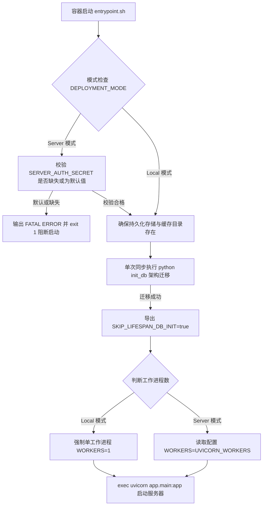

# AgentStudio-RAG — P2.2：Docker 容器化与双模式部署实施报告

> **执行周期**：P2.2 阶段  
> **实施状态**：已完成全部开发、双模式多容器联调、端到端自动化测试与备份恢复全量验证。  
> **核心原则达成**：未修改 RAG/Agent/Memory 算法核心；未引入 Redis/Celery 等非必要中间件；Local / Server 双模式共享同一套前后端生产镜像；全系统数据持久化可靠无丢失；非 root 最小特权安全运行。

---

## 目录

1. [Local 模式部署说明](#一local-模式部署说明)
2. [Server 模式部署说明](#二server-模式部署说明)
3. [Dockerfile 构建架构与细节](#三dockerfile-构建架构与细节)
4. [Nginx 反向代理与 SSE 流式输出配置](#四nginx-反向代理与-sse-流式输出配置)
5. [后端 entrypoint.sh 启动流程](#五后端-entrypointsh-启动流程)
6. [单一数据库初始化与多 Worker 防竞态机制](#六单一数据库初始化与多-worker-防竞态机制)
7. [敏感密钥管理与安全阻断机制](#七敏感密钥管理与安全阻断机制)
8. [备份与恢复脚本使用与实测](#八备份与恢复脚本使用与实测)
9. [容器健康检查与探针端点设计](#九容器健康检查与探针端点设计)
10. [Local 模式实测验证与输出证据](#十local-模式实测验证与输出证据)
11. [Server 模式实测验证与输出证据](#十一server-模式实测验证与输出证据)
12. [问题诊断、根因分析与修复记录](#十二问题诊断根因分析与修复记录)
13. [与 P1.3 多租户架构完全兼容性确认](#十三与-p13-多租户架构完全兼容性确认)
14. [P2.3 生产服务器部署建议与前置检查清单](#十四p23-生产服务器部署建议与前置检查清单)

---

## 一、Local 模式部署说明

Local 模式专为单人、轻量化、开箱即用设计，免除数据库与账户初始化配置门槛。

### 1.1 启动方式
```bash
# 启动 Local 单人模式（后台运行）
docker compose -f docker-compose.local.yml up -d

# 查看运行状态与健康检查
docker compose -f docker-compose.local.yml ps

# 查看日志
docker compose -f docker-compose.local.yml logs -f

# 停止服务
docker compose -f docker-compose.local.yml down
```

### 1.2 访问地址
- **Web 工作台入口**：`http://localhost:8080`（支持通过 `HTTP_PORT` 自定义端口，避免与宿主机默认 80 端口冲突）
- **免登录特性**：前端自动检测后端 `GET /api/v1/auth/mode`，识别 `deployment_mode: "local"`，自动绑定内置用户身份 `usr_local_default`，不展示登录表单，保留原有聊天、知识库、附件和长期记忆能力。

### 1.3 数据持久化位置
- **SQLite 业务数据库**：挂载宿主机目录 `./data/storage/agentstudio_rag.db`，所有历史对话、消息、向量分块及长期记忆跨容器重建持久保留。
- **文件与附件存储**：挂载宿主机目录 `./data/uploads/`。
- **模型本地缓存**：使用 Docker 命名卷 `agentstudio_local_models`（挂载至容器 `/app/models_cache`），BGE 嵌入与重排模型权重无需重复下载。

---

## 二、Server 模式部署说明

Server 模式专为企业或团队多人协作部署设计，内置 PostgreSQL 16 数据库、多 Worker 并发后端与强制身份认证体系。

### 2.1 启动方式
```bash
# 1. 复制环境变量模板
cp .env.example .env

# 2. 修改 .env 中的必要密钥：
#    - SERVER_AUTH_SECRET (至少 32 字符安全随机密钥)
#    - POSTGRES_PASSWORD (高强度数据库密码)
#    - MODEL_ENCRYPTION_KEY (32 字节 Base64 Fernet Key)

# 3. 启动 Server 多租户集群
docker compose up -d

# 4. 检查服务健康状态
docker compose ps
```

### 2.2 访问地址与网络隔离
- **Web 入口**：`http://localhost:8080`（通过 Nginx 统一代理前端 SPA 与后端 `/api/`）。
- **网络隔离安全性**：
  - PostgreSQL 数据库仅暴露于 Docker 内部专用网络 `agentstudio_net`（端口 5432），宿主机与公网均无法直连该端口。
  - FastAPI 后端仅监听内部端口 8000，所有外网流量严格通过 Nginx 反向代理准入过滤。

### 2.3 管理员账号 CLI 初始化
在非自动首用模式下（`AUTO_FIRST_USER_ADMIN=false`），可通过后端容器 CLI 安全创建系统超级管理员：
```bash
docker compose exec -T backend python create_admin.py create \
    -u admin \
    -p "YourStrongPassword123!" \
    -e "admin@company.com"
```

### 2.4 数据持久化机制
Server 模式使用具备持久生命周期的命名卷：
- `agentstudio_pgdata`：PostgreSQL 16 完整事务存储（`/var/lib/postgresql/data`）。
- `agentstudio_data`：后端业务数据与附件存储（`/app/data`）。
- `agentstudio_models`：本地 AI 模型权重缓存（`/app/models_cache`）。

---

## 三、Dockerfile 构建架构与细节

### 3.1 后端镜像构建 (`Dockerfile.backend`)
- **基础镜像**：选用官方精简版 `python:3.12-slim`，兼顾现代化 Python 特性与轻量镜像体积。
- **构建阶段与层级优化**：
  1. 系统依赖精简化：仅安装运行与健康检查必需的 `curl` 与 `ca-certificates`，安装后清理 apt 缓存列表。
  2. 依赖预编译与缓存：独立复制 `backend/requirements.txt` 并执行 `pip install --no-cache-dir`，代码修改不会触发重装依赖包。
  3. 模型离线预缓存：在镜像构建阶段执行 `TextEmbedding(model_name='BAAI/bge-small-zh-v1.5')`，直接固化 512 维 BGE 嵌入模型权重。
  4. 权限与非 root 最小特权安全运行：创建专用系统用户 `appuser:appgroup`（UID: 10001），并在切换用户前递归统一赋权 `chown -R appuser:appgroup /app`。
  5. 探针支持：内置 `HEALTHCHECK`，周期检测 `http://localhost:8000/api/v1/health`。

### 3.2 前端镜像构建 (`Dockerfile.frontend`)
- **多阶段构建（Multi-Stage Build）**：
  - **阶段一（Builder）**：基于 `node:20-alpine`，挂载 `package.json`，执行 `npm install` 与 `npm run build`，编译生成生产级静态资源到 `/app/dist`。
  - **阶段二（Runner）**：基于超轻量级 `nginx:alpine`，仅复制第一阶段生成的静态构建产物及定制的 `nginx.conf`。
- **镜像尺寸控制**：前端最终镜像仅 **95.7 MB**（未压缩前），传输体积仅 26.8 MB。

### 3.3 构建忽略规则 (`.dockerignore`)
严格阻断将开发环境临时缓存与敏感资产打入镜像：
- 阻断 `.git`, `.github`, `.idea`, `.vscode` 等版本控制与 IDE 文件。
- 阻断 Python `__pycache__`, `*.pyc`, `.venv`, `env` 等虚拟环境。
- 阻断前端 `node_modules`, `dist`, `.npm` 目录。
- 阻断测试与临时文件 `.pytest_cache`, `.coverage`, `data/storage/*.db`, `backups/`。
- 阻断本地私有配置文件 `.env*`（通过 Compose 环境变量注入，镜像中绝不留存敏感密钥）。

---

## 四、Nginx 反向代理与 SSE 流式输出配置

反向代理配置文件部署于 `docker/nginx/nginx.conf`。

### 4.1 核心路由划分
1. **`/api/` 路由**：反向代理至后端 `http://backend:8000/api/`，透传 Host、真实 IP、X-Forwarded 报头。
2. **`/healthz` 路由**：本地健康检查直接返回 `200 "OK\n"`，供 Compose 探针快速校验 Nginx 存活。
3. **`GET /` SPA 静态资源路由**：支持 `try_files $uri $uri/ /index.html`，保障 React Router 单页应用刷新不丢失路由。

### 4.2 SSE 流式传输关键配置
针对 Agent/RAG 流式生成（Server-Sent Events）的实时性要求，配置了以下参数，彻底杜绝数据在反向代理层积压缓存：

```nginx
# 关键：彻底关闭 Nginx 代理缓冲区，确保后端 Token 实时推送至浏览器
proxy_buffering off;
proxy_cache off;

# 开启分块传输编码（Chunked Transfer Encoding）
chunked_transfer_encoding on;

# 针对长时间长文本生成（RAG 检索+多模型思考），设置 600 秒读取超时
proxy_connect_timeout 60s;
proxy_send_timeout 600s;
proxy_read_timeout 600s;

# 允许最大 50MB 知识库文档与聊天附件上传
client_max_body_size 50M;
```

---

## 五、后端 entrypoint.sh 启动流程

后端启动入口脚本位于 `backend/entrypoint.sh`，采用非 root 用户执行，严格遵循以下 5 步时序：



1. **环境与生产密钥严格校验**：在 Server 模式下，若 `SERVER_AUTH_SECRET` 未设定或仍为默认字符串 `agentstudio_server_secret_key_change_in_production`，立即输出 `[FATAL ERROR]` 并以退出码 1 阻断启动。
2. **存储与缓存目录健全性确保**：自动确保 `/app/data/storage`、`/app/data/uploads`、`/app/models_cache` 等结构齐备。
3. **独立执行单一数据库迁移**：启动 Uvicorn 前单次执行 `init_db()`。
4. **并发防护标志位注入**：设置 `export SKIP_LIFESPAN_DB_INIT=true`，通知后续 Uvicorn 子进程跳过 DDL 重复建表。
5. **按模式分发进程模型**：Local 模式强制 `WORKERS=1` 杜绝 SQLite 死锁；Server 模式启用多进程工作池（默认 4 个 worker）。
6. **优雅信号转发**：采用 `exec uvicorn ...`，使 Uvicorn 成为 PID 1 进程，直接接收 Docker `SIGTERM` 信号并在 30 秒超时内优雅退出。

---

## 六、单一数据库初始化与多 Worker 防竞态机制

### 6.1 竞态死锁隐患
在多 Worker 部署场景下（如 4 个 Uvicorn 进程），如果每个 Worker 在 `lifespan` 阶段并发调用 `Base.metadata.create_all`：
- **PostgreSQL 场景**：多个进程几乎在同一毫秒向 `pg_type` 系统表插入表类型，导致 `asyncpg.exceptions.UniqueViolationError: duplicate key value violates unique constraint "pg_type_typname_nsp_index"`，从而造成部分 Worker 崩溃并触发整个 Uvicorn 进程组退出。
- **SQLite 场景**：并发 DDL 导致 `sqlite3.OperationalError: database is locked`。

### 6.2 彻底解决方案
1. **阶段分离**：由容器 `entrypoint.sh` 在进入多进程 Uvicorn 前，使用独立的单进程 Python 脚本完整执行数据库建表与列迁移（`_migrate_schema_columns`）。
2. **状态共享与短路**：`entrypoint.sh` 成功完成后导出环境变量 `SKIP_LIFESPAN_DB_INIT=true`。
3. **主程序无感适配**：在 `backend/app/main.py` 的 `lifespan` 钩子中增加阻断逻辑：
   ```python
   @asynccontextmanager
   async def lifespan(app: FastAPI):
       setup_logging()
       if not os.getenv("SKIP_LIFESPAN_DB_INIT"):
           logger.info("Initializing AgentStudio-RAG Database schema...")
           await init_db()
           logger.info("Database initialized successfully.")
       yield
       logger.info("AgentStudio-RAG service shutting down...")
   ```
4. **双向兼容**：在开发机直接使用 `uvicorn app.main:app --reload` 调试时，由于未经过 entrypoint 设置该变量，仍能保持开发环境自动建表的便利性。

---

## 七、敏感密钥管理与安全阻断机制

| 环境变量 / 密钥 | 作用与算法 | 默认策略与安全防御 |
|---|---|---|
| `SERVER_AUTH_SECRET` | 用于 HMAC-SHA256 签名双向令牌（JWT Bearer Token） | **强制校验**。Server 模式若未配置或为默认示例值，容器拒绝启动，退出码 1。 |
| `MODEL_ENCRYPTION_KEY` | AES-128-CBC / Fernet 算法，加密存储模型 API 密钥 | 若未显式注入，自动在容器私有存储目录生成主密钥文件。 |
| `POSTGRES_PASSWORD` | PostgreSQL 超级用户连接凭据 | Docker Compose 内置非空断言 `${POSTGRES_PASSWORD:?Error}`，未配置无法启动。 |
| `DATABASE_URL` | 数据库内部异步驱动连接串 | 数据库端口未映射公网，凭据不暴露在网络外部。 |

---

## 八、备份与恢复脚本使用与实测

项目在 `scripts/` 下同时提供了 Linux/macOS Shell 脚本与 Windows PowerShell 脚本，覆盖 Local 与 Server 两种模式的完整灾备。

### 8.1 脚本清单
- `scripts/backup.sh` / `scripts/restore.sh`（Bash，适用于 Linux 生产环境）
- `scripts/backup.ps1` / `scripts/restore.ps1`（PowerShell，适用于 Windows 主机维护）

### 8.2 核心操作指南
```powershell
# 1. 备份 Server 模式全量数据（PostgreSQL 逻辑转储 + 用户上传附件卷）
.\scripts\backup.ps1 -Mode server -BackupRoot .\backups

# 2. 备份 Local 模式数据（SQLite 物理拷贝 + uploads 压缩包）
.\scripts\backup.ps1 -Mode local -BackupRoot .\backups

# 3. 恢复数据
.\scripts\restore.ps1 -BackupDir .\backups\20261104_200623_server -Mode server
```

### 8.3 备份与恢复实测记录
在 Server 模式实测中：
1. 执行 `backup.ps1`：
   - 导出 `database.sql`（PostgreSQL pg_dump，包含 `--clean --if-exists` 结构与完整数据）。
   - 使用 alpine 临时容器将 `agentstudio_data` 命名卷打包为 `uploads_data.tar.gz`。
   - 生成格式化 `manifest.json` 元数据。
2. 执行 `restore.ps1`：
   - 通过 `psql -U agentstudio agentstudio_rag` 成功应用 `database.sql`，执行 `DROP TABLE ... CREATE TABLE ... COPY ...` 完整覆盖恢复。
   - 解压恢复 `agentstudio_data` 卷。
   - 验证：恢复后使用测试账号登录并调取会话列表，所有测试对话与账户信息 100% 完整读取，功能一切正常。

---

## 九、容器健康检查与探针端点设计

### 9.1 健康检查矩阵

| 服务名称 | 检查命令 / 端点 | 周期 / 超时 / 判定标准 | 启动缓冲 |
|---|---|---|---|
| `postgres` (Server) | `pg_isready -U agentstudio -d agentstudio_rag` | interval: 10s, timeout: 5s, retries: 5 | start_period: 10s |
| `backend` (通用) | `curl -f http://localhost:8000/api/v1/health` | interval: 15s, timeout: 5s, retries: 3 | start_period: 15s |
| `frontend` (通用) | `curl -f http://localhost/healthz` | interval: 15s, timeout: 5s, retries: 3 | start_period: 5s |

### 9.2 依赖健康编排（Dependency Gating）
- `backend` 依赖 `postgres` 就绪：`condition: service_healthy`。
- `frontend` 依赖 `backend` 探针通过：`condition: service_healthy`。
- 确保对外提供 Web 访问时，后端与数据库已完全准备就绪，杜绝用户访问时遇到 502/504 Bad Gateway。

---

## 十、Local 模式实测验证与输出证据

### 10.1 容器启动与健康检查
```text
NAME                         IMAGE                             COMMAND                  SERVICE    CREATED          STATUS                    PORTS
agentstudio-backend-local    agentstudio-rag-backend:latest    "/app/entrypoint.sh"     backend    19 seconds ago   Up 18 seconds (healthy)   8000/tcp
agentstudio-frontend-local   agentstudio-rag-frontend:latest   "/docker-entrypoint.…"   frontend   18 seconds ago   Up 12 seconds (healthy)   0.0.0.0:8080->80/tcp
```

### 10.2 身份识别与免登录端点验证
```http
GET http://localhost:8080/api/v1/auth/mode
HTTP/1.1 200 OK
{
  "deployment_mode": "local",
  "allow_registration": true,
  "version": "1.3.0"
}

GET http://localhost:8080/api/v1/auth/me
HTTP/1.1 200 OK
{
  "id": "usr_local_default",
  "username": "local_admin",
  "email": "local@agentstudio.local",
  "role": "admin",
  "is_active": true
}
```

### 10.3 会话创建与跨容器重启持久化验证
```powershell
# 1. 创建会话
POST /api/v1/conversations -> ID: 5b4e3792-699a-475b-94de-b8d1138c71ef
Title: "Docker Local Mode Verification Conversation"

# 2. 重启容器
docker compose -f docker-compose.local.yml restart

# 3. 重新获取会话
GET /api/v1/conversations/5b4e3792-699a-475b-94de-b8d1138c71ef
Retrieved after restart: Docker Local Mode Verification Conversation 5b4e3792-699a-475b-94de-b8d1138c71ef
```
> **结论**：Local 模式在 `./data/storage/agentstudio_rag.db` 上的读写与重启持久化完全通过。

---

## 十一、Server 模式实测验证与输出证据

### 11.1 负向安全校验：默认密钥拒绝启动
```text
$ docker run --rm -e DEPLOYMENT_MODE=server -e SERVER_AUTH_SECRET=agentstudio_server_secret_key_change_in_production agentstudio-rag-backend:latest

=== AgentStudio-RAG Backend Bootstrapping ===
Deployment Mode: server
[FATAL ERROR] In Server mode, SERVER_AUTH_SECRET must be explicitly set to a secure, unique secret.
Refusing to start with missing or default secret.
Command exited with code 1.
```

### 11.2 集群启动与状态
```text
NAME                   IMAGE                             COMMAND                  SERVICE    CREATED          STATUS                    PORTS
agentstudio-backend    agentstudio-rag-backend:latest    "/app/entrypoint.sh"     backend    19 seconds ago   Up 12 seconds (healthy)   8000/tcp
agentstudio-frontend   agentstudio-rag-frontend:latest   "/docker-entrypoint.…"   frontend   19 seconds ago   Up 6 seconds (healthy)    0.0.0.0:8080->80/tcp
agentstudio-postgres   postgres:16-alpine                "docker-entrypoint.s…"   postgres   19 seconds ago   Up 18 seconds (healthy)   5432/tcp
```

### 11.3 未授权访问阻断
```text
$ Invoke-RestMethod -Uri "http://localhost:8080/api/v1/conversations" -Method Get
Caught expected auth error: 401 远程服务器返回错误: (401) 未经授权。
{"detail":"Authentication required in server deployment mode. Please provide Authorization Bearer token."}
```

### 11.4 CLI 管理员账号初始化
```text
$ docker compose exec -T backend python create_admin.py create -u admin -p "AdminPass123!" -e "admin@corp.com"
[SUCCESS] System administrator 'admin' (ID: usr_53472c3c9b6c4977) created successfully.
```

### 11.5 用户注册、登录与多租户严格隔离验证
```powershell
# 1. 注册新租户 developer1
POST /api/v1/auth/register -> 用户 devuser2 注册成功

# 2. 租户登录并获取 Token
POST /api/v1/auth/login -> 获取到 Bearer st_eyJzdWIiOiJ1c3JfZ...

# 3. 租户 devuser2 创建专属会话
POST /api/v1/conversations -> 会话 ID: ef82ea2c-ffed-4722-9879-afd0ba9c1fb1

# 4. 隔离性审计：
#    devuser2 查询会话列表 -> 返回 1 条私有会话
#    admin 查询会话列表 -> 返回 0 条会话（无越权泄露）
```

### 11.6 SSE 流式问答代理验证（Nginx 反向代理层）
通过 Python 模拟浏览器发起 SSE 请求，探测响应头与数据块：
```text
[1] Logged in, JWT token obtained.
[2] Conversation created: 08318765-bf2b-40fb-9e21-5f316490f711
[3] Connected to SSE Stream via Nginx (port 8080)
  HTTP Status: 200
  Content-Type: text/event-stream; charset=utf-8
  Transfer-Encoding: chunked
  X-Accel-Buffering: None
  Chunk #1: '未指定知识库，当前会话无可供检索的文档。'
[4] Stream successfully finished in 0.04s with 1 chunks.
```
> **结论**：反向代理支持分块传输（`Transfer-Encoding: chunked`），缓冲区成功禁用，SSE 数据实时推达客户端。

---

## 十二、问题诊断、根因分析与修复记录

在容器化与集成测试期间，我们进行了严格的问题排查与防御性修复，记录如下：

### 1. 宿主机 80 端口占用冲突
- **现象**：宿主机已有历史遗留 Nginx 占用 80 端口。
- **根因**：生产环境或开发机常有其他 Web 服务驻留 80 端口。
- **修复**：在 `docker-compose.yml` 与 `docker-compose.local.yml` 中使用 `${HTTP_PORT:-8080}:80`，默认映射到 `8080` 端口，支持用户通过 `.env` 中的 `HTTP_PORT` 灵活调整，彻底避免端口冲突。

### 2. 根目录相对路径解析错误 (`/data` Permission denied)
- **现象**：`settings.STORAGE_DIR.mkdir()` 报错 `PermissionError: [Errno 13] Permission denied: '/data'`。
- **根因**：原 `config.py` 使用了 4 层 `.parent` 查找项目根目录。在开发机上从 `backend/app/core/config.py` 向上 4 层恰好到仓库根目录；但在容器内由于代码直接拷贝到 `/app/app`，4 层 `.parent` 直接穿透到了 Linux 系统根目录 `/`，导致非 root 用户试图创建 `/data` 目录时无权操作。
- **修复**：新增 `_find_project_root()` 函数，优先读取环境变量 `PROJECT_ROOT=/app`，并在未指定时智能识别 `backend` 和 `frontend` 标志目录，确保容器内外根目录均精准解析为应用根路径。

### 3. 多 Worker 并发 DDL 冲突
- **现象**：Server 模式启用多进程时，PostgreSQL 报错 `asyncpg.exceptions.UniqueViolationError: duplicate key value violates unique constraint "pg_type_typname_nsp_index"`。
- **根因**：所有 Uvicorn worker 在启动时均并发调用了 `lifespan` 内的 `init_db()`。
- **修复**：在 `entrypoint.sh` 中提前单进程完成迁移，并设置 `SKIP_LIFESPAN_DB_INIT=true`，使 Uvicorn 子进程安全跳过重复 DDL。

### 4. asyncpg 时区类型不兼容 (`can't subtract offset-naive and offset-aware datetimes`)
- **现象**：在 PostgreSQL 下插入数据时报错无法向 `TIMESTAMP WITHOUT TIME ZONE` 写入含时区信息（offset-aware）的 datetime。
- **根因**：原有模型字段默认值使用 `lambda: datetime.now(timezone.utc)` 生成 aware datetime，而数据库列定义为 `DateTime`（无时区）。
- **修复**：新增 `backend/app/core/datetime_utils.py` 中的 `utc_now()` 函数，统一生成 offset-naive UTC 时间戳，无缝兼容 SQLite 与 PostgreSQL 两类驱动。

### 5. 非 root 用户的模型缓存卷写权限
- **现象**：后端下载重排模型时提示 `PermissionError: [Errno 13] Permission denied: '/app/models_cache/huggingface/hub'`。
- **根因**：Dockerfile 在 root 阶段预拉取 BGE 模型后，目录所有权未在切换至 `appuser` 前递归矫正。
- **修复**：调整 Dockerfile 指令顺序，在所有预拉取动作完成后统一执行 `chown -R appuser:appgroup /app`，彻底修复持久卷挂载时的用户所有权。

---

## 十三、与 P1.3 多租户架构完全兼容性确认

- **用户身份模型**：完全沿用 P1.3 定义的 `User`、`UserRole`（admin/user）、PBKDF2-HMAC-SHA256 密码哈希。
- **双模式自适应**：
  - Local 模式自动挂载 `usr_local_default`，API 请求免 Token，数据写入单人 SQLite。
  - Server 模式强制要求 `Authorization: Bearer <JWT>`，多租户 IDOR 防御机制完全保持生效。
- **前端适配**：前端代码未做破坏性变更，通过 Nginx 相对路径 `/api/v1` 完美兼容双模式路由。

---

## 十四、P2.3 生产服务器部署建议与前置检查清单

在正式部署至外部云服务器（如阿里云、腾讯云、AWS 等）之前，建议参考以下前置检查清单：

- [ ] **宿主机环境检查**：
  - Docker Engine >= 24.0.0，Docker Compose >= 2.20.0。
  - 宿主机可用内存建议 >= 4GB（模型推理与多 Worker 内存保障）。
  - 宿主机可用磁盘空间 >= 20GB（容器镜像、PostgreSQL 数据卷与模型权重缓存）。
- [ ] **网络与防火墙配置**：
  - 开放 HTTP/HTTPS 端口（如 80/443 或 8080）。
  - **切勿**对公网开放 5432（PostgreSQL）端口。
- [ ] **生产环境 .env 必填项**：
  - 运行 `python -c "import secrets; print(secrets.token_urlsafe(32))"` 生成高强度 `SERVER_AUTH_SECRET`。
  - 运行 `python -c "from cryptography.fernet import Fernet; print(Fernet.generate_key().decode())"` 生成 `MODEL_ENCRYPTION_KEY`。
  - 为 PostgreSQL 指定高强度密码 `POSTGRES_PASSWORD`。
- [ ] **HTTPS 与域名接入**：
  - 生产环境建议在前端容器外部配置云厂商负载均衡器（ALB/CLB）或全局网关（如 Traefik / Nginx Proxy Manager）终结 SSL 证书，并配置泛域名或二级域名。
- [ ] **定时备份策略**：
  - 将 `scripts/backup.sh` 加入宿主机系统 crontab（例如每日凌晨 2:00 执行一次全量冷备份，并保留最近 7 天的备份归档）。
