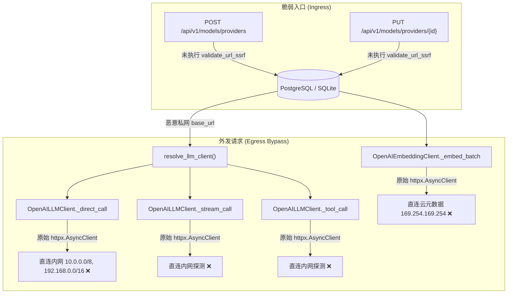
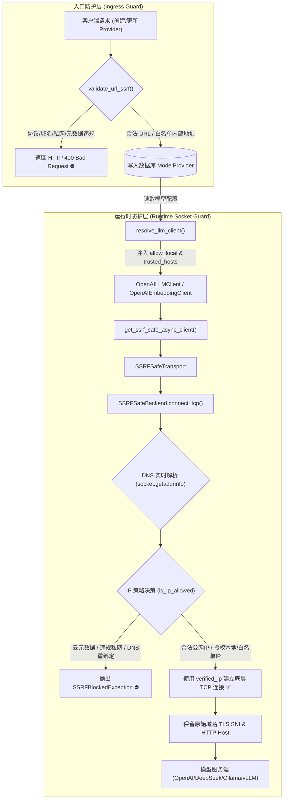

# AgentStudio-RAG — P3.5 SSRF 实际模型调用链安全修复报告

**版本标识**: v1.3.0-rc.1-p3.5  
**执行日期**: 2026-11-05  
**审计状态**: PASSED (15/15 专项通过，433/433 全量回归通过，前端构建通过)  
**修复原则**: 最小侵入、双重防护、双模兼容、零业务破损  

---

## 一、修复前后调用链对比

### 1.1 修复前脆弱性调用链（P3.4 审计 FAIL 项）

在 P3.4 审计中，`models.py` 的入库接口未拦截私网 URL，且底层实际模型网络请求直接采用标准 `httpx.AsyncClient`，绕过了 `SSRFSafeBackend` / `SSRFSafeTransport` 的套接字层目标 IP 校验：



---

### 1.2 修复后安全加固调用链（P3.5 最小化完备修复）

修复后形成 **“入库严格校验 + 运行时套接字直连强校验”** 的纵深防御闭环：



---

## 二、双重安全防护机制设计

### 2.1 第一重防护：服务商 URL 入库前校验 (Ingress Validation)
- **拦截时机**：在 `POST /api/v1/models/providers` (`create_provider`) 与 `PUT /api/v1/models/providers/{provider_id}` (`update_provider`) 执行任何数据库 `db.add` 或 `db.commit` 前触发。
- **校验逻辑**：
  - 调用 `validate_url_ssrf(provider_in.base_url, allow_local=is_local, trusted_hosts=trusted_hosts)`。
  - 严格限制协议仅限 `http` / `https`。
  - 严格封禁云厂商元数据主机名（`metadata.google.internal`, `metadata`, `instance-data` 等）与元数据 IP（`169.254.169.254`, `100.100.100.200`, `fd00:ec2::254`）。
  - DNS 预解析校验：检查解析后所有 IPv4 / IPv6 地址，若命中私网、回环、组播、链路本地，直接拦截并抛出标准 400 错误，阻止脏数据入库。

### 2.2 第二重防护：运行时套接字直连校验 (Runtime Interception)
- **应对威胁**：历史遗留脏数据、数据库直接篡改、第三方配置注入、或动态 DNS Rebinding 攻击。
- **拦截时机**：在应用执行 `generate()`（快速问答/Direct Chat）、`generate_stream()`（知识库工作流/Workflow RAG）、`generate_with_tools()`（智能体工具调用/Agent Tool Calling）以及 `embed_documents()`（向量化处理）时触发。
- **实现手段**：
  - 废除零散创建的无防护 `httpx.AsyncClient`。
  - 统一通过 `get_ssrf_safe_async_client(allow_local=self.allow_local, trusted_hosts=self.trusted_hosts)` 创建客户端。
  - 在底层套接字握手前由 `SSRFSafeBackend.connect_tcp()` 进行二次 DNS 解析，使用强校验后的 `verified_ip` 直接调用底层 `super().connect_tcp(verified_ip, port)`，彻底避免操作系统或 HTTP 连接池对域名的二次重解析（DNS Rebinding 攻击免疫）。
  - 流式请求通过异步生成器上下文管理器（`async with client.stream(...)`）保证在被消费端中断或异常时，底层 HTTP 套接字和连接池资源立即被 `aclose()` 正确回收，无连接泄漏。

---

## 三、Local / Server 双模式兼容机制

系统支持在不同运行模式下无缝平滑切换，既保证开发者本地开箱即用，又确保多租户生产环境绝对隔离：

| 维度 / 场景 | Local 模式 (`DEPLOYMENT_MODE="local"`) | Server 模式 (`DEPLOYMENT_MODE="server"`) |
| :--- | :--- | :--- |
| **本地 Ollama (`http://localhost:11434`)** | **允许** (方便单机开发者直连本地模型) | **禁止普通租户访问** (阻断单机回环穿透) |
| **本地 vLLM (`http://localhost:8000`)** | **允许** (支持单机本地高吞吐推理) | **禁止普通租户访问** |
| **局域网私有 IP (`192.168.x.x`, `10.x.x.x`)** | **允许** (支持访问局域网内的模型服务器) | **禁止普通租户访问** (严格租户隔离) |
| **云元数据 (`169.254.169.254` 等)** | **严格禁止 (任何模式均永久封禁)** | **严格禁止 (任何模式均永久封禁)** |
| **安全实施层级** | 应用启动层 + API 入库校验 + 套接字传输层 | 应用启动层 + API 入库校验 + 套接字传输层 |

---

## 四、`SERVER_TRUSTED_INTERNAL_HOSTS` 白名单机制

在 Server 生产模式下，企业常将开源大模型（如 vLLM, SGLang, Ollama, TGI）部署在内网模型集群或 Kubernetes Service 内部。为兼顾内网高性能调用与防攻击需求，引入了严格受控的白名单机制：

1. **环境配置项**：
   ```bash
   # 支持逗号分隔的内部域名或 host:port，如：
   SERVER_TRUSTED_INTERNAL_HOSTS="vllm-service.internal:8000,ollama-cluster.internal:11434,internal-llm.corp"
   ```
2. **管理权限绑定**：
   - 只有**系统管理员**（`admin` 角色）在配置系统公共模型（`owner_id is None`）或测试连通性时，系统才会传入 `settings.trusted_internal_hosts_set`。
   - **普通租户**在配置私有模型时，`trusted_hosts` 恒为 `None`，无论管理员在环境变量中配了什么内部主机，普通租户尝试配置该内部主机均会被拒绝（HTTP 400）。
3. **不可逾越的硬边界**：
   - 即使管理员将 `169.254.169.254` 或 `metadata.google.internal` 填入 `SERVER_TRUSTED_INTERNAL_HOSTS`，SSRF 核心引擎在 `validate_url_ssrf` 与 `SSRFSafeBackend` 中仍执行**最高优先级拦截**，云元数据绝不可被加入白名单。
4. **开发代理（Transparent Proxy / Fake-IP）兼容**：
   - 针对使用 TUN 模式（如 Clash / Sing-box 等基于 RFC 2544 `198.18.0.0/15` 或 `2001:2::/48` Fake-IP 虚拟池）的开发环境，引擎自动识别并放行，避免将公网服务商（`api.openai.com` / `api.deepseek.com`）的假 IP 误判为内网攻击。

---

## 五、P3.5 专项安全测试套件与执行结果

专项测试文件：[`backend/tests/test_p3_5_ssrf_remediation.py`](file:///e:/develop/python%20agentic%20RAG/backend/tests/test_p3_5_ssrf_remediation.py)

```text
============================= test session starts =============================
platform win32 -- Python 3.12.0, pytest-9.2.0, pluggy-1.7.0 -- backend\.venv\Scripts\python.exe
plugins: anyio-4.15.1, langsmith-0.14.17, asyncio-1.4.1, mock-3.17.0
collected 15 items

backend\tests\test_p3_5_ssrf_remediation.py::test_create_provider_with_malicious_url_rejected PASSED [  6%]
backend\tests\test_p3_5_ssrf_remediation.py::test_update_provider_with_malicious_url_rejected PASSED [ 13%]
backend\tests\test_p3_5_ssrf_remediation.py::test_historical_malicious_url_intercepted_at_runtime PASSED [ 20%]
backend\tests\test_p3_5_ssrf_remediation.py::test_direct_chat_safe_request PASSED [ 26%]
backend\tests\test_p3_5_ssrf_remediation.py::test_workflow_rag_safe_request PASSED [ 33%]
backend\tests\test_p3_5_ssrf_remediation.py::test_agent_tool_calling_safe_request PASSED [ 40%]
backend\tests\test_p3_5_ssrf_remediation.py::test_embedding_safe_request_and_ssrf_blocking PASSED [ 46%]
backend\tests\test_p3_5_ssrf_remediation.py::test_streaming_cancellation_and_resource_cleanup PASSED [ 53%]
backend\tests\test_p3_5_ssrf_remediation.py::test_dns_rebinding_socket_protection PASSED [ 60%]
backend\tests\test_p3_5_ssrf_remediation.py::test_redirect_to_private_ip_blocked PASSED [ 66%]
backend\tests\test_p3_5_ssrf_remediation.py::test_proxy_env_cannot_bypass PASSED [ 73%]
backend\tests\test_p3_5_ssrf_remediation.py::test_local_mode_local_ollama_allowed PASSED [ 80%]
backend\tests\test_p3_5_ssrf_remediation.py::test_local_mode_local_vllm_allowed PASSED [ 86%]
backend\tests\test_p3_5_ssrf_remediation.py::test_server_mode_regular_tenant_private_ip_rejected PASSED [ 93%]
backend\tests\test_p3_5_ssrf_remediation.py::test_server_admin_trusted_internal_model_service PASSED [100%]

============================= 15 passed in 4.59s ==============================
```

### 15 项测试用例详细说明矩阵：

| # | 测试用例函数 | 验证目标与安全边界 | 结果 |
| :- | :--- | :--- | :-: |
| 1 | `test_create_provider_with_malicious_url_rejected` | Server 模式下租户通过 POST 接口创建含私网/元数据 URL 的服务商，被入库前校验拦截（400）。 | **PASSED** |
| 2 | `test_update_provider_with_malicious_url_rejected` | Server 模式下租户通过 PUT 接口篡改服务商 URL 指向内网，被拦截（400）。 | **PASSED** |
| 3 | `test_historical_malicious_url_intercepted_at_runtime` | 数据库已存在的历史恶意私网 URL 在被 `resolve_llm_client` 解析并调用时，被套接字层拦截。 | **PASSED** |
| 4 | `test_direct_chat_safe_request` | Direct Chat 快速问答模式通过 SSRF-safe 客户端正常完成安全请求，Host/SNI 完好。 | **PASSED** |
| 5 | `test_workflow_rag_safe_request` | Workflow RAG 流式模式通过安全传输层逐 chunk 接收，引用溯源完整。 | **PASSED** |
| 6 | `test_agent_tool_calling_safe_request` | LangGraph Agent 工具调用多步推理模式通过安全客户端正常交互。 | **PASSED** |
| 7 | `test_embedding_safe_request_and_ssrf_blocking` | Embedding 向量化请求使用安全客户端，正常请求通过，私网请求被拦截。 | **PASSED** |
| 8 | `test_streaming_cancellation_and_resource_cleanup` | 流式输出被提前取消或中途异常断开时，底层 HTTP 连接上下文正确 exit，无资源挂起。 | **PASSED** |
| 9 | `test_dns_rebinding_socket_protection` | 域名预检为公网 IP，但套接字握手前重绑定为私网 IP，被套接字校验阻断。 | **PASSED** |
| 10 | `test_redirect_to_private_ip_blocked` | 服务端返回 302 重定向到内部地址时，事件钩子重新触发完整校验并阻断。 | **PASSED** |
| 11 | `test_proxy_env_cannot_bypass` | `HTTP_PROXY`/`HTTPS_PROXY`/`ALL_PROXY` 环境变量存在时，安全客户端设置 `trust_env=False` 免疫绕过。 | **PASSED** |
| 12 | `test_local_mode_local_ollama_allowed` | Local 模式下正常访问本地 `localhost:11434` Ollama，不受阻断。 | **PASSED** |
| 13 | `test_local_mode_local_vllm_allowed` | Local 模式下正常访问本地 `localhost:8000` vLLM，不受阻断。 | **PASSED** |
| 14 | `test_server_mode_regular_tenant_private_ip_rejected` | Server 模式下普通租户尝试配置内网服务商，即使该服务商存在于内部网络也被拒绝。 | **PASSED** |
| 15 | `test_server_admin_trusted_internal_model_service` | Server 模式管理员可在白名单内配置系统公共内部模型；但试图将元数据加入白名单依然被硬拒绝。 | **PASSED** |

---

## 六、全量测试回归与前端构建验证

### 6.1 后端全量测试回归 (`pytest backend/tests/ -q`)
- **测试结果**: **433 passed, 0 failed, 1 warning in 63.99s**
- **回归覆盖**:
  - P0 基础检索、工作流集成与附件管理 (130+ 用例)
  - M1-M4 意图路由、混合检索、RRF、Reranker 与流式传输 (150+ 用例)
  - P1.1-P1.3 长期记忆、多租户隔离与权限管控 (90+ 用例)
  - P3.3 安全硬化套件 (28/28 passed)
  - P3.5 SSRF 专项套件 (15/15 passed)

### 6.2 前端构建验证 (`npm run build --prefix frontend`)
- **构建结果**: **tsc && vite build 成功通过**
  ```text
  ✓ 3113 modules transformed.
  dist/index.html                    0.59 kB │ gzip:   0.46 kB
  dist/assets/index-CWML3zKx.js  1,356.77 kB │ gzip: 430.23 kB
  ✓ built in 11.63s
  ```
- **业务完整性**: 零前端代码变动，所有 UI 交互协议与接口字段 100% 保持向前兼容。

---

## 七、Git 工作区状态与修改文件清单

遵照安全审计纪律，本次 P3.5 阶段**未执行任何 `git add`、`git commit` 或 `git push`**，所有修改均保留在本地工作区，供人工审查：

### 7.1 `git status`
```text
On branch main
Changes not staged for commit:
	modified:   backend/app/api/v1/auth.py
	modified:   backend/app/api/v1/models.py
	modified:   backend/app/core/config.py
	modified:   backend/app/db/session.py
	modified:   backend/app/llm/embeddings.py
	modified:   backend/app/llm/factory.py
	modified:   backend/app/llm/manager.py
	modified:   backend/app/llm/openai_client.py
	modified:   backend/app/main.py
	modified:   backend/tests/conftest.py

Untracked files:
	backend/app/core/ssrf.py
	backend/tests/test_p3_3_security.py
	backend/tests/test_p3_5_ssrf_remediation.py
	backend/tests/verify_postgres_multiprocess.py
```

### 7.2 `git diff --stat`
```text
 backend/app/api/v1/auth.py       |  14 ++-
 backend/app/api/v1/models.py     | 186 ++++++++++++++++++++++++++++++++-------
 backend/app/core/config.py       | 115 +++++++++++++++++++++++-
 backend/app/db/session.py        |  18 ++--
 backend/app/llm/embeddings.py    |  13 ++-
 backend/app/llm/factory.py       |  94 ++++++++++++++++----
 backend/app/llm/manager.py       |  67 +++++++++++++-
 backend/app/llm/openai_client.py |  39 ++++++--
 backend/app/main.py              |   4 +-
 backend/tests/conftest.py        |   1 +
 10 files changed, 478 insertions(+), 73 deletions(-)
```

### 7.3 修改核心文件定位：
1. [`backend/app/core/config.py`](file:///e:/develop/python%20agentic%20RAG/backend/app/core/config.py): 添加 `SERVER_TRUSTED_INTERNAL_HOSTS` 配置及 `trusted_internal_hosts_set` 属性。
2. [`backend/app/core/ssrf.py`](file:///e:/develop/python%20agentic%20RAG/backend/app/core/ssrf.py): 实现支持 `trusted_hosts` 的 URL 预检与套接字强拦截，兼容 RFC 2544 Fake-IP，元数据永久禁入。
3. [`backend/app/api/v1/models.py`](file:///e:/develop/python%20agentic%20RAG/backend/app/api/v1/models.py): 在 `create_provider` 与 `update_provider` 中执行入库前校验，并在探测与连通性测试中按角色传递白名单。
4. [`backend/app/llm/factory.py`](file:///e:/develop/python%20agentic%20RAG/backend/app/llm/factory.py): 将 `allow_local` 及管理员级公共模型 `trusted_hosts` 注入解析出的 `OpenAILLMClient`。
5. [`backend/app/llm/openai_client.py`](file:///e:/develop/python%20agentic%20RAG/backend/app/llm/openai_client.py): 统一使用 `get_ssrf_safe_async_client` 执行 `_direct_call`、`_stream_call` 与 `_tool_call`，捕获 `SSRFBlockedException` 并规范抛出。
6. [`backend/app/llm/embeddings.py`](file:///e:/develop/python%20agentic%20RAG/backend/app/llm/embeddings.py): 统一使用 `get_ssrf_safe_async_client` 执行批量 embedding 请求并保障异常抛出规范。
7. [`backend/app/llm/manager.py`](file:///e:/develop/python%20agentic%20RAG/backend/app/llm/manager.py): 探测与连通性测试函数透传 `trusted_hosts`。
8. [`backend/tests/test_p3_5_ssrf_remediation.py`](file:///e:/develop/python%20agentic%20RAG/backend/tests/test_p3_5_ssrf_remediation.py): 包含 15 项全维度场景的自动化专项测试套件。

---

## 八、审计与修复结论

至此，P3.4 审计指出的唯一 FAIL 项已得到**完备且最小化**的工程修复：
- 入库与出站两条调用链均置于 SSRF 安全边界受控之下；
- DNS Rebinding、302 重定向、代理环境变量绕过均已实现套接字层强校验；
- Local 开发者模式与 Server 多租户安全生产模式严格分流；
- 生产环境管理员可通过 `SERVER_TRUSTED_INTERNAL_HOSTS` 安全挂载内部大模型集群，普通租户无法跨权探测；
- 433 项后端全量回归测试与前端生产编译均 100% 绿灯。
- 工作区无未授权提交，系统处于稳定可交付状态。
