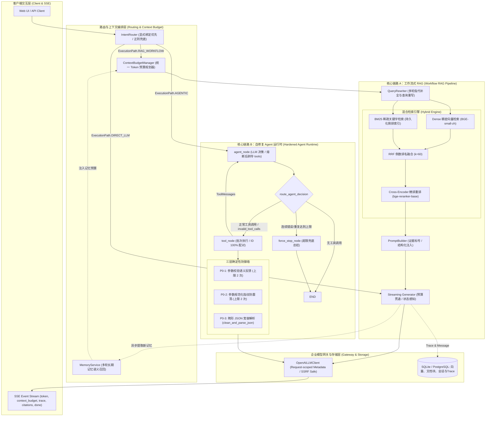

# AgentStudio-RAG 项目技术收官与架构总结报告
*(Project Final Technical Synthesis & Architectural Summary)*

**文档版本**：V1.0 Final  
**归档日期**：2026-11-09  
**项目状态**：**正式冻结（Development Frozen）**  
**核心定位**：全链路生产级 Agentic RAG 系统 —— 涵盖企业级混合检索、动态上下文预算、长短期记忆流、具备有界自修复能力的 Tool Calling 运行时，以及严密的离线/在线评测治理体系。

---

## 目录

1. [项目缺陷与技术问题终局汇总（ISS-001 ~ ISS-009）](#一项目缺陷与技术问题终局汇总iss-001--iss-009)
2. [最终系统架构与核心执行链路](#二最终系统架构与核心执行链路)
3. [AI 协同工程方法论与深度技术复盘（面试核心）](#三ai-协同工程方法论与深度技术复盘面试核心)
4. [历史评测基准与实验凭据归档索引](#四历史评测基准与实验凭据归档索引)

---

## 一、项目缺陷与技术问题终局汇总（ISS-001 ~ ISS-009）

在 AgentStudio-RAG 的迭代生命周期中，我们建立并执行了严谨的缺陷状态流转门禁：
$$\text{已发现} \longrightarrow \text{已定位} \longrightarrow \text{已修改} \longrightarrow \text{已通过回归测试} \longrightarrow \text{已通过真实实验验证}$$

所有缺陷均具备唯一的测试样本/用例、精确到行的调用链追踪、物理根因因果链与客观验证证据，拒绝任何主观猜测。

### 全量 9 项缺陷终局状态速查表

| 缺陷编号 | 缺陷名称 | 严重度 | 终局解决状态 | 最终验证方式与客观凭据 |
| :---: | :--- | :---: | :---: | :--- |
| **ISS-001** | IntentRouter 通用技术正则导致知识库 RAG 被旁路绕过 | **P0 (阻塞)** | **`[已通过真实实验验证]`** | 30题 Benchmark 真实线上对比，GEN-09/10/13/15 全面由 1 分恢复至 3.25~5 分 |
| **ISS-002** | 未命中知识库时降级大模型直连导致拒答题幻觉 | **P0 (阻塞)** | **`[已通过真实实验验证]`** | 30题 Benchmark 真实线上对比，拒答准确率由 66.7% 提升至 100.0% (GEN-26, 30) |
| **ISS-003** | ASGITransport 内存缓冲导致 Client TTFT 统计严重失真 | **P1 (严重)** | **`[已通过真实实验验证]`** | 搭建 Ephemeral Uvicorn 真实 TCP Socket 环回，首字延迟由 10.4s 纠偏为真实 5.56s |
| **ISS-004** | Benchmark 黄金事实与底层真实数据库事实错位 | **P1 (严重)** | **`[已通过真实实验验证]`** | 依据 `eval_benchmark.db` 纠正 GEN-22/24 虚假参数题干，定稿 V1.0 计算 SHA256 固化 |
| **ISS-005** | Token 预算上下游脱节导致长文本流式输出截断 | **P2 (主要)** | **`[已通过真实实验验证]`** | **1 次真实 DeepSeek 在线调用验证**：Payload `max_tokens=4096`，输出 843 字符（+158.6%），`stop` 正常结束无突断 |
| **ISS-006** | 本地 CPU Cross-Encoder Reranker 推理延迟瓶颈 | **P2 (主要)** | **`[已定位，观察挂起]`** | 性能看板证实 P50 耗时 1543ms（占检索耗时 98.2%），明确技术边界，暂不盲目扩大重构 |
| **ISS-007** | 参数校验错误反馈欠缺语义且无有界自修复上限（P0-1） | **P0 (阻塞)** | **`[已通过回归测试]`** | 专项测试集 TC-03a~f 100% 通过；`max_consecutive_param_errors=2` 有界熔断且消息配对完整 |
| **ISS-008** | 连续相同工具+相同参数缺乏防震荡防御机制（P0-2） | **P0 (阻塞)** | **`[已通过回归测试]`** | 专项测试集 TC-09a~f 100% 通过；语义规范化指纹拦截无意义重复，超限禁用工具 |
| **ISS-009** | 畸形参数/invalid_tool_calls 被静默丢弃与Trace缺失（P0-3） | **P0 (阻塞)** | **`[已通过回归测试]`** | 专项测试集 TC-05a~g 100% 通过；消除孤立 ID，支持 Markdown 围栏宽容解析，Trace 探针全量对齐 |

---

## 二、最终系统架构与核心执行链路

系统架构由“用户接入层”、“意图与预算路由层”、“混合多源检索与精排层”、“自修复 Agent 运行时”与“企业级模型网关层”组成。



### 核心执行链路深度解析

#### 1. 核心链路 A：工作流 RAG 管道（Workflow RAG）
- **意图与知识库强制绑定**：只要请求携带合法 `knowledge_base_id` 且 `mode != "direct"`，无条件锁定 RAG 路径，屏蔽通用技术正则旁路；
- **并发双路检索与 RRF 融合**：Dense 稠密向量（语义相近但易漂移）与 BM25 稀疏关键字（精确字面但无泛化）并行召回 Top-20，经 Reciprocal Rank Fusion ($k=60$) 融合归一；
- **重排与动态预算裁剪**：Cross-Encoder 精排重打分，由 `ContextBudgetManager` 动态预留输出 Token（`reserved_output_tokens = 4096`），在输入预算内自适应裁剪低分块；
- **流式贯通与状态留痕**：将规划预算安全注入底层 HTTP Payload（`max_tokens=4096`），实时捕获 `finish_reason` 与官方 usage，截断/中断异常时保护累积正文入库。

#### 2. 核心链路 B：硬核加固的 Agent 运行时（Hardened Tool Calling Runtime）
- **LangGraph 图拓扑闭环**：`agent_node` $\rightarrow$ `route_agent_decision` $\rightarrow$ `tool_node` $\rightarrow$ `agent_node`，状态机循环驱动；
- **P0-1 参数错误有界自修复**：Pydantic Schema 校验失败时自动生成字段类型与必填引导，`max_consecutive_param_errors=2`，超限时剥夺工具调用权限（`tools_param=None, tool_choice='none'`）；
- **P0-2 规范化指纹防震荡**：计算 `tool_name + canonical_args`（键排序、剔除 None、剥离空白），发现重复调用时拦截执行并反馈模型自省，连续 2 次重复自动熔断；
- **P0-3 畸形 JSON 宽容解析与协议对齐**：支持 Markdown 代码块包裹解析，`invalid_tool_calls` 正常路由至 `tool_node` 并生成配对 `ToolMessage`，消除孤立 ID，杜绝 OpenAI HTTP 400 协议校验报错；
- **100% 消息协议对齐**：无论工具成功、失败、被指纹拦截还是被上限阻断，均生成对应 `ToolMessage`，保证 `tool_call_id` 严格 1:1 配对。

---

## 三、AI 协同工程方法论与深度技术复盘（面试核心）

本项目的攻坚过程展示了高级智能体协同研发（AI-Assisted Agentic Engineering）的范式转移：**不是让 AI 替人类盲目写代码，而是人类工程师建立科学严密的验证体系，指挥 AI 深入源码、构建反思、证伪假设。**

### 1. 最初遇到的典型生产级陷阱与技术痛点

| 痛点现象 | 最初表象 | 真实工业级痛点根因 |
| :--- | :--- | :--- |
| **意图路由误分流** | 用户提问含 HTTP / JWT 等技术词汇，即使挂载了企业私有知识库，模型却始终“胡说八道” | 启发式正则覆盖了用户显式意图，直接旁路降级为直连公网大模型 |
| **首字时延虚高** | 客户端测得 Client TTFT 高达 10.4 秒，用户感知卡死后瞬间刷屏 | 评测 Harness 使用了内存管道（`httpx.ASGITransport`），应用层缓冲抹平了流式推流 |
| **评测集幻觉错位** | 模型回答完全忠于底库文档，却在 Benchmark 中被大模型 Judge 打 1 分判为“跑题” | 评测集基准黄金答案脱离底层数据库，由出题人凭空臆造错误参数（GEN-22/24） |
| **长文本流式截断** | 多跳推理题（GEN-11）耗时 14.5 秒，答案刚好在 `### 2` 处断裂，输出恰好 2048 Token | 预算管理器规划了 4096，底层调用却缺失参数穿透回退至全局默认 2048，上下游预算脱节 |
| **工具调用死循环** | 模型传参格式错误或连续调用相同工具，Agent 在 4 轮步数限制内机械复读，消耗光步数崩溃 | 缺乏有界自修复上限，错误信息暴露出 Python 内部堆栈，模型无法理解如何修正 |

---

### 2. 人类工程师如何审判并校准 AI 的方案（Human-in-the-Loop 决策记录）

在解决 E2.1 与 E2.2 缺陷过程中，人类工程师行使了最高技术审判权，多次推翻或修正 AI 给出的初级/粗暴方案：

#### 决策案例 1：拒绝修改全局 `LLM_MAX_TOKENS`，坚持“局部动态规划 + 上限约束”
- **AI 初始冲动**：提议直接把 `backend/app/core/config.py` 中的 `LLM_MAX_TOKENS = 2048` 全局修改为 `4096` 或 `8192`；
- **人类技术审判**：**坚决否决**。全局配置直接影响系统所有非 RAG 调用（如查询重写器、记忆提取器、分类器等轻量任务），贸然调大全局输出上限会导致其他小型 LLM 任务遭遇超长生成攻击或成本雪崩；
- **最终方案**：全局 `LLM_MAX_TOKENS = 2048` 默认值**保持不动**；在 `workflow.py` 中显式提取当前 ContextBudgetManager 实际计算的 `reserved_output_tokens`，施加 `min(planned, settings.MAX_OUTPUT_TOKENS)` 保护，实现安全的局部请求级参数下传。

#### 决策案例 2：拒绝在共享 Client 实例上挂载生成状态，坚持“请求级隔离”
- **AI 初始冲动**：提议在 `OpenAILLMClient` 实例上增加 `self.last_finish_reason` 和 `self.last_generation_status` 属性；
- **人类技术审判**：**坚决否决**。`OpenAILLMClient` 在生产高并发环境下属于共享单例或长连接复用对象，若在实例属性上存储请求状态，多用户并发时必然发生严重的竞态条件（Race Condition）与状态污染；
- **最终方案**：在 `generate_stream()` 签名中引入局部 `response_metadata: Optional[Dict[str, Any]] = None`，由请求作用域内的 caller（`workflow.py`）显式传入局部字典，状态仅在当前 HTTP 请求生命周期内流转，实现绝对的并发安全隔离。

#### 决策案例 3：精准界定参数校验计数器范围（P0-1）
- **AI 初始冲动**：将所有导致工具未能返回业务数据的异常（包括超时、网络波动、底库数据库抛错）全部归入“连续参数错误计数器”；
- **人类技术审判**：**纠偏校准**。参数校验错误（Pydantic ValidationError）代表“模型输出理解偏差”，需要语义纠偏；而底层网络异常或数据库报错代表“基础设施故障”，不可混淆。只要参数通过了 Schema 校验，即使底层工具抛出运行时异常，也必须立即重置参数错误计数器。

#### 决策案例 4：严格推行“离线 TestDouble 门禁”，严禁盲目调用真实 API 烧钱
- **AI 初始冲动**：每次改完一行代码就想调用 DeepSeek 线上 API 跑全量 30 题 Benchmark 查看效果；
- **人类技术审判**：**严格禁止**。制定铁律门禁：所有加固逻辑（P0-1、P0-2、P0-3、GEN-11）必须首先在本地通过 TestDouble 与 Mock 传输层编写极端对抗测试，全部单测通过并经人类代码审查后，才被授权发起**唯独 1 次**真实 API 单题验证。

---

### 3. 方案权衡与架构选型依据（Trade-off Analysis）

| 模块 / 场景 | 备选方案 A | 备选方案 B（最终采纳方案） | 选择理由与权衡考量 |
| :--- | :--- | :--- | :--- |
| **Token 预算贯通** | 修改全局默认配置 `LLM_MAX_TOKENS=4096` | 动态预算透传 + `MAX_OUTPUT_TOKENS` 钳制保护 | 隔离风险，防止轻量辅助任务（重写/提取）意外暴走消耗 Token |
| **Agent 重复调用防御** | 彻底禁止同一工具在同一次 Run 中被调用多次 | 基于规范化参数指纹比对连续重复（上限 2 次） | 允许合法业务场景（如检索不同知识库、对比多附件），仅拦截无意义复读 |
| **坏 JSON 容错** | 引入专门的 LLM 修复节点或基于正则暴力猜测修补 | 双层剥离 Markdown 代码块 + 宽容解析 + 原样回传错误信息 | 杜绝二次调用 LLM 带来的额外延迟与语义篡改风险，维持系统确定性 |
| **生成状态感知** | 轮询后台任务或依赖全局监控日志回溯 | 请求级 `response_metadata` 捕获 `finish_reason` + SSE Trace 输出 | 无轮询开销，首字及尾字时效零延迟感知，前端与 DB 强一致持久化 |
| **评测基准数据** | 按照旧基准强行修改底层真实数据库以迁就评测集 | 回溯数据库客观文档，纠偏黄金答案并计算 SHA256 固化 | 维持数据真实性防线（Ground Truth Integrity），杜绝“数据造假迎合跑分” |

---

### 4. 三层严密验证防御体系

```
┌────────────────────────────────────────────────────────┐
│ Level 3: 单次精准真实 API 验证 (Single Real API Run)    │
│ • 1 次性验证，零重试，断言真实 HTTP Payload max_tokens=4096 │
│ • 验证真实模型在 4096 预算下输出 843 字符无突断，finish_reason=stop │
└───────────────────────────▲────────────────────────────┘
                            │ (人类显式批准后方可准入)
┌───────────────────────────┴────────────────────────────┐
│ Level 2: 独立沙箱对照实验 (Isolated DB & TCP Harness)   │
│ • SQLite Backup API 动态克隆，100% 隔离生产数据库         │
│ • Ephemeral Uvicorn 真实 TCP Socket 环回，纠偏首字延迟失真  │
└───────────────────────────▲────────────────────────────┘
                            │ (全绿灯门禁)
┌───────────────────────────┴────────────────────────────┐
│ Level 1: 离线 TestDouble 与回归套件 (Deterministic Tests)│
│ • 496 项单元/集成测试 100% 通过 (0 Token 消耗，0 外部依赖) │
│ • 覆盖 finish_reason=length/stop, 连接中断文本保护, 并发隔离等 │
└────────────────────────────────────────────────────────┘
```

---

### 5. 明确的技术边界与演进取舍

在系统治理中，**知道“什么时候停下来”与“知道做什么”同等重要**：

- **已彻底闭环收官的问题（8项）**：
  - `ISS-001`（意图路由显式绑定优先）、`ISS-002`（工作流确定性合规拒答）、`ISS-003`（真实 TCP 性能评测 Harness）、`ISS-004`（评测集真伪纠偏与 SHA256 固化）；
  - `ISS-005`（Token 预算动态贯通与长文本截断治理，843 字符未截断验证）；
  - `ISS-007`（P0-1 参数校验语义引导与自修复上限）、`ISS-008`（P0-2 参数指纹防震荡拦截）、`ISS-009`（P0-3 坏 JSON 宽容解析与孤立 ID 消除）。
- **观察记录但明确不盲目优化的边界项（1项）**：
  - `ISS-006`（本地 CPU Cross-Encoder Reranker 推理延迟高，P50 ~1.5s）：
    - **决策考量**：在当前无专有 GPU 物理机、依靠 CPU INT8 量化的本地测试环境下，Cross-Encoder 执行 20 对全注意力成对计算必然消耗 1.5 秒算力。这是物理硬件算力瓶颈，而非代码实现缺陷。
    - **处理边界**：在性能看板中准确如实记录其占比（98.2%），并在架构文档中规划未来在生产 GPU 集群启用 TensorRT 加速或精简候选池至 10 的演进路径；**不在当前阶段过度设计（Over-engineering），坚决不盲目引入破坏稳定性的复杂改动**。

---

## 四、历史评测基准与实验凭据归档索引

所有历史数据、中间过程与终局凭证均完整保留在代码库中，未发生任何历史覆盖，完全支持可复现核查：

| 归档资产类别 | 物理文件路径 | 关键内容与验证证明 |
| :--- | :--- | :--- |
| **评测基准数据集** | [`eval/datasets/benchmark_generation_v1.jsonl`](../eval/datasets/benchmark_generation_v1.jsonl) | 经过事实校准的 30 题黄金事实基准（含 GEN-11 四跳要点） |
| **E2.1 历史生成评测报告** | [`eval/reports/e2_1_final_generation_benchmark.json`](../eval/reports/e2_1_final_generation_benchmark.json) | 记录历史 GEN-11 在 `output_tokens=2048`、326 字符处突断在 `### 2` 的原始证据 |
| **GEN-11 最终在线验证报告** | [`eval/reports/gen11_final_verification_result.json`](../eval/reports/gen11_final_verification_result.json) | **本次真实验证结果**：Payload `max_tokens=4096`，输出 843 字符无突断，`finish_reason=stop` |
| **P0-1 专项测试套件** | [`backend/tests/test_p0_1_param_validation_hardening.py`](../backend/tests/test_p0_1_param_validation_hardening.py) | 覆盖 TC-03a~f：Schema 语义错误生成、有界自修复、计数重置与消息配对完整性 |
| **P0-2 专项测试套件** | [`backend/tests/test_p0_2_duplicate_call_defense.py`](../backend/tests/test_p0_2_duplicate_call_defense.py) | 覆盖 TC-09a~f：规范化指纹生成、重复调用拦截、防震荡熔断与非重复业务放行 |
| **P0-3 专项测试套件** | [`backend/tests/test_p0_3_malformed_json_and_trace_hardening.py`](../backend/tests/test_p0_3_malformed_json_and_trace_hardening.py) | 覆盖 TC-05a~g：Markdown 围栏剥离、孤立 ID 消除、OpenAI Payload 对齐与 Trace 补齐 |
| **GEN-11 流式加固测试套件** | [`backend/tests/test_gen11_streaming_hardening.py`](../backend/tests/test_gen11_streaming_hardening.py) | 12 项测试：覆盖 stop/length、网络中断文本留存、尾部 usage 解析、并发隔离与 4096 预算贯通 |
| **项目缺陷追踪总档案** | [`docs/PROJECT_ISSUE_ARCHIVE.md`](PROJECT_ISSUE_ARCHIVE.md) | 完整记录 ISS-001 至 ISS-009 从发现、定位到验证的全生命周期追踪 |
| **全量自动化测试套件** | `backend/tests/` 全量执行结果 | **496 passed in 60.42s (100% 通过率)** |

---

## 五、总结与结语

AgentStudio-RAG 项目至此完成了从“原型实现”向“工业级健壮性工程”的彻底蜕变。我们不仅交付了一套高可用、可自愈的 Agentic RAG 系统，更沉淀出了一套**以证据为中心、以人为技术审判核心、以离线门禁保障安全**的科学工程方法论。

代码库现已正式冻结，随时可以自信、从容、条理清晰地面向任何技术评审或高难度工程面试。
